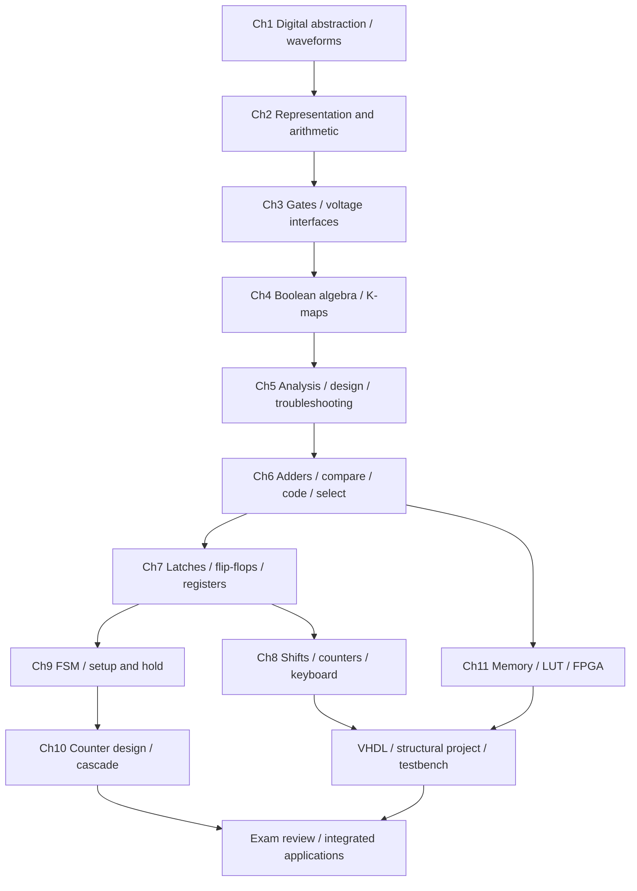

---
tags:
  - ECE2050
  - index
date: 2026-09-30
aliases:
  - ECE2050 知识树
  - Knowledge Tree
  - 数字逻辑与系统知识树
  - 知识树
---

# ECE2050 Knowledge Tree · 知识树

> [!NOTE] Entry point · 导航入口
> Start with the chapter paths below; use [[Glossary]] to look up English and Chinese terms. Topic notes are in `Notes/`, figures in `Figures/`, reusable tools in `Tools/`, and working material in `.scratch/`。
> For layout, naming, figure, and validation conventions, see `Tools/README.md`。参考教材：Floyd《Digital Fundamentals》/ Harris《Digital Design and Computer Architecture》。
> Status: `✅` written · `❗` key/difficult. / 中文：已建 · 重难点。

## Learning Path · 学习路径

Follow the arrows as prerequisite relationships, not as mandatory lecture dates. 学到时序部分后，回到组合逻辑重新理解“旧状态生成下一状态”；学到 FPGA 后，回到电压与时序接口核对物理条件。

| Review goal · 复习目标 | Starting note | Follow-through |
|---|---|---|
| Read a question accurately · 准确读题 | [[Exam Review and Problem Solving]] | Representation, polarity, bit order, active edge and assumptions |
| Build a combinational function · 组合实现 | [[Combinational Logic Design]] | [[Karnaugh Map]] → [[Universal Gates and Bubble Pushing]] → [[Decoder]] / [[Multiplexer and Demultiplexer]] |
| Trace sequential waveforms · 追踪状态 | [[D Latch and D Flip-Flop]] | [[Register Enable and Reset]] → [[Shift Registers]] → [[Counters]] |
| Design a controller · 控制器设计 | [[Finite State Machine]] | [[State Encoding and Unused States]] → [[Sequence Detector]] / [[Traffic Light Controller]] |
| Check maximum frequency · 检查频率 | [[Propagation Delay and Logic Hazards]] | [[Setup and Hold Timing]] → [[Metastability and Clock Domain Crossing]] |
| Solve display/keyboard integration · 综合应用 | [[Seven-Segment Display and Code Conversion]] | [[Keyboard Scanning and Encoding]] → [[Memory Arrays and Expansion]] |
| Implement and verify · 实现与验证 | [[VHDL Language and Modeling]] | [[Structural Shift Register Project]] → [[Testbench and Functional Verification]] → [[Field-Programmable Gate Array]] |

Use **Quick recall** first, then the derivation and worked examples, then answer the English question without looking. 第一遍理解因果与模型，第二遍闭卷推导，第三遍用英文完整说明结果和条件；遇到新术语从 [[Glossary]] 回到 canonical note。

## Ch1 · Introductory Concepts ✅ (2 notes)

- [[Digital Abstraction and System Design]] ✅ — Discrete information, continuous voltages, hierarchy, modularity, and controller/datapath design · 数字抽象与系统设计。
- [[Digital Waveforms]] ✅ — Period, frequency, duty cycle, rise/fall time, and interval-by-interval waveform reading · 波形读图。

## Ch2 · Number Systems ✅ (73 lecture pages · 18 notes)

- [[Number Systems]] ✅ — Base, digits, positional weights, and $\sum a_iR^i$; the foundation for every representation in this chapter (数制基础).
- [[Decimal Number System]] ✅ — Base 10 and place values; decimal does not mean that a radix point must be present.
- [[Binary Number System]] ✅ — Base 2, powers of two, and the value of binary fractions such as $(10.101)_2=2.625$.
- [[Octal Number System]] ✅ — Base 8; one octal digit equals three bits, including in Unix permission notation.
- [[Hexadecimal Number System]] ✅ — Base 16 with digits 0–9 and A–F; one hex digit equals four bits.
- [[Number Base Conversion]] ✅ ❗ — Positional expansion, repeated division or multiplication, and three- or four-bit grouping; read division remainders from last to first.
- [[Bits and Bytes]] ✅ — Bit, nibble, byte, $2^N$ possible patterns, and the difference between decimal and binary prefixes.
- [[Binary Arithmetic]] ✅ — Addition, subtraction, shift-and-add multiplication, long division, and the effect of fixed width on overflow.
- [[Sign-Magnitude Representation]] ✅ — A separate sign bit and magnitude; symmetric range, two zero patterns, and special handling for arithmetic.
- [[Two's Complement Representation]] ✅ ❗ — Negative MSB weight, signed range, negate-by-invert-plus-one, and signed overflow detection.
- [[Signed Binary Multiplication and Division]] ✅ ❗ — Sign extension and partial products in multiplication; quotient sign and remainder handling in division.
- [[Fixed-Point Numbers]] ✅ — Formats such as $\text{U}a.b$ and $Qa.b$; resolution $2^{-b}$, range, and overflow behavior.
- [[Floating-Point Numbers]] ✅ ❗ — IEEE 754 single precision: sign, biased exponent, fraction, and the encodings for zero, infinity, and NaN.
- [[Binary Coded Decimal]] ✅ ❗ — 8421 BCD encodes each decimal digit in four bits; invalid patterns and the 0110 addition correction.
- [[Gray Code]] ✅ — Neighboring codewords differ by one bit; reflected construction and the binary-to-Gray XOR rule.
- [[American Standard Code for Information Interchange]] ✅ — Seven-bit ASCII character codes and the separate ranges for digits and letters.
- [[Parity Bit]] ✅ — Even and odd parity; detects odd numbers of bit errors but does not correct them.
- [[Cyclic Redundancy Check]] ✅ ❗ — Modulo-2 polynomial division, appended remainder, receiver check, and a shift-register implementation.

## Ch3 · Logic Gates ✅ (25 lecture pages · 11 notes)

- [[Logic Gates]] ✅ — Ideal gate functions, truth tables, timing diagrams, and the $2^n$ input patterns of an $n$-input gate.
- [[Inverter]] ✅ — NOT, the inversion bubble, buffer behavior, and propagation delay.
- [[AND Gate]] ✅ — $Y=AB$; the output is high only when every input is high.
- [[OR Gate]] ✅ — $Y=A+B$; the output is high when at least one input is high.
- [[NAND Gate]] ✅ — $Y=\overline{AB}$; AND followed by inversion, with a low output only for all-high inputs.
- [[NOR Gate]] ✅ — $Y=\overline{A+B}$; OR followed by inversion, with a high output only for all-low inputs.
- [[Exclusive-OR Gate]] ✅ — $Y=A\oplus B$; two-input inequality, odd parity, and the sum bit of an adder.
- [[Exclusive-NOR Gate]] ✅ — $Y=\overline{A\oplus B}$; a one-bit equality detector.
- [[Logic Levels]] ✅ ❗ — Input and output voltage thresholds, the indeterminate region, and logic-family compatibility.
- [[Noise Margin]] ✅ ❗ — High and low voltage margins: $NM_H=V_{OH}-V_{IH}$ and $NM_L=V_{IL}-V_{OL}$.
- [[DC Transfer Characteristic]] ✅ — The steady-state $V_{out}(V_{in})$ curve and its relation to switching and noise margin.

## Ch4 · Boolean Algebra and Logic Simplification ✅ (63 lecture pages · 14 notes)

- [[Combinational Circuit]] ✅ — Outputs depend on current inputs alone; composition rules exclude state and feedback loops.
- [[Boolean Equation]] ✅ — Express a specified output as a Boolean function of its inputs; includes full-adder equations.
- [[Boolean Axioms]] ✅ — Foundational identities and duality under AND/OR and 0/1 exchange.
- [[Laws and Rules of Boolean Algebra]] ✅ ❗ — Commutative, associative, and distributive laws, plus the identities used in simplification.
- [[Proof by Perfect Induction]] ✅ — Prove a Boolean identity by exhausting every truth-table row, or by algebraic rewriting.
- [[DeMorgan's Theorems]] ✅ ❗ — Move a complement through AND or OR while exchanging the operation; connect NAND/NOR gate forms.
- [[Boolean Expression Simplification]] ✅ ❗ — Rewrite expressions step by step with valid identities while preserving the truth table.
- [[Minterm and Maxterm]] ✅ — Literals, implicants, minterms $m_i$, maxterms $M_i$, and their row numbering.
- [[Sum-of-Products Form]] ✅ — OR of AND terms; canonical SOP collects the truth-table rows where the output is 1.
- [[Product-of-Sums Form]] ✅ — AND of OR terms; canonical POS collects the truth-table rows where the output is 0.
- [[Truth Table and Boolean Expression]] ✅ — Move between a complete truth table and canonical SOP/POS expressions; mark don't-care rows explicitly.
- [[Karnaugh Map]] ✅ ❗ — Arrange cells in Gray-code order and group adjacent 1s to obtain a simplified SOP.
- [[Karnaugh Map with Don't Cares]] ✅ ❗ — Use X cells only when they enlarge a useful group; includes a BCD-to-seven-segment example.
- [[POS Minimization with Karnaugh Map]] ✅ ❗ — Group 0 cells to read maxterms and form a simplified POS expression.

## Ch5 · Combinational Logic Analysis and Design ✅ (3 notes)

- [[Combinational Logic Design]] ✅ — Specification → truth table → minimization → implementation → exhaustive verification; parallel pattern/classification examples · 组合分析与设计。
- [[Universal Gates and Bubble Pushing]] ✅ — NAND/NOR completeness, DeMorgan transformations, polarity and gate-count constraints · 通用门与气泡推移。
- [[Digital Logic Troubleshooting]] ✅ — Activate a stuck-at fault, propagate its effect, choose distinguishing tests, and check physical-model boundaries · 故障敏化与诊断。

## Ch6 · Functions of Combinational Logic ✅ (11 notes)

- [[Tri-State Buffers and Bus Drivers]] ✅ — Enable, high impedance, bus ownership and contention · 三态与总线驱动。
- [[Half Adder and Full Adder]] ✅ — Sum/parity and carry/majority equations, truth tables, conservation and cascading · 加法单元。
- [[Ripple Carry and Carry Look-Ahead Adders]] ✅ — Propagate/generate conventions, expanded carry equations, arithmetic and path delay · RCA/CLA。
- [[Binary Subtractors and Adder-Subtractors]] ✅ — Difference/borrow derivation, mode-controlled inversion, carry versus signed overflow · 减法与加减器。
- [[Combinational Multiplier]] ✅ — AND partial products, weighted column addition, complete 3×3 design and signed boundary · 组合乘法器。
- [[Magnitude Comparator]] ✅ — Highest unequal bit, equality gating and cascade · 多位比较器。
- [[Encoder and Priority Encoder]] ✅ — One-hot/one-cold coding, priority, multiple inputs and valid output · 编码与优先级。
- [[Decoder]] ✅ — Minterm generation, active-low output combination, enables and expansion · 译码器。
- [[Multiplexer and Demultiplexer]] ✅ — Shannon expansion, cofactors, selection and routing · MUX/DEMUX。
- [[Propagation Delay and Logic Hazards]] ✅ — Longest/shortest paths, static hazards, consensus and sampling boundaries · 延迟与冒险。
- [[Seven-Segment Display and Code Conversion]] ✅ — Segment/polarity table, blanking and zero suppression, scanning, and two-adder BCD conversion · 显示综合。

## Ch7 · Sequential Logic and Storage Elements ✅ (5 notes)

- [[Sequential Logic]] ✅ — Old state → next state, common-clock discipline, feedback and initialization · 时序逻辑模型。
- [[Set-Reset Latch]] ✅ — NOR/NAND polarity, bistability, hold/set/reset and forbidden condition · SR锁存器。
- [[D Latch and D Flip-Flop]] ✅ — Transparent level versus active edge, master–slave idea and waveform tracing · D存储元件。
- [[JK and T Flip-Flops]] ✅ — Characteristic/excitation tables, toggle and FF conversion · JK/T触发器。
- [[Register Enable and Reset]] ✅ — Data hold/load, synchronous/asynchronous reset, priority and reset release · 寄存器控制。

## Ch8 · Shift Registers and Applications ✅ (4 notes)

- [[Shift Registers]] ✅ — SISO/SIPO/PISO/PIPO, universal modes, explicit left/right order, delay and serial conversion · 移位寄存器。
- [[Ring and Johnson Counters]] ✅ — Feedback sequences, n versus 2n states, duty cycle and illegal initialization · 环形/Johnson。
- [[One-Shots and Pulse Applications]] ✅ — Monostable/astable behavior, RC threshold derivation and registered event pulses · 单稳态与脉冲。
- [[Keyboard Scanning and Encoding]] ✅ — One-cold scan, row/column encoding, debounce, valid capture and six-bit key register · 键盘综合。

## Ch9 · Finite State Machines and Timing ✅ (7 notes)

- [[Setup and Hold Timing]] ✅ — Maximum/minimum arrival derivations, slack, skew, hold repair and frequency limits · 建立/保持时间。
- [[Metastability and Clock Domain Crossing]] ✅ — Single-bit synchronizer, pulse/multi-bit boundaries and coherent transfer · 亚稳态与CDC补充。
- [[Finite State Machine]] ✅ — State meaning, diagram/table/equations, output logic and verification · FSM设计。
- [[Moore and Mealy Machines]] ✅ — State-only versus state/input outputs, response timing and alignment · Moore/Mealy比较。
- [[State Encoding and Unused States]] ✅ — Binary/one-hot choices, don't-cares, initialization and recovery · 编码与未用状态。
- [[Sequence Detector]] ✅ — Longest reusable suffix, overlap, state equations and serial trace · 序列检测。
- [[Traffic Light Controller]] ✅ — Traffic states, sensor-controlled transitions, output coding and timer extension · 交通灯控制。

## Ch10 · Counters ✅ (3 notes)

- [[Counters]] ✅ — Modulus, ripple/common-clock behavior, up/down toggling and control semantics · 计数基础。
- [[Synchronous Counter Design]] ✅ — D/JK excitation synthesis, modulo-3 recovery and a specified eight-state cycle · 同步计数设计。
- [[Cascaded Counters and Digital Clocks]] ✅ — Accepted rollover, mixed radix, 59→00, frequency/pulse duty and preset truncation · 级联与数字时钟。

## Ch11 · Data Storage and Programmable Logic ✅ (4 notes)

- [[Memory Arrays and Expansion]] ✅ — Depth/width/capacity, address units, bank selection and chip expansion · 存储组织。
- [[SRAM DRAM and ROM]] ✅ — Feedback versus charge, refresh/volatility, nonvolatile variants and mechanism examples · 存储技术。
- [[Read-Only Memory and Programmable Logic Arrays]] ✅ — Multi-output truth-table lookup, LUTs and programmable AND/OR arrays · ROM/LUT/PLA/PAL。
- [[Field-Programmable Gate Array]] ✅ — LUT/FF/routing, simulation/synthesis/implementation and clock/I/O constraints · FPGA流程。

## HDL · VHDL, FPGA Workflow and Project ✅ (3 notes)

- [[VHDL Language and Modeling]] ✅ — Entity/architecture, types, concurrent/process semantics, signal/variable and reset patterns · VHDL语言。
- [[Structural Shift Register Project]] ✅ — Complete DFF + structural bidirectional register, explicit bit order and implementation checks · 结构化项目。
- [[Testbench and Functional Verification]] ✅ — Complete directed testbench, independent reference model, delta cycles and coverage · 测试与验证。

## Review · Exam Review and Integration ✅ (1 notes)

- [[Exam Review and Problem Solving]] ✅ — Question wording, representation/polarity/timing decisions, worked mini-problems and English answer patterns · 考试复习。

## Course Roadmap · 课程路线图

| Chapter | Topic | Status |
|---|---|---|
| Ch1 | Introductory Concepts | ✅ 2 notes |
| Ch2 | Number Systems | ✅ 18 notes |
| Ch3 | Logic Gates and Electrical Interfaces | ✅ 11 notes |
| Ch4 | Boolean Algebra and Logic Simplification | ✅ 14 notes |
| Ch5 | Combinational Logic Analysis and Design | ✅ 3 notes |
| Ch6 | Functions of Combinational Logic | ✅ 11 notes |
| Ch7 | Sequential Logic and Storage Elements | ✅ 5 notes |
| Ch8 | Shift Registers and Applications | ✅ 4 notes |
| Ch9 | Finite State Machines and Timing | ✅ 7 notes |
| Ch10 | Counters | ✅ 3 notes |
| Ch11 | Data Storage and Programmable Logic | ✅ 4 notes |
| HDL | VHDL, FPGA Workflow and Project | ✅ 3 notes |
| Review | Exam Review and Integration | ✅ 1 notes |

## Conventions and Status · 约定与统计

- **Canonical organization:** existing English filenames and aliases are preserved. All formal topics stay in `Notes/`; the knowledge tree and glossary remain the two global hubs. 每篇专题回链到两个枢纽，并在正文中连接先修概念、实现方法或应用。
- **Bilingual reading:** English headings, terminology, explanatory paragraphs and answered exam questions support professional vocabulary; Chinese explains derivations and pitfalls. English is targeted at approximately 40% of readable prose, with language measurement treated as an estimate rather than exact character equality.
- **Verification:** truth tables, integer arithmetic, full state-input enumeration and independent reference models check worked examples. 图示明确位序、有效边沿、初态及模型条件；布尔等价不替代电气与时序检查。
- **Scope:** this library covers the supplied lecture, homework, exam and project concepts; it is a connected learning resource rather than a transcription of every reference answer. Source documents remain read-only. 扫描答案、重复版本及资料中的笔误按可验证的推导处理；资料中的历史提交要求不作为本次操作指令。
- **Statistics:** 86 topic notes, 2 hubs, 52 reproducible SVG figures and the existing 14 cropped PNG figures. Original 43 topics refined; 43 topics added across foundations, Ch5–11, HDL and review.
- **Tools:** figure and layout conventions remain in `Tools/README.md`. Formal checks require `PROBLEMS (0)`; source coverage, plan and validation evidence are retained in `.scratch/`.

---
索引：[[Glossary]]
