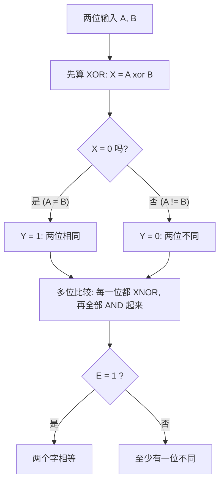

---
tags:
  - ECE2050
  - logic-gates
date: 2026-09-16
aliases:
  - 同或门
  - XNOR 门
  - 同或
  - Exclusive-NOR Gate
  - XNOR Gate
---

> [!NOTE] Where this fits · 定位
> 这一篇是 Ch3 门家族的最后一个：XNOR 就是 [[Exclusive-OR Gate]] 的输出加一个气泡，
> 于是"不同为 1"翻成"**相同为 1**"——它因此有了一个响亮的名字：**相等检测器 (equality detector)**。
> 讲义 p.10 把 XOR 与 XNOR 并排放在同一页，正是为了让读者看到这一对互补关系。
> 前置：[[Exclusive-OR Gate]]（$Y=A\oplus B$）、[[Inverter]]（气泡 = 取反）。
> 下游：[[Laws and Rules of Boolean Algebra]]（Ch4：把 $\overline{A\bar B+\bar AB}$ 展开成 $AB+\bar A\bar B$）。
> 平行：[[Parity Bit]]（偶校验就是多输入 XNOR）、[[NAND Gate]] / [[NOR Gate]]（同样带输出气泡的门）。

> [!SUMMARY] Quick recall · 英文速览
> XNOR is the complement of XOR. For two inputs it outputs 1 when the inputs are equal, so it acts as a one-bit equality test.

## Core Definition · 核心定义

**Exclusive-NOR (XNOR) gate**：当且仅当两个输入**相同**时输出 1；它等价于 XOR 的输出取反。

$$Y=\overline{A\oplus B}=AB+\bar A\bar B$$

- 意义：等号最右边是它的标准 SOP 形式 —— 真值表里输出为 1 的两行（$(0,0)$ 与 $(1,1)$）各贡献一个 minterm。
- 符号 (symbol)：XOR 的图形（OR 本体 + 输入侧那道弧）后面再加一个**输出气泡**。
- 别名记法：$A\odot B$ 或 $A\equiv B$（"同或"、"equivalence"）。

**两输入真值表**（行按二进制顺序）：

| $A$ | $B$ | $A\oplus B$（对照） | $Y=\overline{A\oplus B}=AB+\bar A\bar B$ | 说明 |
|---|---|---|---|---|
| 0 | 0 | 0 | **1** | 相同 → 1 |
| 0 | 1 | 1 | 0 | 不同 → 0 |
| 1 | 0 | 1 | 0 | 不同 → 0 |
| 1 | 1 | 0 | **1** | 相同 → 1 |

- 逐列对照可见：**XNOR 的输出列是 XOR 输出列的逐位取反**（$\overline{A\oplus B}$ 里的横线就是这个意思）。
- 多输入时"相同为 1"升级为：**输入中 1 的个数为偶数 → 输出 1**（even parity，见表末的 XNOR3）。

![[xnor-gate-timing.svg]]
*图 1 — $A$（周期 4）、$B$（周期 2）与 $Y=\overline{A\oplus B}$ 的时序图；虚线是 XOR 的输出 $A\oplus B$（灰），
实线是 XNOR。每格顶部标出输入比较结果 `=`（相同，红）或 `≠`（不同，灰）；灰底格子是"相同"的四格
（第 1、4、5、8 格），$Y$ 在那里为 1 —— 与真值表的 "相同 → 1" 一致，也说明两条输出波形处处互补。*

## Assumptions and Validity · 适用前提

> [!IMPORTANT] XNOR 的三条前提
> ① **"相同为 1"只对两输入成立**：三输入起必须改成"1 的个数为偶数 → 1"
>    （"三个输入彼此相同"与"偶数个 1"不是一回事：$011$ 有两个 1（偶）却并不三个都相同；
>    $111$ 三个输入彼此相同，1 的个数却是奇数）。
> ② **$AB+\bar A\bar B$ 是两输入专有展开式**：变量增多要重新按真值表写 SOP。
> ③ **它是 XOR 的补**：$Y=\overline{A\oplus B}$ 只是把 XOR 的输出整列取反。凡是想把 XOR 的代数性质
>    （交换、结合、$A\oplus A=0$）直接搬到 XNOR 上用的，都要回到真值表重算一遍：
>    例如 $A\odot A=1$，而 $A\oplus A=0$ —— 两者一个给出 1、一个给出 0，绝不能混用。

- 与 NOR 的分界：NOR 只有"全 0"一行输出 1（$Y=\overline{A+B}$）；XNOR 有"全 0"和"全 1"两行输出 1
  （$Y=\overline{A\oplus B}$）。两者在 $(0,1)$、$(1,0)$ 两行恰好都给 0，容易混淆。
- 有效边界：输入必须是合法逻辑电平（[[Logic Levels]]），否则"相同/不同"无从判断。

## Derivation · 推导过程

### ① 从 XOR 接一个反相器

把 XOR 的输出 $X=A\oplus B$ 取反：

$$Y=\overline{A\oplus B}$$

- 意义：XNOR 同样是"复合门"——符号上的输出气泡就是那个反相器。
- 数值校验（取 $A=1,B=1$）：$X=1\oplus1=0\Rightarrow Y=\bar0=1$ ✓（真值表第 4 行）；
  取 $A=0,B=1$：$X=1\Rightarrow Y=0$ ✓（第 2 行）。

### ② 从"相同为 1"直接写 SOP

输出为 1 的行是 $(A,B)=(0,0)$ 与 $(1,1)$：取值为 1 的变量写原变量、取值为 0 的写反变量，再 OR：

$$Y=\underbrace{\bar A\bar B}_{(0,0)\text{ 行}}+\underbrace{AB}_{(1,1)\text{ 行}}$$

- 意义：与 XOR 的写法完全对称，只是把两个**交叉项**换成了两个**同号项**（链 [[Sum-of-Products Form]]）。
- 数值校验（取 $A=0,B=0$）：$\bar A\bar B=1\Rightarrow Y=1$ ✓；取 $A=0,B=1$：$\bar A\bar B=0$、$AB=0\Rightarrow Y=0$ ✓。
- 全表核验（Python 复核 4 行）：$AB+\bar A\bar B$ 与"两个输入相同"完全一致 ✓。

### ③ 代数证明：$\overline{A\bar B+\bar AB}=AB+\bar A\bar B$

从 XOR 的 SOP 形式出发，用德摩根定理与分配律化到 XNOR 的 SOP 形式：

$$
\overline{A\bar B+\bar AB}
=\overline{A\bar B}\cdot\overline{\bar AB}
=(\bar A+B)(A+\bar B)
=\underbrace{\bar AA}_{0}+\bar A\bar B+BA+\underbrace{B\bar B}_{0}
=AB+\bar A\bar B
$$

- 意义：第一、二条等号都是德摩根（和取反 = 各项取反后相乘；乘积项取反 = 各变量取反后相加，
  [[DeMorgan's Theorems]]），第三条用分配律展开（[[Laws and Rules of Boolean Algebra]]）；
  中间出现的 $\bar AA$ 与 $B\bar B$ 恒为 0 被丢掉。
- 数值校验（取 $A=1,B=0$）：左式 $=\overline{A\bar B+\bar AB}=\overline{1\cdot1+0\cdot0}=\overline{1}=0$；
  右式 $=AB+\bar A\bar B=1\cdot0+0\cdot1=0$ ✓（两式相等）。
- 再取 $A=1,B=1$：左式 $=\overline{1\cdot0+0\cdot1}=\overline{0}=1$；右式 $=1\cdot1+0\cdot0=1$ ✓。
- 四行全部核验（Python 逐行比对）：$\overline{A\bar B+\bar AB}$ 与 $AB+\bar A\bar B$ 在 4 行上完全相等 ✓。

### ④ 多输入：偶数个 1 → 1

$$Y=\overline{A\oplus B\oplus C}=\sum m(0,3,5,6)$$

- 意义：四种"偶数个 1"的行 $(000,011,101,110)$ 输出 1 —— 这就是**偶校验 (even parity)** 函数，
  与 [[Exclusive-OR Gate]] 的"奇数个 1"恰好互补（链 [[Parity Bit]]）。
- 数值校验：$A=B=C=1$ 时 1 的个数为 3（奇）→ $Y=0$ ✓；$A=B=C=0$ 时为 0（偶）→ $Y=1$ ✓；
  把讲义 p.13 的 XOR3 列 `0,1,1,0,1,0,0,1` 逐位取反得 `1,0,0,1,0,1,1,0`，正是本式的 8 行结果 ✓。

### ⑤ 应用：相等检测器（equality detector）

两个 $n$ 位二进制数 $A=A_{n-1}\cdots A_0$ 与 $B=B_{n-1}\cdots B_0$ 相等，当且仅当**每一位都相同**：

$$E=(A_{n-1}\odot B_{n-1})\cdot(A_{n-2}\odot B_{n-2})\cdots(A_0\odot B_0)$$

- 意义：每一位用 XNOR 给出"这一位相同"（1 = 相同），再把所有位**相与**（AND）—— 任一位不同，$E$ 立刻为 0。
  等价写法：$E=\overline{(A_{n-1}\oplus B_{n-1})+\cdots+(A_0\oplus B_0)}$（各取 XOR 后 OR 起来再取反）。
- 数值校验（2 位，$A=10_2$、$B=10_2$）：$A_1\odot B_1=1\odot1=1$、$A_0\odot B_0=0\odot0=1$，$E=1\cdot1=1$ ✓（相等）。
  换成 $B=11_2$：$1\odot1=1$、$0\odot1=0$，$E=1\cdot0=0$ ✓（不相等）。
- 位数校验：$n$ 位比较需要 $n$ 个 XNOR + $(n-1)$ 个 AND；用等价写法则是 $n$ 个 XOR + 1 个 NOR
  （NOR 就是 OR 之后取反，直接给出 $E$）。

## Method and Steps · 求解步骤与方法

1. **确定输入个数** $n$，按二进制顺序列出 $2^n$ 行。
2. **数每行 1 的个数**：偶数 → 输出 1；奇数 → 输出 0。两输入时等价于"两个输入相同"。
3. **写表达式**：把输出为 1 的行写成 minterm 再 OR（$AB+\bar A\bar B$），或直接写 $\overline{A\oplus B}$。
4. **要门级实现时**：XOR 后面加反相器，或用两个 AND + 一个 OR（$AB+\bar A\bar B$）。
5. **做多位比较时逐位 XNOR 再 AND**；做奇偶校验时先明确约定（奇校验用 XOR，偶校验用 XNOR）。

## Worked Example · 例题

**Example 1 — 讲义 p.10 的 XNOR 表逐行核对（含 p.25 的 T/F 陷阱题）**

题目：(a) 逐行核对讲义 p.10 的 XNOR 真值表；(b) 判断讲义 p.25 Quiz 的说法
"The output of an exclusive-OR is 0 if the inputs are opposite" 是否正确。

| $A$ | $B$ | XOR | XNOR（p.10 原表） | 我的核验：$AB+\bar A\bar B$ |
|---|---|---|---|---|
| 0 | 0 | 0 | 1 | $0+1\cdot1=1$ ✓ |
| 0 | 1 | 1 | 0 | $0+0\cdot0=0$ ✓ |
| 1 | 0 | 1 | 0 | $0+1\cdot0=0$ ✓ |
| 1 | 1 | 0 | 1 | $1\cdot1+0=1$ ✓ |

解 (b)：**False**。XOR 的判据是"输入**不同** → 1"，所以输入相反（一个 0 一个 1）时 XOR 输出是 **1** 而不是 0；
输出 0 的是"输入相同"的两行。把这句话里的 XOR 换成 XNOR 就对了（XNOR 在输入相反时为 0）。

**数值校验 (Numerical check)**：XNOR 列 `1,0,0,1` 与 XOR 列 `0,1,1,0` 逐位互补（相加恒为 1）✓；
(b) 用第 2 行检验：$A=0,B=1$（相反）时 XOR $=1$ ✓，所以原说法被这一行直接推翻 ✓；
若改成"XNOR 在输入相反时输出 0"，则第 2、3 行都给出 0 ✓，说法成立。

![[ch3-xor-xnor.png]]
*图 2 — 讲义 p.10 原图：左半是 XOR、右半是 XNOR 的符号、表达式与真值表，底部是两者的时序图。
右半的表达式就是本篇的 $\overline{A\oplus B}$；请注意 XNOR 符号比 XOR 多出的那个输出气泡，
以及底部两条波形处处互补。*

**Example 2 — 两位相等检测器（自算，配合 ⑤ 的公式）**

题目：用 XNOR 与 AND 比较两个 2 位数 $A=A_1A_0$ 与 $B=B_1B_0$，给出 $E=1$ 的条件，并验证
$A=10_2$ 分别与 $B=10_2$、$B=01_2$、$B=11_2$ 比较的结果。

解：$E=(A_1\odot B_1)(A_0\odot B_0)$，逐位算 XNOR 再相与：

| $A$ | $B$ | $A_1\odot B_1$ | $A_0\odot B_0$ | $E$ | 是否相等 |
|---|---|---|---|---|---|
| 10 | 10 | $1\odot1=1$ | $0\odot0=1$ | 1 | 相等 |
| 10 | 01 | $1\odot0=0$ | $0\odot1=0$ | 0 | 不等 |
| 10 | 11 | $1\odot1=1$ | $0\odot1=0$ | 0 | 不等 |
| 10 | 00 | $1\odot0=0$ | $0\odot0=1$ | 0 | 不等 |

**数值校验 (Numerical check)**：$10_2=2$，只有第 1 行满足 $A=B$ ✓；
用等价写法复核第 3 行：$(A_1\oplus B_1)+(A_0\oplus B_0)=0+1=1$，取反得 $E=0$ ✓（与表一致）；
Python 穷举 $A,B\in\{0,1,2,3\}$ 的全部 16 对：$E=1$ 恰好出现在 $A=B$ 的 4 对上，其余 12 对为 0 ✓。

**Example 3 — 三输入 XNOR3：偶数个 1 输出 1（由讲义 p.13 的 XOR3 表取反）**

题目：讲义 p.13 右表是三输入 XOR（奇数个 1 输出 1，$Y$ 列 `0,1,1,0,1,0,0,1`）。
求三输入 XNOR3 的真值表。

| $A$ | $B$ | $C$ | 1 的个数 | XOR3（p.13 原表） | XNOR3 $=\overline{A\oplus B\oplus C}$ |
|---|---|---|---|---|---|
| 0 | 0 | 0 | 0（偶） | 0 | **1** |
| 0 | 0 | 1 | 1（奇） | 1 | 0 |
| 0 | 1 | 0 | 1（奇） | 1 | 0 |
| 0 | 1 | 1 | 2（偶） | 0 | **1** |
| 1 | 0 | 0 | 1（奇） | 1 | 0 |
| 1 | 0 | 1 | 2（偶） | 0 | **1** |
| 1 | 1 | 0 | 2（偶） | 0 | **1** |
| 1 | 1 | 1 | 3（奇） | 1 | 0 |

**数值校验 (Numerical check)**：XNOR3 的 $Y$ 列 `1,0,0,1,0,1,1,0` 正是 XOR3 列的逐位取反 ✓；
$Y=1$ 的行数为 4 $=C_3^0+C_3^2=1+3$（偶数个 1 的组合数）✓；
用 Python 逐行复核 $\lnot\left(\left(\sum\text{bits}\right)\bmod2\right)$ 的 8 行全部一致 ✓；
注意第 8 行 $111$：三个输入**彼此相同**，但 1 的个数是 3（奇），所以 XNOR3 输出 **0** ——
这就是"多输入不能再说'相同为 1'"的原因 ✓。

## Pitfalls · 常见误区

> [!WARNING] XNOR 与 NOR、XOR 三者的边界最容易混
> 1. **把 XNOR 当 NOR**。错在：以为 XNOR 是"全 0 才输出 1"。正确：**两输入** XNOR 在 $(0,0)$ 与 $(1,1)$
>    两行都给 1（相同即 1），NOR 只有 $(0,0)$ 一行给 1；$A=B=1$ 时 NOR $=0$、XNOR $=1$，一行就能分开。
> 2. **写成 $A\bar B+\bar AB$**。错在：那是 XOR（不同为 1）。正确：$A\odot B=AB+\bar A\bar B$（两个同号项）。
> 3. **多输入时说"偶数个 0 输出 1"**。错在：数错了对象。正确：数 **1** 的个数，偶数 → 1
>    （等价地：XOR 的"奇数个 1"整列取反）。
> 4. **多位比较时忘了 AND**。错在：只看某一位的 XNOR 就下结论。正确：$E$ 必须把所有位的 XNOR 结果**相与**，
>    任何一位不同都要把 $E$ 拉成 0（也可写成"各位 XOR 相 OR 后取反"）。
> 5. **T/F 陷阱："exclusive-OR 在输入相反时输出 0"**。错在：把 XOR 与 XNOR 的判据对调了。
>    正确：XOR 是**不同 → 1**；"输入相反 → 0"是 XNOR 的性质（讲义 p.25）。
> 6. **以为 XNOR 只在两输入时有定义**。错在：放弃多输入情形。正确：多输入 XNOR 有明确定义
>    （偶数个 1 → 1），它正是偶校验位。

> [!TIP] 一句话记住整族门
> **输出气泡 = 把输出的整列取反**：AND → NAND（原来唯一为 1 的全 1 行变成 0）、
> OR → NOR（原来唯一为 0 的全 0 行变成 1）、XOR → XNOR（"不同 → 1"翻成"相同 → 1"）。
> 所以只要记住三个"裸门" AND / OR / XOR，带 N 的三个门就是它们的输出取反。

## Equality versus parity reduction · 相等与偶数重归约

Two-input XNOR is a bit equality test. Word equality requires all corresponding bit comparisons to be TRUE, so an AND of bitwise XNOR results is appropriate. A multi-input XNOR defined as the complement of a multi-input XOR instead reports an even number of ones; it is not a test that all inputs are identical.

Be careful when constructing a multi-input function from two-input XNOR gates. $(A\odot B)\odot C=A\oplus B\oplus C$, because the two internal complements cancel. This is not $\overline{A\oplus B\oplus C}$. A symbol labeled XNOR3 must be interpreted according to its defined truth table rather than assumed equivalent to an arbitrary cascade.

**Worked application — compare words.** A=`1010`，B=`1001`。逐位 XNOR 得 `1100`，AND-reduction=0，故不相等。若误用 XOR-reduction of the difference mask，A XOR B=`0011`，两个 1 的 parity=0，可能错误认为“没有差异”。正确不等检测是 OR-reduction=`1`。

In English: equality requires zero differences, not an even number of differences. Reduction operators must match the intended word-level predicate.

**English exam question:** What is $(0\odot0)\odot0$, and what is a three-input even-parity XNOR on 000?

**Answer:** The cascade gives $1\odot0=0$. The complemented three-input XOR gives $\overline{0}=1$. They are different circuits, despite both being informally described with the word XNOR.

Follow [[Magnitude Comparator]] for complete equality, greater-than, and less-than functions. In [[Parity Bit]], an even-parity **generator** uses XOR of data; an even-parity **checker** can complement the XOR of the full received word. Distinguish generation from checking.

## Connections · 相关笔记

- 上游 (upstream)：[[Exclusive-OR Gate]] —— XNOR 就是它加一个输出气泡。
- 上游 (upstream)：[[Inverter]] —— 气泡（取反）的符号与含义。
- 下游 (downstream)：[[Laws and Rules of Boolean Algebra]] —— 把 $\overline{A\bar B+\bar AB}$ 展开成 $AB+\bar A\bar B$。
- 平行 (parallel)：[[NAND Gate]]、[[NOR Gate]] —— 同族中另外两个"带气泡"的门，判据要分清。
- 平行 (parallel)：[[Parity Bit]] —— data 的 XOR 生成偶校验位，取反生成奇校验位；对整组再 XOR 可校验总 parity，两端约定必须一致。
- 平行 (parallel)：[[Logic Levels]] —— "相同/不同"的前提是输入已经是合法逻辑电平。

---
索引：[[ECE2050 Knowledge Tree]] · [[Glossary]]
