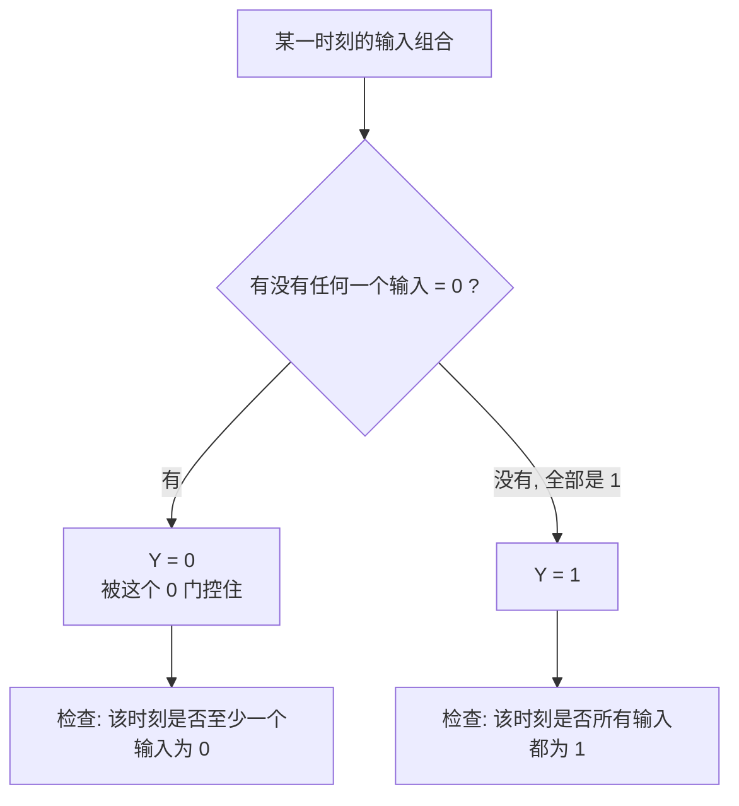

---
tags:
  - ECE2050
  - logic-gates
date: 2026-09-16
aliases:
  - 与门
  - AND 门
  - AND Gate
  - AND Operation
---

> [!NOTE] Where this fits · 定位
> 多输入门的第一篇。前置：[[Logic Gates]]（门的分类与三种描述方式）、[[Inverter]]（气泡与取反记号）。
> AND 是所有"条件同时成立"逻辑的基本块，也是 [[NAND Gate]] 的母门；
> 它的对偶门是 [[OR Gate]]（"全 1 才 1" ↔ "有 1 就 1"），两篇要对着看。
> 讲义来源：p.6（定义、Inputs $\ge2$、$2^n$ 行）、p.12（两输入门总表中的 AND）、
> p.13（AND3 与"行按二进制顺序"）、p.25（T/F 自测第 4 题）。

> [!SUMMARY] Quick recall · 英文速览
> An AND gate outputs 1 only when every input is 1. A zero on any input forces the output low, which makes AND useful for gating a signal.

## Core Definition · 核心定义

**与门 (AND gate)** 的输出为 1 **当且仅当它的所有输入都为 1**：

$$Y=A\cdot B=AB \qquad(\text{读作 } A \text{ AND } B)$$

- 输入个数 $\ge2$（讲义 p.6 的标题就是 *Inputs $\ge2$*）。
- 乘法号通常**省略**：$AB$ 就是 $A\cdot B$；三个输入写 $ABC$。
- 为什么用乘法：真值表上它的行为与算术乘一致——$0\cdot0=0$、$0\cdot1=0$、$1\cdot1=1$，
  只有"全 1"才得到 1，这正是"当且仅当"的代数形式。
- 符号：**D 形 (distinctive shape)**；IEEE 矩形符号在框内写 `&`。

两输入真值表（4 行 $=2^2$，讲义 p.12）：

| $A$ | $B$ | $Y=AB$ |
|---|---|---|
| 0 | 0 | 0 |
| 0 | 1 | 0 |
| 1 | 0 | 0 |
| 1 | 1 | 1 |

![[ch3-two-input-gates.png]]
*图 1 — 讲义 p.12 原图：两输入门总表。**AND 在总表的最左一列**：D 形符号、$Y=AB$、
4 行真值表里只有最后一行 $11$ 输出 1。与它并排的 OR 把符号换成弧形、把"全 1"换成"有 1"即为对偶。*

## Assumptions and Validity · 适用前提

> [!IMPORTANT] 两条硬条件，缺一不可
> ① **输入个数 $\ge2$**：一个输入的 AND 会退化成 $Y=A$，也就是 [[Inverter]] 里的 BUF，不再叫 AND；
> ② "当且仅当**所有**输入为 1"——"所有"是重点：$n$ 个输入里只要有一个 0，输出必为 0。
> 而且这个性质与 $n$ 无关：两输入、三输入、八输入都成立，只是真值表行数变成 $2^n$。

- 布尔乘与算术乘在 0/1 上**完全一致**，所以 AND 是四个基本门里最不容易算错的一个
  （真正会翻车的是 OR 的 $1+1=1$，见 [[OR Gate]]）。
- 与 [[Logic Gates]] 相同的理想门假设：延迟为 0、输出只有 0/1 两个电平、扇出无限。
- 失效边界：输入悬空（没有明确驱动）时"全 1 才 1"的判据失效——悬空不是 1 也不是 0，
  必须由外部电路保证每个输入都有确定电平。

## Derivation · 推导过程

### ① 从"当且仅当"导出 4 行真值表

把输入按二进制顺序列全，再逐行检查"是否所有输入都为 1"：

| 行 | $A$ | $B$ | 判断 | $Y$ |
|---|---|---|---|---|
| 1 | 0 | 0 | $A$ 就是 0，条件不成立 | 0 |
| 2 | 0 | 1 | $A=0$，条件不成立 | 0 |
| 3 | 1 | 0 | $B=0$，条件不成立 | 0 |
| 4 | 1 | 1 | 全为 1，条件成立 | 1 |

- 意义：**输出为 1 的行只有 1 行**（全 1 那行），输出为 0 的行有 $2^n-1$ 行。这是 AND 的"指纹"。
- 数值校验：4 行 $=2^2$ ✓；1 行为 1 ✓；$2^2-1=3$ 行为 0 ✓；把 4 行输出按 $A\cdot B$ 重算得 $0,0,0,1$ ✓。

### ② $n$ 输入推广：$Y=A\cdot B\cdot C\cdots$，行数 $2^n$，只有全 1 那行是 1

- 意义：AND 的"当且仅当"在 $n$ 个输入下写法不变，只是乘积项变长；
  真值表按 $2^n$ 行、二进制顺序排（讲义 p.13 的 AND3 就是 8 行）。
- 数值校验：AND3 的 8 行中，只有 $111$ 一行满足"全 1"，输出 1；其余 7 行 $=2^3-1$ 行输出 0 ✓。
  再往下：AND4 需要 $2^4=16$ 行，仍只有 1 行输出 1 ✓——**行数随 $n$ 指数增长，而"1 的行数"恒为 1**。

### ③ 门控 (gating)：为什么它真的是一扇"门"

把 $Y=AB$ 里的一个输入当作**使能 (enable)**，另一个当作**数据**，例如取 $B$ 为使能、$A$ 为数据：

$$B=1\Rightarrow Y=A \quad(\text{数据放行}); \qquad B=0\Rightarrow Y=0 \quad(\text{数据被挡住})$$

- 意义：$B=0$ 就像把门关上——**不管 $A$ 怎么变，输出都被钉在 0**。这就是"任一输入为 0，
  输出被门控为 0"的准确含义，也是 AND 在硬件里做掩码 (masking) 的原理。
- 数值校验：取 $A$ 的序列 $1,0,1,1$、$B$ 的序列 $1,0,1,0$，逐拍相与：
  $1\cdot1=1$、$0\cdot0=0$、$1\cdot1=1$、$1\cdot0=0$ → $Y=1,0,1,0$ ✓。
  第 2 拍被 $B=0$ 关掉、第 4 拍同样被 $B=0$ 关掉，而第 3 拍的 $A=1$ 因为 $B=1$ 被放行 ✓。

![[and-gate-timing.svg]]
*图 2 — AND 的时序图：A 在 $10\sim40$ ns 为 1、B 在 $20\sim60$ ns 为 1，输出 Y 只在
$20\sim40$ ns（两者同时为 1 的那一段）为 1。浅红色带标出"至少一个输入为 0"的时间段，
带下的短标签写着是哪个输入在门控（$B=0$ / $A=0$），绿色带是全图唯一能让 Y 变成 1 的窗口。*

## Method and Steps · 求解步骤与方法

1. **数输入个数 $n$**（必须 $\ge2$），写出真值表的 $2^n$ 行，输入列按二进制顺序填满。
2. **填输出列**：只有"全 1"那一行写 1，其余全部写 0。
3. **写表达式**：把各输入变量直接相乘，$Y=AB$（三输入 $Y=ABC$）。
4. **读 / 画时序图**：先把每个输入为 0 的时间段找出来——
   这些时间段内 Y 一定是 0（被门控）；剩下的时间段里若所有输入都为 1，Y 才是 1。
5. **自检**：输出为 1 的行数是不是正好 1 行？行数是不是 $2^n$？

## Worked Example · 例题

**Example 1 — 讲义 p.12 总表的 AND 列逐行核对（与 OR / XOR 对照）**

题目：$A,B$ 按 $00,01,10,11$ 排列，写出 AND 的输出，并与同一张表里 OR、XOR 的输出对照。

解：AND 只有"全 1"才给 1：

| $A$ | $B$ | AND $AB$ | OR $A+B$ | XOR $A\oplus B$ |
|---|---|---|---|---|
| 0 | 0 | 0 | 0 | 0 |
| 0 | 1 | 0 | 1 | 1 |
| 1 | 0 | 0 | 1 | 1 |
| 1 | 1 | 1 | 1 | 0 |

**数值校验 (Numerical check)**：AND 列有 $1$ 行为 1、$3$ 行为 0（$1+3=4=2^2$ ✓）；
OR 列有 $3$ 行为 1；XOR 列有 $2$ 行为 1（$2=2^{2-1}$ ✓）；
三列在 $11$ 行的取值分别是 $1,1,0$——**$1+1=1$ 是布尔加，$1\cdot1=1$ 是布尔乘，
$1\oplus1=0$**，一行把三个门区分开 ✓。

**Example 2 — 讲义 p.13 的 AND3：$Y=ABC$ 逐行核对**

题目：三输入 AND，$A,B,C$ 按二进制顺序取 $000\sim111$，求 8 行输出。

解：只有 $111$ 一行全为 1，因此 $Y$ 在 $000,001,010,011,100,101,110$ 七行为 0，在 $111$ 行为 1。

**数值校验 (Numerical check)**：行数 $2^3=8$ ✓；输出为 1 的行数为 1 ✓，为 0 的行数 $8-1=7=2^3-1$ ✓；
用乘积逐行重算：$0\cdot0\cdot0=0$、$0\cdot0\cdot1=0$、$0\cdot1\cdot0=0$、$0\cdot1\cdot1=0$、
$1\cdot0\cdot0=0$、$1\cdot0\cdot1=0$、$1\cdot1\cdot0=0$、$1\cdot1\cdot1=1$ ✓ 与判据一致。

![[ch3-multiple-input-gates.png]]
*图 3 — 讲义 p.13 原图：多输入门，左侧即 AND3（$Y=ABC$）。8 行表里只有最后一行 $111$ 输出 1；
把它与右边的 XOR3 并排看，就能体会"数 1 的行数"为什么是认门的最快办法。*

**Example 3 — 掩码 (masking)：用一个输入当使能（自算）**

题目：$Y=A\cdot B$，其中 $A$ 是数据序列 $1,0,1,1$，$B$ 是使能序列 $1,0,1,0$（两序列逐拍对齐）。
求 $Y$ 序列，并说明哪些拍被"挡住"。

解：逐拍做布尔乘：$1\cdot1=1$、$0\cdot0=0$、$1\cdot1=1$、$1\cdot0=0$ → $Y=1,0,1,0$。

**数值校验 (Numerical check)**：第 4 拍 $A=1$ 却被 $B=0$ 挡住，输出 0 ✓——这正说明
"**输入 1 不保证输出 1**"，被门控的那一拍与 $A$ 无关；
第 2 拍 $A=B=0$，输出 0 是两个 0 共同的结果 ✓；第 1、3 拍 $B=1$，数据被放行，$Y$ 与 $A$ 相同 ✓。
逐拍输出 $1,0,1,0$ 与 $A\cdot B$ 的 4 行真值表完全对得上 ✓。

## Pitfalls · 常见误区

> [!WARNING] AND 的坑几乎都来自"把 OR 的性质记到 AND 头上"

1. **讲义 p.25 T/F 第 4 题**：*If all inputs to an AND gate are 1, the output is 0* → **False**。
   正确：全 1 时输出 **1**，这正是 AND 的定义。
2. **把 AND 说成"有 1 就 1"**。错在：把 $A\cdot B$ 与 $A+B$ 的判据互换。
   正确：AND 要**全** 1；"有 1 就 1"是 [[OR Gate]]。
3. **三输入 AND 只写 4 行真值表**。错在：照抄两输入的表。
   正确：$n$ 个输入 $\Rightarrow2^n$ 行，AND3 是 8 行，且仍然只有 $111$ 一行是 1。
4. **符号形状混用**。D 形（平背 + 半圆头）是 AND 家族，弧形是 OR 家族；
   IEEE 矩形符号里 AND 写 `&`，不要凭字母顺序猜。
5. **把 $1\cdot1=1$ 与布尔加的 $1+1=1$ 混成一件事**。前者是乘积（AND），后者是布尔和（OR）；
   在 AND 里绝不会有"$1$ 和 $1$ 加起来变成 2 或 10"的情况。
6. **以为"某个输入接 0 不影响输出"**。正确：接 0 会**强制**输出 0（$A\cdot0=0$），
   这正是掩码 (masking) 的用法；AND 里没有"不参与运算的输入"——想让某个输入彻底失效，
   必须靠额外的选择 / 使能结构，单靠 AND 做不到。

## Qualified conditions and enables · 条件许可与使能

AND expresses a conjunction: every required predicate must be true. Calling one input an enable does not change the truth table; it assigns that input a role in a larger design. The enable must have the asserted polarity expected by the expression. An active-low permission should first be translated to a positive predicate or be shown explicitly with inversion.

A common implementation mistake is to gate a clock with an ordinary AND gate and an enable that can change at any time. If the enable rises while the clock is already HIGH, the output can contain an unintended edge. Boolean correctness of $Y=CE$ does not by itself make that output a suitable register clock.

**Worked application — motor permission.** run=1 请求运行，door_closed=1 门已关，fault_n=1 表示没有故障。令 $M=run\cdot door\_closed\cdot fault_n$。输入 111 时允许，110 时因 fault_n=0 禁止。若信号改为 fault=1 表示故障，则公式要变为 $M=run\cdot door\_closed\cdot\overline{fault}$，不能照抄同一个变量名和极性。

In English: the conditions are semantic predicates, not just pin levels. Verify the dangerous and inactive cases individually, and ensure that each control signal has a defined source rather than an undriven input.

**English exam question:** What does a LOW enable do to an AND data gate?

**Answer:** It forces the output LOW regardless of the data input. A HIGH enable passes the data's Boolean value. This is a combinational data-selection behavior; it does not store the previous output.

Use [[Register Enable and Reset]] for controlled register updates, [[Multiplexer and Demultiplexer]] for selecting held versus new data, and [[Propagation Delay and Logic Hazards]] for transitions on real paths.

## Connections · 相关笔记

- 上游 (upstream)：[[Logic Gates]] —— 门的分类、$2^n$ 行规则与三种描述方式是本篇的前提。
- 上游 (upstream)：[[Inverter]] —— 气泡与取反记号在这里定义；NAND 就是"AND 加一个气泡"。
- 下游 (downstream)：[[NAND Gate]] —— 母门关系：$Y=\overline{AB}$，先 AND 再取反。
- 下游 (downstream)：[[Exclusive-OR Gate]] —— XOR 的进位项就是 $AB$，半加器由它和 XOR 拼成。
- 下游 (downstream)：[[Sum-of-Products Form]]（Ch4）—— SOP 的每一个"乘积项"就是一个 AND 运算。
- 平行 (parallel)：[[OR Gate]] —— 对偶门："全 1 才 1" ↔ "有 1 就 1"，两者的时序图共用同一组 A / B 波形。

---
索引：[[ECE2050 Knowledge Tree]] · [[Glossary]]
