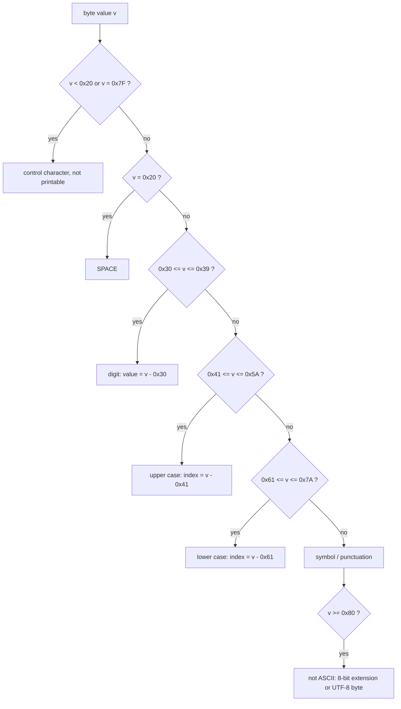

---
tags:
  - ECE2050
  - codes
date: 2026-09-16
aliases:
  - ASCII 码
  - 美国信息交换标准代码
  - 字符编码
  - American Standard Code for Information Interchange
  - ASCII
---

> [!NOTE] Where this fits · 定位
> 分区 8「Codes」的最后一篇，也是**从"数字"走向"文本"的那一步**：前面 [[Binary Coded Decimal]] 把十进制
> **数字**编码成 4 位，[[Gray Code]] 把**位置/符号**编码成只变 1 位的码字；ASCII 则把**字符**
> (character) 编码成位串，让计算机第一次能存"文字"而不是"数"。
> 前置：[[Hexadecimal Number System]]（看懂 `0x41` 这种写法）、[[Bits and Bytes]]（byte = 8 bit 的容器）、
> [[Binary Coded Decimal]]（对照：BCD 编数字，ASCII 编符号）。
> 下游：[[Parity Bit]] —— 串行传输里最常见的做法就是把 1 位校验位挂在 7 位 ASCII 码后面。

> [!SUMMARY] Quick recall · 英文速览
> ASCII assigns seven-bit codes to 128 characters. Numeric, uppercase, and lowercase letters occupy distinct code ranges; the code for a digit is different from the number it represents.

## Core Definition · 核心定义

**字母数字码 (alphanumeric code)** 是一类编码：它把英文字母、数字、标点与控制动作映射成位串
（讲义 p.69）。关键区别：

- **BCD 编码的是"数值"**：`0101` 与 `0100` 相加有意义（还要 +6 修正）。
- **ASCII 编码的是"符号"**：`0x35` 与 `0x30` 相加没有意义，它只是"字符 5"和"字符 0"。

**ASCII (American Standard Code for Information Interchange)** 是 **7 位码 (7-bit code)**，因此一共
$2^{7}=128$ 个码字 (code word)：

$$
\#\text{codes}=2^{7}=128,\qquad \text{code}=(\text{high nibble})\times 16+(\text{low nibble})
$$

- 物理意义：每个字符占用一个 7 位码字，范围 `0x00`–`0x7F`；在内存里通常放进 1 个字节，
  最高位空出来（置 0，或用来放校验位，见 [[Parity Bit]]）。
- 数值校验：$2^{7}=128$，而可打印字符 `0x20`–`0x7E` 共有 $0x7E-0x20+1=126-32+1=95$ 个，
  剩下 $128-95=33$ 个是不可打印的控制字符 (`0x00`–`0x1F` 与 `0x7F`) ✓。

**分区结构 (block structure)** —— 记这张表要记"块"，不要记 128 行：

| 区间 (range) | 内容 | 个数 | 关键事实 |
|---|---|---|---|
| `0x00`–`0x1F` | 控制字符 (control) | 32 | 不可打印：LF `0x0A`、CR `0x0D`、ESC `0x1B` |
| `0x20` | 空格 SP | 1 | 唯一的"空白但可打印"字符 |
| `0x21`–`0x2F`、`0x3A`–`0x40`、`0x5B`–`0x60`、`0x7B`–`0x7E` | 符号 | 32 | `!` `"` `$` `%` `:` `@` `[` `\` `{` `~` 等 |
| `0x30`–`0x39` | 数字 `'0'`–`'9'` | 10 | **低 4 位就是数字本身** |
| `0x41`–`0x5A` | 大写 `'A'`–`'Z'` | 26 | `'A' + k`（k = 0…25） |
| `0x61`–`0x7A` | 小写 `'a'`–`'z'` | 26 | **= 大写 + `0x20`** |
| `0x7F` | DEL | 1 | 删除；`0x20`–`0x7E` 共 95 个可打印字符 |

**必须背下来的锚点 (anchor codes)**：

| 字符 | 十六进制 | 十进制 | 7 位二进制 | 记忆方式 |
|---|---|---|---|---|
| `'0'` | `0x30` | 48 | `011 0000` | 数字块起点 |
| `'9'` | `0x39` | 57 | `011 1001` | `0x30 + 9`，低 4 位 = `1001` = 9 |
| `'A'` | `0x41` | 65 | `100 0001` | 字母块起点，低 5 位 = `00001` = 1 |
| `'Z'` | `0x5A` | 90 | `101 1010` | `0x41 + 25`，低 5 位 = `11010` = 26 |
| `'a'` | `0x61` | 97 | `110 0001` | `'A' + 0x20` |
| `'z'` | `0x7A` | 122 | `111 1010` | `'Z' + 0x20` |
| 空格 SP | `0x20` | 32 | `010 0000` | 最小的可打印字符 |
| DEL | `0x7F` | 127 | `111 1111` | 最大的 7 位码 |

![[ascii-code-structure.svg]]
*图 1 — 16×16 的 ASCII 码图：行 = 高 4 位、列 = 低 4 位，所以"查表"就是"读十六进制"。控制字符（红）、
符号（浅灰）、数字（绿）、大写（蓝）、小写（深红）各自成块，`0x30`/`0x41`/`0x61` 三个锚点被圈出；
下半区（`0x80`–`0xFF`，斜纹）不是 ASCII，而是 Latin-1/代码页等 8 位扩展。*

## Assumptions and Validity · 适用前提

> [!IMPORTANT] ASCII 是"7 位 + 1 位自由"的约定，不是 8 位码
> 真正的 ASCII 只有 7 位（128 个码字）。第 8 位在历史上有两种用法：
> ① 恒为 0，于是 1 字节存 1 个字符；② 作为**校验位**挂在 7 位码后（奇偶校验的经典用法，见 [[Parity Bit]]）。
> 所以看到"ASCII 是 8 位"时要说清：那是**存储/传输的容器宽度**，不是编码宽度。

- **结构规律只在块内成立**：`'0'`–`'9'`、`'A'`–`'Z'`、`'a'`–`'z'` 各自连续，但三块之间不连续（`'9' + 1 = 0x3A = ':'`，不是 `'A'`）。
- **ASCII 只覆盖英文**：`0x80`–`0xFF` 属于 Latin-1、GB2312、CP437 之类的**8 位扩展或代码页**，不是 ASCII；中日韩文字放不进 7 位。
- **Unicode / UTF-8 的关系**：Unicode 给每个字符一个码点 (code point)，如 `'A'` = U+0041；UTF-8 对 **U+0000–U+007F 用 1 个字节、且与 ASCII 逐位相同** → **向后兼容 (backward compatible)**，这就是老程序不改也能读 ASCII 的原因。
- **超出范围的字符要 2–4 字节**：`'é'` U+00E9 → `0xC3 0xA9`，`'中'` U+4E2D → `0xE4 0xB8 0xAD`。
- **失效边界**：算术技巧（减 `0x30`、异或 `0x20`）只在**已知字符属于对应块**时有效；对任意字节做这些运算会得到别的字符或控制码（见"常见误区"第 4 条）。

## Derivation · 推导过程

### 1. 为什么是 7 位

需要表示的符号量级：26 大写 + 26 小写 + 10 数字 + 约 30 个标点 + 若干控制动作 $\approx 100$ 个。

- 6 位只有 $2^{6}=64$ 个码字，不够；7 位有 $2^{7}=128$ 个，刚好够且留有富余 ✓。
- 8 位要给汉字/图形留空间也远不够（汉字常用 6763 个），所以后来是 16 位/21 位的 Unicode，而不是把 ASCII 简单加宽 1 位。

### 2. 三条结构规律（可直接算，不必查表）

**(a) 数字：码值 = `0x30` + 数字值**

$$
\text{code}('d') = \texttt{0x30} + d,\qquad d=0,\dots,9
$$

- 意义：数字字符的低 4 位就是它的十进制值，高 3 位固定是 `011`。
- 数值校验：`'7'` → `0x30 + 7 = 0x37`，二进制 `011 0111`，低 4 位 `0111` = 7 ✓；
  `'0'` → `0x30` = `011 0000` ✓；`'9'` → `0x39` = `011 1001` ✓。
- 推论：`c - '0'` 就是数字值；反过来 `'0' + 5 = 0x35 = '5'` ✓。

**(b) 字母：码值 = 起点 + 序号**

$$
\text{code}('A'+k) = \texttt{0x41}+k,\qquad
\text{code}('a'+k) = \texttt{0x61}+k,\qquad k=0,\dots,25
$$

- 意义：字母在各自块内连续排列，低 5 位 = $k+1$（低 5 位从 1 开始计）。
- 数值校验：`'E'` 是第 5 个字母 ($k=4$) → `0x41 + 4 = 0x45` = `100 0101` ✓；
  `'C'` ($k=2$) → `0x43` ✓；`'J'` ($k=9$) → `0x4A` = `100 1010`，低 5 位 `01010` = 10 = $k+1$ ✓。

**(c) 大小写：只差第 5 位（权值 `0x20` = 32）**

$$
\text{code}('a') - \text{code}('A') = \texttt{0x61}-\texttt{0x41} = \texttt{0x20} = 32_{10} = 010\,0000_2
$$

- 意义：把第 5 位（权值 32 的那一位）取反，就在大写和小写之间切换：
  `'A'` = `100 0001`，`'a'` = `110 0001`，二者只差 bit 5 ✓。
- 数值校验：`'a' XOR 0x20 = 0x61 XOR 0x20 = 0x41 = 'A'` ✓；
  `'Z' XOR 0x20 = 0x5A XOR 0x20 = 0x7A = 'z'` ✓。

### 3. 从字符到字节：字符串就是字节序列

一串文本在机器里就是一个字节序列（每个 ASCII 字符 1 字节），用十六进制查看就是**内存转储**的样子：

$$
\texttt{"ECE2050"} \;\longrightarrow\; \texttt{45 43 45 32 30 35 30}_{16}
$$

- 数值校验（逐字符用上面的规律复核）：
  `'E'` = `0x41+4` = `0x45` ✓；`'C'` = `0x41+2` = `0x43` ✓；`'2'` = `0x30+2` = `0x32` ✓；
  `'0'` = `0x30+0` = `0x30` ✓；`'5'` = `0x30+5` = `0x35` ✓ —— 7 个字符 → 7 字节 ✓。
- 这一步是后面所有"文本处理"的基础：字符串长度 = 字节数（纯 ASCII 时成立；UTF-8 下中文一个字 3 字节）。

### 4. 8 位扩展与 Unicode 的分工

| 层次 | 范围 | 编码宽度 | 说明 |
|---|---|---|---|
| ASCII | `0x00`–`0x7F` | 7 bit | 英文、数字、标点、控制 |
| 8 位扩展 / 代码页 | `0x80`–`0xFF` | 8 bit | Latin-1 重音字母、西里尔字母、制表符等 |
| Unicode 码点 | U+0000–U+10FFFF | 抽象编号 | 为全世界字符编号，不是存储格式 |
| UTF-8 | 1–4 字节 | 变长 | U+0000–U+007F 与 ASCII 完全一致（向后兼容） |

- 数值校验：`'A'` 的码点 U+0041 ≤ U+007F → UTF-8 用 1 字节 `0x41`，与 ASCII 相同 ✓；
  `'中'` U+4E2D > U+007F → UTF-8 用 3 字节 `0xE4 0xB8 0xAD`（不是 ASCII）✓。

## Method and Steps · 求解步骤与方法

1. **编码（字符 → 码值）**：先判断它属于哪个块——数字用 `0x30 + d`，大写用 `0x41 + k`，小写用 `0x61 + k`，标点直接查表。
2. **写成 7 位二进制**：`0x41` → `100 0001`；需要放进字节时在最前面补 0 → `0100 0001`。
3. **解码（码值 → 字符）**：先看落在哪个区间（见下面流程图），再在块内做减法/异或。
4. **处理字符串**：逐字符编码，得到一个字节序列；长度 = 字符个数。
5. **大小写转换**：只对字母用 `XOR 0x20`（或 $\pm 32$），并用区间判断保护。
6. **收尾校验**：把结果代回规律——数字的低 4 位是否等于数字值？大小写码值是否相差 `0x20`？

## Worked Example · 例题

**Example 1 — 把字符串 `ECE2050` 写成 ASCII 十六进制与二进制**

题目：给出 `ECE2050` 的 ASCII 码（十六进制字节串与 8 位二进制），并说明为什么它正好是 7 字节。

解：
1. 逐字符定块：`E`、`C` 是大写字母块；`2`、`0`、`5` 是数字块。
2. 用规律算码值：
   - `'E'` = `0x41 + 4` = `0x45`，`'C'` = `0x41 + 2` = `0x43`；
   - `'2'` = `0x30 + 2` = `0x32`，`'0'` = `0x30`，`'5'` = `0x30 + 5` = `0x35`。
3. 十六进制字节串：`45 43 45 32 30 35 30`。
4. 二进制（每字节 8 位）：`0100 0101  0100 0011  0100 0101  0011 0010  0011 0000  0011 0101  0011 0000`。

**数值校验 (Numerical check)**：
- `'E'`：`0x45` = `0100 0101`，十进制 $64+4+1=69$ ✓（`'A'` = 65，加 4 = 69 ✓）。
- `'2'`：`0x32` = `0011 0010`，低 4 位 `0010` = 2 ✓（数字规律）。
- `'5'`：`0x35`，低 4 位 `0101` = 5 ✓。
- 长度：7 个字符 → 7 字节 = 56 bit ✓（若按 7 位紧凑存放只有 $7\times 7=49$ bit；多出的 7 位就是"每字符补 0 到 1 字节"的代价）。

**Example 2 — 由码值反推字符：`0x4A`、`0x6A`、`0x35`**

题目：已知这是 ASCII，写出对应字符并说明用到的规律。

解：
1. `0x4A`：落在 `0x41`–`0x5A` → 大写；`0x4A - 0x41 = 9` → 第 10 个字母 = **`J`**。
2. `0x6A`：落在 `0x61`–`0x7A` → 小写；`0x6A - 0x61 = 9` → **`j`**；
   也可以直接由 `0x6A = 0x4A + 0x20` 得到（大小写只差第 5 位）✓。
3. `0x35`：落在 `0x30`–`0x39` → 数字；`0x35 - 0x30 = 5` → **`'5'`**。

**数值校验 (Numerical check)**：
- `0x4A` = `100 1010`，低 5 位 `01010` = 10 = $k+1$ → $k=9$ → `'A'+9 = 'J'` ✓。
- `0x6A XOR 0x20 = 0x4A` ✓（两个字符确实只差 bit 5）。
- `0x35` 与 `0x25` 对比：`0x25` 是 `%`（符号块），`0x35` 是 `'5'` —— 相差的正是 bit 4（`0x10`），别混 ✓。

**Example 3 — 把 `'a'` 变成 `'A'` 需要做什么运算**

题目：给出至少两种做法，并说明什么时候会出错。

解：
1. 做法一（异或）：`'a' XOR 0x20` = `110 0001 XOR 010 0000` = `100 0001` = `'A'` ✓。
2. 做法二（减法）：`'a' - 32 = 97 - 32 = 65 = 'A'` ✓（等价，因为差的正是权值 32 的那一位）。

**数值校验 (Numerical check)**：
- `'a'` = `0x61` = `0110 0001`，`'A'` = `0x41` = `0100 0001`，逐位比较只有 bit 5 不同 ✓。
- 反向：`'A' XOR 0x20 = 0x61 = 'a'` ✓ —— 同一个运算两个方向都成立。
- 边界反例：`'0'` = `0x30`，`0x30 XOR 0x20 = 0x10` = 控制字符 DLE，**不是**任何字母 ✗
  → 必须先判断 `0x41 <= c <= 0x5A` 或 `0x61 <= c <= 0x7A` 才能做这个运算。

## Pitfalls · 常见误区

> [!WARNING] 字符 ≠ 数字，这是本章最容易混的一处

1. **把字符当数值**。错在：以为 `'9'` 在内存里就是 9。
   正确：`'9'` 的码值是 `0x39` = 57；数值 9 是 `0x09`（TAB 控制字符）。要得到数值必须写 `c - '0'`。
2. **以为 ASCII 是 8 位**。错在：说"ASCII 有 256 个码字"。
   正确：ASCII 是 **7 位、128 个码字**；`0x80`–`0xFF` 属于 8 位扩展/代码页，不是 ASCII。
3. **以为 `'A'` 永远等于 65**。错在：把 ASCII 的数值当成"字符的天性"。
   正确：这是 ASCII 家族的约定；EBCDIC 里 `'A'` = `0xC1`，UTF-16 里 `'A'` = `0x0041`。变的是编码，不是字符。
4. **对任意字节做大小写运算**。错在：`c XOR 0x20` 一把梭。
   正确：只有字母才差 `0x20`；对 `'0'`、空格做异或会得到控制字符（Example 3 的反例）。
5. **以为字节序 = 字典序**。错在：直接比较字符串大小当作"字母顺序"。
   正确：ASCII 里 `'Z'` = `0x5A` < `'a'` = `0x61`，所以 `"Zebra" < "apple"`；要大写不敏感比较必须先归一化。
6. **以为 `'9' + 1` 是 `'A'`**。错在：把数字块和字母块当成连在一起。
   正确：`'9'+1 = 0x3A = ':'`，两块之间隔着 `0x3A`–`0x40` 的 7 个符号。
7. **把 BCD 与 ASCII 混用**。错在：把十进制 5 的 BCD `0101` 当成字符 `'5'`。
   正确：BCD `5` = `0101`（4 位，表示数值），ASCII `'5'` = `0x35` = `011 0101`（7 位，表示符号），
   见 [[Binary Coded Decimal]]。

## Character processing as a datapath · 字符怎样进入数据通路

ASCII codes represent characters, while an arithmetic datapath usually needs numeric values. Converting a digit character to an integer therefore has two steps: verify that the character belongs to the digit range, then subtract the code for '0'. Subtraction without the range check can turn a punctuation character into an apparently plausible number.

For a string of decimal digits, accumulate the numeric value from left to right. If the value already accumulated is $v$ and the next digit value is $d$, the next value is $10v+d$. This is the positional expansion evaluated incrementally. The accumulator width must accommodate the final value, not merely one character code.

**Worked application — parse a two-digit setting.** 输入字符 `"42"`，codes 是 `0x34,0x32`。分别检查在 `0x30`–`0x39` 内，取 $d_1=0x34-0x30=4$，$d_2=0x32-0x30=2$，累加 $v=10\times4+2=42$。输出给普通二进制寄存器应为 `00101010`；若显示电路要 BCD，应为 `0100 0010`，不应原封不动写入 ASCII `0x34 0x32`。

In English: character decoding, numeric accumulation, and display encoding are three distinct operations. Their bit widths and meanings differ even though they all use binary storage.

**English exam question:** Is extracting the low nibble a complete ASCII digit decoder?

**Answer:** No. The low nibble gives the digit value only after the byte is known to lie between `0x30` and `0x39`. Other ASCII characters can have the same low nibble. A valid-range check is required to distinguish digits from those characters.

The validation can use [[Magnitude Comparator]]. The numeric result then connects to [[Binary Coded Decimal]], [[Seven-Segment Display and Code Conversion]], and [[Memory Arrays and Expansion]] for storing strings versus numeric settings.

## Connections · 相关笔记

- 上游 (upstream)：[[Hexadecimal Number System]] —— `0x41` 这种写法与"高低 4 位"的读法全部来自十六进制。
- 上游 (upstream)：[[Bits and Bytes]] —— 7 位码放进 8 位字节，才有了"字符数 = 字节数"的直觉。
- 平行 (parallel)：[[Binary Coded Decimal]] —— 同样的 4 位编码思路，但 BCD 编的是数值、ASCII 编的是符号。
- 平行 (parallel)：[[Gray Code]] —— 另一种编码设计目标（相邻只差 1 位），与 ASCII 的"块结构"思路互为对照。
- 下游 (downstream)：[[Parity Bit]] —— 串行链路里最经典的用法是"7 位 ASCII + 1 位奇偶校验"组成 1 字节。

---
索引：[[ECE2050 Knowledge Tree]] · [[Glossary]]
