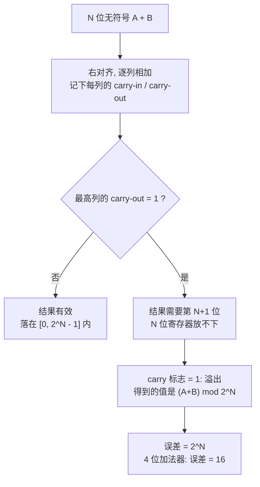

---
tags:
  - ECE2050
  - binary-arithmetic
date: 2026-09-16
aliases:
  - 二进制算术运算
  - 二进制四则运算
  - Binary Arithmetic
  - Binary Addition and Subtraction
---

> [!NOTE] Where this fits · 定位
> 这一篇把 base-2 的**四则运算**一次立起来：加法进位链、减法借位、乘法的部分积、除法的长除，
> 最后收在"位宽固定 → 溢出"这个硬件世界的铁律上（讲义 p.28–33）。
> 它是全章**最像硬件**的一篇：这里的每一条法则后面都会变成门电路。
> 前置：[[Binary Number System]]（$0/1$ 与位权）、[[Bits and Bytes]]（位宽、$2^N$ 与范围）。
> 下游：[[Sign-Magnitude Representation]]、[[Two's Complement Representation]]（有符号算术全部建在
> 这一篇的无符号加法器上）、[[Signed Binary Multiplication and Division]]（部分积 + 符号处理）。
> 平行：[[Cyclic Redundancy Check]] 用的"模 2 加法"是本篇加法规则的**退化版**（进位被扔掉）。

> [!SUMMARY] Quick recall · 英文速览
> Binary addition, subtraction, multiplication, and division use the same place-value logic as decimal arithmetic. Fixed register width makes carry, borrow, and overflow essential to interpreting a result.

## Core Definition · 核心定义

**四种运算的法则**（每条都只有 4 行，因为数码只有 0 和 1）：

| 运算 | 全部法则 | 关键点 |
|---|---|---|
| 加法 | $0+0=0$、$0+1=1$、$1+0=1$、$1+1=10_2$ | $1+1$ **产生进位 (carry)** |
| 减法 | $0-0=0$、$1-0=1$、$1-1=0$、$0-1$ 需**借位 (borrow)** 得 $10_2-1=1$ | 不够减就向高位借 1（=借 2） |
| 乘法 | $0\times0=0$、$0\times1=0$、$1\times0=0$、$1\times1=1$ | 只有 $1\times1$ 非零 → 乘法退化成**移位 + 相加** |
| 除法 | 二进制长除 / **反复相减** | 商 = 相减次数（二进制下每位商只能是 0 或 1） |

三个术语贯穿全篇：

- **竖式 (long form)**：把两个操作数按位权对齐，从 LSB 列开始逐列算，进位往左传。
- **部分积 (partial product)**：$A\times B$ 中"乘数第 $i$ 位 × $A$"的结果，按 $2^i$ 左移后累加。
- **溢出 (overflow)**：位宽固定时，结果超出了可表示范围。**不是"算错"，是"放不下"。**

## Assumptions and Validity · 适用前提

> [!IMPORTANT] 三条前提，决定你算的是哪一套算术
> ① **无符号 (unsigned) 前提**：本篇的加减乘除都在 $N$ 位无符号整数上定义，
> 运算等价于"先按无限精度算，再 $\bmod 2^N$"。有符号数必须换成补码再套同一套加法器
> （见 [[Two's Complement Representation]]）。
> ② **位宽固定 (fixed width)**：数字系统的寄存器宽度不变，所以"第 $N+1$ 位"无处存放，
> 丢掉它就要付 $2^N$ 的代价。
> ③ **减法与除法的前提**：无符号减法只在"够减"时结果有意义，否则**借位标志 (borrow) = 1**
> 表示结果为负（本例中会回绕）；除法必须停在**余数 < 除数**，否则商还会变大。

- 乘法的"移位相加"成立，只因为乘数的每一位非 0 即 1；十进制里每位有 10 种取值，所以人算乘法要用九九表。
- 除法在二进制里尤其便宜：每一位商**试一次**就知道是 0 还是 1（不是 0 就是 1）。
- 失效边界：**进位不等于错误**。进位只是"结果需要第 $N+1$ 位"的信号，见下文 ⑤。

## Derivation · 推导过程

### ① 加法：法则与逐列进位链

把"有多进位进来"也算进去，第 $i$ 列的三个输入是 $a_i$、$b_i$、$c_i$（carry-in），输出是
本位和 $s_i$ 与向高位的进位 $c_{i+1}$：

$$
s_i=a_i\oplus b_i\oplus c_i,
\qquad
c_{i+1}=a_ib_i+c_i\,(a_i\oplus b_i)
$$

- 意义：$s_i$ 用**异或**（三个输入里有奇数个 1 就是 1），$c_{i+1}$ 用"至少两个输入是 1"
  （三个两两组合取或）。这正是后面 Ch6 全加器的公式，所以竖式不是"手算技巧"，而是电路结构。
- 数值校验（取 $1011_2+0110_2$ 的第 2 列 $i=2$：$a_2=0$、$b_2=1$、$c_2=1$）：
  $s_2=0\oplus1\oplus1=0$ ✓；$c_3=0\cdot1+1\cdot(0\oplus1)=0+1=1$ ✓ ——
  与图 1(a) 中该列的"$0+1+1=10$"一致。
- 完整进位链（$1011_2+0110_2=1\,0001_2$，讲义 p.29）：
  $c_0=0$；第 0 列 $1+0+0=1$，$c_1=0$；第 1 列 $1+1+0=10$，本位 0、$c_2=1$；
  第 2 列 $0+1+1=10$，本位 0、$c_3=1$；第 3 列 $1+0+1=10$，本位 0、$c_4=1$。
  于是结果 $=c_4s_3s_2s_1s_0=1\,0001_2=17$ ✓（$11+6=17$）
- 溢出预告：结果的最高位 $c_4=1$ 落在第 4 位，而两个操作数都只有 4 位——**这一位就是溢出信号**。

![[binary-addition-carries.svg]]
*图 1 — (a) $1011_2+0110_2$ 的竖式：每一列标出 carry-in 与 carry-out，箭头表示"本列的进位
就是左边一列的进位输入"，最终得到 5 位结果 `1 0001`。(b) 若寄存器只有 4 位，最高位的进位
被迫丢弃，`1 0001` 变成 `0001` = 1，与真值 17 相差 16 —— 这就是溢出。*

### ② 减法：借位就是"向高位借 2"

$0-1$ 时向左边借 1 位，因为 $2^i=2\times2^{i-1}$，所以借来的 1 在本列值 **2**：

$$
0-1\;\Longrightarrow\;(0+2)-1=1,\quad\text{并向高位借 }1
$$

- 意义：和十进制的退位减法完全一样，只是每借一次值 2（十进制借一次值 10）。
- 数值校验（$1001_2-0011_2$，即 $9-3$）：第 0 列 $1-1=0$；第 1 列 $0-1$ 要向第 2 列借，
  而第 2 列是 0，于是继续向第 3 列借 → 第 3 列的 1 变成 0，第 2 列变成 $10_2$ 并借 1 给第 1 列
  （自己剩 $1$）；第 1 列 $10_2-1=1$；第 2 列 $1-0=1$；第 3 列 $0-0=0$ → 结果 `0110` $=6$ ✓（$9-3=6$）
- 不够减时：$0011_2-0101_2$（$3-5$）会借出第 3 位，得到 `1110` $=14$ 且借位标志 = 1。
  这不是"14"，而是 $-2 \bmod 16=14$ ✓（$3-5=-2$，$-2+16=14$）。

### ③ 乘法：只有 $1\times1=1$ → 部分积移位相加

$A\times B=\sum_{i} b_i\cdot(A\times2^{i})$：乘数第 $i$ 位是 1 就把 $A$ 左移 $i$ 位写下来，是 0 就写全 0，
最后把 $n$ 行**部分积**加起来。

- 意义：二进制乘法不需要乘法表，只需要**移位寄存器和加法器**——这就是硬件乘法器的全部（Ch8 内容）。
- 位数规律：$m$ 位 $\times$ $n$ 位，结果最多 $m+n$ 位（$4\times4$ 位最多 8 位），累加器必须留够宽度。
- 数值校验（$1011_2\times1101_2$，自算）：见 Example 2，结果 $1000\,1111_2=143=11\times13$ ✓。

### ④ 除法：长除与"反复相减"是同一件事

商第 $i$ 位问的是"**被除数当前余下部分能不能再减一个除数**"：能就写 1 并减掉，不能就写 0。
所以"反复相减、数相减次数"与"长除法"给出同一个商，只是前者在二进制里每一步只减一次。

- 意义：商的一位 = 一次比较 + 一次减法，硬件里就是"移位 + 减 + 判符号"（见 [[Signed Binary Multiplication and Division]]）。
- 数值校验（$(1001)_2\div(11)_2$，讲义 p.33）：$9\div3$。反复相减：$9-3=6$（第 1 次）、
  $6-3=3$（第 2 次）、$3-3=0$（第 3 次）→ 相减 3 次，商 $=3=11_2$，余数 $=0$ ✓。

### ⑤ 溢出：固定位宽的模运算语义

$N$ 位无符号加法器实际计算的是

$$
S=(A+B)\bmod 2^{N},
\qquad
\text{overflow}\iff A+B>2^{N}-1\iff c_{N}=1
$$

- 意义：第 $N$ 位（最高列的 carry-out）恰好是 $2^N$ 的权，丢弃它就等于减去 $2^N$——
  这正是"取模"。所以溢出不是玄学：**丢一位 = 减 $2^N$**。
- 数值校验：$11+6=17$ 需要 5 位；4 位加法器给出 $17\bmod16=1$，即 `0001`；
  误差 $17-1=16=2^4$ ✓（与图 1(b) 完全对应）。
- 另一个方向：$3-5=-2$，4 位结果 $(-2)\bmod16=14=$ `1110`，借位标志 = 1 ✓。

## Method and Steps · 求解步骤与方法

1. **对齐位权**：两个操作数右对齐（LSB 对 LSB），必要时把短的补 0 到同宽。
2. **逐列算**：写下该列的 $a_i$、$b_i$、$c_i$ 三个数——相加得"本位和 + 进位"；
   相减不够就借位（借 1 当 2）。
3. **进位/借位往左传**：每列的 carry-out 就是左边一列的 carry-in，一路传到最高列之外。
4. **定结果宽度**：加法结果可能比操作数宽 1 位；乘法最多宽到 $m+n$ 位；除法商不超过被除数位数。
5. **判溢出**：最高列的 carry-out（无符号）或借位标志（减法）为 1 → 结果放不下；
   写出"丢弃后的值 + 误差 $2^N$"才算答完。

## Worked Example · 例题

**Example 1 — $11+6$ 的竖式进位链（讲义 p.29）**

题目：用 4 位二进制计算 $1011_2+0110_2$，写出每一列的 carry-in / carry-out，并判断结果需要几位。

解（列号从 LSB 起为 0）：
1. 第 0 列：$1+0+0=1$，本位 1，carry-out 0。
2. 第 1 列：$1+1+0=10_2$，本位 0，carry-out 1。
3. 第 2 列：$0+1+1=10_2$，本位 0，carry-out 1。
4. 第 3 列：$1+0+1=10_2$，本位 0，carry-out 1 —— 它是结果的第 4 位。
5. 结果：`1 0001`（5 位），十进制 $16+1=17$。

**数值校验 (Numerical check)**：$11+6=17$ ✓；$1\,0001_2=16+1=17$ ✓；
每列的 carry-out 等于左边一列的 carry-in（$c_1=0,c_2=1,c_3=1,c_4=1$）✓；
若只有 4 位，`1 0001` 截成 `0001`$=1$，误差 $17-1=16=2^4$ ✓。

**Example 2 — $1011_2\times1101_2$ 的部分积（自算，含部分积表）**

题目：计算 $1011_2\times1101_2$，用部分积表说明，并把结果写成 4 位一组。

解：$1011_2=11$、$1101_2=13$。乘数从 LSB 起是 $1,0,1,1$：

| 乘数位 | 权 | 部分积（8 位对齐） | 十进制 |
|---|---|---|---|
| $b_0=1$ | $2^0$ | `0000 1011` | 11 |
| $b_1=0$ | $2^1$ | `0000 0000` | 0 |
| $b_2=1$ | $2^2$ | `0010 1100` | 44 |
| $b_3=1$ | $2^3$ | `0101 1000` | 88 |
| **求和** | | **`1000 1111`** | **143** |

**数值校验 (Numerical check)**：$11\times13=143$ ✓；求和过程
`0000 1011`$+$`0010 1100`$=$`0011 0111`$=55$，$55+88=143$ ✓；
$1000\,1111_2=128+8+4+2+1=143$ ✓；位数 $4+4=8$ ✓（143 需要 8 位，7 位装不下）。

**Example 3 — $(1001)_2\div(11)_2$ 的两种视角（讲义 p.33）**

题目：计算 $9\div3$ 的二进制除法，给出商与余数。

解一（反复相减，商 = 相减次数）：$1001_2-11_2=110_2$（第 1 次）、$110_2-11_2=11_2$（第 2 次）、
$11_2-11_2=0$（第 3 次，余数到 0 停止）→ 商 $=11_2=3$，余数 $=0$。

解二（长除，逐位试商）：被除数 `1001`、除数 `11`。
① 取 `1`$=1<3$ → 商位 0；② 取 `10`$=2<3$ → 商位 0；③ 取 `100`$=4\ge3$ → 商位 1，余 $4-3=1$；
④ 落下末位得 `11`$=3\ge3$ → 商位 1，余 $3-3=0$。商 $=0011_2$，去掉前导 0 即 `11`$=3$。

**数值校验 (Numerical check)**：$3\times3+0=9$ ✓（商 × 除数 + 余数 = 被除数）；
两种视角给出同一个商 `11`$=3$ 与余数 $0$ ✓；余数 $0<$ 除数 $3$ ✓（停止条件成立）。

**Example 4 — 哪些 4 位无符号加法会溢出？（自算）**

题目：判断 $11+6$、$7+9$、$5+9$、$15+1$ 在 4 位无符号加法器上是否溢出，并给出实际输出。

解：

| 算式 | 精确和 | 5 位二进制 | 最高列 carry-out | 4 位输出 | 是否溢出 |
|---|---|---|---|---|---|
| $11+6$ | 17 | `1 0001` | 1 | `0001`$=1$ | **溢出**（误差 16） |
| $7+9$ | 16 | `1 0000` | 1 | `0000`$=0$ | **溢出**（误差 16） |
| $5+9$ | 14 | `0 1110` | 0 | `1110`$=14$ | 不溢出 |
| $15+1$ | 16 | `1 0000` | 1 | `0000`$=0$ | **溢出**（误差 16） |

**数值校验 (Numerical check)**：$7+9=16>15=2^4-1$ ✓ 溢出；$5+9=14\le15$ ✓ 不溢出；
$15+1=16$ → $16\bmod16=0$ ✓ 输出 `0000`；
判据一致：carry-out = 1 $\iff$ 精确和 $>2^4-1=15$ ✓（这四行的 carry-out 与"是否溢出"完全对应）。

## Pitfalls · 常见误区

> [!WARNING] 二进制的坑几乎都集中在"进位/借位"和"位宽"上

1. **写出数码 2**。错在：把 $1+1$ 写成 2。
   正确：$1+1=10_2$（本位 0、进位 1）；二进制只有 `0` `1` 两个数码。
2. **部分积忘记移位**。错在：把四行部分积都左对齐相加。
   正确：乘数第 $i$ 位的部分积要左移 $i$ 位（见表里 `0010 1100` 与 `0101 1000`）。
3. **累加器宽度不够**。错在：$4\times4$ 位乘法只留 4 位结果。
   正确：乘积最多 $m+n$ 位；$11\times13=143$ 需要 8 位，7 位就会丢掉最高位。
4. **借位后忘记把被借的那一位减 1**。错在：$1001_2-0011_2$ 算出 `1100`。
   正确：借出的 1 要从高位扣掉（该位由 1 变 0），结果是 `0110`$=6$。
5. **看到 carry = 1 就说"算错了"**。错在：把进位当成错误。
   正确：carry 是"结果需要更高位"的信号；只有**位宽放不下**才叫溢出
   （4 位加 4 位时两者等价，但概念不同）。
6. **把溢出的结果当成真值**。错在：说"4 位下 $11+6=1$"。
   正确：`0001` 是 $(11+6)\bmod16$ 的结果，真值 17 需要 5 位；答题要写出"误差 $=2^4=16$"。
7. **有符号数直接套无符号规则**。错在：用本篇的 carry 判据去判补码溢出。
   正确：补码要看"两个同号数相加，结果的符号位却相反"（见 [[Two's Complement Representation]]）。

## Arithmetic as Boolean hardware · 算术怎样变成门电路

A binary addition column has two output roles: the sum bit stays in its current position, and the carry bit moves to the next weight. For bits $a,b,c_{in}$, the arithmetic identity is

$$a+b+c_{in}=s+2c_{out}.$$

The addition symbols here denote integer addition. The logic expressions are $s=a\oplus b\oplus c_{in}$ and $c_{out}=ab+ac_{in}+bc_{in}$, where the final “+” denotes OR. Stating that distinction prevents the common error of treating the output sum bit as the entire numeric sum.

**Worked application — one column, then a word.** 最高位之前某列输入 $a=b=c_{in}=1$，总数为 3=`11`，故 $s=1,c_{out}=1$，且 $1+2\times1=3$。对 4 位无符号 $14+3$：`1110+0011=1 0001`，保留低 4 位是 1，carry-out=1；完整精确值 17 需要第 5 位。carry 并没有使精确和变成 1，而是宽度限制丢掉了 16。

In English: a fixed-width result is a stored residue. Report both the residue and the overflow condition when the problem asks for an $N$-bit computation. If the circuit supplies an extra carry output, that output may be used to reconstruct the full unsigned sum.

**English exam question:** Is the carry-out from subtraction by $A+\bar B+1$ the borrow-out?

**Answer:** Under the usual fixed-width unsigned implementation, carry-out 1 indicates no borrow, and carry-out 0 indicates a borrow. They are complements in that convention. A signed subtraction must instead check its signed representable range.

For implementation, follow [[Half Adder and Full Adder]], [[Ripple Carry and Carry Look-Ahead Adders]], and [[Binary Subtractors and Adder-Subtractors]].

## Connections · 相关笔记

- 上游 (upstream)：[[Binary Number System]] —— 位权与数码 $0/1$ 是全部法则的来源。
- 上游 (upstream)：[[Bits and Bytes]] —— 位宽 $N$ 与范围 $[0,2^N-1]$ 决定"什么时候放不下"。
- 下游 (downstream)：[[Sign-Magnitude Representation]] —— 原码的加法之所以失败，正是因为它绕开了本篇的进位链。
- 下游 (downstream)：[[Two's Complement Representation]] —— 减法被改写成本篇的加法（加上相反数），进位照丢。
- 下游 (downstream)：[[Signed Binary Multiplication and Division]] —— 部分积法 + 符号位处理，商与余数的符号规则。
- 平行 (parallel)：[[Cyclic Redundancy Check]] —— 模 2 运算 (XOR) 把本篇的进位**主动丢掉**，于是"减法 = 加法"。

---
索引：[[ECE2050 Knowledge Tree]] · [[Glossary]]
