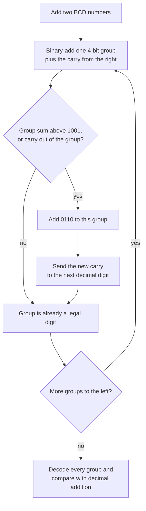

---
tags:
  - ECE2050
  - codes
date: 2026-09-16
aliases:
  - BCD 码
  - 二-十进制编码
  - 8421 码
  - Binary Coded Decimal
  - BCD
---

> [!NOTE] Where this fits · 定位
> 第 8 分区 Codes 的第一篇（讲义 p.64–66）。从这里开始，一串 bit 不再"按位权加起来等于某个数"，
> 而是**一张查表 (lookup table)**：某个 bit 模式代表什么，由编码规则规定。
> 前置：[[Decimal Number System]]（每个十进制数字的含义）、[[Bits and Bytes]]（4 bit = 1 nibble = 16 个模式）。
> 本篇处理的是人机之间那道缝：机器只有二进制，人只信任十进制——BCD 就是把两者缝起来的编码。

> [!SUMMARY] Quick recall · 英文速览
> BCD encodes each decimal digit separately in four bits. Only ten of the sixteen four-bit patterns are valid digits; decimal addition may require a correction of 0110.

## Core Definition · 核心定义

**BCD（Binary Coded Decimal，二-十进制编码）**：把**每一个十进制数字**单独编码成固定的 4 位二进制，
再把各数字的 4 位码**并排 (concatenate)** 起来（讲义 p.65：*Express each of the decimal digits with a binary code.*）。

**8421 码 (8421 code)** 是 BCD 的常用版本，它的 4 位是**有权码 (weighted code)**，位权从左到右为 $8,4,2,1$：

$$
(d)_{10} \;=\; 8b_3+4b_2+2b_1+b_0, \qquad b_i\in\{0,1\}
$$

- 意义：这四位的信息量是 16 个码字，但十进制数字只有 0–9 —— 也就是说 **$1001$ 以上的 6 个码字没有数字可用**。
- 数值校验：$7 = 0111 \Rightarrow 4+2+1 = 7$ ✓；$9 = 1001 \Rightarrow 8+1 = 9$ ✓；
  $8 = 1000 \Rightarrow 8$ ✓。注意 $1101$ 按权值也能算出 $8+4+1=13$，但 **13 不是十进制数字**，
  所以 $1101$ 不是合法 BCD 码。

| 十进制数字 $d$ | 0 | 1 | 2 | 3 | 4 | 5 | 6 | 7 | 8 | 9 |
|---|---|---|---|---|---|---|---|---|---|---|
| BCD (8421) | `0000` | `0001` | `0010` | `0011` | `0100` | `0101` | `0110` | `0111` | `1000` | `1001` |
| 权值求和 | 0 | 1 | 2 | 3 | 4 | 5 | 6 | 7 | 8 | 9 |

16 个 4 位码字里只有 10 个被用到，剩下 6 个是**非法码 (illegal code)**：

| 非法码 | `1010` | `1011` | `1100` | `1101` | `1110` | `1111` |
|---|---|---|---|---|---|---|
| 8421 权值 | 10 | 11 | 12 | 13 | 14 | 15 |

这 6 个码字没有对应的十进制数字（十进制**位**只到 9），也正是后面 BCD 加法要 $+6$ 的**唯一原因**（见推导 3）。

![[bcd-8421-encoding.svg]]
*图 1 — (a) 0–15 全部 16 个 4 位码字：前 10 个（`0000`–`1001`）是合法 BCD 数字，后 6 个（`1010`–`1111`）
是非法码，列头标出各位权值 8/4/2/1。(b) 十进制 → BCD 是**逐位翻译**：$170$ 的 3 个数字变成 3 个 4 位组
`0001 0111 0000`，$2469$ 的 4 个数字变成 4 个 4 位组 `0010 0100 0110 1001`。*

## Assumptions and Validity · 适用前提

> [!IMPORTANT] BCD 是**编码 (code)**，不是**数制 (number system)**
> BCD 借用二进制的 0/1，但整个码串**不是位权数**：`0001 0111 0000` 不能按 $2^i$ 求和当 170 用
> （那样读出来是 368）。BCD 只在**每个 4 位组内部**临时借用 8421 的权值；
> 组与组之间是"十进制数字的并排"，不存在 $16^i$ 的位权关系。这正是 BCD 加法不能照搬
> [[Binary Arithmetic]] 的原因。

- 成立条件 1：对象必须是**十进制语义**的数据 —— 金额、计数器读数、仪表显示、十进制字符串、计算器输入。
- 成立条件 2：位宽按 4 位对齐。$n$ 位十进制数字需要 $4n$ 位：$170$ 是 3 位数字 → 12 位；
  $2469$ 是 4 位数字 → 16 位。不足的高位数字要补 `0000`。
- 代价：码字利用率只有 $10/16 = 62.5\%$，而且 BCD 比纯二进制更长（$170$：12 位 vs 8 位，**1.5 倍**）；
  运算还需要专门的修正电路（推导 3），所以它只用在"十进制显示优先"的场合：金额、计算器、仪表。
- 失效边界：BCD 只编码"数字的写法"，不含符号、不含小数点的位置约定（符号与小数点位置必须另外约定）；
  并且**不能**把 BCD 码串直接丢进二进制加法器当数值相加（见常见误区 3）。

## Derivation · 推导过程

### 1. 十进制 → BCD：逐位翻译，没有除法、没有进位

$$
(d_{n-1}d_{n-2}\dots d_1d_0)_{10} \;\longrightarrow\; \mathrm{BCD}(d_{n-1}) \,\|\, \mathrm{BCD}(d_{n-2}) \,\|\, \dots \,\|\, \mathrm{BCD}(d_0)
$$

- 意义：每个数字独立查上面那张表，**高位数字的 4 位在左边**；翻译过程不影响邻居，也不产生进位。
- 数值校验：$170 \to 1|7|0 \to 0001\,|\,0111\,|\,0000$ = `0001 0111 0000` ✓；
  $2469 \to 2|4|6|9 \to 0010\,|\,0100\,|\,0110\,|\,1001$ = `0010 0100 0110 1001` ✓。
- 与 [[Number Base Conversion]] 的对比：那里要"反复除以 2"或"找最大的 $2^k$"，因为整个数是一个**数值**；
  这里没有数值运算，只有 10 项查表。

### 2. BCD → 十进制：从右往左每 4 位一组（讲义 p.65）

- 从**最右**开始，每 4 位一组（*Starting from the right-most bit and divide the code into groups of four bits*）；
- 每组查 8421 表得到一个 0–9 的数字，按顺序拼起来就是十进制数；
- 若任何一组 `> 1001`，这串码就不是合法 BCD（要么写错，要么数据出错）。
- 数值校验：`0010 0100 0110 1001` → 2、4、6、9 → $2469$ ✓；
  `0001 0111 0000` → 1、7、0 → $170$ ✓。

### 3. 为什么要加 6：6 个被跳过的码字

BCD 数数的方式与二进制不同（以一个 nibble 为单位）：

| 计数 | … | 8 | 9 | 10 | 11 | … |
|---|---|---|---|---|---|---|
| BCD | … | `1000` | `1001` | `0001 0000` | `0001 0001` | … |
| 纯二进制 | … | `1000` | `1001` | `1010` | `1011` | … |

二进制加法器并不知道"BCD 在 `1001` 之后要跳过 6 个码字"：它从 `1001` 加 1 直接得到 `1010` 继续数下去。
于是当一组 nibble 的真值 $s \ge 10$ 时，二进制算出的进位权重是 **16**，而十进制要的进位权重是 **10** ——
两者正好差 6（这 6 就是被跳过的 `1010`…`1111`）。把这个差补上，两边就对齐了：

$$
s + 6 \;=\; 16 + (s-10) \qquad (10 \le s \le 19)
$$

- 意义：$+0110$ 把"非法的 4 位和"变成"**进到下一位十进制数字的 1** + 正确的数字 $s-10$"。
- 数值校验：$s = 13$：$13+6 = 19 = 16+3$ → 进位 1、数字 3，正是 $8+5 = 13$ 的 `0001 0011` ✓；
  $s = 18$：$18+6 = 24 = 16+8$ → 进位 1、数字 8，正是 $9+9 = 18$ 的 `0001 1000` ✓。
- 反过来看更直白：$16-10 = 6$，就是每个 nibble 被跳过的码字个数 ✓。

> [!WARNING] 讲义 p.66 的第 2 条要补一句
> 讲义写 *If a 4-bit sum $\le 9$ → Valid BCD number*，严格说还要**同时看有没有进位出组**：
> 只要这一组产生了进位，即使低 4 位 $\le 1001$ 也必须 $+0110$。
> 反例就是 $9+9$：二进制和 `1 0010` 的低 4 位是 `0010`（看起来合法），
> 但直接读成"1 和 2"得到 12，正确答案是 18 —— 补上 $+0110$ 后 `0010` 变 `1000` ✓。

### 4. 多位 BCD 的进位传播

每一组独立判定、独立修正；某组 $+0110$ 之后新产生的进位，要送到**左边相邻的那一组**
（也就是更高一位的十进制数字）。

数值校验 $27 + 15$：

1. 个位组：`0111 + 0101 = 1100`（$=12 > 9$）→ `1100 + 0110 = 1 0010` → 个位 = 2，进位 = 1；
2. 十位组：`0010 + 0001 + 1(进位) = 0100`（$=4 \le 9$，合法，**不修正**）→ 十位 = 4；
3. 结果 `0100 0010` → 4 和 2 → $42$；而 $27+15 = 42$ ✓。

![[bcd-addition-correction.svg]]
*图 2 — 两列并排的 BCD 加法修正过程。(a) $8+5$：二进制和 `1101` 命中非法码（$13 > 9$），
判定点在这里，加 `0110` 后得到 `1 0011` → `0001 0011` = 13。(b) $9+9$：这一组**有进位出组**，
同样是判定点；低 4 位 `0010` 看着合法，加 `0110` 后才是 `1000` → `0001 1000` = 18。
两例的 $+0110$ 之所以是 **6**，正是因为 BCD 跳过了 6 个码字。*

## Method and Steps · 求解步骤与方法

1. **编码 (decimal → BCD)**：把每一位数字查 8421 表写成 4 位，按顺序并排（高位数字在左）。
2. **验位宽**：$n$ 位数字 → 恰好 $4n$ 位；不足的高位补 `0000`。
3. **BCD 加法（每个 nibble 分别处理）**：
   ① 用二进制法则把两个 nibble（含低组送来的进位）相加；
   ② 判定：组内和 $> 1001$，**或**有进位出组 → 需要修正；两者都不满足则该组已合法；
   ③ 修正：给该组 $+0110$，并把新产生的进位送到左边相邻组；
   ④ 从最低组向最高组依次重复。
4. **解码 (BCD → decimal)**：从右往左每 4 位一组，逐组查表。
5. **收尾校验**：把结果解码回十进制，与十进制加法结果比对；同时确认没有任何一组的码字落在 `1010`–`1111`。

> [!TIP] 心算捷径
> BCD 加法可以先用十进制心算再"翻译"（$8+5=13$ → `0001 0011`），二进制加法器算的才是 $+6$ 那条路。

## Worked Example · 例题

**Example 1 — 把 170 与 2469 编码成 BCD（讲义 p.65）**

题目：写出 $170_{10}$ 与 $2469_{10}$ 的 8421 BCD 码，并说明各占多少位。

解：逐位查表并并排 —— $170$：1, 7, 0 → `0001 0111 0000`（$3\times4 = 12$ 位）；
$2469$：2, 4, 6, 9 → `0010 0100 0110 1001`（$4\times4 = 16$ 位）。

**数值校验 (Numerical check)**：
- 反读：`0001` → 1，`0111` → $4+2+1 = 7$，`0000` → 0，拼起来 $170$ ✓；
  `0010` → 2，`0100` → 4，`0110` → $4+2 = 6$，`1001` → $8+1 = 9$，拼起来 $2469$ ✓。
- 位宽校验：12 位 = 3 个 nibble ✓；16 位 = 4 个 nibble ✓；没有任何一组 > `1001` ✓。
- 与二进制对照：$170_{10} = 1010\,1010_2$（8 位），BCD 要 12 位；
  $2469_{10} = 1001\,1010\,0101_2$（12 位），BCD 要 16 位 —— BCD 更长，这是它的代价 ✓。

**Example 2 — $8+5$ 的 BCD 加法与 $+6$ 修正（讲义 p.66）**

题目：用 BCD 计算 $8+5$。

解：
1. 编码：$8 \to$ `1000`，$5 \to$ `0101`。
2. 按二进制相加：`1000 + 0101 = 1101`（这一步不产生进位）。
3. 判定：$1101 = 13 > 1001$（9），是 6 个非法码之一 → 必须修正。
4. 修正：`1101 + 0110 = 1 0011`（$13 + 6 = 19 = 16+3$）。
5. 分组：新出现的进位 1 是十位数字，`0011` 是个位数字 → 结果 `0001 0011`。

**数值校验 (Numerical check)**：
- 解码结果：`0001 0011` → 1 和 3 → $13$ ✓，与 $8+5 = 13$ 一致 ✓。
- 修正算式：$s+6 = 13+6 = 19 \ge 16$ → 进位 1、数字 $19-16 = 3$ ✓；若不加 6，`1101` 既不是合法 BCD 码也读不出 13 ✓。

**Example 3 — $9+9$：有进位时也要修正（自算，讲义只给了 $8+5$）**

题目：用 BCD 计算 $9+9$，并说明为什么"低 4 位 ≤ 9 就合法"是不完整的。

解：
1. 编码：`1001`、`1001`。
2. 二进制相加：`1001 + 1001 = 1 0010`（这一组**有进位出组**，低 4 位是 `0010`）。
3. 判定：有进位 → 仍然要修正（即使 `0010` 看上去合法）。
4. 修正：`1 0010 + 0110 = 1 1000`（$18+6 = 24 = 16+8$）。
5. 解码：进位 1 = 十位，`1000` = 8 → `0001 1000`。

**数值校验 (Numerical check)**：
- $9+9 = 18$ ✓，而结果 `0001 1000` 解码 = 1、8 = 18 ✓。
- 不做修正会得到 "12"，与真值 18 恰好差 6（每个 nibble 跳过的码字数）✓；低 4 位从 `0010` 到 `1000` 也正好差 $0110$ ✓。

**Example 4 — 合法性判断与多位进位传播**

题目 (a)：下列 4 位码哪些是合法 BCD：`0110`、`1010`、`1001`、`1111`、`0000`？

答：`0110`（6 ✓）、`1001`（9 ✓）、`0000`（0 ✓）合法；`1010`（10）与 `1111`（15）落在 `1010`–`1111` 区间 → 非法。

题目 (b)：用 BCD 计算 $27+15$，写出每一步的判定与进位。

解：
1. 个位组：`0111 + 0101 = 1100` = 12 > 9 → 修正 `1100 + 0110 = 1 0010` → 个位 2、进位 1；
2. 十位组：`0010 + 0001 + 1 = 0100` = 4 ≤ 9 → 合法，不修正 → 十位 4；
3. 结果 `0100 0010`。

**数值校验 (Numerical check)**：`0100 0010` 解码 = 4、2 = 42，而 $27+15 = 42$ ✓；
两组都没有非法码 ✓。若把第一步漏掉的进位丢掉不算，十位会得到 `0011` = 3 → 32 ✗ —— 进位必须传播。

## Pitfalls · 常见误区

> [!WARNING] BCD 的错法几乎都来自"把它当二进制"

1. **把 BCD 码串当二进制读**。错在：`0001 0011` 按位权算是 19，就以为它表示 19。
   正确：它是 BCD 的 13。更隐蔽的例子：`0010 0100 0110 1001` 按二进制是 9321，BCD 却是 2469。
   正确做法：看到"BCD / 8421"就只允许 4 位一组查表。
2. **对合法组也加 6**。错在：把 `+0110` 当成"BCD 加法的一部分"。
   正确：只有和 $> 1001$ 或有进位时才加。反例：`0011 + 0100 = 0111`（合法 7），再 `+0110` 得 `1101` —— 变成非法码。
3. **直接用二进制加法算两个 BCD 数**。错在：把 `0001 0011`（13）和 `0010 0111`（27）按二进制相加，
   得 `0011 1010`，里面出现非法码 `1010`，结果毫无意义（正确答案 `0100 0000` = 40）。
   正确：每个 nibble 单独加，再做 $+6$ 判定与进位传播。
4. **有进位时忘了修正**。错在：照搬"4 位和 ≤ 9 就合法"，于是 $9+9$ 得到 12。
   正确：有进位出组 → 该组仍要 $+0110$（Example 3）。
5. **分组方向错**。错在：BCD → 十进制从左往右分组，把高位补的 `0000` 算进第一组。
   正确：**从最右**开始每 4 位一组（讲义 p.65）。
6. **位宽没按 4 位对齐**。错在：把 170 的 BCD 写成 `1 0111 0000`。
   正确：每个数字占满 4 位（`0001 0111 0000`），不足的高位数字补 `0000`。

> [!TIP] 一句话记住它
> BCD = "每个十进制数字各自翻译成 4 bit"（**查表**）；二进制 = "整个数翻译成 2 的幂之和"（**位权**）。

## BCD validity and decimal carries · BCD 合法性与英文理解

Packed BCD places two decimal digits in one byte, but neither nibble may represent 10–15. A binary sum that produces such a nibble is an intermediate result rather than a valid BCD digit. The correction adds six because a four-bit binary column wraps at sixteen whereas a decimal digit must wrap at ten; the two radices differ by six.

The correction condition uses both the four-bit sum and its carry-out. Checking only whether the low nibble exceeds nine misses sums such as $9+9=18$, whose low nibble is 2 even though a decimal carry is required. The corrected carry must feed the next decimal digit.

**Worked application — multi-digit sum.** 计算 BCD $47+38$：个位 $7+8=15$，二进制中间 nibble `1111` 非法，加 `0110` 得 `1 0101`，个位 5、进到十位 1。十位 $4+3+1=8$，合法不用修正，故 `1000 0101`=85。校验 $47+38=85$；按普通二进制直接加 `0x47+0x38=0x7F`，不能当作合法 BCD。

In English: correction is applied per decimal digit, starting at the least significant digit. A decimal carry is propagated once to the next digit. A legal intermediate nibble with no carry must be left unchanged.

**English exam question:** May the six invalid BCD inputs be treated as don't-cares in a display decoder?

**Answer:** Only when the input specification guarantees that those codes do not occur, or explicitly permits any output for them. If invalid digits must blank the display or signal an error, that behavior is part of the function and cannot be discarded during minimization.

Continue with [[Seven-Segment Display and Code Conversion]], [[Karnaugh Map with Don't Cares]], and [[Cascaded Counters and Digital Clocks]]. For 0–9 counters, define the transition after 9 separately from the arithmetic correction.

## Connections · 相关笔记

- 上游 (upstream)：[[Decimal Number System]] —— BCD 存在的全部理由：让十进制在二进制机器里保持"一位对一位"。
- 上游 (upstream)：[[Bits and Bytes]] —— 1 个十进制数字 = 1 nibble = 4 bit，这是 BCD 的物理基础。
- 平行 (parallel)：[[Number Base Conversion]] —— 数制转换改变的是"数值怎么表示"，BCD 改变的是"每位数字怎么写"；两者最容易混。
- 平行 (parallel)：[[Gray Code]] —— 同样是 4 位码：8421 是**有权码**，格雷码是**非位权码**。
- 下游 (downstream)：[[American Standard Code for Information Interchange]] —— 另一种"把符号映射成 bit"的编码，只是对象换成了字符。
- 补充对照：[[Binary Number System]] —— $13_{10}$ 的二进制是 `1101`，BCD 是 `0001 0011`；同一个值，两种表示。

---
索引：[[ECE2050 Knowledge Tree]] · [[Glossary]]
