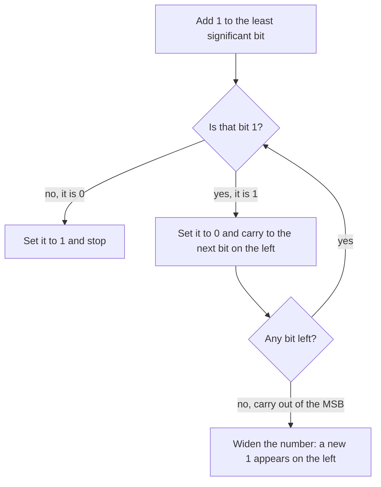

---
tags:
  - ECE2050
  - number-bases
date: 2026-09-16
aliases:
  - 二进制
  - 二进制数制
  - Binary
  - Binary Number System
  - Base-2
---

> [!NOTE] Where this fits · 定位
> 数字系统的**内部语言**：所有位运算、补码、定点/浮点、编码，最终都是对一串二进制位做操作。
> 本篇给出 base-2 的三要素、**必背的 $2^{0}$–$2^{10}$ 幂表**、以及"从 0000 数到 1111"的计数过程；
> 后面 [[Bits and Bytes]] 用它的位权来算容量，[[Binary Arithmetic]] 用它的进位规则来算加乘。
> 前置：[[Number Systems]]（三要素与通式）、[[Decimal Number System]]（人机接口的那一侧）。
> 下游：[[Number Base Conversion]]、[[Bits and Bytes]]、[[Binary Arithmetic]]、
> [[Octal Number System]]、[[Hexadecimal Number System]]。

> [!SUMMARY] Quick recall · 英文速览
> Binary is a base-2 positional system with digits 0 and 1. Each position has weight $2^i$, so a bit string represents the sum of its weighted digits.

## Core Definition · 核心定义

**二进制数制 (binary number system / base-2)** 的三要素（讲义 p.7）：

| 要素 | 取值 |
|---|---|
| 基数 (base) | $R = 2$ |
| 数码 (digit) | $0,\;1$（共 2 个，所以叫 **bit**） |
| 位权 (weight) | $\dots 2^{2},\;2^{1},\;2^{0}\;.\;2^{-1},\;2^{-2},\;2^{-3}\dots$ |

**二进制点 (binary point)** 是整数位与小数位的分界：左边最低位的权是 $2^{0}=1$，
右边最高位的权是 $2^{-1}=0.5$。代入通式 $(N)_R=\sum_i a_iR^{i}$：

$$
(N)_2 \;=\; \sum_{i=-m}^{\,n-1} a_i\,2^{i}
$$

- **意义**：每一位只有"拿"或"不拿"两种选择（$a_i\in\{0,1\}$），所以二进制的展开式天然就是
  "把若干个 $2$ 的幂挑出来相加"。
- **数值校验**（讲义 p.7）：$(10.101)_2 = 1\times2^{1}+0\times2^{0}+1\times2^{-1}+0\times2^{-2}+1\times2^{-3} = 2 + 0 + 0.5 + 0 + 0.125 = 2.625 = (2.625)_{10}$ ✓

**幂表（讲义 p.8，标了 Handy to memorize）**——这张表要能默写：

| $k$ | $2^{k}$ | $k$ | $2^{k}$ |
|---|---|---|---|
| 0 | 1 | 6 | 64 |
| 1 | 2 | 7 | 128 |
| 2 | 4 | 8 | 256 |
| 3 | 8 | 9 | 512 |
| 4 | 16 | 10 | 1024 |
| 5 | 32 | | |

- $2^{0}$–$2^{7}$ 是讲义明确要求背下来的一段；再加 $2^{8}=256$、$2^{9}=512$、$2^{10}=1024$，
  就能覆盖一个字节的全部位权。
- 数值校验：$2^{4}=16$（半个字节的容量）、$2^{8}=256$（一个字节的容量）、$2^{10}=1024\approx10^{3}$
  ——后两个数字正是 [[Bits and Bytes]] 里 byte 与 kilo 的来源 ✓。

![[binary-powers-and-counting.svg]]
*图 1 — (a) $2^{0}$ 到 $2^{10}$ 的位权（对数刻度）与十进制值：柱子每往右一格就翻倍，
$2^{10}=1024$ 用红色标出，它正好是 1 K。(b) 四位二进制的完整计数序列 `0000`–`1111`
（左列 0–7，右列 8–15），每一位下方的红色三角标出"这一步翻的是哪一位"：
`bit 0` 每一步都翻，`bit 1` 每 2 步翻一次，`bit 2` 每 4 步，`bit 3` 每 8 步；
唯一的例外是 `0111 -> 1000`，它一次翻了全部四位——这就是"进位链"的直观样子。*

## Assumptions and Validity · 适用前提

> [!IMPORTANT] 计算机为什么用二进制？（讲义 p.21–22）
> 数字硬件选用二进制的重要原因是：**把连续电压可靠地划成两个逻辑区间，能简化实现并保留噪声余量**：
> ① **二值抽象**：开关通/断、晶体管的开关工作模式用于表示两种逻辑状态；实际晶体管和导线电压仍可连续变化。
>     要造出十个可靠区分的电压档（十进制硬件）成本高得多，而且越靠越近的档位越容易被噪声抹平；
> ② **抗噪声裕度 (noise margin)**：只区分两个状态，可以在两个有效电平区间之间留出判决带；实际门限未必位于电源正中间，
>     电平被干扰上下浮动一点也仍然落回原来的状态；
> ③ **布尔逻辑直接映射**：`0/1` 与真/假一一对应，逻辑门（Ch3）就是对这些位做运算，
>     数的运算与逻辑的运算共用同一套硬件。
> 结论：二进制是**器件与逻辑共同选出来的**，不是数学上的必然（讲义 p.22 只说它是数字系统的选择）。

- **适用条件**：位串必须形如 `0/1`（或 `0b` 前缀），长度固定（位宽 $N$）时才能谈范围 $[0,2^{N}-1]$。
- **失效/代价**：二进制**写起来长**。同一个数，十进制 3 位在二进制里要 10 位
  （$568_{10}=10\,0011\,1000_2$），人眼几乎无法校对。讲义 p.22 给出的补救办法是
  "a more convenient/compact way to represent large binary numbers"——用 base-8 与 base-16 压缩：
  - 八进制：每 **3** 位二进制压成 1 个数字（$2^{3}=8$），如 Linux 文件权限；
  - 十六进制：每 **4** 位压成 1 个数字（$2^{4}=16$），如内存地址。
  见 [[Octal Number System]]、[[Hexadecimal Number System]]。

## Derivation · 推导过程

### 1. 位权阶梯：为什么是"每隔一位翻倍"

$$
\frac{2^{i+1}}{2^{i}} = 2
\qquad\Longrightarrow\qquad
\dots,\;2^{-2}=0.25,\;2^{-1}=0.5,\;2^{0}=1,\;2^{1}=2,\;2^{2}=4,\;2^{3}=8,\dots
$$

- 意义：**相邻位权永远差 2 倍**。所以二进制只有"要"和"不要"两种选择，
  不需要像十进制那样为每一位准备 10 个符号。
- 数值校验：$0.5\times2=1$、$1\times2=2$、$2\times2=4$、$4\times2=8$、$8\times2=16$ ✓（正是表 1 的右列）。

### 2. 逐步展开 $(10.101)_2$（讲义 p.7）

$$
\begin{aligned}
(10.101)_2
&= (1\times2^{1}) + (0\times2^{0}) + (1\times2^{-1}) + (0\times2^{-2}) + (1\times2^{-3})\\
&= (1\times2) + (0\times1) + (1\times0.5) + (0\times0.25) + (1\times0.125)\\
&= 2 + 0 + 0.5 + 0 + 0.125 = (2.625)_{10}
\end{aligned}
$$

- 意义：`10.101` 里两个 `0` 位上**没有贡献**，但位权仍然占着位置——
  二进制点的位置决定了整串数的量级。
- 数值校验：$2+0.5=2.5$，$2.5+0.125=2.625$ ✓；用另一条路核对：
  $(10.101)_2$ 去掉小数点就是 $10101_2=21$，而小数点左移 3 位等价于除以 $2^{3}=8$，
  $21/8=2.625$ ✓（两种算法同值）。

### 3. 加 1 的进位链与各位翻转频率

二进制加 1 的规则只有一条：**从最低位开始，遇到 1 就变 0 并向左进位，遇到 0 就变 1 并停止。**

$$
\dots 0111 + 1 = 1000,\qquad 1011 + 1 = 1100,\qquad 1111 + 1 = 1\,0000
$$

- 意义：`bit 0` 每加一次就翻一次（周期 2），`bit 1` 每 2 次翻一次（周期 4），
  `bit k` 每 $2^{k}$ 次翻一次（周期 $2^{k+1}$）——**低位翻转快，高位翻转慢**（图 1(b) 的红三角）。
- 数值校验：从 `1011`（11）数 5 个数：`1100`(12)、`1101`(13)、`1110`(14)、`1111`(15)、`10000`(16)；
  每一步只在"最低的那个 0"处变 1、它右边的 1 全部变 0，总位数在 `1111 -> 1 0000` 时从 4 位涨到 5 位 ✓
  （Python：`[bin(11+k) for k in range(1,6)]`）。

四位二进制的完整计数表（讲义 p.9 的 Counting in Binary，本库把位串一律补成 4 位便于对齐）：

| 十进制 | 四位二进制 | 十进制 | 四位二进制 |
|---|---|---|---|
| 0 | `0000` | 8 | `1000` |
| 1 | `0001` | 9 | `1001` |
| 2 | `0010` | 10 | `1010` |
| 3 | `0011` | 11 | `1011` |
| 4 | `0100` | 12 | `1100` |
| 5 | `0101` | 13 | `1101` |
| 6 | `0110` | 14 | `1110` |
| 7 | `0111` | 15 | `1111` |

从这张表能直接读出两件事：① **4 位一共 $2^{4}=16$ 个码字**，正好覆盖 $[0,15]$；
② 每一个码字与十进制一一对应，**没有多义、没有重码**（这与后面 [[Sign-Magnitude Representation]]
的 $\pm0$ 形成对照）。

### 4. 二进制太长：八/十六进制为什么能"压缩"

$$
2^{3} = 8,\qquad 2^{4} = 16
$$

- 意义：因为 $8$ 与 $16$ 都是 $2$ 的幂，**每 3 位（或 4 位）二进制恰好对应 1 个八进制（十六进制）数字**，
  分组就是换算，不需要任何除法（讲义 p.19–20，详见 [[Number Base Conversion]]）。
- 数值校验：$568_{10}=10\,0011\,1000_2$（10 位）；按 4 位一组补零得 `0010 0011 1000` →
  $0x238$，只有 3 个十六进制位，长度从 10 个符号降到 3 个 ✓。

## Method and Steps · 求解步骤

1. **确认是二进制**（下标 $_2$ 或前缀 `0b`），并检查每位都是 `0/1`。
2. **以二进制点为界**给位编号：向左 $i=0,1,2,\dots$，向右 $i=-1,-2,\dots$。
3. **列出非零位**：只写 $a_i=1$ 的那些位，它们是 $2$ 的幂（查表 1）。
4. **求和**：从大到小加，先加整数位的幂，再加小数位（$0.5,0.25,0.125,\dots$）。
5. **回代校验**：位数定范围（$n$ 位整数 $<2^{n}$）；或用"去掉二进制点后除以 $2^{m}$"交叉验算。

> [!TIP] 二进制心算的三条捷径
> ① **最高位定范围**：`10011` 的最高位权是 $2^{4}=16$，结果必在 $[16,31]$。
> ② **小数位只看 0.5 / 0.25 / 0.125**：小数部分能凑出的值一定是 $1/8$ 的整数倍
>    （因为最低位权是 $2^{-3}$），所以 $(10.101)_2$ 的小数部分只能是 $0.625$ 这类值。
> ③ **`1111` 认成 $2^{4}-1$**：连续 $k$ 个 1 就是 $2^{k}-1$，`1111 1111` $=255$（一个字节的最大值）。

## Worked Example · 例题

**Example 1 — 二进制转十进制：$(10011)_2$（讲义 p.10）**

题目：把 $(10011)_2$ 转成十进制。

解：
1. 共 5 位，指数从 4 到 0：$1\times2^{4} + 0\times2^{3} + 0\times2^{2} + 1\times2^{1} + 1\times2^{0}$。
2. 展开幂：$1\times16 + 0\times8 + 0\times4 + 1\times2 + 1\times1$。
3. 求和：$16 + 2 + 1 = 19$。

**数值校验 (Numerical check)**：$16+2+1=19$ ✓，与讲义 p.10 的 $1\times16+0\times8+0\times4+1\times2+1\times1=19$
完全相同；范围校验：最高位权 $16 \le 19 \le 31 = 2^{5}-1$ ✓。

**Example 2 — 带小数的转换：$(10.101)_2$（讲义 p.7）**

题目：把 $(10.101)_2$ 转成十进制。

解：
1. 整数部分 `10`：$1\times2 + 0\times1 = 2$。
2. 小数部分 `101`：$1\times0.5 + 0\times0.25 + 1\times0.125 = 0.625$。
3. 合并：$2 + 0.625 = 2.625$。

**数值校验 (Numerical check)**：$0.5+0.125 = 0.625$ ✓；
交叉验算：`10101` $= 21$，$21 \div 2^{3} = 21/8 = 2.625$ ✓；量级校验 $2.625$ 落在 $[2,4)$ ✓。

**Example 3 — 计数：从 $1011_2$ 开始往后数 5 个数**

题目：写出 $1011_2$ 之后的 5 个二进制数（并给出十进制）。

解：
1. $1011 + 1 = 1100$（最低位的 1 变 0、上一位 0 变 1，进位到此为止）。
2. $1100 + 1 = 1101$。
3. $1101 + 1 = 1110$。
4. $1110 + 1 = 1111$。
5. $1111 + 1 = 1\,0000$（进位链穿过全部四位，位宽从 4 位涨到 5 位）。

**数值校验 (Numerical check)**：十进制序列 $11 \to 12,13,14,15,16$ ✓（Python 复核
`bin(11)=0b1011`、`bin(16)=0b10000`）；第 5 步说明**固定位宽下计数会回绕**：
若硬件只有 4 位，$1111+1$ 丢掉最高进位又回到 `0000`——这就是 [[Binary Arithmetic]] 里的溢出。

## Pitfalls · 常见误区

> [!WARNING] 二进制的错误几乎都是"位权数错一位"

1. **把小数位当整数位读**。错在：把 $(10.101)_2$ 算成 $1\times2+0+1\times2+0+1\times4$。
   正确：二进制点右边第一位是 $2^{-1}=0.5$，不是 $2^{1}=2$（自检：小数部分不能大于 1）。
2. **漏掉 0 位导致指数错位**。错在：跳过 `0` 只数 `1`，于是 `10011` 被读成 $2^{2}+2^{1}+2^{0}=7$。
   正确：**指数由位置决定**，必须逐位编号（`10011` 的 `1` 分别在 $i=4,1,0$）。
3. **把 $2^{0}$ 当成 0**。错在：以为 $2^{0}$ 没有值。正确：$2^{0}=1$，它是最低位（LSB）的权。
4. **用十进制长度估二进制长度**。错在：以为 $568$ 只要 3 位二进制。
   正确：$568$ 需要 10 位（$\lceil\log_2 569\rceil = 10$），二进制位数约为十进制位数的 $3.3$ 倍。
5. **忘记二进制点的存在**。错在：把 $(10.101)_2$ 当整数 `10101` 处理。
   正确：点数决定量级；$\pm$ 移动二进制点 $k$ 位等价于乘除 $2^{k}$（Example 2 的交叉验算用的就是这一条）。
6. **数到 `1111` 就以为"到底了"**。错在：忘记位宽是人为约定的。
   正确：4 位只有 $2^{4}=16$ 个码字 $[0,15]$，再数就进位到 5 位；硬件位宽固定时则回绕，见 [[Binary Arithmetic]]。

## Bit patterns in a datapath · 二进制与数据通路

Binary arithmetic relies on positional weights, while digital logic manipulates the same bits as Boolean variables. For example, adding the integers represented by two words is different from applying an OR gate to each pair of corresponding bits. State the intended operation before writing a symbol such as “+”.

A binary word also has an ordering convention. In the notation $b_{N-1}\ldots b_0$, the leftmost bit is the most significant bit (MSB), and the rightmost bit is the least significant bit (LSB). The subscript is a weight index. It does not by itself specify which physical pin, memory address, or serial transmission time carries that bit.

**Worked application — selecting a memory word.** 存储器有 32 个 word，地址需 5 位，因为 $2^5=32$。地址 `10110` 指 word $16+4+2=22$；该地址上的内容可以是 `00011`，表示数据 3。地址 22 与数据 3 是两个不同角色，不要把数据位宽误当成地址位宽。

In English: the address chooses a location; the data word is the information held at that location. A five-bit address can select 32 words regardless of whether each word contains one bit, eight bits, or another specified width.

**English exam question:** Does left shifting a fixed-width binary word always multiply its numeric value by two?

**Answer:** For an unsigned word, a one-bit left shift multiplies the value by two only when the discarded MSB is zero. Otherwise the stored result is $2x\bmod 2^N$, so the true value has overflowed the available width. Signed interpretation adds its own representable-range check.

Continue with [[Shift Registers]] for moving bit patterns and [[Memory Arrays and Expansion]] for addresses. The positional expansion here supplies the numeric interpretation; those notes supply the hardware behavior.

## Connections · 相关笔记

- 上游 (upstream)：[[Number Systems]] —— 三要素与通式 $(N)_R=\sum_i a_iR^{i}$。
- 上游 (upstream)：[[Decimal Number System]] —— 另一侧的语言，"人写十进制、机器存二进制"由此对照。
- 下游 (downstream)：[[Bits and Bytes]] —— $N$ 位的容量 $2^{N}$、范围 $[0,2^{N}-1]$，以及 $2^{10}\approx10^{3}$ 的速记。
- 下游 (downstream)：[[Binary Arithmetic]] —— 本篇的"加 1 进位链"扩展到加、减、乘、除与溢出。
- 下游 (downstream)：[[Number Base Conversion]] —— 二进制 ↔ 十进制 ↔ 八/十六进制的全部算法。
- 平行 (parallel)：[[Octal Number System]]、[[Hexadecimal Number System]] —— 二进制的 3-bit / 4-bit 压缩写法。

---
索引：[[ECE2050 Knowledge Tree]] · [[Glossary]]
