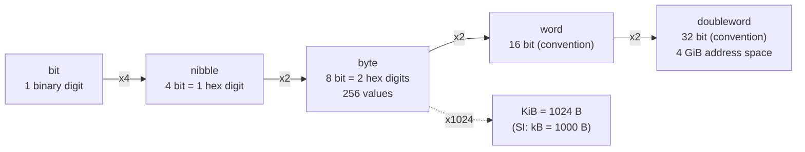

---
tags:
  - ECE2050
  - binary-data
date: 2026-09-16
aliases:
  - 位与字节
  - 比特与字节
  - 位/字节/半字节
  - Bits and Bytes
  - Bit and Byte
---

> [!NOTE] Where this fits · 定位
> 前面几篇讲"怎么写数"，这一篇讲**二进制数据的度量单位**：一位叫 bit，四位叫 nibble，八位叫 byte。
> 它是全章的"尺子"——后面所有位宽、范围、溢出都省略成"$N$ 位"这三个字。
> 前置：[[Binary Number System]]（$2^0$–$2^{10}$ 必背表、counting in binary）、
> [[Number Systems]]（base-$R$ 三要素）。
> 下游：[[Two's Complement Representation]]（同一个 8 位容器换一种解释，范围就从 $[0,255]$ 变成 $[-128,127]$）、
> [[Fixed-Point Numbers]]（同样 $N$ 位，小数点隐含在中间，值域完全不同）。
> 讲义来源：p.13（$N$ 位容量与范围）、p.21–26（为什么用二进制、bit/nibble/byte、大幂次、估算）。

> [!SUMMARY] Quick recall · 英文速览
> A bit has two possible values, while a byte contains eight bits. Distinguish decimal prefixes such as kB from binary prefixes such as KiB when estimating storage and address space.

## Core Definition · 核心定义

| 单位 | 位数 | 码字个数 $2^{N}$ | 无符号范围 | 一个例子 |
|---|---|---|---|---|
| **bit**（位，一个二进制位） | 1 | 2 | $[0,1]$ | `1` |
| **nibble**（半字节） | 4 | 16 | $[0,15]$ | `1010` $=10=A_{16}$ |
| **byte**（字节） | 8 | 256 | $[0,255]$ | `1111 1111` $=255=\text{FF}_{16}$ |
| word（字，约定术语） | 16 | 65 536 | $[0,65\,535]$ | `FFFF` |
| doubleword（双字，约定术语） | 32 | 4 294 967 296 | $[0,4\,294\,967\,295]$ | `FFFF FFFF` |

- **一位二进制位叫 1 bit**；**1 个十六进制数码 = 4 bit = 1 nibble**；**2 个十六进制数码 = 1 byte**
  （讲义 p.24 的三连填空，答案是 1 / 4 / 1 / 1）。
- **MSB（most significant bit）写在最左边，LSB（least significant bit）写在最右边**（p.24）。
  这也决定了整篇的"分组从右往左"惯例（见 [[Number Base Conversion]]）。
- word / halfword / doubleword **不是讲义术语**，是处理器手册里的**约定**：不同架构的 word 宽度不同
  （常见 16 / 32 / 64 位），考试只要求知道"word = 一个机器字"这个含义。

## Assumptions and Validity · 适用前提

> [!IMPORTANT] "$N$ 位有 $2^N$ 个码字"与"范围 $[0,2^N-1]$"是两件事
> ① **容量 $2^N$** 只取决于位数——一个 $N$ 位容器永远能装 $2^N$ 种**不同的位型**，
> 这与你怎么解释这些位型无关；有符号、定点、浮点都共享同一个容量。
> ② **范围**取决于解释方式：无符号是 $[0,2^N-1]$；补码是 $[-2^{N-1},2^{N-1}-1]$
> （见 [[Two's Complement Representation]]）；U4.4 这类定点是 $[0,15.9375]$
> （见 [[Fixed-Point Numbers]]）。**位型容量不变，值域变了。**
> ③ 十进制类比 $10^N$ 只用于理解"容量与范围差一"：$N$ 位十进制能写 $10^N$ 个数，
> 范围 $[0,10^N-1]$——"最大值 = 容量 $-1$"这个 off-by-one 是本节最常见的错。

- 适用范围：这一篇的公式只针对**稠密编码 (dense / positional)** 的二进制。BCD、ASCII、格雷码会
  **浪费码字**（BCD 每个 nibble 只用 10 个码），容量不再等于 $2^N$ 个可用值。
- 失效边界：$\approx10^3$ 只是**数量级**近似；做容量对账（硬盘、内存、带宽）时必须区分
  1024 与 1000，见下文第 ④ 小节。

## Derivation · 推导过程

### ① 为什么是 $2^N$ 个码字：每一位翻一倍

$N$ 位的位型总数 $C(N)$ 满足 $C(N)=2\cdot C(N-1)$（新增的最高位可以取 0 或 1 两种，
其余 $N-1$ 位保持不动），而 $C(1)=2$（`0` / `1`），于是

$$
C(N)=2^{N},
\qquad
\text{range}=[0,\;2^{N}-1]
$$

- 意义：容量按指数增长（**每加一位，容量翻倍、范围上限翻倍再加一**）；范围从 0 开始，
  所以最大值比容量小 1。
- 数值校验（讲义 p.13 的两个例子）：3 位十进制 → $10^3=1000$ 个值、范围 $[0,999]$；
  3 位二进制 → $2^3=8$ 个值、范围 $[0,7]$，即 `000` 到 `111` ✓。
  再验一组：4 位 → $2^4=16$、$[0,15]$；8 位 → $2^8=256$、$[0,255]$ ✓（与下表一致）。

### ② nibble / byte 与十六进制是"同一件事"

因为 $2^4=16$，**4 个二进制位的全部组合正好等于一位十六进制数码的 16 个取值**；
两个 nibble 拼起来就是 1 byte：

$$
1\ \text{hex digit}=4\ \text{bit}=1\ \text{nibble},
\qquad
2\ \text{hex digits}=8\ \text{bit}=1\ \text{byte}
$$

- 意义：十六进制是给人看的二进制缩写；**看到 1 byte 就写 2 位十六进制**是硬件文档的通用写法
  （内存地址、`#RRGGBB` 颜色码、机器码）。
- 数值校验：$1\ \text{byte}=2^8=256$ 个值，写成十六进制正好是 `00`–`FF`：从 `0x00` 数到 `0xFF`
  是 $255-0+1=256$ 个 ✓；`0xFF` $=15\times16+15=255=2^8-1$ ✓（最大值再次比容量小 1）。

### ③ 大幂次的速记：$2^{10}\approx10^{3}$

$$
2^{10}=1024\approx10^{3}
\qquad\Longrightarrow\qquad
2^{10k}\approx10^{3k}
$$

- 意义：把"二进制指数"换算成"十进制数量级"，这是估算一切存储容量的唯一工具
  （讲义 p.25 的 kilo/mega/giga/tera/peta/exa）。

| 名称 (SI 词头) | 幂 | 精确值 | 近似 |
|---|---|---|---|
| kilo | $2^{10}$ | $1\,024$ | $\approx10^{3}$ |
| mega | $2^{20}$ | $1\,048\,576$ | $\approx10^{6}$ |
| giga | $2^{30}$ | $1\,073\,741\,824$ | $\approx10^{9}$ |
| tera | $2^{40}$ | $1\,099\,511\,627\,776$ | $\approx10^{12}$ |
| peta | $2^{50}$ | $1\,125\,899\,906\,842\,624$ | $\approx10^{15}$ |
| exa | $2^{60}$ | $1\,152\,921\,504\,606\,846\,976$ | $\approx10^{18}$ |

- 近似误差可算：$2^{10}/10^{3}=1.024$，所以 $2^{10k}\approx1.024^{k}\times10^{3k}$。
  $k=6$（exa）时 $1.024^{6}=1.1529$，即 $2^{60}$ 比 $10^{18}$ **高 15.3%** ——
  数量级够用，容量对账就会出事。

![[powers-of-two-scale.svg]]
*图 1 — 对数横轴上的 $2^{10}$–$2^{60}$：每个刻度给出幂、SI 词头、精确十进制值与对应的 IEC 前缀；
下方两个红色标记是讲义 p.26 要求"心算"的估算点 $2^{24}\approx16$ M 与 $2^{32}\approx4$ G。
横轴上相邻刻度相差约 3 个数量级，密集的位数在对数尺上其实**很稀疏**——这正是"用指数思考"的原因。*

### ④ IEC 与 SI：1024 与 1000 的制度性分歧

- **SI 词头**（kB、MB、GB、TB）按 1000 进位：$1\ \text{kB}=1000\ \text{B}$；
- **IEC 词头**（KiB、MiB、GiB、TiB）按 1024 进位：$1\ \text{KiB}=1024\ \text{B}=2^{10}\ \text{B}$。
- 后果：标称 $1\ \text{TB}$ 的硬盘有 $10^{12}\ \text{B}=10^{12}/2^{40}=0.9095\ \text{TiB}$，
  在按 1024 计数的系统里显示为 $10^{12}/2^{30}=931.3\ \text{GiB}$ —— 这就是"买来 1 TB 只剩 931 GB"
  的全部原因（**不是厂商偷工减料，是两套词头混用**）。

### ⑤ 两个必背估算点（讲义 p.26）

$$
2^{24}=2^{4}\times2^{20}=16\times1\,048\,576=16\,777\,216\approx16\ \text{M}
$$
$$
2^{32}=2^{2}\times2^{30}=4\times1\,073\,741\,824=4\,294\,967\,296\approx4.29\ \text{G}
$$

- 意义：$2^{24}\approx16$ M 用来估"24 位能寻址多少"（16 MB / 16 M 色）；
  $2^{32}\approx4$ G 用来估 32 位系统：**32 位无符号整数最大 $=2^{32}-1=4\,294\,967\,295$**，
  **32 位地址空间 $=2^{32}$ 字节 $=4$ GiB**。
- 数值校验：$16\times1\,048\,576=16\,777\,216$ ✓（$\approx16.78$ M）；
  $4\times1\,073\,741\,824=4\,294\,967\,296$ ✓（$\approx4.29$ G）；
  $4\,294\,967\,296-1=4\,294\,967\,295$ ✓（最大值 = 容量 $-1$，又一次 off-by-one）。

## Method and Steps · 求解步骤与方法

1. **先问三件事**：位数 $N$ 是多少？有没有符号？是不是稠密编码？（三个问题的答案决定后面所有公式）
2. **算容量**：$2^{N}$ 个码字（无符号、稠密编码时）。
3. **算范围**：无符号 $[0,2^{N}-1]$；有符号补码改用 $[-2^{N-1},2^{N-1}-1]$。
4. **估数量级**：用 $2^{10k}\approx10^{3k}$ 心算（$2^{24}\approx16$ M、$2^{32}\approx4$ G），
   但**写边界值时必须用精确值**。
5. **核对**：目标数是否 $\le$ 最大值？计数个数是否等于容量？
   （例：16 位计数器能数 $2^{16}=65\,536$ 个状态，但最后一个数是 $65\,535$。）

## Worked Example · 例题

**Example 1 — 讲义 p.24 的填空三连**

题目：byte 是几位？能表示多少个值？范围是多少？nibble 呢？一个二进制位叫什么？
一个十六进制数码等于几个 bit、几个 nibble？两个十六进制数码等于几个 byte？

解：
1. **byte = 8 bit** → $2^{8}=256$ 个值 → 范围 $[0,255]$（写成十六进制 `00`–`FF`）。
2. **nibble = 4 bit** → $2^{4}=16$ 个值 → 范围 $[0,15]$（正好一位十六进制数码）。
3. **一位二进制位 = 1 bit**；**一位十六进制数码 = 4 bit = 1 nibble**；**两位十六进制数码 = 1 byte**。

**数值校验 (Numerical check)**：$2^{4}=16$ ✓、$2^{8}=256$ ✓；最大值 $255=2^{8}-1$ ✓；
`0xFF` 展开 $=1111\,1111_2=128+64+32+16+8+4+2+1=255$ ✓；4 bit 与 1 位 hex 位数匹配 ✓。

**Example 2 — 估算 $2^{24}$ 与 $2^{32}$（讲义 p.26）**

题目：不查表，说出 $2^{24}$ 与 $2^{32}$ 各约等于多少；32 位无符号整数能表示到多大？
32 位地址空间有多大？

解：
1. $2^{24}=2^{4}\times2^{20}\approx16\times10^{6}=16$ M，精确值 $16\,777\,216$。
2. $2^{32}=2^{2}\times2^{30}\approx4\times10^{9}=4$ G，精确值 $4\,294\,967\,296$。
3. 32 位无符号整数范围 $[0,\,4\,294\,967\,295]$（最大 $=2^{32}-1$）。
4. 32 位地址空间 $=2^{32}$ 字节 $=4\,294\,967\,296\ \text{B}=4$ GiB。

**数值校验 (Numerical check)**：$2^{30}\times4=1\,073\,741\,824\times4=4\,294\,967\,296$ ✓；
$4\,294\,967\,296/2^{30}=4$ GiB ✓；估算值 16 M / 4 G 与精确值同数量级（误差 $<10\%$）✓。

**Example 3 — 一个 16 位计数器能数到多少？**

题目：一个 16 位无符号计数器从 0 开始每来一个时钟加 1。它能表示多少个不同的数？
溢出前最后一个数是什么？再加 1 会怎样？

解：
1. 容量 $2^{16}=65\,536$ 个状态，范围 $[0,\,65\,535]$。
2. 最后一个数 $=65\,535=$ `1111 1111 1111 1111` $=$ `FFFF`$_{16}$。
3. 再加 1 得到 `1 0000 0000 0000 0000`，第 17 位放不进 16 位寄存器 → 低 16 位全 0，
   计数器回绕到 **0**（这就是溢出 / overflow）。

**数值校验 (Numerical check)**：$2^{16}=65\,536$ ✓；$65\,535=65\,536-1$ ✓；
`FFFF`$_{16}=15\times4096+15\times256+15\times16+15=61\,440+3840+240+15=65\,535$ ✓；
回绕等价于 $\bmod 2^{16}$：$65\,536 \bmod 65\,536=0$ ✓。

## Pitfalls · 常见误区

> [!WARNING] 这一节的错几乎都是"差一"和"两套前缀"造成的

1. **把容量当最大值**。错在：说"8 位能表示 256"然后就写范围 $[0,256]$。
   正确：容量 $2^{N}=256$、范围 $[0,2^{N}-1]=[0,255]$，最大值永远比容量小 1。
2. **把 kB 当 1024 B**。错在：用 SI 词头做 1024 进位的计算（或反过来）。
   正确：kB $=1000$ B、KiB $=1024$ B；$1\ \text{TB}=10^{12}\ \text{B}=931.3\ \text{GiB}=0.9095\ \text{TiB}$。
3. **MSB / LSB 左右写反**。错在：把最低位画在最左边，于是分组、移位、符号位全部错位。
   正确：**MSB 在左、LSB 在右**，分组永远从右往左（见 [[Number Base Conversion]]）。
4. **以为"容量"随解释方式改变**。错在：认为补码 8 位比无符号 8 位"能装的数更少"。
   正确：位型容量都是 $2^{8}=256$ 种，变的只是**值域**（$[0,255]$ vs $[-128,127]$），
   见 [[Two's Complement Representation]]。
5. **用 $2^{10}\approx10^{3}$ 做精确对账**。错在：把 1 MB 当成 $10^{6}$ B 去算文件数。
   正确：估算可以，落到字节数必须用 $1\,048\,576$；$k$ 越大误差越大（exa 处已 15.3%）。
6. **把 word 当固定宽度**。错在：说"word 一定是 16 位"。
   正确：word 是**架构约定**（讲义未定义），考试若出现会明确给出宽度；bit / nibble / byte 才是固定定义。

## Width, capacity, and addressing · 位宽、容量与寻址

The expression $2^N$ counts patterns, not automatically numbers, bytes, or addresses. Its meaning depends on what the $N$ bits represent. An $N$-bit unsigned word contains $2^N$ possible values. An $N$-bit address selects $2^N$ locations. If each location contains $W$ bits, total capacity is $2^N W$ bits.

“Byte-addressable” means that consecutive addresses refer to consecutive bytes. “Word-addressable” means that an address selects a whole word. Never infer one from the other merely because the data bus has eight or sixteen wires. Capacity notation should identify both the number of words and the bits per word.

**Worked application — memory size.** 一个 $256\times16$ memory 有 256 个 word，每个 16 bit。地址线需 8 根，数据线需 16 根，容量 $256\times16=4096$ bit=$512$ byte。若改成 $512\times8$，总容量相同，但地址变为 9 位、数据为 8 位。相同总容量不意味着相同接口。

In English: depth determines the address width, and word width determines the data interface. The first device has 256 addressable words; calling it “512 addresses” would confuse byte capacity with word count.

**English exam question:** How many bits are needed to encode twenty distinct states?

**Answer:** At least five bits, because four bits provide only 16 codes whereas five provide 32. Twelve of those codes are unused under a compact binary encoding. They still exist physically and require a stated policy if recovery matters.

This counting argument leads directly to [[Memory Arrays and Expansion]], [[State Encoding and Unused States]], and [[Counters]]. It is also the first width check to make in [[Structural Shift Register Project]].

## Connections · 相关笔记

- 上游 (upstream)：[[Binary Number System]] —— $2^0$–$2^{10}$ 的幂表与"counting in binary"是本节的地基。
- 上游 (upstream)：[[Number Systems]] —— bit 是 base-2 的数码，容量公式只是位权制的组合计数。
- 平行 (parallel)：[[Octal Number System]]、[[Hexadecimal Number System]] —— 分别把二进制压成 3 bit / 4 bit 一组，
  与 nibble（4 bit）天然对齐。
- 下游 (downstream)：[[Two's Complement Representation]] —— 同一个 8 位容器，换一种解释就得到有符号范围。
- 下游 (downstream)：[[Fixed-Point Numbers]] —— 位宽固定后把小数点隐含在中间，$N$ 位整数变成小数。
- 平行 (parallel)：[[Binary Arithmetic]] —— 容量决定"结果放不放得下"，是溢出判断的前提。

---
索引：[[ECE2050 Knowledge Tree]] · [[Glossary]]
