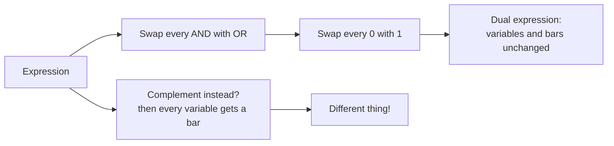

---
tags:
  - ECE2050
  - boolean-algebra
date: 2026-09-16
aliases:
  - 布尔公理
  - 布尔代数公理
  - Boolean Axioms
  - Axioms of Boolean Algebra
---

> [!NOTE] Where this fits · 定位
> 第 4 章第三篇（讲义 p.16–17）。前面把电路写成了方程，这一篇给出**改方程的全部合法动作**的源头 —— 五条公理。
> 公理本身不证自明，它们的作用是"生出"后面所有的定理与规则（第 4-04 的 12 条规则、第 4-06 的 DeMorgan 定理都从这五条来）。
> 前置：[[Boolean Equation]]（方程与三种基本运算）。
> 下游：[[Laws and Rules of Boolean Algebra]]、[[Proof by Perfect Induction]]、[[DeMorgan's Theorems]]。

> [!SUMMARY] Quick recall · 英文速览
> Boolean algebra works with the values 0 and 1 and the operations AND, OR, and NOT. Its axioms and their dual forms justify the identities used in logic design.

## Core Definition · 核心定义

**布尔代数 (Boolean algebra)**：一套公理 (axioms) 与由公理导出的定理 (theorems)，用来**化简布尔方程**（讲义 p.16：
*Axioms and theorems to simplify Boolean equations*）。

它"像普通代数，但更简单"（讲义 p.16）：变量只有 $1$ 或 $0$ **两个取值**，所以任何方程都能用真值表穷举检查。

**对偶性 (duality)**：把一个式子里的

- $\cdot$（AND）$\leftrightarrow$ $+$（OR），
- $0 \leftrightarrow 1$，

**同时**互换，得到的式子叫原式的**对偶式 (dual)**。变量本身、变量上的横线、括号结构都**不动**（讲义 p.16–17）。

### 公理 A1–A5 及其对偶式（讲义 p.17 原表）

| 编号     | 公理 (axiom)          | 对偶式 (dual)       | 名称 (name)    | 为什么成立                                                                         |
| ------ | ------------------- | ---------------- | ------------ | ----------------------------------------------------------------------------- |
| **A1** | $B=0$ if $B\ne1$    | $B=1$ if $B\ne0$ | Binary Field | 一个 bit 只有两个可能取值：不是 1 就是 0，反之亦然。"$=0$" 与 "$\ne1$" 是同一件事的两种说法                   |
| **A2** | $0'=1$              | $1'=0$           | NOT          | 取反 (complement) 的定义就是"把值翻过来"，所以 0 的补是 1、1 的补是 0                               |
| **A3** | $0\cdot0=0$         | $1+1=1$          | AND/OR       | AND 要"全 1 才出 1"，两个 0 相乘当然是 0；它的对偶是 OR："有 1 就出 1"，所以 $1+1=1$ —— **布尔加法不是算术加法** |
| **A4** | $1\cdot1=1$         | $0+0=0$          | AND/OR       | 两个条件都成立，AND 就成立；对偶地，两个条件都不成立，OR 就不成立                                          |
| **A5** | $0\cdot1=1\cdot0=0$ | $1+0=0+1=1$      | AND/OR       | 一条 1、一条 0：AND 得到 0、OR 得到 1（这就是异或/同或里"因为有一个 0 所以 AND 归零"的根据）                   |

- **记号的读法**：$B'$ 与 $\bar B$ 都表示取反（讲义 p.17 用 $0'=1$ 的撇号写法，正文用上横线 $\bar 0=1$，两者等价）。
- **对偶式的写法只有两步**：① 每个 $\cdot$ 改写成 $+$、每个 $+$ 改写成 $\cdot$；② 每个 $0$ 改写成 $1$、每个 $1$ 改写成 $0$。
  变量字母与横线**一个都不动**。

> [!IMPORTANT] 公理是"出发点"，不是"结论"
> A1–A5 不被证明，它们是对这个二值世界的基本约定；所有定理（包括第 4-04 的 12 条规则、第 4-06 的 DeMorgan）
> 都是用它们一步步推出来的。因此**只要改写步骤能对应到公理（或已证的定理），改写就是合法的**。
> 另一个推论是对偶原理 (principle of duality)：公理成对出现（A1–A5 的左列与右列互为对偶），
> 所以任何由公理推出的等式，它的对偶式也能用同一套推导得到 —— 这就是后面"每条规则都有对偶式"的原因。

## Assumptions and Validity · 适用前提

- 成立条件 1：对象是**二值变量**（$0/1$）。公理 A1 保证了"值域只有两个元素"，A2–A5 保证了这两种值上的运算完全确定。
- 成立条件 2：运算就是 AND / OR / NOT 三种，符号 $\cdot$、$+$、上横线只是它们的记号。
- 成立条件 3：对偶操作只对**等式**使用（等式两边同时取对偶，等号仍成立）。
- 失效边界：把这些式子当**算术**用就会出错（$1+1=2$、$A+A=2A$ 都错）；
  另外"对偶"不等于"取反"（见例题 4 与误区 1）。

## Derivation · 推导过程

### 1. 为什么只有五条就够

A1 把变量锁进 $\{0,1\}$ 两个值里；A2 定义了一元运算 NOT；A3–A5 用**真值组合**（$00,11,01$）把二元运算 AND/OR 在
所有输入上钉死。三个符号 $\cdot$、$+$、$'$ 在全部输入组合上的行为都有了规定 —— 于是布尔代数**没有任何自由度**，
任何式子的值都可以推算出来，也都可以用真值表穷举验证（这就是 perfect induction 能当证明用的原因）。

### 2. 对偶是"机械替换"，为什么这样换不会出错

观察 p.17 的表：每一行的左右两列互为对偶，而且**两列都是公理**。例如 A3 的左列 $0\cdot0=0$ 与右列 $1+1=1$：
把左列的 $\cdot$ 换成 $+$、$0$ 换成 $1$，正好得到右列。既然公理本身关于对偶对称，
那么用公理做的每一次替换，它的"镜像替换"也同样是公理 —— 整个推导链都可以镜像过来，结论（等式）自然也对偶成立。

### 3. 从公理到定理：对偶把定理配对

第 4-04 的 12 条规则也是成对的，配对方式与公理一模一样：

| 规则 | 对偶规则 |
|---|---|
| Rule 7：$A+\bar A=1$ | Rule 8：$A\bar A=0$ |
| Rule 1：$A+0=A$ | Rule 2：$A\cdot1=A$ |
| Rule 10：$A+AB=A$ | 吸收律：$A(A+B)=A$ |
| Rule 12：$(A+B)(A+C)=A+BC$ | 分配律：$A(B+C)=AB+AC$ |

- 意义：**只需要记住一半**，另一半用对偶机械得到。
- 数值校验：Rule 7 在 $A=0,1$ 两行分别给出 $0+\bar0=0+1=1$ ✓、$1+\bar1=1+0=1$ ✓；
  它的对偶 Rule 8 在同样两行给出 $0\cdot\bar0=0\cdot1=0$ ✓、$1\cdot\bar1=1\cdot0=0$ ✓ —— 两条都恒成立。

## Method and Steps · 求解步骤与方法

1. **找运算符**：把式子里所有的 $\cdot$ 与 $+$ 圈出来（相邻变量之间省略的乘号也算 $\cdot$，如 $AB=A\cdot B$）。
2. **逐个互换**：$\cdot\to+$，$+\to\cdot$。**括号结构保持不变**，因为优先级顺序不变（NOT > AND > OR）。
3. **互换常量**：式子里的 $0\to1$、$1\to0$。
4. **变量不动**：字母、字母上的横线、下标一律照抄 —— 这一步最容易错。
5. **检查对称性**：把对偶式再取一次对偶，应当回到原式（对偶是对合操作）。
6. **验证**：对 $n$ 个变量枚举 $2^n$ 行，确认原式与对偶式**各自**恒为真（它们是两个不同的等式，不是同一个式子）。

## Worked Example · 例题

**Example 1 — 写出 A1–A5 的对偶式（讲义 p.17）**

题目：逐条给出 A1–A5 的对偶。

解（把 $\cdot\leftrightarrow+$、$0\leftrightarrow1$ 机械替换）：

| 公理 | 对偶式 |
|---|---|
| A1：$B=0$ if $B\ne1$ | $B=1$ if $B\ne0$ |
| A2：$0'=1$ | $1'=0$ |
| A3：$0\cdot0=0$ | $1+1=1$ |
| A4：$1\cdot1=1$ | $0+0=0$ |
| A5：$0\cdot1=1\cdot0=0$ | $1+0=0+1=1$ |

**数值校验 (Numerical check)**：对只有一个变量 $B$ 的情况枚举 $B=0,1$：
A1 左列在 $B=0$ 时给出 $0=0$ ✓、$B=1$ 时前提 $B\ne1$ 不成立（不作断言）✓；
A3 左列 $0\cdot0=0$ 与右列 $1+1=1$ 都是常量等式 ✓；A5 的 $0\cdot1=1\cdot0=0$ 两边相等 ✓。
Python 逐行枚举确认：**A3–A5 及其对偶式在全部 2 行上恒真**。

**Example 2 — 自检题：随手写一条的对偶**

题目 (a)：写出 $A+\bar B C=1$ 的对偶式。
题目 (b)：写出 $(A+B)(\bar A+C)$ 的对偶式。

解：

(a) $\cdot\to+$（$\bar BC$ 里的省略乘号是 $\cdot$）、$+\to\cdot$、$1\to0$：

$$
A+\bar BC=1 \quad\Longrightarrow\quad A(\bar B+C)=0
$$

(b) 只有运算符要换，变量与横线照抄：

$$
(A+B)(\bar A+C) \quad\Longrightarrow\quad AB+\bar A C
$$

**数值校验 (Numerical check)**：
(a) 先看原式 $A+\bar BC=1$：$A=1$ 时 $1+\bar BC=1$ ✓ 成立；$A=0,B=1,C=0$ 时 $0+\bar1\cdot0=0\ne1$ ✗ 不成立。
再看对偶式 $A(\bar B+C)=0$：$A=0$ 时 $0\cdot(\dots)=0$ ✓ 成立；$A=1,B=0,C=0$ 时 $1\cdot(1+0)=1\ne0$ ✗ 不成立。
两式**互为对偶但都不是恒等式** —— 对偶原理保证的是："原式若对**所有**输入成立，则对偶式也对所有输入成立"，
而这里原式本来就不是恒等式（第 4-04 的 12 条规则才是恒等式）。
(b) 枚举 4 行可见两式**不是同一个式子**：$A=1,B=0,C=1$ 时 $(A+B)(\bar A+C)=(1+0)(0+1)=1$，
而对偶式 $AB+\bar AC=1\cdot0+0\cdot1=0$ ✓（值不同）；再把对偶式取一次对偶：
$AB+\bar AC\to(A+B)(\bar A+C)$ ✓ 回到原式，验证了对合性。

**Example 3 — 用对偶把 Rule 7 变成 Rule 8**

题目：已知 $A+\bar A=1$ 恒成立，不另做真值表，直接写出并验证它的对偶式。

解：对偶式 $=A\cdot\bar A=0$（把 $+$ 换成 $\cdot$、$1$ 换成 $0$，变量与横线不动）。

**数值校验 (Numerical check)**：

| $A$ | $\bar A$ | $A+\bar A$ | $A\bar A$ |
|---|---|---|---|
| 0 | 1 | 1 ✓ | 0 ✓ |
| 1 | 0 | 1 ✓ | 0 ✓ |

两行都对：$A+\bar A=1$ 与其对偶 $A\bar A=0$ 同时成立 ✓。这正是第 4-04 里 Rule 7 与 Rule 8 的配对。

**Example 4 — 对偶 ≠ 取反（辨析，自算）**

题目：$F=A+0$ 的对偶式与反函数分别是什么？

解：对偶式 $F^{D}=A\cdot1=A$（只换运算符与常量，变量不动）；
反函数 $\bar F=\overline{A+0}=\bar A\cdot\bar 0=\bar A\cdot1=\bar A$（把整个式子取反，变量要变）。

**数值校验 (Numerical check)**：

| $A$ | $F=A+0$ | $F^{D}=A\cdot1$ | $\bar F$ |
|---|---|---|---|
| 0 | 0 | 0 | 1 |
| 1 | 1 | 1 | 0 |

两行都有 $F^{D}\ne\bar F$ ✓：**对偶式与反函数是两个不同的东西**。前者是"另一条同类等式"（这里恰好与原式相等，
因为 $A+0=A$ 本身是恒等式），后者是"同一个函数的补"。
把 $F^{D}=A$ 误当成 $\bar F$ 会在下一步化简时把整个函数取反，结果全错。

## Pitfalls · 常见误区

> [!WARNING] 对偶最容易被当成"取反"

1. **把对偶式当反函数**。错在：写对偶时顺手给变量加了横线，或把对偶式当成 $\bar F$。
   正确：对偶只换 $\cdot\leftrightarrow+$ 与 $0\leftrightarrow1$，**变量一个都不动**（Example 4：$A+0$ 的对偶是 $A\cdot1=A$，反函数是 $\bar A$）。
2. **只换运算符、忘了换常量**。错在：把 $A+1=1$ 的对偶写成 $A\cdot1=1$。
   正确：$1$ 也要换成 $0$：$A+1=1$ 的对偶是 $A\cdot0=0$；漏换常量会得到一条**假**命题。
3. **把 $1+1=1$ 当算术**。错在：认为布尔加法与十进制加法一样。
   正确：$+$ 是 OR（A3 的对偶），$1+1=1$；布尔代数里 $A+A=A$ 而不是 $2A$。
4. **想"证明"A1–A5**。错在：拿真值表或别的规则去证公理。
   正确：公理是出发点，只需承认；要证的是由它们导出的定理与规则（方法见 [[Proof by Perfect Induction]]）。
5. **对偶用在不等式/局部子式上**。错在：只对式子的一半取对偶，或对"某一行"取对偶。
   正确：对偶是对**整个等式**两边同时做的操作，且两边都要做。

## Duality and logical meaning · 对偶与逻辑含义

Boolean variables take values zero and one. AND and OR are logical operations, so ordinary numerical cancellation and division are generally unavailable. For example, A+A=A is valid Boolean idempotence; it does not imply A=0 by subtracting A as though the plus sign denoted real addition.

Duality exchanges AND with OR and zero with one while preserving the variables and their complements. Complementing a complete expression is a different operation: DeMorgan's law also complements the operands. Keeping these transformations separate prevents a common exam error.

**Worked application.** 恒等式 $A+0=A$ 的对偶是 $A\cdot1=A$，不是 $\bar A+1=\bar A$。后一式在 A=1 时左侧为1、右侧为0，立即失败。若对原等式两边取补，则应得 $\overline{A+0}=\bar A$，并经 DeMorgan 化为 $\bar A\cdot1=\bar A$。

**English exam question:** Can a useful Boolean rewrite be accepted because it works for one input pattern?

**Answer:** One passing row is an example, not a proof. Derive the rewrite from valid axioms and laws, or check every input combination with [[Proof by Perfect Induction]]. These identities become hardware transformations in [[Universal Gates and Bubble Pushing]].

## Connections · 相关笔记

- 上游 (upstream)：[[Boolean Equation]] —— 公理操作的对象（用输入表达输出的方程）。
- 平行 (parallel)：[[Combinational Circuit]] —— 电路侧的合法性由三条构成规则管，式子侧的合法性由这五条公理管。
- 下游 (downstream)：[[Laws and Rules of Boolean Algebra]] —— 交换/结合/分配律与 12 条规则，全部由 A1–A5 推出，并且成对出现。
- 下游 (downstream)：[[Proof by Perfect Induction]] —— 公理 A1 锁死了值域，才有"枚举 $2^n$ 行即可证明"这件事。
- 下游 (downstream)：[[DeMorgan's Theorems]] —— 两条 DeMorgan 定理也是公理的推论，且互为对偶。
- 补充对照：[[Binary Number System]] —— 变量只有 0/1，正是二进制数字的取值集合。

---
索引：[[ECE2050 Knowledge Tree]] · [[Glossary]]
