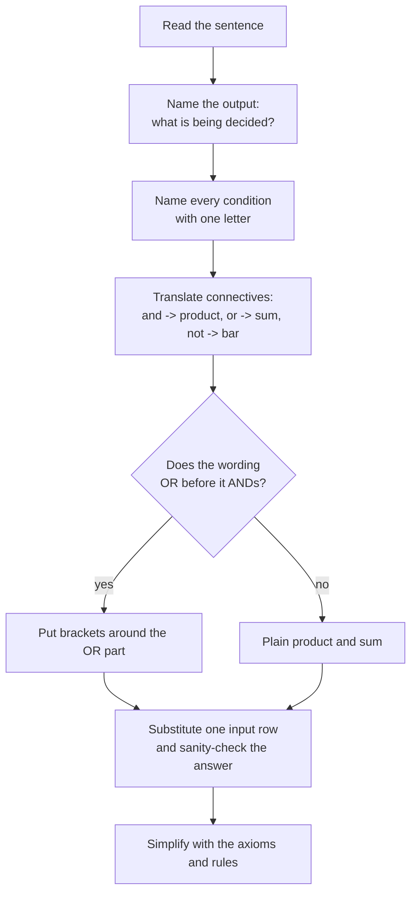

---
tags:
  - ECE2050
  - boolean-algebra
date: 2026-09-16
aliases:
  - 布尔方程
  - 布尔表达式
  - Boolean Equation
  - Boolean Expression
---

> [!NOTE] Where this fits · 定位
> 第 4 章第二篇（讲义 p.8–14）。上一篇回答"电路怎么接才合法"，这一篇回答"接好之后，输出怎么写成式子和输入挂钩"。
> 写出来的式子就是**功能规范 (functional specification)**，接下来第 4-03 起的公理与定理才有东西可以操作。
> 前置：[[Combinational Circuit]]（节点与构成规则）、[[Logic Gates]]（AND/OR/NOT 的行为）。
> 下游：[[Boolean Axioms]]、[[Laws and Rules of Boolean Algebra]]（对写出来的式子做运算与化简）。

> [!SUMMARY] Quick recall · 英文速览
> A Boolean equation specifies an output as a function of its inputs. Translate a verbal requirement into logic operators before choosing gates or simplifying the circuit.

## Core Definition · 核心定义

**布尔方程 (Boolean equation)**：用**输入**表达**输出**的式子，也就是电路的功能规范（讲义 p.9：
*Functional specification of outputs in terms of inputs*）。例如讲义 p.9 的加法器：

$$
S=F(A,B,C_{in}),\qquad C_{out}=G(A,B,C_{in})
$$

**三种基本运算与文字条件的对应**（这是把一段话变成方程的全部词典）：

| 语言里的说法 | 布尔运算 | 记号 | 数学类比 |
|---|---|---|---|
| "...并且..." / "...而且..." (and) | AND | $A\cdot B=AB$ | 乘法 |
| "...或者..." (or) | OR | $A+B$ | 加法 |
| "...不..." / "没有..." (not) | NOT | $\bar A$ | 取反（取补 complement） |

- **优先级 (precedence)**：$\overline{\ \cdot\ }$（NOT）$>$ AND $>$ OR。所以 $M+CT\bar X$ 读作 $M+(C\cdot T\cdot\bar X)$。
  括号只用来**改写**这个默认顺序，不能省掉需要改变意思的括号。
- **变量是一个命题 (proposition)**：$H=1$ 表示"有帽子"这件事为真，$H=0$ 表示为假；方程描述的是"输出什么时候为 1"。

> [!IMPORTANT] 布尔加法不是算术加法
> $1+1=1$：两个条件都成立时，"或者"的结果仍然只是"成立"。
> 布尔代数里的 $+$ 是**逻辑或 (OR)**，不是算术加；布尔代数的 $\cdot$ 是**逻辑与 (AND)**，恰好与算术乘法的 0/1 表一致。
> 这也是后面 Rule 5（$A+A=A$）与 Rule 3（$A+1=1$）成立的原因：讲义 p.18 把这两件事分别叫
> **Boolean addition**（等价于 OR）与 **Boolean multiplication**（等价于 AND）。

## Assumptions and Validity · 适用前提

- 成立条件 1：每个变量只取 $0/1$ 两个值，而且**只在这两个值上有定义**（讲义 p.16）。
  所以式子里不会出现 $2A$ 这种系数 —— $A+A$ 只能是 $A$，不是 $2A$。
- 成立条件 2：每个变量对应一个**二值命题**。如果条件本身是"多值"的（比如"温度 25 °C"），必须先编码成若干位，
  每一位再当变量用（见 [[Binary Number System]]）。
- 成立条件 3：方程默认是**组合**的 —— 右边只含当前输入，不含自己（不能写 $Y=Y+C$，那是上一篇 Example 3 的回路）。
- 失效边界：布尔方程只描述"输出什么时候是 1"，不描述延迟、驱动能力、竞争冒险；
  这些属于时序规范（讲义 p.4），要另外给。

## Derivation · 推导过程

### 1. 讲义 p.9：全加器的两个方程，逐项读

$$
S=A\oplus B\oplus C_{in},\qquad C_{out}=AB+AC_{in}+BC_{in}
$$

- $S$（sum 位）：三个输入**异或**。$A\oplus B\oplus C_{in}=1$ 当且仅当 $A,B,C_{in}$ 中**有奇数个 1**
  （1 个或 3 个）。这正是"三个 1 bit 相加后，留在本位的和"。
- $C_{out}$（carry 位）：三个**两两乘积**再 OR。三项分别代表：
  - $AB=1$ —— $A$ 和 $B$ 都是 1（这两个相加就已经满了）；
  - $AC_{in}=1$ —— $A$ 和进位输入都是 1；
  - $BC_{in}=1$ —— $B$ 和进位输入都是 1。
  三项合起来的意思就是"**至少两个输入是 1**"，也就是"三个 bit 相加达到 2 或 3，要向下一位进 1"。
- 两项的分工：$S$ 数的是**奇偶**（1 的个数模 2），$C_{out}$ 数的是**有没有到 2**。两者拼起来就是完整的加法结果
  $A+B+C_{in}=2C_{out}+S$。

### 2. 从一段文字到方程的四个动作

1. **先定输出**：这段话在问哪件事？（"能不能去公园" → $P$）
2. **把每个前提起一个字母**：Raining → $R$，Sandwiches → $S$，Hat → $H$……
3. **按连接词翻译**：and → 相乘，or → 相加，"not/没有" → 加横线。注意"but not" 也是 and-not。
4. **用优先级和括号还原语序**：先 AND 后 OR；如果原句的意思是先 OR，就必须加括号。

### 3. 讲义 p.10–14 的五个例子

| 讲义页 | 文字条件 | 布尔方程 | 备注 |
|---|---|---|---|
| p.10 | 不下雨 **并且** 有三明治 ($S$) 才去公园 ($P$) | $P=\bar R S$ | 抽取文本横线丢失；按句子语义（$R=1$ 表示下雨）取 $\bar R$，见下方 WARNING |
| p.11 | 给你一百万 ($M$) **或** 一个小记事本 ($N$)，你就是赢家 ($W$) | $W=M+N$ | 只要有一个为 1 就出 1 |
| p.12 | 自己做饭 ($M$)，**或** 有私人厨师 ($C$) **并且** 他/她有天赋 ($T$) **并且** 不贵 ($\bar X$) | $E=M+CT\bar X$ | AND 先算，所以 $M+(CT\bar X)$；括号不能写成 $(M+C)T\bar X$ |
| p.13 | 有帽子 ($H$) **并且** 穿鞋 ($S$)，**或者** 有帽子 ($H$) | $E=HS+H$ | 用 Rule 10 得 $E=H$：有帽子就能进，鞋是废话 |
| p.14 | 有帽子**并且**穿鞋，**或者** 有帽子**并且**没穿鞋 | $E=HS+H\bar S$ | 用分配律 + Rule 7 得 $E=H$：与 p.13 殊途同归 |

最后两例的意义：**两段听起来不同的规则写成了不同的式子，化简后却是同一个 $H$** —— 这就是第 4 章后面要干的事，
化简规则见 [[Laws and Rules of Boolean Algebra]]。

> [!WARNING] 讲义抽取文本里的横线会丢，横线位置以句子语义为准
> 纯文本抽取会把公式的上横线丢掉：p.10 只剩下 `P = RS`，p.14 只剩下 `E = HS + HS`（实际是 $HS+H\bar S$），
> p.12 的 `E = M + CTX` 也丢掉了 $\bar X$。本篇按**句子语义**还原：$R=1$ 表示"在下雨"，
> "不下雨"就是 $\bar R$，所以 $P=\bar R S$。
> 如果老师把变量 $R$ 定义成"不下雨"这件事本身，同一个方程就写成 $P=RS$ ——
> **横线的位置取决于变量怎么定义**，这正是下面误区 5 要强调的：动手前先声明"1 代表什么"。
		
## Method and Steps · 求解步骤与方法

1. **点名输出**：给每件"要判断的事"一个字母，写在等号左边。
2. **点名输入**：给每个条件一个字母，并在纸上注明 $1$ 代表什么（$R=1$ = 下雨）。
3. **逐句翻译**：遇到 and 就写乘积、遇到 or 就写和、"没有/不"就加横线；**but not** 译成 and-not。
4. **套优先级**：默认 NOT > AND > OR；原句语序不同就补括号。
5. **检查每一行**：随便挑一组输入代进去，看方程给出的答案是否与常识一致（见例题的数值校验）。
6. **能化简就化简**：把式子交给公理与规则（[[Laws and Rules of Boolean Algebra]]、[[Proof by Perfect Induction]]）。

## Worked Example · 例题

**Example 1 — 讲义 p.9 的全加器方程逐行核对**

题目：验证 $S=A\oplus B\oplus C_{in}$ 与 $C_{out}=AB+AC_{in}+BC_{in}$ 真的是"三个 1 bit 相加"。

解：把三个输入相加得到十进制和 $A+B+C_{in}\in\{0,1,2,3\}$，它应当等于 $2C_{out}+S$。

**数值校验 (Numerical check)**（8 行全部枚举）：

| $A$ | $B$ | $C_{in}$ | $AB$ | $AC_{in}$ | $BC_{in}$ | $C_{out}$ | $S$ | $A+B+C_{in}$ | $2C_{out}+S$ |
|---|---|---|---|---|---|---|---|---|---|
| 0 | 0 | 0 | 0 | 0 | 0 | 0 | 0 | 0 | 0 ✓ |
| 0 | 0 | 1 | 0 | 0 | 0 | 0 | 1 | 1 | 1 ✓ |
| 0 | 1 | 0 | 0 | 0 | 0 | 0 | 1 | 1 | 1 ✓ |
| 0 | 1 | 1 | 0 | 0 | **1** | 1 | 0 | 2 | 2 ✓ |
| 1 | 0 | 0 | 0 | 0 | 0 | 0 | 1 | 1 | 1 ✓ |
| 1 | 0 | 1 | 0 | **1** | 0 | 1 | 0 | 2 | 2 ✓ |
| 1 | 1 | 0 | **1** | 0 | 0 | 1 | 0 | 2 | 2 ✓ |
| 1 | 1 | 1 | **1** | **1** | **1** | 1 | 1 | 3 | 3 ✓ |

8 行全部满足；$C_{out}$ 恰好是"A 与 B 中至少两个为 1"的 8 行真值，$S$ 恰好是"1 的个数为奇数"。

**Example 2 — 五个文字例子写成方程（讲义 p.10–14）**

题目：写出 $P$（去公园）、$W$（赢家）、$E$（吃美食）、$E$（进楼，两版）的方程。

解：按上表 ——

$$
P=\bar R S,\qquad W=M+N,\qquad E=M+CT\bar X,\qquad E=HS+H,\qquad E=HS+H\bar S
$$

**数值校验 (Numerical check)**：
- $P=\bar RS$：下雨天（$R=1$）→ $\bar R=0$ → $P=0$，无论有没有三明治 ✓；不下雨且有三明治 → $1\cdot1=1$ ✓。
- $W=M+N$：$M=0,N=0$ → $W=0$（两样都没给）✓；$M=0,N=1$ → $W=1$ ✓。
- $E=M+CT\bar X$：取 $M=0,C=1,T=1,X=0$（不做饭、厨师有天赋且不贵）→ $E=0+(1\cdot1\cdot1)=1$ ✓；
  改成 $X=1$（太贵）→ $E=0+(1\cdot1\cdot0)=0$ ✓ —— 横线 $\bar X$ 一票否决整条厨师分支。
- 括号的数值意义：若把 p.12 写成 $(M+C)T\bar X$，取 $M=1,C=0,T=0,X=0$ 得 $0$，
  而正确写法 $M+CT\bar X$ 得 $1$（自己做饭当然能吃上）；两种括号在 16 行里有 **6 行**结果不同 ✓。

**Example 3 — p.13 与 p.14 的例子其实是同一个方程**

题目：证明 $E=HS+H$ 与 $E=HS+H\bar S$ 都等于 $H$。

解：

$$
\begin{aligned}
E&=HS+H=H(1+S)=H\cdot 1=H &&\text{(分配律 + Rule 3 + Rule 2)}\\
E&=HS+H\bar S=H(S+\bar S)=H\cdot 1=H &&\text{(分配律 + Rule 7 + Rule 2)}
\end{aligned}
$$

**数值校验 (Numerical check)**（4 行全枚举）：

| $H$ | $S$ | $HS$ | $H\bar S$ | $HS+H$ | $HS+H\bar S$ | $H$ |
|---|---|---|---|---|---|---|
| 0 | 0 | 0 | 0 | 0 | 0 | 0 ✓ |
| 0 | 1 | 0 | 0 | 0 | 0 | 0 ✓ |
| 1 | 0 | 0 | 1 | 1 | 1 | 1 ✓ |
| 1 | 1 | 1 | 0 | 1 | 1 | 1 ✓ |

两列 $HS+H$ 与 $HS+H\bar S$ 都与 $H$ 逐行相同 —— "戴帽子就能进"这句话里**鞋子完全不影响结果**。

**Example 4 — 自己写一个（自算）**

题目：晚上复习 ($R$)，如果你有咖啡 ($C$) 并且没有停电 ($\bar P$)，或者你有同桌的笔记 ($N$)，就能坚持复习。
写出方程并判断 $C=1,P=1,N=0$ 时的结果。
解：$R=C\bar P+N$。代入：$C\bar P=1\cdot0=0$，$N=0$ → $R=0$：停电了又没有笔记，咖啡救不了 ✓。

## Pitfalls · 常见误区

> [!WARNING] 布尔方程的三个经典错法

1. **把 $+$ 当算术加法**。错在：把 $A+A$ 写成 $2A$，把 $1+1$ 写成 $2$。
   正确：$A+A=A$（Rule 5），$1+1=1$（Rule 3 的对偶形式）；布尔代数里没有系数。
2. **丢掉括号，改变语序**。错在：把 $M+CT\bar X$ 写成 $(M+C)T\bar X$。
   正确：AND 先于 OR，原句里 and 组包住的条件必须是一个乘积项（这里两种写法 16 行里有 6 行不同）。
3. **忘记"反变量"对应"条件不成立"**。错在：看到 "but not expensive" 就丢掉 $X$，或把 $\bar X$ 写成 $X$。
   正确：先把"贵"设成一个变量 $X$，"不贵"就是 $\bar X$；一条反变量能让整个乘积项归零（Example 2）。
4. **把方程当成"输入等于输出"的方程去解**。错在：把 $Y=AB+C$ 看成可以解出 $A$ 的普通方程组。
   正确：它是**功能表**的紧凑写法，要"解"就用真值表逐行枚举（见 [[Proof by Perfect Induction]]）。
5. **变量含义不写清就动手**。错在：$R=1$ 到底是"下雨"还是"不下雨"没注明，最后式子整体取反。
   正确：先在纸上写"$R=1$ 表示下雨"，再翻译（讲义 p.10 的 $P=\bar RS$ 就是靠这一步才对）。

## Specification before implementation · 方程先描述需求

A Boolean equation states what the output must mean. It does not uniquely determine a gate topology. The same equation can be implemented with basic gates, NAND-only gates, a multiplexer, a decoder, or a lookup table. Keep the specification independent of the chosen implementation so there is an external reference for verification.

Declare the input meanings and polarity before writing algebra. If L=1 means “level is low”, a positive L term expresses an asserted low-level event even though the physical sensor could use a LOW voltage. An electrical LOW, a Boolean zero, and a deasserted alarm need not have the same meaning.

**Worked application.** 许可条件 E、故障 F、按钮 P：只在 E=1,F=0,P=1 时启动，故 $RUN=E\bar FP$。若故障输入针脚 FAULT_N=0 表示故障，则“无故障”为 FAULT_N=1，方程变为 $RUN=E\,FAULT\_N\,P$；不是把字母名字中的 N 当作另一次代数取反。

**English exam question:** Why should the variable order be declared for a minterm list?

**Answer:** The order defines each input's binary weight and therefore the row index. A correct truth condition can receive a different minterm number after the variables are reordered. Use [[Truth Table and Boolean Expression]], then compare implementation choices in [[Decoder]] and [[Multiplexer and Demultiplexer]].

## Connections · 相关笔记

- 上游 (upstream)：[[Combinational Circuit]] —— 方程要有意义，电路必须先是合法的组合电路。
- 上游 (upstream)：[[Logic Gates]] —— $+$、$\cdot$、上横线这三种运算对应的门。
- 平行 (parallel)：[[Truth Table and Boolean Expression]] —— 同一份功能规范的两种写法：表格与方程；本篇走"文字 → 方程"。
- 下游 (downstream)：[[Boolean Axioms]] —— 方程写出来以后，靠公理知道哪些改写是合法的。
- 下游 (downstream)：[[Laws and Rules of Boolean Algebra]] —— p.13/p.14 的例子最后都要用 Rule 10 收尾。
- 补充对照：[[Bits and Bytes]] —— 一个布尔变量 = 1 bit，$n$ 个输入就有 $2^n$ 行真值表。

---
索引：[[ECE2050 Knowledge Tree]] · [[Glossary]]
