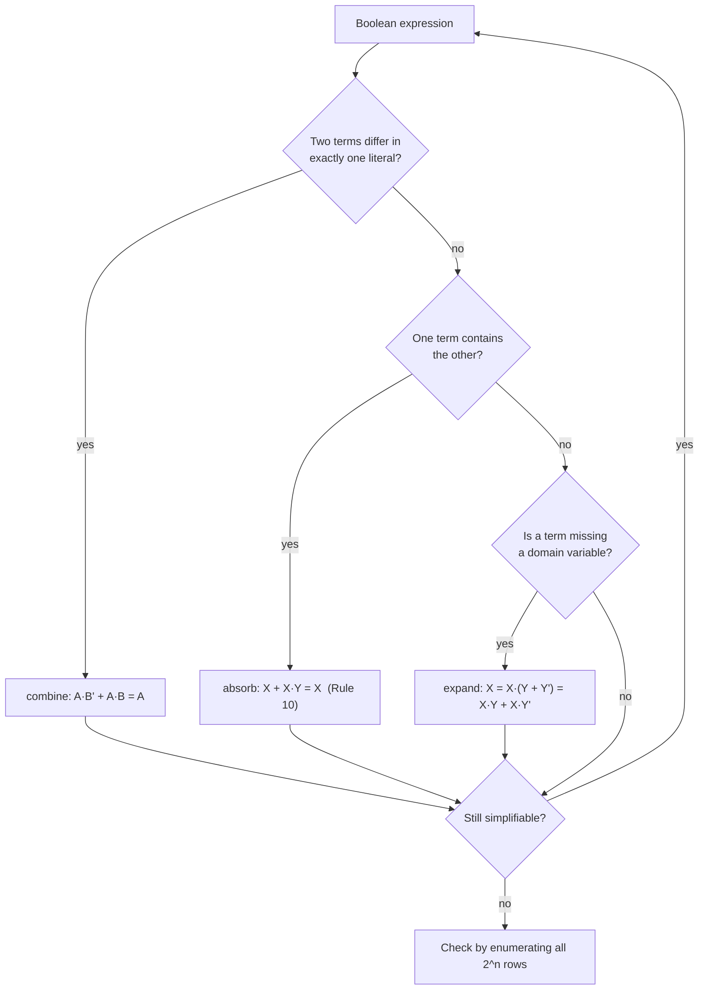

---
tags:
  - ECE2050
  - boolean-algebra
date: 2026-09-16
aliases:
  - 布尔代数化简
  - 逻辑表达式化简
  - Boolean Expression Simplification
  - Logic Simplification
---

> [!NOTE] Where this fits · 定位
> 第 4 章"化简"专题的第一篇（讲义 p.30–33）。前面几篇把工具备齐了：[[Boolean Axioms]] 给公理，
> [[Laws and Rules of Boolean Algebra]] 给 12 条规则，[[Proof by Perfect Induction]] 给"怎么证明"，
> [[DeMorgan's Theorems]] 给取反。这一篇开始**用它们把一个表达式越写越短**。
> 前置：[[Boolean Equation]]（方程 = 用输入表达输出的功能规范）、[[Laws and Rules of Boolean Algebra]]。
> 后续：[[Karnaugh Map]] 把同一件事变成"画格子圈一圈"，而手工化简的每一步正是它的判据来源。

> [!SUMMARY] Quick recall · 英文速览
> Simplification replaces a Boolean expression with an equivalent form that is easier to implement. Each algebraic step must preserve the truth table and cite a valid identity.

## Core Definition · 核心定义

**布尔表达式化简 (Boolean expression simplification)**：用公理、定律与规则对一个表达式做**等价变形**，
在不改变真值表的前提下，让式子里出现的 literal 更少、乘积项更少、嵌套更浅。

- 等价 (equivalent) 的判据：两个表达式在**所有**输入组合下取值相同 —— 这正是
  [[Proof by Perfect Induction]] 的"穷举证明"。本篇每一次化简都用它复核。
- 化简的目标是**最小 SOP / 最小 POS**（见 [[Sum-of-Products Form]]、[[Product-of-Sums Form]]）：项数最少、每项 literal 最少。手工化简只保证"变小"，不保证"最小"；卡诺图才保证最小。
- 衡量"变小"的三个指标：

$$
\text{literal 数} \downarrow,\qquad \text{乘积项数} \downarrow,\qquad \text{嵌套深度} \downarrow
$$

- 意义：literal 数直接对应**门的输入个数**，项数对应**门的总数**。门少了 → 面积小、功耗低、
  信号要穿过的级数少 → 延迟小。这是化简在工程上的全部价值。
- 数值校验：$Y=\bar AB+AB$ 有 4 个 literal、2 个乘积项；化简成 $B$ 只剩 1 个 literal。
  枚举 4 行 $(A,B)=(0,0),(0,1),(1,0),(1,1)$：原式A $=0,1,0,1$，$B=0,1,0,1$，**完全一致** ✓。

> [!IMPORTANT] 写法规范：每一步右边写出所用的规则（讲义 p.32）
> 讲义 p.32 的 Example 3 是最标准的样例：左边一行表达式，右边标注 `distributive law`、
> `Rule 5`、`Rule 7`、`Rule 10`、`Rule 10`。考试与作业里**必须**保持这个格式，原因有三：
> ① 老师/助教能逐步核对，不会因为一次跳三步而判错；② 自己写错时能立刻定位是哪一步；
> ③ 期末题常直接问"某一步用了哪条规则"。
> 规则编号沿用讲义 p.19 的 Floyd 编号：Rule 5 $=A+A=A$，Rule 6 $=A\cdot A=A$，
> Rule 7 $=A+\bar A=1$，Rule 10 $=A+AB=A$，Rule 11 $=A+\bar AB=A+B$，Rule 12 $=(A+B)(A+C)=A+BC$。

## Assumptions and Validity · 适用前提

> [!IMPORTANT] 化简只能"改写"，不能"改值"
> 每一步必须由公理、定律或已证规则推出，**不允许**凭直觉删项、合并项。
> 判断一次变形是否合法，最低成本的办法就是抽几行输入代进去试；要严格证明就枚举 $2^n$ 行。

- 成立条件：表达式里只有 AND、OR、NOT 三种运算（XOR/XNOR 要先展开成 SOP 再化简）。
- 变量个数决定"穷举"的可行性：3 变量 8 行、4 变量 16 行，还能手算；
  8 变量 256 行就不现实了 —— 此时改用代数推导（讲义 p.20 的两种证明方法之分）。
- 失效边界：化简**不改变**函数的真值表，因此也**不能**用它来"修 bug"。
  如果真值表本身就写错了，化简只会把一个错的式子写得更漂亮。
- 与卡诺图的分工（链 [[Karnaugh Map]]）：手工化简靠"看得出公共因子"，需要经验；
  卡诺图靠"圈相邻的 1"，是**系统性**方法，能保证最小。讲义把两者放在同一章，
  顺序正是"先手算体会规则，再学系统方法"。

## Derivation · 推导过程

### 1. 化简的三个"动作"

所有化简步骤，本质只有三个动作（讲义 p.31–33 的四个例子全部由它们组成）：

| 动作 | 用到的规则 | 典型形态 | 一句话 |
|---|---|---|---|
| **合并 (combine)** | Rule 5 $A+A=A$、Rule 7 $A+\bar A=1$ | $A\bar B+AB=A(\bar B+B)=A$ | 两项只差一个变量的正反 → 该变量消去 |
| **吸收 (absorb)** | Rule 10 $A+AB=A$、Rule 11 $A+\bar AB=A+B$ | $BC+BCD=BC(1+D)=BC$ | 一项"包含"另一项 → 短的那项赢 |
| **展开/补项 (expand)** | 分配律、Rule 7、Rule 12 | $CD=CD(B+\bar B)$ | 缺变量时乘上 $(X+\bar X)=1$ 造出新项 |

- 意义：看到式子先问"哪里只差一个变量的正反"（合并）、"哪一项是另一项的真子集"（吸收）、
  "哪一项缺变量"（补项），三步之内基本能下手。
- 数值校验（吸收）：$BC+BCD$ 在 8 行上的取值分别是 $0,0,0,0,0,0,1,1$（按 $BCD$ 从 `000` 到 `111`），
  $BC$ 同样是 $0,0,0,0,0,0,1,1$ —— 完全一致 ✓，所以 $BC+BCD=BC$ 合法。

### 2. 为什么补一项不改变函数：$X=X\cdot 1=X(Y+\bar Y)$

$$
X = X\cdot 1 = X(Y+\bar Y) = XY + X\bar Y
$$

- 意义：把一个乘积项**复制**成两项，是化简里唯一"越写越长"的动作，但它是后面合并/吸收的燃料。
  讲义四个例子里有两个（Example 1、Example 4）都靠它。
- 数值校验：$CD$ 在 $(B,C,D)=(0,1,1)$ 时 $=1$；$CD(B+\bar B)=1\cdot(0+1)=1$ ✓；
  在 $(1,1,1)$ 时 $CD=1$，$CD(B+\bar B)=1\cdot(1+0)=1$ ✓ —— 两行都相等，其它行两边同为 0 ✓。

## Method and Steps · 求解步骤与方法

1. **看清定义域 (domain)**：列出全部输入变量（例 4 的 domain 是 $\{B,C,D\}$）。
2. **展开括号**：用分配律把所有乘积展开成 SOP（除非式子里明显有可提取的公因子）。
3. **合并**：找"只差一个变量正反"的两项，提公因子后用 Rule 7 / Rule 5 消去该变量。
4. **吸收**：找"包含关系"的项，用 Rule 10 / Rule 11 直接删掉长项。
5. **必要时补项**：缺变量的项乘 $(X+\bar X)$，制造可合并/可吸收的伙伴。
6. **每步右侧写规则**（写法规范），最后**穷举 $2^n$ 行核对**化简前后是否完全一致。

> [!TIP] 排错顺序
> 化简卡住时，先检查是不是"漏了一个可以配对的项"（补项），再检查是不是"某两项其实是
> $A+\bar AB$ 的形状"（Rule 11）。这两个动作能解决讲义几乎所有习题。

## Worked Example · 例题

**Example 1 — 讲义 p.31 Example 1：复制一项造出两对**

题目：化简 $Y = A\bar BC + ABC + \bar ABC$。

解：

| 步骤  | 表达式                                     | 用到的规则                                |
| --- | --------------------------------------- | ------------------------------------ |
| 1   | $Y = A\bar BC + ABC + \bar ABC$         | 原式                                   |
| 2   | $= A\bar BC + ABC + ABC + \bar ABC$     | $X = X + X$（Rule 5 的反用，复制 $ABC$）     |
| 3   | $= (A\bar BC + ABC) + (ABC + \bar ABC)$ | 结合律，分成两对                             |
| 4   | $= AC(\bar B + B) + BC(A + \bar A)$     | 分配律（各提公因子）                           |
| 5   | $= AC\cdot 1 + BC\cdot 1$               | Rule 7：$B+\bar B = 1$、$A+\bar A = 1$ |
| 6   | $= AC + BC$                             | Rule 2：$X\cdot 1 = X$                |

**数值校验 (Numerical check)**：按 $(A,B,C)$ 从 `000` 到 `111` 枚举 8 行：
原式 $= 0,0,0,1,0,1,0,1$；结果 $AC+BC = 0,0,0,1,0,1,0,1$ —— **8 行完全一致** ✓。
第 4 步的两对分别是：$A\bar BC+ABC$ 只在 $A=1,C=1$ 时为 1（$B$ 无关）→ $AC$；
$ABC+\bar ABC$ 只在 $B=1,C=1$ 时为 1（$A$ 无关）→ $BC$ ✓。

**Example 2 — 讲义 p.31 Example 2：提公因子后 Rule 7**

题目：化简 $Y = \bar AB + AB$。

解：

$$
Y = (\bar A + A)B = 1\cdot B = B
$$

- 第 1 步是分配律的反用（提公因子 $B$）：$\bar AB + AB = (\bar A + A)B$，
- 第 2 步用 Rule 7（$A+\bar A = 1$），第 3 步用 Rule 2（$X\cdot 1 = X$）。

**数值校验 (Numerical check)**：4 行 $(A,B) = (0,0),(0,1),(1,0),(1,1)$：
原式 $= 0,1,0,1$；$B = 0,1,0,1$ —— **4 行完全一致** ✓。

> [!WARNING] 别把这一例记成 $A\bar B + \bar AB$
> $A\bar B + \bar AB$ 是**异或**（XOR），它**不能**化简成 $B$：
> 枚举 4 行得 $0,1,1,0$，而 $B = 0,1,0,1$，第 3 行 $(1,0)$ 就分道扬镳 ✗。
> 讲义 p.31 的 Example 2 是 $\bar AB + AB$（两项都含 $B$、只差 $A$ 的正反），才能提出公因子 $B$。

**Example 3 — 讲义 p.32 Example 3：完整照抄讲义的标注**

题目：化简 $Y = AB + A(B+C) + B(B+C)$。

解（右侧文字就是讲义上标注的规则）：

| 步骤 | 表达式 | 用到的规则 |
|---|---|---|
| 1 | $Y = AB + A(B+C) + B(B+C)$ | 原式 |
| 2 | $= AB + AB + AC + BB + BC$ | distributive law |
| 3 | $= AB + AC + B + BC$ | Rule 5（$AB+AB=AB$）、Rule 6（$BB=B$） |
| 4 | $= AB + AC + B$ | Rule 10（$B+BC=B$） |
| 5 | $= AC + B$ | Rule 10（$B+AB=B$） |

**数值校验 (Numerical check)**：8 行枚举，原式 $= 0,0,1,1,0,1,1,1$；
$AC + B = 0,0,1,1,0,1,1,1$ —— **完全一致** ✓。
第 3 行 $(0,1,0)$ 是关键行：原式 $AB=0$、$A(B+C)=0$、$B(B+C)=1$，得 1；
$AC+B = 0+1 = 1$ ✓。

> [!WARNING] 讲义 p.32 的规则编号有一处笔误
> 讲义把 $BB=B$ 这一步标成 `Rule 7`；按讲义 p.19 的规则表，$A\cdot A=A$ 是 **Rule 6**，
> Rule 7 是 $A+\bar A=1$（本例里没有出现正反相加）。写作业时按 Rule 6 标注。

**Example 4 — 讲义 p.33 Example 4：补项 $CD(B+\bar B)$ 后再吸收**

题目：化简 $Y = BC + \bar BD + CD$。

解：

| 步骤 | 表达式 | 用到的规则 |
|---|---|---|
| 1 | $Y = BC + \bar BD + CD$ | 原式（domain = $\{B,C,D\}$） |
| 2 | $= BC + \bar BD + CD(B + \bar B)$ | Rule 7（$B+\bar B=1$），$CD\cdot 1 = CD$ |
| 3 | $= BC + \bar BD + BCD + \bar BCD$ | 分配律展开补出来的那一项 |
| 4 | $= BC + BCD + \bar BD + \bar BCD$ | 交换律 + 结合律，排成两对 |
| 5 | $= BC(1 + D) + \bar BD(1 + C)$ | 分配律（各自提公因子） |
| 6 | $= BC + \bar BD$ | Rule 10：$X+XY=X$，用了两次 |

![[simplification-example4.svg]]
*图 1 — 讲义 p.33 例④ 的分步推导：第 2 步把 $CD$ 乘上 $(B+\bar B)=1$ 补成两项，
第 5 步提出公因子后，第 6 步用 Rule 10 把 $BCD$ 与 $\bar BCD$ 各吸收掉一次，
结果 $BC+\bar BD$ 与原式在全部 8 行上取值相同。*

**数值校验 (Numerical check)**：按 $(B,C,D)$ 枚举 8 行，
$BC+\bar BD+CD = 0,1,0,1,0,0,1,1$；$BC+\bar BD = 0,1,0,1,0,0,1,1$ —— **完全一致** ✓。
特别核对 $(B,C,D)=(0,1,1)$：原式 $=0+0+1=1$，结果 $=0+1=1$ ✓ —— 被吸收的正是 $CD$ 这一项。

> [!WARNING] 中间项的横线不能丢
> 若把题目写成 $BC+BD+CD$，那么 $(B,C,D)=(0,1,1)$ 时原式 $=1$ 而 $BC+BD=0$ ✗，
> "化简"立刻不成立。$CD$ 之所以多余，是因为它被 $\bar BD$ 在 $B=0$ 时、被 $BC$ 在 $B=1$ 时
> 分别覆盖 —— 这个论证依赖 $\bar B$。

## Pitfalls · 常见误区

> [!WARNING] 五点高频错误

1. **跳步不写规则**。错在：一步把 5 个变形合并成一行。正确：像讲义 p.32 那样一行一个动作，
   右侧标规则；跳步既容易算错，也没法拿过程分。
2. **把 $A\bar B+\bar AB$ 当成 $B$**。错在：以为"两项相加能把变量消掉"。
   正确：只有**只差一个变量正反**的两项才能消去那个变量；$A\bar B+\bar AB$ 差的是两个变量（$A$ 与 $B$ 都反了），
   它是 XOR，不能化简（枚举 4 行可验：$0,1,1,0 \ne 0,1,0,1$）。
3. **补项后忘了展开就"直接相加"**。错在：把 $CD(B+\bar B)$ 一直留着不展开，导致项数没降。
   正确：补项的下一步一定是**分配律展开**，然后重新配对。
4. **用 Rule 10 时忽略了条件**。错在：见到 $A+B$ 也想"吸收"。
   正确：Rule 10 是 $X+XY=X$ —— 必须一项**完整包含**另一项（$BC$ 包含 $BCD$ 是因为 $BCD=BC\cdot D$）；
   $A+AB$ 能吸收，$A+B$ 不能。
5. **靠"看起来更短"判断对错**。错在：随手删掉"觉得多余"的项。
   正确：每次变形后用 $2^n$ 行穷举核对（3 变量 8 行，手算 1 分钟），
   或至少抽两行"边界行"（全 0 行、全 1 行、以及被删项为 1 的那一行）代进去。
6. **化简到一半就停**。错在：还剩 $AB+AC+B$ 就交卷。正确：再问一遍"有没有包含关系"，
   这一步还能用 Rule 10 变成 $AC+B$ —— 讲义 Example 3 的最后两行就是示范。

## Preserve behavior, then evaluate cost · 先等价，再比较代价

Simplification must preserve every specified output row. Annotate intermediate steps with the identity used, especially when absorbing a term or removing a complement. A shorter expression that silently changes one legal input combination is an incorrect design, regardless of how many gates it saves.

Specify the cost metric. Literal count, number of gates, maximum fan-in, logic depth, and path delay are related but not identical. A two-level expression requiring an unavailable six-input gate may need decomposition and additional delay. Complement availability also changes the inverter count.

**Worked application.** $Y=AB+A\bar B+\bar AC$，前两项为 $A(B+\bar B)=A$；再 $A+\bar AC=A+C$。如果只能使用二输入 NOR，先产生 $n=\overline{A+C}$，再用 tied-input NOR 反相得到 Y，共两门。该实现没有说物理 delay 为零。

**English exam question:** What evidence should accompany a claimed minimum circuit?

**Answer:** State the permitted gates, available complements, and optimization metric, then show that the function is preserved on the required rows. A Boolean minimum alone is not a timing proof. Compare [[Combinational Logic Design]], [[Universal Gates and Bubble Pushing]], and [[Propagation Delay and Logic Hazards]].

## Connections · 相关笔记

- 上游 (upstream)：[[Laws and Rules of Boolean Algebra]] —— 12 条规则是每一步的"依据清单"，
  本篇的 Rule 5/6/7/10 全部来自它。
- 上游 (upstream)：[[Boolean Axioms]] —— 更底层的 A1–A5 与对偶性；分配律、交换律、结合律都从这里来。
- 上游 (upstream)：[[Proof by Perfect Induction]] —— 化简的合法性判据：两个式子等价 $\iff$ 所有行取值相同。
- 平行 (parallel)：[[DeMorgan's Theorems]] —— 化简时若遇到"整条横线压在一堆变量上"，先拆横线再化简。
- 下游 (downstream)：[[Karnaugh Map]] —— 同一目标（最小 SOP/POS）的系统化方法：画格子、圈相邻的 1。
- 下游 (downstream)：[[Sum-of-Products Form]]、[[Product-of-Sums Form]] —— 化简的**标准终点形状**，
  也是"标准式 → 真值表"两个方向的接口。
- 平行 (parallel)：[[Boolean Equation]] —— 它的第 5 个例子（$E=HS+H\bar S$）第一次出现"提公因子"，
  正是本篇 Example 2 的雏形。

---
索引：[[ECE2050 Knowledge Tree]] · [[Glossary]]
