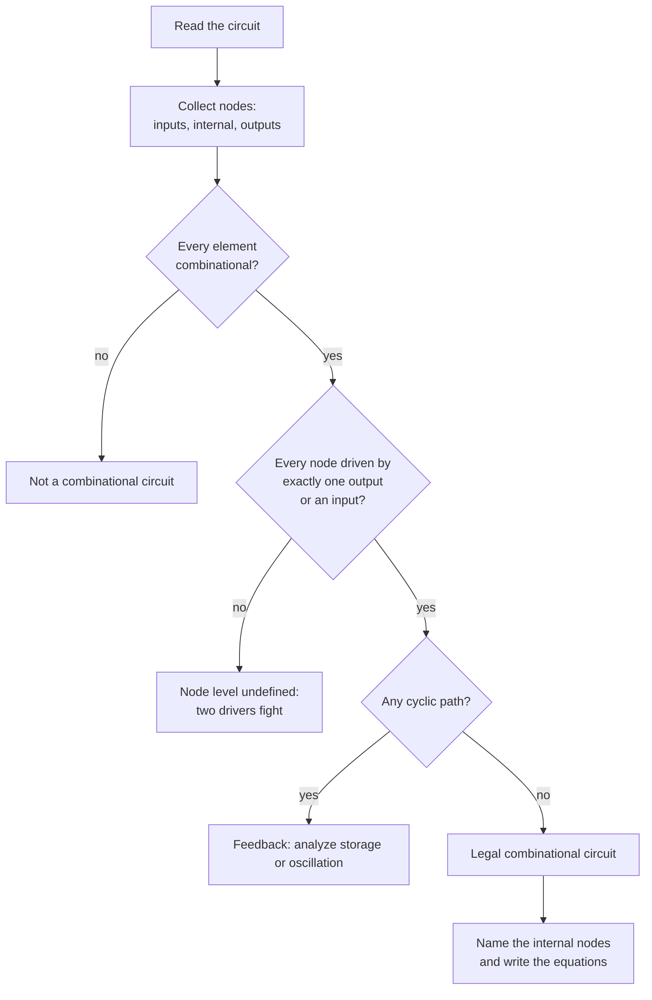

---
tags:
  - ECE2050
  - boolean-algebra
date: 2026-09-16
aliases:
  - 组合电路
  - 组合逻辑电路
  - Combinational Circuit
  - Combinational Logic
---

> [!NOTE] Where this fits · 定位
> 第 4 章 Boolean Algebra and Logic Simplification 的第一篇（讲义 p.3–7）。
> 第 3 章把门一个一个地看（符号、真值表、时序图），这一篇第一次把它们**接成电路**：
> 先规定"什么叫一个合法的组合电路"，后面几篇讨论的"这个电路的方程是什么、能不能化简"才有对象。
> 前置：[[Logic Gates]]（门的符号与真值表）、[[Boolean Equation]]（本篇的下一个问题：输出怎么写成式子）。

> [!SUMMARY] Quick recall · 英文速览
> In a combinational circuit, current outputs depend only on current inputs. Its logic network has no state or feedback loop, although physical gates still have propagation delay.

## Core Definition · 核心定义

一个**逻辑电路 (logic circuit)** 由四件事共同确定（讲义 p.4），缺一件都不算描述完整：

| 要素 | 记号 / 形式 | 回答的问题 |
|---|---|---|
| 输入 (inputs) | $A,B,C,\dots$ | 电路从外面接收什么？ |
| 输出 (outputs) | $Y,Z,\dots$ | 电路把什么交给外面？ |
| 功能规范 (functional specification) | 真值表 / 布尔方程 | 某组输入下输出该是多少？ |
| 时序规范 (timing specification) | 传播延迟、最高时钟频率 | 输入变了以后，输出多久才稳定？ |

**组合电路 (combinational circuit)**：功能规范与时序规范都只由**当前的输入**决定，电路不记忆历史。

**节点 (node)**：由导线连接在一起的一组端点，是电路里最小的"一个电压"单位。讲义 p.5 把节点分成三类：

| 节点 | 讲义 p.5 的例子 | 定义 | 谁来驱动它 |
|---|---|---|---|
| 输入节点 (input node) | $A,B,C$ | 由电路**外部**驱动的节点 | 外部世界 |
| 输出节点 (output node) | $Y,Z$ | 电路交给外部的最终结果 | 恰好一个元件 |
| 内部节点 (internal node) | $n_1$ | 只存在于电路内部的节点 | 恰好一个元件 |

**电路元件 (circuit element)**：$E_1,E_2,E_3$ —— 讲义 p.5 的原话是 *Each a circuit*（每个元件本身也是一个电路）。
一个 AND 门是电路，一个反相器是电路，一整块加法器同样可以只当成"一个元件"。

![[ch4-combinational-nodes.png]]
*图 1 — 讲义 p.5 原图：输入节点 A、B、C，输出节点 Y、Z，内部节点 n1，以及三个元件 E1/E2/E3；
注意图中每个元件的**输出**都只接到一条线上，n1 这一根线同时喂给两个元件的输入（fan-out）。*

> [!IMPORTANT] 节点 = 导线，不是引脚
> 元件有几个引脚接在同一条导线上，仍然只是**一个**节点。判断构成规则时数的是"有几个输出在驱动这个节点"，
> 不是"有几条线连上来"。这一个区分决定了下面对规则 2 的理解。

## Assumptions and Validity · 适用前提

> [!IMPORTANT] 组合 vs 时序 (combinational vs sequential)
> - **组合逻辑 (combinational logic)**：*memoryless*，输出只由**当前**输入决定 ；本库在 Ch4 建立模型，Ch5 展开分析设计；
> - **时序逻辑 (sequential logic)**：*has memory*，输出由**过去和当前**的输入共同决定 ；本课程 Ch7 开始详细讨论。
> 本篇的三条构成规则，就是"保证一个电路真的是组合的"的操作性判据。

**组合电路的三条构成规则 (rules of combinational composition, 讲义 p.7)**：

1. **Every element is combinational** —— 每个元件本身都是组合的（不能拿一个锁存器当"元件"）。
2. **Every node is either an input or connects to exactly one output** —— 每个节点要么是输入节点，要么恰好被**一个**元件的输出驱动。
3. **The circuit contains no cyclic paths** —— 电路中没有回路（不能顺着线走一圈回到自己）。

- 规则 1 管"元件级"，规则 2 管"节点级"，规则 3 管"全局拓扑"；三条都成立时，
  从输入到输出必然是一条**无环的有向路径**，于是输出只依赖当前的输入，电路就是组合的。
- 失效边界：违反任一规则就不能由这套组合构成模型保证正确性。多驱动可能产生冲突；反馈可能形成
  存储、振荡或其他不满足该模型的行为，不能统一归成正常时序电路。

## Derivation · 推导过程

### 1. 先给每个节点找"驱动者"

对每个节点问一个问题：**谁在驱动它？** 答案只有三种：

- 外部世界 → 它是输入节点；
- 恰好一个元件的输出 → 它是内部节点或输出节点；
- 零个或两个以上元件输出 → **违反规则 2**。

### 2. 扇出 (fan-out) 是允许的，两个驱动者是不允许的

一个元件的输出可以同时喂给很多个输入（图 2(a) 里 $n_1$ 同时喂给 E2 和 E3），这叫 **fan-out**，
节点仍然只有**一个**驱动者，合法。反过来，两个元件的输出短接在同一个节点上时，这个节点有了**两个**驱动者：
一个想把电平拉高、另一个想拉低，节点电平就不确定了 —— 违反规则 2。

### 3. 无环 = 无记忆

如果存在回路（例如把 E2 的输出接回 E1 的输入），当前输出就会反过来影响自己的输入。
此时不能按无环组合网络直接逐级求值。合适的反馈能保存状态，但反相反馈也可能振荡；
需结合实际拓扑判断，不能仅凭有环就保证稳定记忆。

![[combinational-rules.svg]]
*图 2 — (a) 合法构成：E1(AND) 驱动内部节点 n1，n1 再扇出到 E2(OR) 与 E3(NOT)；每个节点恰好一个驱动者。
(b) 非法构成：E4(NOT) 与 E5(AND) 的输出被短接在同一个节点上，该节点有两个驱动者，
它们的值可能相反，节点电平（以及 Y）因此没有定义。*

## Method and Steps · 求解步骤与方法

1. **画/读图**：把所有导线端点归成节点，标上名字（$A,B,C$ 是输入，$n_1,n_2$ 是内部，$Y,Z$ 是输出）。
2. **判规则 1**：逐个元件问"它是组合元件吗"（门电路都是；触发器/锁存器不是）。
3. **判规则 2**：逐个节点数**驱动者**（不是数连线）。数到 0 或 ≥2 就失败。
4. **判规则 3**：从任意节点出发沿箭头走，能回到出发点就是有环 → 失败。
5. **通过后写方程**：给每个内部节点一个中间变量（$n_1=\dots$），逐级代出输出（下一步见 [[Boolean Equation]]）。
6. **（可选）枚举校验**：对 $n$ 个输入枚举 $2^n$ 行，检查每个节点的值是否唯一 —— 这也是 perfect induction 的用法（见 [[Proof by Perfect Induction]]）。

## Worked Example · 例题

**Example 1 — 给讲义 p.5 的电路补上元件功能并逐行枚举（讲义 p.5 的节点图）**

题目：讲义 p.5 只标出节点 $A,B,C$、$n_1$、$Y,Z$ 与元件 $E_1,E_2,E_3$，没有说每个元件是什么。
下面自设一组：$E_1=\text{AND}(A,B)$，$E_2=\text{OR}(n_1,C)$，$E_3=\text{NOT}(n_1)$，检查它是否合法并求输出。

解：

1. 节点清单：输入 $A,B,C$；内部 $n_1$；输出 $Y,Z$。
2. 规则 1：AND / OR / NOT 都是组合元件 ✓。
3. 规则 2：$n_1$ 只被 $E_1$ 驱动（$E_2,E_3$ 只是**读**它）✓；$Y$ 只被 $E_2$ 驱动 ✓；$Z$ 只被 $E_3$ 驱动 ✓。
4. 规则 3：$A,B,C\to E_1\to n_1\to E_2/E_3$，没有任何线往回走 ✓。
5. 写方程：$n_1=AB$，$Y=n_1+C=AB+C$，$Z=\overline{n_1}=\overline{AB}$。

**数值校验 (Numerical check)**：把 $A,B,C$ 的 8 种组合全部代入（Python 逐行枚举）：

| $A$ | $B$ | $C$ | $n_1=AB$ | $Y=n_1+C$ | $Z=\overline{n_1}$ |
|---|---|---|---|---|---|
| 0 | 0 | 0 | 0 | 0 | 1 |
| 0 | 0 | 1 | 0 | 1 | 1 |
| 0 | 1 | 0 | 0 | 0 | 1 |
| 0 | 1 | 1 | 0 | 1 | 1 |
| 1 | 0 | 0 | 0 | 0 | 1 |
| 1 | 0 | 1 | 0 | 1 | 1 |
| 1 | 1 | 0 | 1 | 1 | 0 |
| 1 | 1 | 1 | 1 | 1 | 0 |

每一行的 $n_1$ 只有一个值 ✓（两个驱动者的话这一列就会出现"既是 0 又是 1"），
$Y$ 与 $Z$ 也各自唯一 ✓ —— 这就是"电路是组合的"在数值上的样子。

**Example 2 — 违反规则 2：两个输出短接（自算，讲义 p.7 的"违反规则会怎样"）**

题目：把 $E_4=\text{NOT}(A)$ 与 $E_5=\text{AND}(B,C)$ 的输出短接成同一个节点，再引到输出 $Y$。
这个电路合法吗？输出会怎样？

解：该节点有两个驱动者，$E_4$ 想输出 $\bar A$，$E_5$ 想输出 $BC$，两者只在某些输入下一致。

**数值校验 (Numerical check)**：8 行枚举，比较两个驱动者：

| $A$ | $B$ | $C$ | $E_4=\bar A$ | $E_5=BC$ | 节点 |
|---|---|---|---|---|---|
| 0 | 0 | 0 | 1 | 0 | 冲突 |
| 0 | 0 | 1 | 1 | 0 | 冲突 |
| 0 | 1 | 0 | 1 | 0 | 冲突 |
| 0 | 1 | 1 | 1 | 1 | 一致 |
| 1 | 0 | 0 | 0 | 0 | 一致 |
| 1 | 0 | 1 | 0 | 0 | 一致 |
| 1 | 1 | 0 | 0 | 0 | 一致 |
| 1 | 1 | 1 | 0 | 1 | 冲突 |

**8 行里有 4 行两个驱动者给出相反的值**（$A=0,B=0,C=0$；$A=0,B=0,C=1$；$A=0,B=1,C=0$；$A=1,B=1,C=1$），
这 4 行里 $Y$ 究竟是多少**没有定义** —— 电路的行为不再是一个函数，规则 2 不是"风格建议"而是"有没有意义"的分界。

**Example 3 — 规则 3：接成回路会怎样（自设反例）**

题目：把 Example 1 里的 $E_2$ 输出接回 $E_1$ 的第二个输入（$n_1=A\cdot Y$），电路还是组合的吗？

答：不是。此时 $Y=n_1+C=A\cdot Y+C$：$Y$ 通过 $n_1$ 依赖自己。取 $A=1,C=0$，方程变成 $Y=Y$，
$Y=0$ 和 $Y=1$ 都满足 —— 输出不再由输入唯一决定，而是取决于"上一次留下的值"，这正是**记忆**。
稳定反馈的存储机制见 [[Set-Reset Latch]]；时序设计主线见 [[Sequential Logic]]。

## Pitfalls · 常见误区

> [!WARNING] 三个规则的错法都来自"数线不数驱动者"

1. **把扇出当成违规**。错在：看到 $n_1$ 上连了 3 条线就说"一个节点接了多个输出"。
   正确：$n_1$ 只有 $E_1$ 一个输出在驱动，另外两条是**输入**，扇出完全合法（图 2(a)）。
2. **两个输出短接只当成"不推荐"**。错在：以为只是驱动能力问题。
   正确：这是规则 2 的硬性违反，8 行里有 4 行电平不确定（Example 2），电路行为不再是函数。
3. **把组合电路说成"没有延迟"**。错在：把 memoryless 理解成"瞬时"。
   正确：组合只保证**输出只由当前输入决定**，任何实际门都有传播延迟（讲义 p.4 的 timing specification 就是管这件事的）。
4. **用"有没有时钟"判断组合/时序**。错在：把无时钟的反馈环当成组合电路。
   正确：判据是"输出是否只依赖当前输入"；有回路需检查存储或振荡等行为；无时钟并不保证组合（Example 3）。
5. **元件里的电路不算数**。错在：只看顶层连线，忘了一个"元件"内部可能还有非法构成。
   正确：规则 1 要求每个元件本身也是组合电路，这是一条**递归**要求。

## Composition and state boundaries · 构成规则与状态边界

The composition rules establish a single-driver, acyclic Boolean network. They are sufficient conditions for the course's combinational model, not a classifier that turns every invalid connection into a valid sequential circuit. Shorted ordinary outputs can produce contention. An inverter loop can oscillate. A carefully designed bistable feedback circuit can store state. These outcomes require different physical and functional models.

Separate fan-out from multiple drivers. One output feeding three inputs is still one driver; three outputs tied together are three drivers. A deliberately managed tri-state bus needs an ownership protocol and released outputs, as explained in [[Tri-State Buffers and Bus Drivers]]. It is not justified merely by drawing one wire.

**Worked application.** 对 $n=AB,Y=n+C$，A/B/C 改变后需要门延迟才能得到稳定 Y，但不需要保存上一拍的 n。若改为 $n=AY$，A=1,C=0 时允许 Y=0 或1，说明仅凭当前输入不能唯一决定该反馈系统状态；是否真的稳定存储还要检查电路实现。

**English exam question:** Does a circuit without a clock necessarily have combinational behavior?

**Answer:** No. A latch can store a value without a clock edge, and an unstable feedback loop can oscillate. Determine whether the output is uniquely specified by current inputs under the stated model, then inspect state and feedback. Continue with [[Combinational Logic Design]] or [[Sequential Logic]] according to the required behavior.

## Connections · 相关笔记

- 上游 (upstream)：[[Logic Gates]] —— 元件清单：反相器、AND、OR、NAND、NOR、XOR、XNOR，本篇把它们接成网。
- 上游 (upstream)：[[Boolean Equation]] —— 合上本篇的"能不能接"，紧接着回答"接出来是什么式子"。
- 平行 (parallel)：[[Sequential Logic]]（Ch7）—— 研究有状态的逻辑模型；三条规则是本篇组合模型的构成约束。
- 平行 (parallel)：[[Boolean Axioms]] —— 公理管"式子怎么算"，构成规则管"电路怎么连"，是同一件事的两端。
- 下游 (downstream)：[[Proof by Perfect Induction]] —— Example 1 里"逐行枚举"正是它的方法雏形。
- 补充对照：[[Logic Levels]] —— 节点上那个"电平"到底是什么（电压范围、噪声容限），决定了两驱动者为什么必然打架。

---
索引：[[ECE2050 Knowledge Tree]] · [[Glossary]]
