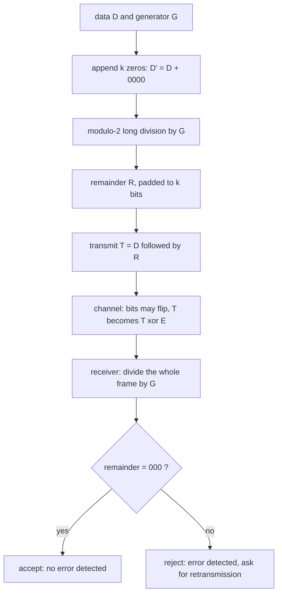

---
tags:
  - ECE2050
  - error-codes
date: 2026-09-16
aliases:
  - 循环冗余校验
  - CRC 校验
  - 生成多项式
  - Cyclic Redundancy Check
  - CRC
---

> [!NOTE] Where this fits · 定位
> 分区 9 的第二篇，也是第二章**最后一个、工程上最重要的知识点**：[[Parity Bit]] 只能统计"1 的个数奇偶性"，
> 对偶数个错误完全失明；CRC 换了判据——**把整帧当成多项式，除以约定好的生成多项式，看余数**——
> 于是错误位置也影响余数，通常可检测 parity 会漏掉的多种错误；实际检出率取决于生成多项式、帧长和错误分布。
> 前置：[[Parity Bit]]（为什么需要更强的检错）、[[Binary Arithmetic]]、[[Bits and Bytes]]。
> 下游：硬件是 Ch8 的[[Shift Registers|移位寄存器 (shift register)]]，本篇图 2 先给出结构。

> [!SUMMARY] Quick recall · 英文速览
> A CRC appends the remainder of polynomial division over $GF(2)$ to a message. The receiver divides the complete frame again; a nonzero remainder detects an error pattern, subject to the chosen generator.

## Core Definition · 核心定义

**循环冗余校验 (CRC)**：*an error detection method that can detect multiple errors in data blocks*
（讲义 p.71）——**能检测数据块中多个错误**的检错方法。做法是把数据看作一个位串，用**模 2 长除**除以
约定的**生成码 (generator code) $G$**，把余数当校验和 (checksum / FCS) 附在数据后一起发送；
接收端把**整帧**再除一次，**余数为 0 表示未检出错误**。

- **生成码 $G$**：收发双方约定的除数位串；讲义例子 $G = 1010$，对应多项式 $G(x) = x^{3}+x$，阶数 (degree) $r=3$。
- **数据、校验和与帧**：$D = 1101\,0011$；在 $D$ 后补 4 个 0 得 $D' = 1101\,0011\,0000$；余数 $R = 100$ 写成
  4 位校验和 `0100`；发送的整帧 $T = D \,\|\, R = 1101\,0011\,0100$（12 位）。
- **接收端判据**：

$$
T \bmod G = 0 \;\Longrightarrow\; \text{未检出错误};\qquad T \bmod G \ne 0 \;\Longrightarrow\; \text{检测到错误}
$$

- 数值校验：$1101\,0011\,0100 \div 1010$ 余 $000$ ✓；末位翻转得 $1101\,0011\,0101$，余 $001 \ne 000$ → 报错 ✓。

| 记号 | 名称 | 讲义例子 | 意义 |
|---|---|---|---|
| $D$ | 数据 (data) | `1101 0011` | 要保护的 $k$ 位信息 |
| $G$ | 生成码 / 生成多项式 | `1010` = $x^3+x$ | 约定的除数，阶数 $r=3$ |
| $D'$ | 补零后的被除数 | `1101 0011 0000` | $D$ 后补 $r$ 个 0（讲义按 4 位校验和补 4 个） |
| $R$ | 余数 / 校验和 (checksum, FCS) | `100` → 场里写 `0100` | 附加在数据后的冗余位 |
| $T$ | 整帧 (frame / codeword) | `1101 0011 0100` | 实际发送的位串 |

![[crc-modulo2-division.svg]]
*图 1 — (a) 发送端：把 $D'$ = `1101 0011 0000` 用模 2 长除一步步除以 $G$ = `1010`。每一级做三件事：
把 $G$ 对齐到当前最高位的 1、逐位 XOR（**没有借位、没有进位**）、消掉那一位；阶梯共 5 步
（消去 $x^{11},x^{10},x^9,x^7,x^4$），最后留下余数 `100`，写成 4 位校验和 `0100`。
(b) 接收端把整帧再除一次：干净帧余 `000`（未检出错误），末位翻转后余 `001`（非 0 → 检测到错误）。*

## Assumptions and Validity · 适用前提

> [!IMPORTANT] CRC 的"除法"是模 2 除法，不是算术除法
> 模 2 运算 (modulo-2 arithmetic)：**加法不进位、减法等于加法**，全部等价于 XOR。
> 长除时只问"当前最高位是不是 1"、是则 XOR 掉，**永远不出现借位 (borrow)**。
> 用算术减法去做，$1101-1010$ 会得到 $0011$ 而不是 $0111$，后面全错。

- **两端约定必须一致**：同一个 $G$；同样的**位序**（MSB-first 还是 LSB-first）；同样的**初值**（寄存器初态，讲义例为全 0）；同样的补零个数。任何一项不一致，正常帧也会被判为出错。
- **补零个数 = 校验和位数**：严格的多项式约定是补 $r=\deg G$ 个 0、余数取 $r$ 位（$G=1010$ 时补 3 位 → 余数 `010`，帧 = `1101 0011 010`）；讲义为演示"4 位校验和"补 4 个 0，余数 `100` 前面补 0 写成 `0100`，帧 = `1101 0011 0100`。两种约定各自自洽（接收端整帧除 $G$ 都得 0 ✓），但**绝不能一端补 4 位、另一端补 3 位**。
- **只能检错、不能纠错**：余数非 0 只说明"这一帧坏了"，单独的 CRC 未提供纠错规则；系统可结合**重传 (ARQ)**或额外纠错编码等机制恢复数据。
- **不是加密**：$G$ 是公开的，CRC 只防传输/存储中的随机错误，不防人为篡改（改完可以重算校验和）。
- **失效边界**：盲区是**恰好等于 $G(x)$ 倍数的错误模式**。任何非零 $G$ 倍数只要能放进帧内，都可能漏检；良好的生成多项式与帧长限制是为了保证特定错误类别的检出，不能消灭所有倍数；讲义的玩具 $G=1010$ 以 $x$ 为因子（末尾是 0），确实存在这类盲区（见"常见误区"第 5 条与图 3）。

## Derivation · 推导过程

### 1. 模 2 运算：加法不进位，减法就是加法

| 运算 | 结果 | 运算 | 结果 |
|---|---|---|---|
| $0 \oplus 0$ | 0 | $1 \oplus 0$ | 1 |
| $0 \oplus 1$ | 1 | $1 \oplus 1$ | **0（进位被丢弃）** |

- 意义：模 2 下 $1+1=0$，故 $-1=+1$（每个数的相反数就是它自己），**减法与加法完全相同**：$A-B=A\oplus B$。
- 数值校验：算术上 $1101_2-1010_2=0011_2$；模 2 上 $1101\oplus1010=0111$（$1\oplus1=0,1\oplus0=1,0\oplus1=1,1\oplus0=1$）✓。
  CRC 长除用的必须是后者。
- 多项式视角：位串 $a_{n-1}\cdots a_0 \leftrightarrow \sum a_ix^i$，于是 `1010` $\leftrightarrow x^3+x$，
  `11010011` $\leftrightarrow x^7+x^6+x^4+x+1$，位串 XOR 就是多项式的加法（系数在 GF(2) 上）。

### 2. 发送端：补零 → 长除 → 取余

$$
R(x) = D(x)\cdot x^{k} \bmod G(x),\qquad k=\text{校验和位数}
$$

- 意义：把数据"抬高" $k$ 位，腾出的低位正好由余数填满，使整帧成为 $G(x)$ 的倍数。
- 逐级长除（与图 1(a) 一致，每级消掉当前最高位的 1）：

| 级 | 当前位串 | 对齐的 $G$ | XOR 后 | 消去的位 |
|---|---|---|---|---|
| 1 | `110100110000` | `1010` | `011100110000` | $x^{11}$ |
| 2 | `011100110000` | ` 1010` | `001000110000` | $x^{10}$ |
| 3 | `001000110000` | `  1010` | `000010110000` | $x^{9}$ |
| 4 | `000010110000` | `    1010` | `000000010000` | $x^{7}$ |
| 5 | `000000010000` | `      1010` | `000000000100` | $x^{4}$ |

- 数值校验：最后一行只剩低位 `100` = $x^2$ ✓；回代成整帧 $1101\,0011\,0100 \div 1010$ 余 `000` ✓
  ——这正是"附上余数后整帧可被 $G$ 整除"的定义。

### 3. 接收端：整帧再除一次

$$
T(x) = D(x)\cdot x^{k} + R(x) \;\equiv\; 0 \pmod{G(x)}
$$

- 意义：合法帧一定被 $G$ 整除；接收端再算一次余数，非 0 就说明帧被改动过。
- 数值校验：干净帧 `1101 0011 0100` → 余 `000` ✓；末位翻转 `1101 0011 0101` → 余 `001` ✓
  ——余数本身就是"错误模式的指纹"。

### 4. 为什么比奇偶校验强：错误模式 $E(x)$

设收到 $T \oplus E$（$E$ 是错误模式）。因为 $T \equiv 0$，接收端算出的是

$$
(T \oplus E) \bmod G = E(x) \bmod G(x)
\qquad\Longrightarrow\qquad
\text{漏检} \iff G(x) \mid E(x)
$$

- 意义：**CRC 漏检当且仅当错误模式本身是 $G(x)$ 的倍数**，于是"能查哪些错"变成纯代数问题：
  **单比特** $E=x^i$ 除不尽 $G$ → 全检出（本例 12 位帧实测 12/12 ✓）；
  **奇数个错误**：若 $(x+1)\mid G$，奇数重模式有 $E(1)=1$ 而 $G(1)=0$ → 全检出（实测 2048/2048 ✓）；
  **突发错误 (burst)**：长度 $b$ 的突发 $E=x^iB(x)$，若 $G$ 末尾是 1（$x\nmid G$）则须 $G\mid B$，
  而 $b\le r$ 时 $\deg B<r$ 不可能 → **长度不超过阶数 $r$ 的突发全检出**。
- 数值校验（对照 [[Parity Bit]]）：同一个 12 位帧穷举 4095 个非零错误模式——奇偶校验漏检 2047 个（50%，全是偶数重模式）；
  CRC 漏检 511 个（12.5%），且漏掉的全是 $G$ 的倍数（包括移位，也包括多个移位项的 XOR 组合），而不是整整一半。

### 5. 能力对照（同一帧上穷举，数字来自图 3）

| 错误类型 | 模式个数 | 奇偶校验检出 | CRC 检出（$G=1010$） |
|---|---|---|---|
| 单比特 | 12 | 12（100%） | 12（100%） |
| 双比特 | 66 | 0（0%） | 41（62%） |
| 奇数个比特 | 2048 | 2048（100%） | 2048（100%） |
| 偶数个比特 | 2047 | 0（0%） | 1536（75%） |
| 跨度 ≤ 3 位的突发 | 43 | 22（51%） | 34（79%） |
| 跨度 ≥ 4 位的突发 | 4052 | 2026（50%） | 3550（88%） |

- 读表要点：奇偶校验的每一列只由"错误个数的奇偶性"决定（0%、50% 或 100%）；CRC 每一列都不低于它。
  讲义 $G=1010$ 是玩具：末尾是 0，所以"长度 ≤ 阶数的突发全检出"不再严格成立（如 `101` 突发在非最低位时正好等于 $x^{i-1}\cdot G$，会漏掉）。

### 6. 硬件：移位寄存器 + XOR 反馈

除法可以一位一位在线完成："当前最高位是 1 → XOR 掉"等价于一个**带反馈抽头的移位寄存器**。
下面保留的四级教学图实际对应扩展多项式 $H(x)=xG(x)=x^4+x^2$（位串 `10100`）。其寄存器次态是

$$
D_0 \leftarrow D_{in},\qquad D_1 \leftarrow Q_0,\qquad D_2 \leftarrow Q_1 \oplus Q_3,\qquad D_3 \leftarrow Q_2
$$

- 意义：当前最高级 **$Q_3$** 在移位时经反馈与 $Q_1$ 异或，进入 $D_2$，对应 $H$ 的 $x^2$ 项。
  四级网络求 $H$ 余数；本例三条输入序列恰好也得到 $G$ 余数，但不代表任意输入都等价。
  例如输入 `1000` 时四级寄存器为 `1000`，直接除 $G=1010$ 的余数却是 `010`。
- 数值校验（按四式逐拍模拟 $D'=110100110000$）：寄存器终值 = `0100` ✓，与长除余数 `100`（补成 4 位）一致；
  喂干净帧 `110100110100` 得 `0000` ✓，喂末位翻转帧得 `0001` ✓。
- 工程延伸：CRC-8、CRC-16-IBM、CRC-32（$0x04C11DB7$）都是"末尾为 1"的多项式，正是为了让上面的保证严格成立；
  以太网、ZIP、PNG 都用 CRC-32。

![[crc-shift-register.svg]]
*图 2 — CRC 编码器的串行硬件：4 级 D 触发器（$D_0$–$D_3$，上升沿时钟，整体左移）串联，图中 $D_{in}$ 从左侧 $D_0$ 喂入；
最高位级 $Q_3$ 经反馈线送回 XOR 门，与 $Q_1$ 异或后进入 $D_2$，实际是 $H=xG=x^4+x^2$ 的四级形态。
12 个时钟后，寄存器里留下的正是图 1 长除的余数。*

![[binary-parity-vs-crc.svg]]
*图 3 — 把两种码放在同一帧（`1101 0011 0100`，4095 个非零错误模式）上穷举对比：奇偶校验只统计"翻了几位"，
偶数个错误一律漏掉；CRC 统计"翻在哪些位置"，只在错误模式恰好是 $G(x)$ 的倍数时失手。这张图就是"为什么需要 CRC"的答案。*

## Method and Steps · 求解步骤与方法

1. **写出 $D$ 与 $G$**：确认位数；$G$ 的阶数 $r=\deg G$ 决定校验和至少几位。
2. **补零**：在 $D$ 后补 $k$ 个 0（讲义约定 $k=4$），得 $D'$。
3. **模 2 长除**：从最高位开始，只要当前位是 1 就把 $G$ 对齐到该位做 XOR；**逐位 XOR，不进位不借位**。
4. **取余数**：剩下的 $k$ 位就是校验和，不足 $k$ 位时左侧补 0（讲义：`100` → `0100`）。
5. **发送整帧** $T = D \,\|\, R$。
6. **接收端复算**：整帧除 $G$，余数全 0 → 未检出错误；否则报错，后续恢复策略由协议规定。
7. **收尾校验**：$T$ 除一遍应得 0；任一位翻转后余数应非 0（用图 1(b) 的两个数字对照）。

## Worked Example · 例题

**Example 1 — 讲义 p.71 全流程：$D = 11010011$、$G = 1010$**

题目：按讲义步骤求校验和与发送帧，并验证接收端判定。

解：
1. **补零**：$D' = D \,\|\, 0000 = 1101\,0011\,0000$。
2. **长除**（对齐 → XOR → 消最高位，重复 5 次，见表与图 1(a)）：
   `110100110000` → `011100110000` → `001000110000` → `000010110000` → `000000010000` → `000000000100`。
3. **余数** $R=100$ → 4 位校验和 `0100`；**发送** $T = 1101\,0011\,0100$（8 位数据 + 4 位校验和）。
4. **接收端复算**：$1101\,0011\,0100 \div 1010$ 余 `000` → 判定无错。

**数值校验 (Numerical check)**：
- 逐级各消掉一个最高位 1，共消去 5 个（$x^{11},x^{10},x^9,x^7,x^4$），最后一个 1 停在 $x^2$ → 余数 $=x^2=100$ ✓。
- 整除性自检：把 `0100` 附到数据后整帧再除 $G$ 得 `000` ✓（这正是发送端算法的目的）；位数自检：$8+4=12$ 位 ✓。
- 严格多项式约定：补 3 个 0 → `1101 0011 000` 除 `1010` 余 `010`，帧 = `1101 0011 010`，接收端余数同样是 `000` ✓。

**Example 2 — 本例全部单比特错误都检得出来**

题目：把 Example 1 的帧末位翻转，验证接收端能检出；并说明 12 个单比特错误是否全部可检出。

解：
1. 传输中末位翻转：$T' = 1101\,0011\,0101$。
2. 接收端长除：$1101\,0011\,0101 \div 1010$ → 余数 `001` ≠ `000` → **检测到错误**，请求重传。
3. 穷举 12 种单比特翻转（每一位各翻一次）：余数可以重复，但全部非零，**12/12 全部检出**。

**数值校验 (Numerical check)**：
- 末位翻转对应 $E = x^0$，$\deg E = 0 < r = 3$ → $G \nmid E$ → 必被检出 ✓（与图 1(b) 的 `001` 一致）。
- 余数可当"错误指纹"读：干净帧 `000`、末位翻转 `001` ✓，两者不同即已证明可区分（这正是 [[Parity Bit]] 做不到的）。

**Example 3 — 什么样的错误 CRC 会漏掉（玩具生成码的盲区）**

题目：$G=1010$ 时构造一个检不出的双比特错误，并解释原因。

解：
1. 取错误模式 $E = 0101\,0000\,0000$（把帧的第 2、4 位各翻一次，属双比特错误）。
2. 接收端长除 $E$：$0101\,0000\,0000 \div 1010$ 余 `000` → **判为无错，漏检**。
3. 原因：$E(x) = x^{10}+x^{8} = x^{7}(x^{3}+x) = x^{7}\cdot G(x)$，恰好是 $G$ 的倍数。

**数值校验 (Numerical check)**：
- 余数公式 $\text{rem} = E \bmod G$：$x^7G \bmod G = 0$ ✓，与长除结果 `000` 一致 ✓。
- 规模：12 位帧上 4095 个非零错误模式中有 511 个是 $G$ 的倍数 = 12.5%（都会漏检）✓；奇偶校验漏检 2047 个 = 50% ✓。
- 修法：让 $G$ 末尾为 1（如 CRC-32 的 $0x04C11DB7$），则 $\deg E<r$ 的模式都无法被整除，
  常数项为 1 且含至少两个非零项时可检出全部单比特错误，并支持长度不超过 $r$ 的突发检出；双比特保证还需检查位间距与帧长。

## Pitfalls · 常见误区

> [!WARNING] CRC 的坑几乎都在"两端的约定"和"把 XOR 当减法"上

1. **用算术减法做长除**。错在：$1101-1010=0011$。正确：模 2 减法是 XOR，$1101\oplus1010=0111$，比较的是"最高位是否为 1"。
2. **补零个数写错**。错在：补 4 位却按 3 位取余（或相反），两端不一致。正确：补零个数 = 校验和位数，讲义例补 4 位、余数写 4 位 `0100`。
3. **以为 CRC 能纠错**。错在：想用余数"还原"出错的那一位。正确：CRC 只回答"有没有错"，纠错要靠重传或另加纠错码。
4. **忘了两端必须同 $G$ / 同位序 / 同初值**。错在：一端 MSB-first、另一端 LSB-first。正确：这些参数属于具体 CRC 定义；同为 32 位 CRC 也可能使用不同初值、反射和 final XOR，不可只凭宽度推断。
5. **以为 CRC 一定查到所有多比特错误**。错在：把"比奇偶校验强"当成"万无一失"。正确：**等于 $G(x)$ 倍数的错误模式一定检不出**；实际设计靠生成多项式与帧长限制保证选定错误类别的检出，不能堵住所有倍数盲区；讲义的 $G=1010$ 末尾是 0，确有盲区（Example 3）。
6. **把 CRC 当加密或防篡改**。错在：以为校验和能防人改数据。正确：$G$ 公开，改完可以重算；防篡改要用 MAC 或数字签名。
7. **把 CRC 与"累加和 checksum"混为一谈**。错在：以为都是"把数加起来"。正确：普通 checksum 做算术加法（有进位、对调字节常检不出），CRC 做模 2 多项式除法，**对位置敏感**。

## Standard exam algorithm and guarantees · 标准算法与检错边界

For the elementary zero-initialized, MSB-first polynomial convention used in these exam questions, a generator of length $r+1$ has degree $r$. Append exactly $r$ zeros to the data, divide using XOR, and append the $r$-bit remainder to the original data. Divide the complete received frame for checking. A named practical CRC can add initialization, reflection, or final-XOR conventions, so identify that format before transferring the elementary calculation.

**Worked application — short exam frame.** $D=1101$、$G=101$，$r=2$。补零得 `110100`。先 XOR 对齐 `101000` 得 `011100`，再 XOR `010100` 得 `001000`，再 XOR `001010` 得 `000010`。余数必须写足 2 位=`10`，发送 `110110`。接收端除以 `101` 得余 `00`，表示校验通过。

In English: the remainder has fewer than $r+1$ significant bits but occupies an $r$-bit field, including leading zeros. A zero remainder proves divisibility by the generator. It does not prove that no transmission error occurred.

For an error polynomial $E(x)$, detection fails exactly when $G(x)$ divides $E(x)$. A nonzero multiple of the generator is always a counterexample if it fits in the frame. A constant term of one supports short-burst guarantees, but does not alone guarantee detection of all double-bit errors. For two flipped bits separated by $j$, the relevant question is whether $G(x)$ divides $x^j+1$.

**English exam question:** Why can a CRC detect an error that even parity misses?

**Answer:** Even parity depends only on the number of flipped bits modulo two. CRC also depends on their positions through polynomial division. Some even-weight masks have a nonzero CRC remainder, though generator multiples still remain undetectable.

For the degree-three toy generator $G=1010$, a direct three-stage serial remainder register starting at zero obeys $Q_0^+=D_{in}$, $Q_1^+=Q_0\oplus Q_2$, $Q_2^+=Q_1$ when input bits are fed MSB-first. This follows from shifting the remainder and reducing its $x^3$ term by $x^3+x$. The earlier four-stage illustration uses the extended divisor $H=xG$ and must not be assumed identical on arbitrary streams.

Follow [[Shift Registers]], [[Exclusive-OR Gate]], and [[Testbench and Functional Verification]] for the stateful implementation and verification against the long-division model.

## Degree-three serial divider · 三阶生成式的串行模型

For $G=x^3+x$ itself, use three remainder bits $R_2R_1R_0$, zero initialization, and MSB-first input. Appending one bit d shifts the old polynomial; the outgoing $R_2x^3$ is reduced by $x^3+x$, yielding:

$$R_2^+=R_1,\qquad R_1^+=R_0\oplus R_2,\qquad R_0^+=d.$$

Feed data followed by **three** zeros to compute the conventional three-bit checksum. 数据11010011给出010，发送11010011010；题目数据10110010给出110，发送10110010110。接收整帧后寄存器000表示整除、未检出错误。

The preserved four-stage diagram instead uses $H=xG$ and the explicitly described four-bit extension. The two networks are not interchangeable for arbitrary input; `1000` is a simple counterexample. Compare [[Shift Registers]] and [[Testbench and Functional Verification]] to verify the recurrence against direct polynomial division.

## Connections · 相关笔记

- 上游 (upstream)：[[Parity Bit]] —— CRC 要解决的就是"偶数个错误全漏"这个问题。
- 上游 (upstream)：[[Binary Arithmetic]] —— 竖式长除的读法来自二进制算术；但减法要换成 XOR。
- 上游 (upstream)：[[Bits and Bytes]] —— 帧、位序（MSB/LSB first）、字节边界是约定的一部分。
- 平行 (parallel)：[[Gray Code]] —— 同样与"错误"打交道：格雷码减少出错概率，CRC 检测已发生的错误。
- 下游 (downstream)：[[Shift Registers]] 与 XOR 反馈构成串行 CRC 的硬件基础（图 2 的四级扩展模型见正文说明）；以太网/PNG/ZIP 的 CRC-32 是它在工程中的标准形态。

---
索引：[[ECE2050 Knowledge Tree]] · [[Glossary]]
