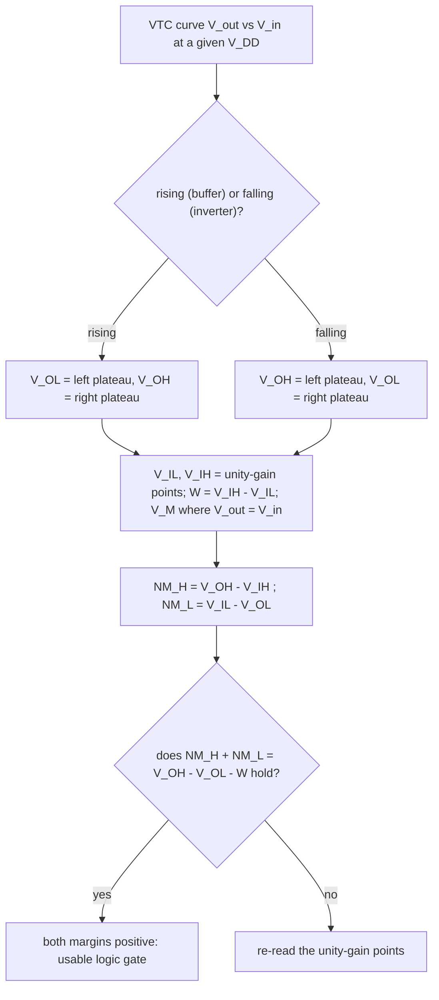

---
tags:
  - ECE2050
  - logic-levels
date: 2026-09-16
aliases:
  - 直流传输特性
  - 电压传输特性
  - DC Transfer Characteristic
  - VTC
---

> [!NOTE] Where this fits · 定位
> 逻辑电平三篇的最后一篇。[[Logic Levels]] 定义了 $V_{IL}$、$V_{IH}$、$V_{OL}$、$V_{OH}$ 四个数，
> [[Noise Margin]] 用它们算出两个余量；本篇回答"这四个数究竟是从哪里来的" ——
> 它们全部从同一条曲线 $V_{out}$–$V_{in}$ 上读出来（讲义 p.19：ideal buffer / real buffer；
> p.20：实际反相器的传输特性）。
> 前置：[[Logic Levels]]（四个参数的含义与方向）、[[Noise Margin]]（$NM_H$、$NM_L$ 的定义）。
> 平行：[[Inverter]] —— 反相器的 VTC 与缓冲器只差一次"上下颠倒"。

> [!SUMMARY] Quick recall · 英文速览
> A DC transfer characteristic plots steady-state output voltage against input voltage. Its transition region helps explain switching behavior and voltage noise margins.

## Core Definition · 核心定义

**直流传输特性 (DC transfer characteristic, VTC)**：在静态（DC）条件下，把输出电压画成输入电压的函数
$V_{out}=f(V_{in})$（讲义 p.19–p.20）。横轴是输入 $V_{in}$、纵轴是输出 $V_{out}$，两个轴都用
$[0,\,V_{DD}]$ 的电压刻度。

从曲线上读出的四个参数：

| 参数 | 从 VTC 的哪里读 | 说明 |
|---|---|---|
| $V_{OH}$ | 曲线**左端**（$V_{in}$ 小）平台的电压 | 输出为 1 时的最低保证值（理想时 $=V_{DD}$） |
| $V_{OL}$ | 曲线**右端**（$V_{in}$ 大）平台的电压 | 输出为 0 时的最高保证值（理想时 $=0$） |
| $V_{IL}$ | 过渡区**靠 0 一侧**的边界 | 再低一点仍稳读为 0；严格定义是斜率 $\lvert\mathrm{d}V_{out}/\mathrm{d}V_{in}\rvert=1$ 的点 |
| $V_{IH}$ | 过渡区**靠 1 一侧**的边界 | 再高一点已稳读为 1；同为单位增益点 (unity-gain point) |

另外两个记号：

- **开关阈值 (switching threshold) $V_M$**：曲线与直线 $V_{out}=V_{in}$ 的交点，即
  $V_{out}(V_M)=V_M$ 的那一点（讲义 p.20）。对称的反相器 $V_M=V_{DD}/2$。
- **过渡区宽度 (transition width) $W = V_{IH}-V_{IL}$** 与**增益 (gain)**
  $A=\mathrm{d}V_{out}/\mathrm{d}V_{in}$：过渡区越陡 $\lvert A\rvert$ 越大、$W$ 越窄。

两种门的 VTC 形状：

| 器件 | 曲线走向 | 平台 | 过渡区 |
|---|---|---|---|
| 缓冲器 (buffer) | **单调上升**：输入低 → 输出低 | 左端 $V_{OL}$、右端 $V_{OH}$ | 中间一段上升的陡坡 |
| 反相器 (inverter) | **单调下降**：输入低 → 输出高 | 左端 $V_{OH}$、右端 $V_{OL}$ | 中间一段下降的陡坡 |

## Assumptions and Validity · 适用前提

> [!IMPORTANT] VTC 是"一整条曲线"，四个参数只是它的四个特征点
> 曲线必须在**指定的 $V_{DD}$、温度、负载**下测量或仿真；换 $V_{DD}$ 时整条曲线会一起缩放
> （横轴、纵轴同时压缩）。$V_{IL}$、$V_{IH}$ 用单位增益点定义，是为了把"过渡区有多宽"
> 变成一个与噪声容限直接挂钩的量：$NM$ 就是曲线上的**水平余量**。

1. **两类曲线的参数定义相同**：缓冲器与反相器的 $V_{IL}/V_{IH}/V_{OL}/V_{OH}$ 读法一致，
   [[Noise Margin]] 的两个公式对两者都适用，只是反相器的输出逻辑是反的。
2. **过渡区必须有限宽**：$V_{IH}>V_{IL}$ 是 $W>0$ 的前提；理想阶跃是 $W=0$ 的极限情况。
3. **$V_M$ 由上下开关的相对强度决定**：对称反相器 $V_M=V_{DD}/2$；$p$ 管偏强则 $V_M$ 上移，
   $n$ 管偏强则下移。$V_M$ 偏离中心会**同时**吃掉一个方向的余量、放大另一个方向。
4. **悬空输入是最坏工作点**：输入停在过渡区时输出既非 0 也非 1，CMOS 还会上下管同时导通而耗流
   （未用输入必须接到固定电平）。
5. **失效边界**：真实曲线不是折线；用增益 $\lvert A\rvert$ 估算 $W$ 只在过渡区近似线性时有效。

## Derivation · 推导过程

### 1. 理想缓冲器：阶跃，两段余量正好铺满 $V_{DD}$

讲义 p.19 的理想缓冲器就是把过渡区压缩成一个点：

$$
V_{out}=0\ (V_{in}<V_{DD}/2),\qquad V_{out}=V_{DD}\ (V_{in}>V_{DD}/2)
\ \Longrightarrow\
V_{OL}=0,\quad V_{OH}=V_{DD},\quad V_{IL}=V_{IH}=V_M=\frac{V_{DD}}{2}
$$

代入两个噪声容限的定义：

$$
NM_H = V_{OH}-V_{IH} = V_{DD}-\frac{V_{DD}}{2} = \frac{V_{DD}}{2},\qquad
NM_L = V_{IL}-V_{OL} = \frac{V_{DD}}{2}-0 = \frac{V_{DD}}{2}
\ \Longrightarrow\
NM_H = NM_L = \frac{V_{DD}}{2},\quad NM_H+NM_L = V_{DD}
$$

- 意义：理想缓冲器把整个供电电压**平分成两份**噪声预算（讲义 p.19 的第一行标注）。
- 数值校验：$V_{DD}=5$ V → $NM_H = NM_L = 2.5$ V，$2.5+2.5 = 5.0 = V_{DD}$ ✓；
  $V_{DD}=3.3$ V → $NM_H = NM_L = 1.65$ V，$1.65+1.65 = 3.3 = V_{DD}$ ✓。

### 2. 实际缓冲器：过渡区吃掉一块预算

真实门的过渡区有宽度 $W=V_{IH}-V_{IL}>0$（讲义 p.19 的 real buffer：*NM_H, NM_L < V_DD/2*）。
把两个容限相加：

$$
NM_H+NM_L = (V_{OH}-V_{IH})+(V_{IL}-V_{OL}) = \underbrace{(V_{OH}-V_{OL})}_{\text{输出摆幅}} - \underbrace{(V_{IH}-V_{IL})}_{W}
$$

- 意义：$V_{DD}$ 这块预算被三样东西分掉 —— **输出摆幅的损失**（$V_{OH}$ 掉下 $V_{DD}$、$V_{OL}$ 抬离 0）、
  **过渡带** $W$、**两个噪声余量**。曲线的陡坡越宽，留给噪声的就越少。
- 数值校验：$V_{DD}=5$ V、轨到轨（$V_{OH}=5$、$V_{OL}=0$）、$V_{IL}=2.0$、$V_{IH}=3.0$（$W=1.0$）→
  $NM_H = 5-3.0 = 2.0$ V、$NM_L = 2.0-0 = 2.0$ V，和 $=4.0$ V，而 $V_{DD}-W = 5-1 = 4.0$ V ✓；
  每个 $2.0$ V 都 $< V_{DD}/2 = 2.5$ V ✓，与讲义 p.19 的结论一致。
- 若输出也不轨到轨（$V_{OH}=4.8$、$V_{OL}=0.2$）：$(4.8-0.2)-1.0 = 3.6$ V，再扣掉 $0.4$ V 摆幅损失 ✓。

![[dc-transfer-buffer.svg]]
*图 1 — (a) 理想缓冲器：VTC 是在 $V_{in}=V_{DD}/2$ 处的一级台阶，$V_{IL}=V_{IH}=V_M=2.5$ V，
两个箭头就是 $NM_L = 2.5$ V 与 $NM_H = 2.5$ V，下方的预算条正好拼满 $V_{DD}=5$ V。
(b) 实际缓冲器（$V_{IL}=2.0$、$V_{IH}=3.0$）：过渡区是一条有宽度的陡坡（虚线），
$V_M=2.5$ V 是它与 $V_{out}=V_{in}$ 直线的交点；此时 $NM_L = NM_H = 2.0$ V，
预算条多出一段 $W=1.0$ V 的过渡带，于是 $NM_H+NM_L = V_{DD}-W = 4.0$ V $<V_{DD}$。*

### 3. 增益与过渡带宽度：为什么"陡"就是"抗噪"

在过渡区内把曲线近似成一条直线，斜率就是增益 $\lvert A\rvert$，它要在宽度 $W$ 内走完整个摆幅
$V_{OH}-V_{OL}\approx V_{DD}$：

$$
\lvert A\rvert \approx \frac{V_{DD}}{W}
\qquad\Longrightarrow\qquad
W \approx \frac{V_{DD}}{\lvert A\rvert},
\qquad
NM_H+NM_L \approx V_{DD}\left(1-\frac{1}{\lvert A\rvert}\right)
$$

- 意义：**增益越大 → 过渡带越窄 → 两个噪声余量之和越大**（讲义 p.20 关注的正是过渡区的陡度）。
  这就是"数字电路要努力把反相器做陡"的原因。
- 数值校验：$V_{DD}=3.3$ V、$\lvert A\rvert = 20$ → $W = 3.3/20 = 0.165$ V，对称时 $NM_H = NM_L = (3.3-0.165)/2 = 1.5675$ V ✓；
  $\lvert A\rvert$ 掉到 $5$ → $W = 0.66$ V、每个余量 $1.32$ V —— 增益降低 4 倍，噪声容限就掉 $0.2475$ V（约 16%）✓。

### 4. 实际反相器的 VTC 与 $V_M$（讲义 p.20）

反相器的曲线是缓冲器的"上下颠倒"版，但同样分三段：

| 区间 | 输入 | 器件状态 | 输出 |
|---|---|---|---|
| 饱和区（左） | $V_{in}<V_{IL}$ | $n$ 管关断、$p$ 管导通 | $V_{out}=V_{OH}\approx V_{DD}$ |
| 增益区（中） | $V_{IL}\le V_{in}\le V_{IH}$ | 两管都导通，电流急剧变化 | 从 $V_{OH}$ 陡降到 $V_{OL}$，斜率 $=\lvert A\rvert$ 最大 |
| 饱和区（右） | $V_{in}>V_{IH}$ | $p$ 管关断、$n$ 管导通 | $V_{out}=V_{OL}\approx0$ |

- $V_M$ 是曲线穿过 $V_{out}=V_{in}$ 的那一点：对称反相器 $V_M=V_{DD}/2$（讲义 p.20 标注的 switch point）。
  $V_M$ 上移意味着"更容易被判成 1"，高电平方向的余量被吃掉。
- 读数规则不变：$V_{IL}$、$V_{IH}$ 仍是过渡区的两个单位增益点，$V_{OL}$、$V_{OH}$ 仍是两端的平台。

### 5. $V_{DD}$ 缩放对 VTC 的影响

$V_{DD}$ 降低时，VTC 的**横轴、纵轴一起压缩**：曲线整体变小。若门限按 $V_{DD}$ 的固定比例定义，
噪声容限的**绝对值**也按同一比例缩小：

- 门限比例（讲义 p.23 的表）：CMOS 5 V 是 $1.35/5 = 0.27$、$3.15/5 = 0.63$；LVCMOS 3.3 V 是 $0.9/3.3 = 0.273$、$1.8/3.3 = 0.545$。
- 数值校验（按比例外推到 1.8 V，因子 $1.8/3.3 = 0.5455$）：$NM_H = 0.9\times0.5455 = 0.491$ V、
  $NM_L = 0.54\times0.5455 = 0.295$ V，与逐项缩放门限的差 $1.473-0.982$、$0.491-0.196$ 一致 ✓。
- 结论：电压越低，曲线越"矮"，留给噪声的**伏特数**越少，低压设计必须重做噪声预算。

## Method and Steps · 求解步骤与方法

**从一条 VTC 读出全部接口参数**：

1. 确认坐标：横轴 $V_{in}$、纵轴 $V_{out}$，两轴都是 $0\ldots V_{DD}$；先判断曲线是**上升**（缓冲器）
   还是**下降**（反相器）。
2. 读两端平台：左端平台的电压是 $V_{OL}$（上升曲线）或 $V_{OH}$（下降曲线），右端相反。
3. 读过渡区边界：在曲线离开平台、斜率 $\lvert\mathrm{d}V_{out}/\mathrm{d}V_{in}\rvert=1$ 的两点读出
   $V_{IL}$ 与 $V_{IH}$，得到宽度 $W=V_{IH}-V_{IL}$。
4. 找 $V_M$：曲线与 $V_{out}=V_{in}$ 直线的交点。
5. 算余量：$NM_H = V_{OH}-V_{IH}$、$NM_L = V_{IL}-V_{OL}$；再用
   $NM_H+NM_L = (V_{OH}-V_{OL})-W$ 复核，两个结果必须一致。

## Worked Example · 例题

**Example 1 — 理想缓冲器（讲义 p.19 第一行）**

题目：$V_{DD}=5$ V 的理想缓冲器，求 $V_{IL}$、$V_{IH}$、$V_{OL}$、$V_{OH}$、$V_M$、$NM_H$、$NM_L$ 与 $NM_H+NM_L$；若 $V_{DD}$ 改成 3.3 V 呢？

解：

1. 阶跃位置由对称性给出：$V_M = V_{IL} = V_{IH} = V_{DD}/2 = 2.5$ V。
2. 平台：$V_{OL} = 0$、$V_{OH} = V_{DD} = 5$ V。
3. 余量：$NM_H = 5-2.5 = 2.5$ V、$NM_L = 2.5-0 = 2.5$ V。
4. $V_{DD}=3.3$ V：$V_M = 1.65$ V、$NM_H = NM_L = 1.65$ V。

**数值校验 (Numerical check)**：$NM_H+NM_L = 2.5+2.5 = 5.0 = V_{DD}$ ✓（3.3 V 时 $1.65+1.65 = 3.3$ ✓）；
用第 2 节的恒等式复核：$(V_{OH}-V_{OL})-W = (5-0)-0 = 5.0$ ✓（理想阶跃 $W=0$）。

**Example 2 — 实际缓冲器：过渡区如何吃掉预算（讲义 p.19 第二行）**

题目：$V_{DD}=5$ V 的缓冲器，$V_{IL}=2.0$ V、$V_{IH}=3.0$ V、输出轨到轨。求 $V_M$、$W$、两个余量、
总和，并检验"每个余量 $<V_{DD}/2$"。若输出只能到 $V_{OH}=4.8$ V、$V_{OL}=0.2$ V 呢？

解：

1. $W = V_{IH}-V_{IL} = 3.0-2.0 = 1.0$ V；$V_M = (V_{IL}+V_{IH})/2 = 2.5$ V（曲线对称）。
2. $NM_H = V_{OH}-V_{IH} = 5.0-3.0 = 2.0$ V；$NM_L = V_{IL}-V_{OL} = 2.0-0 = 2.0$ V。
3. 总和 $= 4.0$ V；与 $V_{DD}-W = 5.0-1.0 = 4.0$ V 相同。
4. 输出不轨到轨时：$NM_H = 4.8-3.0 = 1.8$ V、$NM_L = 2.0-0.2 = 1.8$ V，总和 $3.6$ V
   $= (4.8-0.2)-1.0$ ✓。

**数值校验 (Numerical check)**：每个余量 $2.0 < V_{DD}/2 = 2.5$ ✓（讲义 p.19 的 *NM_H, NM_L < V_DD/2*）；
第 4 步再损失 $0.2+0.2 = 0.4$ V 摆幅，$4.0-3.6 = 0.4$ ✓。
对照讲义 p.23 的真实家族：TTL 的过渡带 $W = 2.0-0.8 = 1.2$ V，占 $V_{DD}$ 的 $1.2/5 = 24\%$；
LVCMOS 是 $1.8-0.9 = 0.9$ V，占 $0.9/3.3 = 27.3\%$ —— 真实门的过渡带都要吃掉约四分之一电源。

**Example 3 — 反相器的增益、$V_M$ 与噪声容限（讲义 p.20）**

题目：$V_{DD}=3.3$ V 的反相器，过渡区近似线性，$V_M=V_{DD}/2$。求 $\lvert A\rvert=20$ 与
$\lvert A\rvert=5$ 两种情况下 $W$、$NM_H$、$NM_L$，并说明"陡"意味着什么。

解：

1. $\lvert A\rvert=20$：$W = V_{DD}/\lvert A\rvert = 3.3/20 = 0.165$ V；
   $V_{IL} = 1.65-0.0825 = 1.5675$ V、$V_{IH} = 1.65+0.0825 = 1.7325$ V。
2. 于是 $NM_L = 1.5675-0 = 1.5675$ V、$NM_H = 3.3-1.7325 = 1.5675$ V（对称，各占 $V_{DD}$ 的 47.5%）。
3. $\lvert A\rvert=5$：$W = 0.66$ V，$V_{IL} = 1.32$ V、$V_{IH} = 1.98$ V → $NM_L = NM_H = 1.32$ V。

**数值校验 (Numerical check)**：$1.65\pm0.0825$ 给出 $1.5675$ / $1.7325$ ✓、$3.3-1.7325 = 1.5675$ ✓
（与 $NM_L$ 相等，正是 $V_M=V_{DD}/2$ 的对称性）；$1.5675/3.3 = 47.5\%$ ✓、$1.32/3.3 = 40\%$ ✓。
增益从 20 掉到 5，过渡带涨 4 倍（$0.165\to0.66$ V），每个噪声容限掉 $0.2475$ V（相对损失 $15.8\%$）
—— **曲线越陡，抗噪越好**。

## Pitfalls · 常见误区

> [!WARNING] VTC 的错，几乎都错在"读错轴"和"把理想阶跃当普遍规律"

1. **横纵轴搞反**。错在：把 $V_{in}$ 画在纵轴，于是"曲线下降"看起来像"电压变小"。
   正确：横轴永远是输入 $V_{in}$、纵轴是输出 $V_{out}$；先判断走向 ——
   缓冲器上升、反相器下降，两者的 $V_{OL}/V_{OH}$ 位置正好互换。
2. **认为 $NM_H+NM_L$ 恒等于 $V_{DD}$**。错在：把讲义 p.19 第一行（理想缓冲器 $NM_H=NM_L=V_{DD}/2$）
   当成通用公式。正确：只有 $W=0$ 且输出轨到轨时才等于 $V_{DD}$；一般情况见例 2（$4.0$ V $<5$ V）。
3. **以为过渡区越宽越"平缓安全"**。错在：把斜率小当成"更不容易误判"。
   正确：过渡带 $W$ 是**从预算里被扣掉的部分**（$NM_H+NM_L = V_{DD}-W$），
   曲线越斜，两个余量越小（例 3）。
4. **以为 $V_M$ 总在 $V_{DD}/2$**。错在：默认所有反相器都对称。
   正确：$V_M$ 由上下开关的相对强度决定；$V_M$ 偏一侧会同时压缩该方向的余量。
5. **把 $V_{IL}/V_{IH}$ 当成输出参数**。错在：在曲线两端平台上找 $V_{IL}$、$V_{IH}$。
   正确：它们是过渡区的两个单位增益点，读错位置会让第 5 步的复核等式不成立。
6. **忽略 $V_{DD}$ 缩放会把曲线整体压小**。错在：以为换了低压工艺，余量的"伏特数"不变。
   正确：门限按 $V_{DD}$ 比例缩小时 $NM$ 的绝对值同比缩小（3.3 V LVCMOS 的 $NM_L$ 只有 0.54 V）。

## What a static curve can establish · 静态曲线能证明什么

A DC transfer characteristic relates settled output voltage to settled input voltage. It helps identify valid logic regions and voltage restoration. It does not provide propagation delay, setup time, or the transient pulse shape after a fast transition. Those quantities require a dynamic model or measurement.

The switching voltage $V_M$, often defined by the intersection $V_{out}=V_{in}$ for an inverter, is not automatically equal to either guaranteed input limit. $V_{IL}$ and $V_{IH}$ bound recognized input regions; $V_M$ describes a crossing on a particular curve. Keeping these definitions separate prevents use of a nominal midpoint as a guaranteed interface threshold.

**Worked application — read distinct thresholds.** 假设某反相器静态曲线给出 $V_M=1.65$ V，但接口规定 $V_{IL(max)}=0.9$ V、$V_{IH(min)}=2.0$ V。输入 1.4 V 虽低于 $V_M$，仍处于 0.9–2.0 V 的未保证区，不能据此认定有效 LOW。若 $V_{OH(min)}=3.0$ V、$V_{OL(max)}=0.2$ V，则噪声容限分别为 1.0 V 与 0.7 V。

In English: the nominal crossing and the guaranteed logic regions answer different questions. A steep transition supports regeneration, but interface decisions should use the appropriate guaranteed limits rather than a visually estimated crossing.

**English exam question:** Can an inverter's DC curve determine the clock frequency at which a register chain will work?

**Answer:** No. The curve describes settled voltage behavior. Clock frequency requires clock-to-Q delay, combinational propagation delay, setup time, and the relevant clock timing assumptions. A valid voltage interface is necessary but does not complete the timing proof.

Continue with [[Noise Margin]], [[Propagation Delay and Logic Hazards]], and [[Setup and Hold Timing]]. These form a progression from static voltage interpretation to transient settling to reliable sampling.

## Connections · 相关笔记

- 上游 (upstream)：[[Logic Levels]] —— 四个参数的定义；本篇说明它们来自曲线的哪几个特征点。
- 上游 (upstream)：[[Noise Margin]] —— $NM_H$、$NM_L$ 的公式；本篇把它们解释成曲线上的水平余量。
- 平行 (parallel)：[[Inverter]] —— 反相器的 VTC 与缓冲器形状相反、定义相同，是理解增益区的最简器件。
- 平行 (parallel)：[[Logic Gates]] —— 逻辑函数是抽象的 0/1，VTC 是它落在硅片上的样子。

---
索引：[[ECE2050 Knowledge Tree]] · [[Glossary]]
