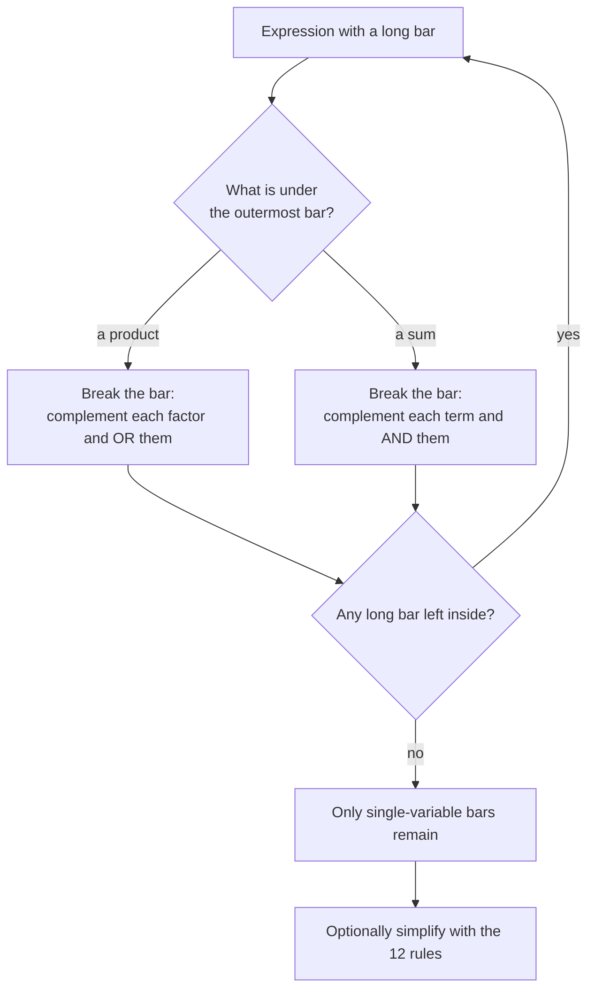

---
tags:
  - ECE2050
  - boolean-algebra
date: 2026-09-16
aliases:
  - 德摩根定理
  - 德摩根定律
  - DeMorgan's Theorems
  - De Morgan's Law
---

> [!NOTE] Where this fits · 定位
> 第 4 章第六篇（讲义 p.28–29）。前面 12 条规则处理"乘与加"，这一篇处理**上横线**：
> 什么时候可以把一整条横线拆开、拆开时符号怎么变。
> 它是把 NAND/NOR 电路改写成 AND/OR 形式的唯一工具，也是反函数与 SOP↔POS 之间的桥。
> 前置：[[Boolean Axioms]]（对偶性）、[[Proof by Perfect Induction]]（本篇的两种证法）、[[NAND Gate]]、[[NOR Gate]]（门级含义）。
> 下游：[[Sum-of-Products Form]]、[[Product-of-Sums Form]]、[[Boolean Expression Simplification]]。

> [!SUMMARY] Quick recall · 英文速览
> DeMorgan's theorems move a complement across AND or OR while exchanging the operator. They connect equivalent gate implementations and support Boolean simplification.

## Core Definition · 核心定义

两条 **DeMorgan 定理 (DeMorgan's theorems, 讲义 p.28)**：

$$
\overline{XY}=\bar X+\bar Y,\qquad \overline{X+Y}=\bar X\,\bar Y
$$

- **读法（一句话操作指令）**：**断开长横线，把符号反过来** ——
  *break the long bar and change the sign underneath*：乘积变和、和变乘积。
  即 $\overline{XY}$ 拆开后 $\cdot\to+$；$\overline{X+Y}$ 拆开后 $+\to\cdot$。
- **两条互为对偶**：把第一条里的 AND$\leftrightarrow$OR 与两边互换，就得到第二条（见 [[Boolean Axioms]] 的对偶性）。
- **门级含义 (gate-level meaning)**（讲义 p.29 的例子图）：

| 左边 | 右边 | 门的说法 |
|---|---|---|
| $\overline{XY}$ | $\bar X+\bar Y$ | **NAND 门** ≡ **两个输入各带反相气泡的 OR 门** |
| $\overline{X+Y}$ | $\bar X\bar Y$ | **NOR 门** ≡ **两个输入各带反相气泡的 AND 门** |

一句话记忆：**把输出端的气泡搬到输入端，同时换门（AND↔OR），功能不变**。

![[demorgan-gate-equivalence.svg]]
*图 1 — (a) NAND 门与"输入带反相的 OR 门"等价：$\overline{AB}=\bar A+\bar B$；
(b) NOR 门与"输入带反相的 AND 门"等价：$\overline{A+B}=\bar A\bar B$。
中间的等号表示两个门在全部 4 种输入组合下输出完全相同。*

> [!IMPORTANT] 适用范围：横线下面必须是一个"整体"
> DeMorgan 只处理**最外层**的那条横线。$\overline{XY}$ 里的横线盖住整个乘积，拆开才合法；
> 而 $X\bar Y$ 里的横线只盖住 $Y$，不能"顺便"把它也拆成 $\bar X+\bar Y$。
> 形式化地说：把横线下的式子看成一个整体 $F$，DeMorgan 说的是 $\bar F$ 怎么展开 ——
> $F$ 若是乘积 → 展开成"各项取反后相加"；$F$ 若是和 → 展开成"各项取反后相乘"。

## Assumptions and Validity · 适用前提

- 成立条件 1：横线（取反）覆盖的是一个**乘积**或一个**和**的整体，而不是单个变量。
- 成立条件 2：拆横线时，横线下面的**每一项都要取反**，一个都不能漏；同时运算符整体翻转。
- 成立条件 3：可以反复使用 —— 多层横线时从最外层往里拆，直到没有横线或只剩单变量上的横线。
- 失效边界：
  - $\overline{XY}\ne\bar X\bar Y$（这是最常见的错，见例题 4 与误区 1）；
  - $\overline{X+Y}\ne\bar X+\bar Y$；
  - DeMorgan 只管逻辑等价，不改变电路"是不是组合的"或"延迟多少"（见 [[Combinational Circuit]]）。

## Derivation · 推导过程

### 1. 用 perfect induction 证明第一条：$\overline{XY}=\bar X+\bar Y$

| $X$ | $Y$ | $XY$ | $\overline{XY}$ | $\bar X$ | $\bar Y$ | $\bar X+\bar Y$ | 比较 |
|---|---|---|---|---|---|---|---|
| 0 | 0 | 0 | 1 | 1 | 1 | 1 | ✓ |
| 0 | 1 | 0 | 1 | 1 | 0 | 1 | ✓ |
| 1 | 0 | 0 | 1 | 0 | 1 | 1 | ✓ |
| 1 | 1 | 1 | 0 | 0 | 0 | 0 | ✓ |

4 行全等 → 成立 ✓。**只有 $X=Y=1$ 这一行左边为 0**，而右边也只有在 $\bar X=\bar Y=0$ 时为 0，两者同步。

### 2. 用 perfect induction 证明第二条：$\overline{X+Y}=\bar X\bar Y$

| $X$ | $Y$ | $X+Y$ | $\overline{X+Y}$ | $\bar X$ | $\bar Y$ | $\bar X\bar Y$ | 比较 |
|---|---|---|---|---|---|---|---|
| 0 | 0 | 0 | 1 | 1 | 1 | 1 | ✓ |
| 0 | 1 | 1 | 0 | 1 | 0 | 0 | ✓ |
| 1 | 0 | 1 | 0 | 0 | 1 | 0 | ✓ |
| 1 | 1 | 1 | 0 | 0 | 0 | 0 | ✓ |

第二条也可以**由第一条取对偶**直接得到（第 4-03 的对偶原理），不必再枚举一次 —— 这是对偶性省力的典型例子。

### 3. 多变量推广

$$
\overline{XYZ}=\bar X+\bar Y+\bar Z,\qquad\qquad \overline{X+Y+Z}=\bar X\,\bar Y\,\bar Z
$$

- **分组证明（不用真值表）**：把三变量乘积当成"两项"的乘积：

$$
\overline{XYZ}=\overline{(XY)Z}=\overline{XY}+\bar Z=(\bar X+\bar Y)+\bar Z=\bar X+\bar Y+\bar Z
$$

  第一步把 $XY$ 看成 A、$Z$ 看成 B，用两变量版本；第二步再用一次两变量版本；这本质上是数学归纳法，
  所以对任意多个变量都成立（和项同理，取对偶即可）。

- **数值校验 (Numerical check)**：对 $(X,Y,Z)$ 的 8 种组合枚举，$\overline{XYZ}$ 与 $\bar X+\bar Y+\bar Z$ 8 行全等 ✓；
  $\overline{X+Y+Z}$ 与 $\bar X\bar Y\bar Z$ 8 行全等 ✓。检验点：只有 $(1,1,1)$ 那行 $\overline{XYZ}=0$，
  也只有那行 $\bar X+\bar Y+\bar Z=0$；只有 $(0,0,0)$ 那行 $\overline{X+Y+Z}=1$，也只有那行 $\bar X\bar Y\bar Z=1$。

### 4. 两个用途

1. **把 NAND/NOR 电路改写成 AND/OR 形式**：整个电路只有 NAND 时，反复用第一条定理把横线"外推"，
   最后得到 SOP 形式。例：$Y=\overline{\overline{AB}\cdot\overline{CD}}=\overline{\overline{AB}}+\overline{\overline{CD}}=AB+CD$。
2. **求反函数 (complement)**：想得到 $\bar Y$，就对 $Y$ 整体取反再用 DeMorgan 拆开 ——
   展开后 SOP 会变成 POS（反之亦然），这就是 [[Sum-of-Products Form]] 与 [[Product-of-Sums Form]] 之间的桥：

$$
Y=AB+CD\ \Longrightarrow\ \bar Y=\overline{AB+CD}=(\bar A+\bar B)(\bar C+\bar D)
$$

   注意右边是**和之积**：乘积项取反后整体变号，得到的是 POS。

## Method and Steps · 求解步骤与方法

1. **找到最外层的长横线**（盖住最多内容的那一条），它决定这一步拆谁。
2. **判断横线下面是"积"还是"和"**：是积 → 拆成"各项取反后**相加**"；是和 → 拆成"各项取反后**相乘**"。
3. **每一项都要取反**，包括已经是反变量的项（$\overline{\bar X}=X$，用 Rule 9）。
4. **括号要跟着走**：$\overline{A(B+C)}=\bar A+\overline{B+C}=\bar A+\bar B\bar C$ —— 先拆外层，再拆内层。
5. **重复到没有"长横线"为止**，只留下单变量上的横线。
6. **用真值表抽查**：变形前后各枚举一遍（$n$ 个变量 $2^n$ 行），确认逐行一致。

## Worked Example · 例题

**Example 1 — 讲义 p.28 的两条定理（perfect induction）**

题目：用穷举证明两条 DeMorgan 定理。

解：见上面推导 1 与推导 2 的两张 4 行真值表，两列 $\overline{XY}$ 与 $\bar X+\bar Y$（以及 $\overline{X+Y}$ 与 $\bar X\bar Y$）
**8 个比较点全部相同** ✓。

**数值校验 (Numerical check)**：4 行 ×2 条定理 = 8 组比较，全部 ✓；第二条也可由第一条取对偶得到，
两条独立方法与对偶原理三者互相印证。

**Example 2 — 讲义 p.29 的同型例题：把带长横线的式子拆开（自算）**

题目：化简 $Y=\overline{A+\bar B C}$。

解：最外层横线盖住一个**和** $A+\bar BC$ → 拆成"各项取反后相乘"：

$$
Y=\overline{A+\bar BC}=\bar A\cdot\overline{\bar BC}=\bar A\,(B+\bar C)
$$

再用分配律展开：$Y=\bar A B+\bar A\bar C$。

**数值校验 (Numerical check)**（8 行全枚举）：

| $A$ | $B$ | $C$ | $\bar BC$ | $A+\bar BC$ | $Y=\overline{A+\bar BC}$ | $\bar A(B+\bar C)$ | $\bar AB+\bar A\bar C$ |
|---|---|---|---|---|---|---|---|
| 0 | 0 | 0 | 0 | 0 | 1 | 1 | 1 ✓ |
| 0 | 0 | 1 | 1 | 1 | 0 | 0 | 0 ✓ |
| 0 | 1 | 0 | 0 | 0 | 1 | 1 | 1 ✓ |
| 0 | 1 | 1 | 1 | 1 | 0 | 0 | 0 ✓ |
| 1 | 0 | 0 | 0 | 1 | 0 | 0 | 0 ✓ |
| 1 | 0 | 1 | 1 | 1 | 0 | 0 | 0 ✓ |
| 1 | 1 | 0 | 0 | 1 | 0 | 0 | 0 ✓ |
| 1 | 1 | 1 | 1 | 1 | 0 | 0 | 0 ✓ |

三个式子在 8 行上完全一致 ✓。第二、三次取反时注意 $\overline{\bar B}=B$（Rule 9）、$\overline{\bar C}=C$。

**Example 3 — 把 NAND-only 电路化成 AND/OR（自算，典型考试题）**

题目：化简 $Y=\overline{\overline{AB}\cdot\overline{CD}}$。

解：最外层盖住一个**积**（两个 NAND 输出的乘积）→ 拆成相加，再对每一项用一次 DeMorgan：

$$
Y=\overline{\overline{AB}\cdot\overline{CD}}=\overline{\overline{AB}}+\overline{\overline{CD}}=AB+CD
$$

**数值校验 (Numerical check)**：对 4 个变量枚举 $2^4=16$ 行 —— 原式与 $AB+CD$ 16 行全等 ✓。
抽查：$A=B=1,C=D=0$ → $\overline{AB}=0$、$\overline{CD}=1$ → 原式 $\overline{0\cdot1}=1$，$AB+CD=1$ ✓；
$A=B=C=D=1$ → 原式 $\overline{0\cdot0}=1$，$AB+CD=1+1=1$ ✓。

**Example 4 — 陷阱对照：$\overline{XY}$ 不等于 $\bar X\bar Y$**

题目：判断 $\overline{XY}=\bar X\bar Y$ 是否成立。

解：不成立。右边是"两个都取反再相乘"，左边是"相乘后取反"，两者只在部分行为上巧合相同。

**数值校验 (Numerical check)**：

| $X$ | $Y$ | $\overline{XY}$ | $\bar X\bar Y$ | 比较     |
| --- | --- | --------------- | -------------- | ------ |
| 0   | 0   | 1               | 1              | 巧合相同   |
| 0   | 1   | 1               | 0              | **不同** |
| 1   | 0   | 1               | 0              | **不同** |
| 1   | 1   | 0               | 0              | 巧合相同   |

4 行里有 **2 行不同** ✓ —— 所以 $\overline{XY}=\bar X\bar Y$ 是错的；正确的展开是 $\overline{XY}=\bar X+\bar Y$（第一条定理）。

**Example 5 — 求反函数（自算）**

题目：求 $Y=A\bar B+C$ 的反函数 $\bar Y$，并给出 POS 形式。

解：

$$
\bar Y=\overline{A\bar B+C}=\overline{A\bar B}\cdot\bar C=(\bar A+B)\bar C=\bar A\bar C+B\bar C
$$

**数值校验 (Numerical check)**：对 3 个变量枚举 8 行 ——
$A=1,B=0,C=0$：$Y=1\cdot1+0=1$，$\bar Y=0$；而 $(\bar A+B)\bar C=(0+0)\cdot1=0$ ✓。
$A=1,B=1,C=0$：$Y=0+0=0$，$\bar Y=1$；$(\bar A+B)\bar C=(0+1)\cdot1=1$ ✓。
$A=0,B=0,C=1$：$Y=0+1=1$，$\bar Y=0$；$(1+0)\cdot0=0$ ✓。8 行全部一致 ✓。

## Pitfalls · 常见误区

> [!WARNING] DeMorgan 的错几乎都是"横线没拆对"或"符号没翻"

1. **$\overline{XY}$ 写成 $\bar X\bar Y$**。错在：只给每一项加横线，没换运算符。
   正确：$\overline{XY}=\bar X+\bar Y$（积 → 和）；反例见 Example 4，4 行里 2 行不同。
2. **$\overline{X+Y}$ 写成 $\bar X+\bar Y$**。错在：横线拆了、运算符没换。
   正确：$\overline{X+Y}=\bar X\bar Y$（和 → 积）。检验点：$X=Y=0$ 时左边 $\overline{0+0}=1$，右边 $\bar0+\bar0=1+1=1$ 看似对，
   取 $X=0,Y=1$ 立刻露馅：左边 $\overline{0+1}=0$，错式右边 $1+0=1$ ✗。
3. **只给部分项取反**。错在：$\overline{ABC}$ 只拆成 $\bar A+BC$。
   正确：**每一项**都要取反：$\bar A+\bar B+\bar C$（多变量推广，推导 3）。
4. **把 DeMorgan 用在横线只盖住一部分的地方**。错在：把 $A+\bar{B+C}$ 里的 $A$ 也取反。
   正确：横线只盖住 $B+C$，所以 $\bar{\overline{B+C}}$ 这部分单独处理：$A+\bar B\bar C$。
5. **用 DeMorgan 时忘了括号**。错在：$\overline{A(B+C)}$ 写成 $\bar A+\overline{B+C}=\bar A+\bar B\bar C$ 却漏掉乘积层级，
   或写成 $\bar A+\bar B+\bar C$。正确：先拆外层得 $\bar A+\overline{B+C}$，再拆内层得 $\bar A+\bar B\bar C$（乘积在最内层）。
6. **把 DeMorgan 与"对偶"混为一谈**。错在：认为 DeMorgan 就是取对偶。
   正确：对偶是 $\cdot\leftrightarrow+$、$0\leftrightarrow1$ 的交换（变量不动，见 [[Boolean Axioms]]）；
   DeMorgan 是**取反**的展开（变量要加/去横线）。两者刚好都把 AND 与 OR 对调，所以容易混。

## Move the outer complement carefully · 外层取补怎样分配

Apply DeMorgan's law to the operation enclosed by the outermost bar. Change AND to OR or OR to AND, and complement every operand at that level. If an operand is itself a compound expression, keep its parentheses and repeat the transformation there. This is a recursive operation, not a global exchange of every symbol at once.

For a NAND implementation, the output is the complement of a product. Its equivalent negative-OR symbol has complemented inputs. The gate body and bubbles must change together; moving only one bubble changes the function.

**Worked application.** $Y=\overline{(A+B)C}$，第一步为 $\overline{A+B}+\bar C$，第二步为 $\bar A\bar B+\bar C$。A=0,B=1,C=1 时原式0，正确式0；错误式 $\bar A+\bar B+\bar C$ 却为1。

**English exam question:** Does the dual of an expression equal its complement?

**Answer:** Generally no. Duality exchanges the operations and constants but leaves each literal unchanged. Complementation must invert the literals under DeMorgan's laws. Use [[Boolean Axioms]] for that distinction and [[Universal Gates and Bubble Pushing]] to carry the algebra into a gate diagram.

## Connections · 相关笔记

- 上游 (upstream)：[[NAND Gate]] —— $\overline{AB}$ 的门级形态，第一条定理的左边。
- 上游 (upstream)：[[NOR Gate]] —— $\overline{A+B}$ 的门级形态，第二条定理的左边。
- 上游 (upstream)：[[Proof by Perfect Induction]] —— 两条定理都是用 4 行穷举证出来的。
- 平行 (parallel)：[[Boolean Axioms]] —— 两条定理互为对偶，这正是对偶原理的一个实例。
- 平行 (parallel)：[[Laws and Rules of Boolean Algebra]] —— DeMorgan 拆完横线后，接着用 12 条规则继续化简。
- 下游 (downstream)：[[Sum-of-Products Form]] —— 反函数是 POS：$\overline{SOP}$ 展开后得到 POS，反之亦然。
- 下游 (downstream)：[[Product-of-Sums Form]] —— 由真值表写 POS 时，本质就是对"输出为 0 的行"取反。
- 下游 (downstream)：[[Boolean Expression Simplification]] —— 化简时横线处理全靠本篇，之后再用 Rule 10–12 收尾。

---
索引：[[ECE2050 Knowledge Tree]] · [[Glossary]]
