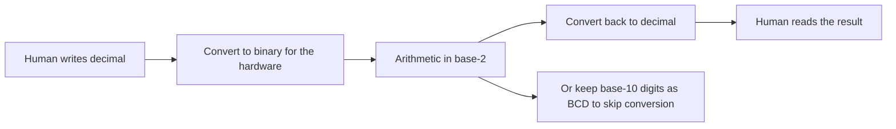

---
tags:
  - ECE2050
  - number-bases
date: 2026-09-16
aliases:
  - 十进制
  - 十进制数制
  - Decimal
  - Decimal Number System
  - Base-10
---

> [!NOTE] Where this fits · 定位
> [[Number Systems]] 给出的 base-$R$ 三要素，第一个实例就是**十进制 (base-10)**：它既是我们在纸上
> 用了一辈子的数制，也是**人与机器之间的接口语言**——你输入的是十进制，机器算的是二进制，
> 中间那次换算是要付代价的。
> 前置：[[Number Systems]]（基数 / 数码 / 位权的定义、通式 $(N)_R=\sum_i a_iR^{i}$）。
> 下游：[[Binary Number System]]、[[Number Base Conversion]]（换算的代价就出在这里）、
> [[Binary Coded Decimal]]（"不换算、直接用 4 bit 存 1 位十进制"的折中方案）。

> [!SUMMARY] Quick recall · 英文速览
> Decimal is the base-10 positional system, whether or not a radix point appears. A digit in position $i$ contributes its value times $10^i$.

## Core Definition · 核心定义

**十进制数制 (decimal number system / base-10)** 的三要素（讲义 p.6）：

| 要素 | 取值 |
|---|---|
| 基数 (base) | $R = 10$ |
| 数码 (digit) | $0,1,2,3,4,5,6,7,8,9$（共 10 个） |
| 位权 (weight) | $\dots 10^{2},\;10^{1},\;10^{0}\;.\;10^{-1},\;10^{-2},\;10^{-3}\dots$ |

**小数点 (decimal point)** 是整数部分与小数部分 (fractional numbers) 的分界：
它左边最低位的权是 $10^{0}=1$，它右边最高位的权是 $10^{-1}=0.1$。
换句话说，**小数点左边的位权按 $\times10$ 向左递增，右边的位权按 $\div10$ 向右递减**。

**"decimal number" 的准确含义**（讲义 p.6 的旁注）：
*decimal numbers mean any base 10 numbers, not just those with a decimal point* ——
"十进制数"指的是**基数为 10 的数**，不是"带小数点的数"。$568$ 是十进制数，$568.23$ 也是；
反过来，`1011` 就算不带小数点，也不是十进制数（它没有下标时通常按二进制读）。

把通式代进 $R=10$，得到十进制数的展开式：

$$
(N)_{10} \;=\; \sum_{i=-m}^{\,n-1} a_i\,10^{i}
$$

- **意义**：每一位的贡献是"数码 $\times$ 这一位的权"，整数的权是 $10^{k}$、小数的权是 $10^{-k}$。
- **数值校验**：$(568.23)_{10} = 5\times10^{2}+6\times10^{1}+8\times10^{0}+2\times10^{-1}+3\times10^{-2} = 500+60+8+0.2+0.03 = 568.23$ ✓（与讲义 p.6 逐项一致）。

![[positional-weights.svg]]
*图 1 — 十进制数 $(568.23)_{10}$ 的位权展开（左图 (a)）：柱高＝位权 $10^{i}$，从 $10^{2}=100$ 一路降到
$10^{-2}=0.01$，每一级正好是右边的 10 倍——这就是"每往左一位大十倍"的图像。
柱顶的注解给出每位的实际贡献 $5\times10^{2}=500$、$6\times10^{1}=60$、$8\times10^{0}=8$、
$2\times10^{-1}=0.2$、$3\times10^{-2}=0.03$，五项相加 $=568.23$。
小数点左边是整数、右边是小数，图里用虚线标出了这条分界。*
*(图中 (b) 是同一套画法用在 base-2 上，留给 [[Binary Number System]] 用；本篇只看 (a)。)*

## Assumptions and Validity · 适用前提

> [!IMPORTANT] 人为什么用十进制？——历史约定，不是数学必然
> 讲义 p.3 把日常数制列成 *10, 12, 60, …*：十进制并不比十二进制或六十进制"更正确"。
> 公认的解释很朴素：**人有十根手指**，于是"逢十进一"成了最省事的约定。
> 这个事实有两个直接推论：
> ① **数学上没有任何理由偏爱 10**——位权制的通式对任意 $R\ge2$ 都成立；
> ② **机器也没有理由偏爱 10**——硬件里"两种稳定状态"最便宜，所以计算机选 $R=2$
> （见 [[Binary Number System]]：开关/晶体管的导通与截止、抗噪声裕度大、布尔逻辑直接映射）。
> 十进制之所以重要，是因为**它长在人这一侧**，而不是因为它长在物理这一侧。

- **十进制是人机接口语言**：人写十进制，机器存二进制，所以每一次输入/输出都要**转换**。
  转换不是免费的：
  - 需要专门的时间与电路（[[Number Base Conversion]] 里的反复除法、按位权求和都要逐步做）；
  - 十进制整数 $N$ 用二进制存需要约 $\log_2 N$ 位，位数比十进制位数多（$568$ 要 10 位二进制）。
- **折中方案**：如果某类数据"以十进制为人看的样子出现"（金额、仪表读数、计算器显示），
  可以不换算，直接用 4 bit 存 1 位十进制数字，这就是 [[Binary Coded Decimal]]（BCD）。
  代价是 16 个 4-bit 码里只用 10 个，**每位浪费 6 个码**，而且加法要额外做 $+6$ 修正。
- **表示能力与基数无关**：一个数能否用**有限位**写出来，取决于它与基数的关系。
  $1/3$ 在十进制下写不完（$0.333\dots$），$1/10=0.1$ 在十进制下却是一位写完；
  到了二进制正好反过来。**这不是"精度高低"，只是"分母里有没有基数的因子"**。

## Derivation · 推导过程

### 1. 位权阶梯：为什么"每往左一位就大十倍"

十进制的位权序列是 $10^{i}$，相邻两位的比值恒为 $10$：

$$
\frac{10^{i+1}}{10^{i}} = 10,\qquad i = \dots,-2,-1,0,1,2,\dots
$$

- 意义：只要记住"小数点左边第一位是 $1$、往左每一位乘 $10$；右边第一位是 $0.1$、往右每一位除以 $10$"，
  就能随口读出任意十进制数。
- 数值校验：$10^{2}=100$、$10^{1}=10$、$10^{0}=1$、$10^{-1}=0.1$、$10^{-2}=0.01$ ——
  $100 \div 10 = 10$、$10 \div 10 = 1$、$1 \div 10 = 0.1$、$0.1 \div 10 = 0.01$ ✓，比值处处为 10。

### 2. $(568.23)_{10}$ 的展开与求和

$$
\begin{aligned}
(568.23)_{10}
&= (5\times10^{2}) + (6\times10^{1}) + (8\times10^{0}) + (2\times10^{-1}) + (3\times10^{-2})\\
&= (5\times100) + (6\times10) + (8\times1) + (2\times0.1) + (3\times0.01)\\
&= 500 + 60 + 8 + 0.2 + 0.03 = 568.23
\end{aligned}
$$

- 意义：**整数部分与小数部分走的是同一套规则**，只是指数从 $0$ 起一个往左、一个往右。
- 数值校验：$500+60=560$，$560+8=568$；$0.2+0.03=0.23$；$568+0.23=568.23$ ✓（分两次加也对得上）。

### 3. "除以 10 取余"与十进制记法自洽

把整数 $N$ 反复除以 10，第一个余数其实是 $N \bmod 10$，也就是**最低位 (LSD, least significant digit)**：

$$
N = 10\,q_0 + r_0,\qquad r_0 = N \bmod 10,\quad q_0 = \lfloor N/10 \rfloor
$$

再对 $q_0$ 重复同样的动作，直到商为 0，把余数**从下往上**读就是十进制写法。

- 意义：这条算法说明"十进制记法"本身就是"按 $10$ 的幂分解"，所以它才能同时是**记法**和**算法**。
- 数值校验（以 $568$ 为例）：
  $568 = 10\times56 + \mathbf{8}$；$56 = 10\times5 + \mathbf{6}$；$5 = 10\times0 + \mathbf{5}$。
  余数依次是 $8,6,5$，倒过来读 $5,6,8$，即 $568 = 5\times10^{2}+6\times10^{1}+8\times10^{0}$ ✓。

## Method and Steps · 求解步骤

1. **找小数点**：它把位串切成整数部分与小数部分；没有小数点就说明小数部分为空。
2. **标指数**：小数点左边从 $0$ 开始向左递增（$0,1,2,\dots$），右边从 $-1$ 开始向右递减（$-1,-2,\dots$）。
3. **逐位写乘积**：每个位置写"数码 $\times 10^{i}$"，**不要跳过数码为 0 的位置**。
4. **求和**：整数部分与小数部分分别累加，最后合并。
5. **回代校验**：把结果与其量级比较（$n$ 位整数小于 $10^{n}$），或反过来用"除以 10 取余"把数值还原成位串。

> [!TIP] 心算十进制展开的两个快捷检查
> ① **位数定范围**：$568$ 是 3 位数，必然落在 $[100, 999]$；算出的 568 落在这个区间 ✓。
> ② **末位定尾巴**：小数部分只看最后一位——末位是 $3$、指数是 $-2$，贡献必然是 $0.03$，
> 所以结果的小数第二位一定是 3。

## Worked Example · 例题

**Example 1 — 按位权展开 $(568.23)_{10}$（讲义 p.6）**

题目：把 $(568.23)_{10}$ 完全展开成位权之和。

解：
1. 整数部分 $568$：$5\times10^{2} + 6\times10^{1} + 8\times10^{0}$。
2. 小数部分 $0.23$：$2\times10^{-1} + 3\times10^{-2}$。
3. 合并化简：$500 + 60 + 8 + 0.2 + 0.03$。

**数值校验 (Numerical check)**：$500+60+8 = 568$；$0.2+0.03 = 0.23$；$568+0.23 = 568.23$ ✓。
与讲义 p.6 的两行中间结果逐项相同（$(5\times100)+(6\times10)+(8\times1)+(2\times0.1)+(3\times0.01)$）。

**Example 2 — 用"除以 10 取余"把 $(568)_{10}$ 写成位权形式**

题目：不查任何表，用反复除以 10 的方法说明 $568 = 5\times10^{2}+6\times10^{1}+8\times10^{0}$。

解：
1. $568 \div 10 = 56$ 余 $\mathbf{8}$ → 最低位 $a_0 = 8$（LSD 先出来）。
2. $56 \div 10 = 5$ 余 $\mathbf{6}$ → $a_1 = 6$。
3. $5 \div 10 = 0$ 余 $\mathbf{5}$ → $a_2 = 5$；商为 0，停止。
4. 余数**从下往上**读：$5\,6\,8$。

**数值校验 (Numerical check)**：回代 $500+60+8 = 568$ ✓；商序列 $568 \to 56 \to 5 \to 0$ 每步整除，
余数恰好是 $568$ 的各位数字，说明该算法与十进制记法**自洽**（它就是把通式反过来用）。
注意：这条算法对任意基数 $R$ 都成立，把 10 换成 2、8、16 就得到
[[Number Base Conversion]] 里的"反复除法"。

**Example 3 — "写不完"的小数与基数有关**

题目：$1/3$ 在十进制下写成小数会怎样？这说明了什么？

解：
1. $1 \div 3 = 0$ 余 $1$ → 第一位 $0.3$，余数又回到 $1$。
2. 余数重复 → 后面的位无限循环：$0.333\dots$。
3. 换到二进制：$1/3 = 0.0101\,0101\dots_2$，同样写不完（但 $1/10=0.1_{10}$ 在二进制下也是无限循环的 $0.0001\,1001\,1001\dots_2$）。

**数值校验 (Numerical check)**：$3 \times 0.3333 = 0.9999 \ne 1$，而 $3\times(1/3)=1$ ✓ ——
"写不完"是**表示方式**的限制，不是数值本身有问题；同理 $0.1$ 在二进制里也写不完，
这正是 [[Floating-Point Numbers]] 里"$0.1$ 无法精确表示"的根源。

## Pitfalls · 常见误区

> [!WARNING] 十进制太熟，反而最容易在"它是什么"上出错

1. **把"decimal number"当成"带小数点的数"**。错在：说 $568$ 不是 decimal number。
   正确：decimal 说的是**基数 10**（讲义 p.6 旁注），与有没有小数点无关。
2. **以为十进制是数学必然**。错在：把"逢十进一"当宇宙规律。正确：它是十根手指带来的历史约定；
   位权制通式对任意 $R\ge2$ 成立，计算机选 $R=2$ 有物理上的硬理由。
3. **小数点后第一位写成 $10^{-2}$**。错在：把 $568.23$ 的小数部分展开成 $2\times10^{-2}+3\times10^{-3}$。
   正确：**小数点后第一位是 $10^{-1}$**（$0.1$ 那一位），往右才依次是 $10^{-2},10^{-3}\dots$。
   自检：$2\times10^{-1}=0.2$ 与末位的 $0.03$ 相加得 $0.23$ ✓。
4. **漏掉数码为 0 的位置**。错在：把 $5\times10^{2}+6\times10^{1}+8$ 写成 $5\times10^{2}+6\times10^{1}+8\times10^{-1}$。
   正确：位权由**位置**决定，0 只让这一位贡献为 0，不会让位权变小（图 1 的虚线柱就是这种位置）。
5. **以为"十进制更精确"**。错在：认为 $1/3$ 写不完是十进制"不够好"。
   正确：$1/3$ 在二进制下同样写不完，$0.1$ 在二进制下也写不完——能否有限表示取决于
   **分母是否含基数的因子**，与"哪一种进制更高级"无关。
6. **把十进制直接丢给硬件算**。错在：以为计算机"内部就是十进制"。
   正确：硬件用二进制；要让机器按十进制算，要么先做 [[Number Base Conversion]]，
   要么用 [[Binary Coded Decimal]]（每位 4 bit，且加法后要做 $+6$ 修正）。

## Decimal intent in digital hardware · 十进制语义与英文理解

Decimal notation is convenient for human quantities, but digital hardware may store those quantities in binary. A decimal display requirement does not imply that every internal register must use BCD. The designer can count in binary and convert at the output, or maintain one decimal digit per counter. The choice affects the arithmetic, the number of storage bits, and the decoding logic.

The words “decimal number” identify a radix, whereas “fractional number” identifies a noninteger value. An integer such as 120 is decimal when written in base ten. A value such as $10.1_2$ is fractional but binary. Keep these two classifications independent when reading English questions.

**Worked application — seconds display.** 仪表显示 00–59 s，共 60 种数值。纯二进制计数至少需 $\lceil\log_2 60\rceil=6$ 位；以两位 BCD 存则需 8 位。59 的二进制是 `111011`，BCD 是 `0101 1001`。后一种可把十位 5 和个位 9 分别送入显示译码器，但状态转移必须在 59 后回到 00，不能继续到 60。

In English: six bits are sufficient to enumerate sixty values, but two BCD digits require eight bits because each digit has its own four-bit field. The extra codes are not additional valid seconds. Display format and state range are separate specifications.

**English exam question:** Why does a two-digit decimal counter not necessarily require seven bits because $99<128$?

**Answer:** Seven bits suffice for an unsigned binary encoding of 0–99. A two-digit BCD encoding uses two four-bit fields and therefore requires eight bits. The answer depends on the requested representation, not only on the maximum numeric value.

Apply this distinction in [[Binary Coded Decimal]], [[Seven-Segment Display and Code Conversion]], and [[Cascaded Counters and Digital Clocks]].

## Connections · 相关笔记

- 上游 (upstream)：[[Number Systems]] —— 通式 $(N)_R=\sum_i a_iR^{i}$ 与"小数点"的定义都是它给的。
- 下游 (downstream)：[[Number Base Conversion]] —— 十进制 ↔ 任意进制的两套算法（按位权求和、反复除法）。
- 下游 (downstream)：[[Binary Coded Decimal]] —— 不换算、直接以 4 bit 存 1 位十进制数字的折中方案。
- 平行 (parallel)：[[Binary Number System]] —— 机器的语言；"人写十进制、机器存二进制"这组对照是本章的主线。
- 平行 (parallel)：[[Floating-Point Numbers]] —— 十进制小数"写不完"的现象，在二进制浮点里变成了精度问题。

---
索引：[[ECE2050 Knowledge Tree]] · [[Glossary]]
