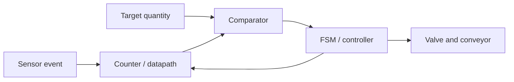

---
tags:
  - ECE2050
  - foundations
date: 2026-09-30
aliases:
  - 数字抽象与系统设计
  - Digital Abstraction and System Design
  - Digital discipline
---

# Digital Abstraction and System Design · 数字抽象与系统设计

> [!SUMMARY] Quick recall · 英文速览
> Digital design treats continuous voltages as discrete symbols under explicit interface rules. Abstraction makes complex systems manageable; voltage and timing constraints make the abstraction reliable.

## Core Definition · 核心定义

数字量 (digital quantity) 取离散值，模拟量 (analog quantity) 可以连续变化。实际导线电压仍是模拟量；我们把满足阈值条件的一段电压解释为逻辑 0 或 1。离散的是**信息解释**，不是说电压只可能恰好为 0 V 与电源电压。

**Abstraction** hides unnecessary detail while preserving the behavior needed at the next level. A gate can be studied through its truth table without solving every transistor equation. Its voltage limits and propagation delays must still be respected at the interface.

| Principle | 中文含义 | Concrete application |
|---|---|---|
| Hierarchy | 逐层组织 | Transistors → gates → adders → datapath |
| Modularity | 接口明确、可替换 | Reuse a verified two-input MUX |
| Regularity | 重复结构易扩展 | Repeat a full-adder stage for each bit |
| Discipline | 用约束换可靠性 | Valid voltage levels and clock timing |

## Assumptions and Validity · 适用前提

静态约束 (static discipline)：有效输入应产生有效输出，见 [[Logic Levels]] 与 [[Noise Margin]]。动态约束 (dynamic discipline)：采样附近数据必须稳定，见 [[Setup and Hold Timing]]。真值表正确只能证明逻辑功能，不能单独证明实际电路可靠。

Positive logic maps HIGH to 1 and LOW to 0. An active-low control is asserted at LOW even when the rest of the circuit uses positive logic. Keep the voltage level, Boolean value, and asserted meaning separate.

## Derivation · 从抽象到系统

1. 外界传感器输出电压；阈值把它转为 Boolean event。
2. [[Counters]] 保存事件个数；组合逻辑比较当前计数和目标。
3. [[Magnitude Comparator]] 得到“已装满”；[[Finite State Machine]] 决定关阀、移动、清零。
4. 数量运算由 datapath 完成，动作时序由 controller 完成。二者分开，能够分别验证。

This is a dependency diagram, not a wiring schematic. The controller feedback crosses clocked state elements; a combinational loop would require a different model.

## Worked Examples · 实际例题

**Bottle filling.** 目标 12 粒，计数器初值 0，每个有效传感器事件加 1。需要至少 $n=\lceil\log_2(12+1)\rceil=4$ 位来保存 0 至 12。第 12 次事件后 count=12，比较器相等输出有效，控制器进入停止状态。3 位只能到 7，不够。

An input pulse must be converted into exactly one count event. Sampling a HIGH level for three cycles must not count one tablet three times. Synchronization, edge detection, and the event specification belong in the input interface.

**Digital audio.** ADC 把幅值量化成代码，数字部分存储和运算，DAC 再生成模拟输出。数字存储可以抗一定噪声，但量化会产生误差；数字系统不是“没有模拟部分”。采样理论不是本课程逻辑模型的全部内容。

## Method and Review · 方法与复习

- Identify what is data and what is control before choosing gates.
- Specify widths, polarity, initial state, and the meaning of one event.
- Verify individual modules before composing the whole system.
- 检查逻辑功能、电压接口和时序，三层分别完成。

**Exam question:** Why can a correct truth table still produce an unreliable circuit?

**Answer:** The truth table describes steady-state Boolean behavior. Real gates can violate voltage margins, take time to settle, or be sampled during a transition. Correct functionality must be combined with valid electrical interfaces and timing constraints.

## Connections · 相关笔记

- Foundations: [[Bits and Bytes]], [[Logic Gates]], [[Combinational Circuit]].
- Stateful implementation: [[Sequential Logic]], [[Field-Programmable Gate Array]].
- 实际例题连接 [[Cascaded Counters and Digital Clocks]]，理解模块如何组成完整系统。

---
索引：[[ECE2050 Knowledge Tree]] · [[Glossary]]
