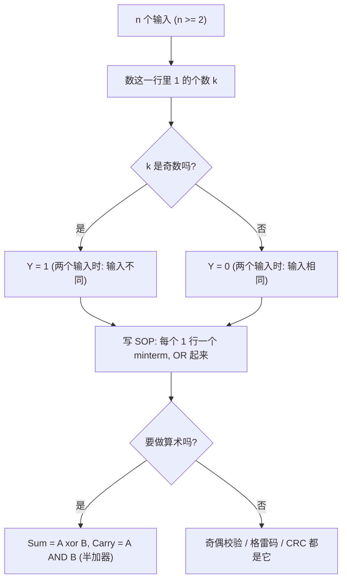

---
tags:
  - ECE2050
  - logic-gates
date: 2026-09-16
updated: 2026-10-08
aliases:
  - 异或门
  - XOR 门
  - 异或
  - Exclusive-OR Gate
  - XOR Gate
---

> [!NOTE] Where this fits · 定位
> 这一篇是门家族里唯一"**不是** AND/OR 加气泡"得到的门：XOR 由真值表直接定义 —— **两个输入不同时输出 1**。
> 讲义 p.10 给符号与真值表，p.11 给出它最著名的用途：**XOR 可以把两个比特相加**（产生 Sum 位，进位交给 AND）。
> 前置：[[AND Gate]]、[[OR Gate]]、[[Inverter]]（$\bar A$ 的记号）。
> 下游：[[Exclusive-NOR Gate]]（XOR 的反相 = 相等检测器）、[[Sum-of-Products Form]]（Ch4：由真值表写出 $A\bar B+\bar AB$）。
> 平行：[[Parity Bit]]（XOR 检测数据中奇数个 1，其结果用作偶校验位）、[[Gray Code]]（$g=b\oplus(b\gg1)$）、
> [[Cyclic Redundancy Check]]（模 2 加法即逐位 XOR）。

> [!SUMMARY] Quick recall · 英文速览
> For two inputs, XOR outputs 1 when the inputs differ. More generally it reports odd parity and forms the sum bit in binary addition.

## Core Definition · 核心定义

**Exclusive-OR (XOR) gate**：当且仅当两个输入**不相同**时输出 1。

$$Y=A\oplus B=A\bar B+\bar AB$$

- 意义：等号右边是它的**标准 SOP 形式** —— 真值表里输出为 1 的两行各贡献一个 minterm，再用 OR 加起来。
- 符号 (symbol)：OR 的弧形本体，输入侧多一道弧线（"exclusive" 的那道弧）；没有输出气泡。
- $\oplus$ 读作 "exclusive-OR"，是**模 2 加法 (modulo-2 addition)**：$0\oplus0=0$、$0\oplus1=1$、$1\oplus0=1$、$1\oplus1=0$。

**两输入真值表**（行按二进制顺序）：

| $A$ | $B$ | $A\oplus B$ | 说明 |
|---|---|---|---|
| 0 | 0 | 0 | 相同 → 0 |
| 0 | 1 | **1** | 不同 → 1 |
| 1 | 0 | **1** | 不同 → 1 |
| 1 | 1 | 0 | 相同 → 0 |

- 多输入时"不同为 1"升级为：**输入中 1 的个数为奇数 → 输出 1**（odd parity，见 Example 2 与讲义 p.13 的 XOR3）。
- 门级等价（两输入）：$A\oplus B=(A+B)\cdot\overline{AB}$ —— "至少一个 1" 且 "不是两个都 1"。

![[xor-gate-timing.svg]]
*图 1 — $A$（周期 4）、$B$（周期 2）与 $Y=A\oplus B$ 的时序图。每个格子顶部标出两个输入的比较结果：
`≠`（不同，红）或 `=`（相同，灰）；灰底格子正是 $A\neq B$ 的四格（第 2、3、6、7 格），
$Y$ 在那里为 1 —— 与真值表的两行 "不同 → 1" 完全对应。*

## Assumptions and Validity · 适用前提

> [!IMPORTANT] XOR 的三条前提与它最常被误用的地方
> ① **两输入时的判据是"不同"，多输入时的判据是"奇数个 1"**：两者在两输入时等价，
> 但三输入起"不同"这句话就没有定义了 —— 必须改数 1 的个数（奇偶校验的来历）。
> ② **$A\bar B+\bar AB$ 是两输入专有的展开式**：它依赖"只有两个变量"，变量变多要重新按真值表写 SOP。
> ③ **$\oplus$ 是可结合、可交换的**：$A\oplus B\oplus C=(A\oplus B)\oplus C$，所以"多输入 XOR"才有唯一含义
> （这正是 [[Parity Bit]] 电路与 [[Cyclic Redundancy Check]] 的模 2 加法能成立的基础）。

- 与 OR 的分界：$1+1=1$，但 $1\oplus1=0$ —— **XOR 的"1"是"恰好一个/奇数个"，不是"至少一个"**。
- 有效边界：输入仍是合法逻辑电平；XOR 的可靠性同样受 [[Logic Levels]] / [[Noise Margin]] 约束。

## Derivation · 推导过程

### ① 从真值表写出 $Y=A\bar B+\bar AB$

"不同为 1"意味着输出为 1 的行只有两行：$(A,B)=(0,1)$ 与 $(1,0)$。
按 Ch4 的规则，每行写一个含全部变量的乘积项（取值为 1 的变量写原变量、取值为 0 的写反变量），再 OR：

$$Y=\underbrace{\bar AB}_{(0,1)\text{ 行}}+\underbrace{A\bar B}_{(1,0)\text{ 行}}$$

- 意义：真值表 → 标准 SOP 是一步机械操作（链 [[Sum-of-Products Form]]、[[Minterm and Maxterm]]）。
- 数值校验（取 $A=1,B=0$）：$A\bar B=1\cdot1=1$、$\bar AB=0\cdot0=0\Rightarrow Y=1$ ✓；
  取 $A=1,B=1$：$A\bar B=1\cdot0=0$、$\bar AB=0\cdot1=0\Rightarrow Y=0$ ✓（两个乘积项同时为 0）。
- 全表核验（Python 复核 4 行）：$A\bar B+\bar AB$ 与"两输入不同"完全一致 ✓。

### ② 另一种等价写法：$A\oplus B=(A+B)\overline{AB}$

- 意义：把"至少一个 1"（$A+B$）与"不是两个都 1"（$\overline{AB}$）相乘 —— 这就是用 OR/NAND/AND 搭 XOR 的经典结构。
- 数值校验（取 $A=1,B=1$）：$(1+1)\cdot\overline{1\cdot1}=1\cdot0=0$ ✓；
  取 $A=0,B=1$：$(0+1)\cdot\overline{0\cdot1}=1\cdot1=1$ ✓。四行逐一代入都与第 ① 条相同 ✓。

### ③ 多输入推广：奇数个 1 → 1

三输入时把定义写成"1 的个数为奇数"：

$$Y=A\oplus B\oplus C=\sum m(1,2,4,7)$$

- 意义：三种"恰好一个 1"的行 $(001,010,100)$ 加上"恰好三个 1"的行 $(111)$，共 4 行输出 1 —— 这就是
  **奇数性指示 (odd-parity indication)** 函数，也是讲义 p.13 右表标注 "Odd parity" 的原因（逐行核对见 Example 2）；若把该结果作为新增位，则生成的是偶校验码字。
- 数值校验：$A=1,B=1,C=1$ 时 1 的个数是 3（奇）→ $Y=1$ ✓；$A=1,B=1,C=0$ 时是 2（偶）→ $Y=0$ ✓。
- 递推校验：$A\oplus B\oplus C=(A\oplus B)\oplus C$ —— 先算前两个的奇偶，再与第三个异或 ✓（Python 逐行一致）。

### ④ XOR 的代数性质（都能用真值表一行行验证）

| 性质 | 式子 | 直觉 |
|---|---|---|
| 与 0 异或 | $A\oplus0=A$ | 0 不改变奇偶性 |
| 与 1 异或 | $A\oplus1=\bar A$ | 1 翻转该位 |
| 自异或 | $A\oplus A=0$ | 两个相同的 1 抵消 |
| 与反变量 | $A\oplus\bar A=1$ | 恰好一个 1 |
| 交换/结合 | $A\oplus B=B\oplus A$、$(A\oplus B)\oplus C=A\oplus(B\oplus C)$ | 与 1 的个数有关，与顺序无关 |

- 意义："$A\oplus1=\bar A$"说明 XOR 是**可编程反相器**（把控制位当开关），
  而 "$A\oplus A=0$"是 CRC 校验"两端再除一遍、余数为 0 就判无错"的原理（链 [[Cyclic Redundancy Check]]）。
- 数值校验：$A=1$ 时 $A\oplus1=0=\bar1$ ✓、$A\oplus A=1\oplus1=0$ ✓、$A\oplus\bar A=1\oplus0=1$ ✓。

### ⑤ 应用：XOR 把两个比特"相加"（讲义 p.11）

两个 1 位二进制数相加的结果是 2 位：本位和 (Sum) 与进位 (Carry)：

$$1+1=10_2\ \Rightarrow\ \text{Sum}=0,\ \text{Carry}=1$$

对照真值表会发现：**Sum 列就是 XOR 的输出**，**Carry 列就是 AND 的输出**（对应"两个都是 1"那一行）。
于是 `XOR + AND` 两个门就构成了 **半加器 (half adder)**（链 [[AND Gate]]、[[Binary Arithmetic]]）：

$$\text{Sum}=A\oplus B,\qquad \text{Carry}=A\cdot B,\qquad 2\cdot\text{Carry}+\text{Sum}=A+B$$

- 意义：这是 Ch2 的二进制加法第一次落到门上；把多个半加器串起来（低级进位接下一级）就是全加器与多位加法器（Ch6 内容）。
- 数值校验：$A=1,B=1$：Sum $=0$、Carry $=1$，$2\times1+0=2=A+B$ ✓；$A=1,B=0$：Sum $=1$、Carry $=0$，$2\times0+1=1$ ✓。

## Method and Steps · 求解步骤与方法

1. **确定输入个数** $n$，按二进制顺序列出 $2^n$ 行。
2. **数每行 1 的个数**：奇数 → 输出 1；偶数（含 0 个）→ 输出 0。两输入时等价于"两个输入不同"。
3. **写表达式**：取输出为 1 的行写 minterm 再 OR（如 $A\bar B+\bar AB$，链 [[Sum-of-Products Form]]）。
4. **要门级实现时**用 $A\oplus B=(A+B)\overline{AB}$，或直接调用 XOR 符号。
5. **做加法时配套 AND**：Sum 由 XOR 给，Carry 由 AND 给；只用一个 XOR 是**加不出进位**的。

## Worked Example · 例题

**Example 1 — 两输入 XOR：真值表、SOP 与等价式三路对齐（讲义 p.10 / p.12）**

题目：讲义 p.12 第三张表是 XOR2（$Y=A\oplus B$）。用三种方法算出 $Y$ 并互相对照：
(a) 定义（不同为 1）；(b) $A\bar B+\bar AB$；(c) $(A+B)\overline{AB}$。

| $A$ | $B$ | (a) 不同为 1 | (b) $A\bar B$ | (b) $\bar AB$ | (b) OR 后 | (c) $A+B$ | (c) $\overline{AB}$ | (c) 相乘 |
|---|---|---|---|---|---|---|---|---|
| 0 | 0 | 0 | 0 | 0 | 0 | 0 | 1 | 0 |
| 0 | 1 | 1 | 0 | 1 | 1 | 1 | 1 | 1 |
| 1 | 0 | 1 | 1 | 0 | 1 | 1 | 1 | 1 |
| 1 | 1 | 0 | 0 | 0 | 0 | 1 | 0 | 0 |

**数值校验 (Numerical check)**：三列结果 `0,1,1,0` 完全相同 ✓（用 Python 对 4 行全部复核）；
$Y=1$ 的行数是 2，恰好等于真值表里"两个输入不同"的组合数 $C_2^1=2$ ✓；
把 $Y$ 整列取反得 `1,0,0,1` —— 那是 [[Exclusive-NOR Gate]] 的输出 ✓。

![[ch3-xor-xnor.png]]
*图 2 — 讲义 p.10 原图：左半是 XOR 的符号、表达式与真值表，右半是 XNOR，底部是两者的时序图。
本例题用的是左边那张表；注意 XOR 符号输入侧多出的那道弧线，以及 XNOR = XOR 加输出气泡。*

**Example 2 — 三输入 XOR3：奇数个 1 的指示（讲义 p.13 右表逐行核对）**

题目：讲义 p.13 最右边的三输入表标注 "Odd parity: Output true if an odd number of inputs are true"。
逐行核对它的 $Y$ 列，并说明它为什么是"奇数个 1 输出 1"。

| $A$ | $B$ | $C$ | 1 的个数 | 奇偶 | $Y=A\oplus B\oplus C$（讲义 p.13 原表） |
|---|---|---|---|---|---|
| 0 | 0 | 0 | 0 | 偶 | 0 |
| 0 | 0 | 1 | 1 | 奇 | 1 |
| 0 | 1 | 0 | 1 | 奇 | 1 |
| 0 | 1 | 1 | 2 | 偶 | 0 |
| 1 | 0 | 0 | 1 | 奇 | 1 |
| 1 | 0 | 1 | 2 | 偶 | 0 |
| 1 | 1 | 0 | 2 | 偶 | 0 |
| 1 | 1 | 1 | 3 | 奇 | 1 |

**数值校验 (Numerical check)**：读出的 $Y$ 列是 `0,1,1,0,1,0,0,1`，与讲义 p.13 原表逐行一致 ✓；
用 Python 复核 $\left(\sum\text{bits}\right)\bmod 2$ 的全部 8 行：完全一致 ✓；
$Y=1$ 的行数 $=4=$ 奇数个 1 的组合数 $C_3^1+C_3^3=3+1$ ✓；
把 $Y$ 整列取反得 `1,0,0,1,0,1,1,0`，即"偶数个 1"（XNOR3，[[Exclusive-NOR Gate]]）✓。

**Example 3 — 半加器：XOR 出 Sum、AND 出 Carry（讲义 p.11）**

题目：用 XOR 与 AND 实现"两个比特相加"，列出四种输入下的 Sum 与 Carry，并检查 $2\,\text{Carry}+\text{Sum}=A+B$。

| $A$ | $B$ | Sum $=A\oplus B$（XOR） | Carry $=A\cdot B$（AND） | $2\,\text{Carry}+\text{Sum}$ | $A+B$ |
|---|---|---|---|---|---|
| 0 | 0 | 0 | 0 | $2\times0+0=0$ | 0 |
| 0 | 1 | 1 | 0 | $2\times0+1=1$ | 1 |
| 1 | 0 | 1 | 0 | $2\times0+1=1$ | 1 |
| 1 | 1 | 0 | 1 | $2\times1+0=2$（即二进制 `10`） | 2 |

**数值校验 (Numerical check)**：四行的 $2\,\text{Carry}+\text{Sum}$ 与 $A+B$ 全部相等 ✓（Python 复核）；
$A=B=1$ 时 Sum $=0$、Carry $=1$，写成二进制就是 `10` $=2$ ✓ —— 与 [[Binary Arithmetic]] 里 $1+1=10_2$ 一致；
单独一个 XOR 只能给出 Sum，第 4 行的进位必须由 AND 提供 ✓。

![[xor-half-adder.svg]]
*图 3 — 半加器原理图（脚本重画）：$A$、$B$ 各分两路（实心圆点是分叉节点），
上路进 XOR 得 Sum $=A\oplus B$，下路进 AND 得 Carry $=A\cdot B$；两个门的标注都是英文。*

![[ch3-xor-adder.png]]
*图 4 — 讲义 p.11 原图："An XOR gate can be used to add two bits" —— 与本篇图 3 是同一个半加器结构
（XOR 给 Sum 位，AND 给进位），对照看可以确认图的连线和本节表格说的是同一件事。*

## Pitfalls · 常见误区

> [!WARNING] XOR 的坑集中在"把 XOR 当成 OR"和"忘了进位"
> 1. **把 XOR 当 OR 用**。错在：以为"有 1 就输出 1"。正确：$1\oplus1=0$；XOR 要的是**恰好/奇数个** 1。
> 2. **写成 $AB+\bar A\bar B$**。错在：把"相同为 1"的式子安到 XOR 上（那是 XNOR）。
>    正确：$A\oplus B=A\bar B+\bar AB$（两个**交叉**项）。
> 3. **多输入时沿用"不同为 1"**。错在：三输入时"不同"没有定义。正确：数 1 的个数，奇数 → 1
>    （$001,010,100,111$ 四行），这就是 p.13 的 "Odd parity"。
> 4. **用 XOR 做加法却不接 AND**。错在：$1+1$ 时 Sum $=0$ 就以为"结果是 0"。
>    正确：$1+1=10_2$，Sum $=0$ **且** Carry $=1$；进位只能由 AND（或等价结构）产生。
> 5. **把 $\oplus$ 当普通加法**。错在：写成 $1\oplus1=2$ 或 $A\oplus B=A+B$。
>    正确：$\oplus$ 是**模 2** 加法（结果只有 0/1），$1\oplus1=0$，而 $1+1=10_2$ 是算术加法。
> 6. **用 XOR 检测"相等"**。错在：把不同为 1 的 XOR 当相等检测器。正确：检测相等要用 XNOR
>    （[[Exclusive-NOR Gate]]），或者对 XOR 的输出再取反。

> [!TIP] 三个"看起来一样"的式子
> $A\oplus B=A\bar B+\bar AB$（不同为 1）；$A\odot B=AB+\bar A\bar B$（相同为 1，即 XNOR）；
> $A+B$（至少一个 1）。三者只在 $A=B=1$ 这一行上分道扬镳：XOR 给 0、XNOR 给 1、OR 给 1。

## XOR as difference and controlled inversion · 差异检测与受控取反

XOR reports a bit difference. Applied position by position, it forms a difference mask for two words: a one marks a position where they differ. OR-reducing that mask reports whether any difference exists; XOR-reducing it reports only the parity of the number of differences. Those reductions answer different questions.

XOR also acts as a controlled inverter. In $Y=A\oplus C$, control $C=0$ passes A and $C=1$ complements A. This mechanism lets an adder invert every bit of B during subtraction while using the same control as the initial carry-in.

**Worked application — conditional complement.** B=`0110`，减法控制 M=1，每位 $B_i\oplus M$ 得 `1001`，carry-in=M=1，因此相当于加 `1010`（4 位中 −6）。若 A=`1001` 按无符号读为 9，则 $9-6=3$，`1001+1001+0001=1 0011`，低 4 位=`0011`，carry=1 表示无 borrow。

In English: the XOR gates invert the subtrahend conditionally, and the initial carry supplies the missing one in two's-complement negation. Setting M to zero restores ordinary addition without changing the datapath wiring.

**English exam question:** Is a three-input XOR HIGH only when exactly one input is HIGH?

**Answer:** No. It is HIGH when an odd number of inputs is HIGH, so both one HIGH input and three HIGH inputs produce 1. “Exactly one” requires a different three-variable Boolean function.

Continue with [[Binary Subtractors and Adder-Subtractors]], [[Magnitude Comparator]], [[Parity Bit]], and [[Cyclic Redundancy Check]]. The last two use XOR without integer carries, unlike the sum-and-carry arithmetic model.

## Ch5 Application · 第五章门级应用

课件 Ch5 p.8 以与或结构实现 $X=A\bar B+\bar AB$，p.11–14 则将 XOR 级联用于偶校验。**奇数性指示 (odd-parity indication)** 与**偶校验位发生器 (even-parity-bit generator)** 使用相同的 XOR 函数：前者描述原始数据，后者把结果作为新增位，使完整码字中 1 的总数为偶数。完整发生器与检查器见 [[Parity Bit#Gate-Level Parity Circuits · 门级校验电路，Ch5 p.11–14]]。

This distinction also explains why a four-input XOR cannot detect “exactly three inputs are 1”: it additionally asserts for exactly one input. Compare [[Combinational Logic Design]] and [[AND-OR and AND-OR-Invert Logic]].

来源：Tinghuan CHEN, *ECE2050 Chapter 5: Combinational Logic Design*, PDF p.8、11–14；[第五章课件](../ECE2050-Chap5.pdf#page=8)。

## Connections · 相关笔记

- 上游 (upstream)：[[AND Gate]]、[[OR Gate]] —— 半加器由 XOR + AND 组成，$(A+B)\overline{AB}$ 也用它们表达。
- 上游 (upstream)：[[Inverter]] —— 反变量 $\bar A$ 与"与 1 异或即取反"的来源。
- 下游 (downstream)：[[Exclusive-NOR Gate]] —— XOR 的输出取反，即"相等检测器"。
- 下游 (downstream)：[[Sum-of-Products Form]] —— 由真值表机械地写出 $A\bar B+\bar AB$ 的方法。
- 平行 (parallel)：[[Parity Bit]] —— 偶校验位就是数据位的 XOR；奇校验位取其补。
- 平行 (parallel)：[[Gray Code]] —— $g=b\oplus(b\gg1)$ 逐位用 XOR 生成。
- 平行 (parallel)：[[Cyclic Redundancy Check]] —— 模 2 长除的每一步都是 XOR（$A\oplus A=0$ 是判据）。

---
索引：[[ECE2050 Knowledge Tree]] · [[Glossary]]
