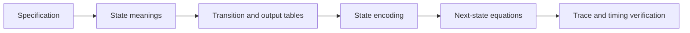

---
tags:
  - ECE2050
  - finite-state-machines
date: 2026-09-30
aliases:
  - 有限状态机
  - Finite State Machine
  - FSM
---

# Finite State Machine · 有限状态机

> [!SUMMARY] Quick recall · 英文速览
> An FSM combines a state register, next-state logic, and output logic. Build a transition table from the specification before choosing encodings or deriving gates.

## Core Definition · 核心定义

有限状态机 (finite state machine) 用有限个状态概括历史。状态不只是“当前输出”，还要包含决定后续行为所需的信息。状态寄存器存 current state，组合逻辑计算 next state 与 outputs。

$$S[k+1]=F(S[k],X[k]).$$

此式适用于明确采样事件的同步 FSM。Moore/Mealy 的区别在输出函数，不在 next-state 是否依赖输入。

## Design Procedure · 设计过程

1. Identify inputs, outputs, polarity, sampling events, and reset behavior.
2. State what information must be remembered.
3. Draw a complete transition diagram.
4. Convert every arrow into transition/output tables.
5. Select an encoding and define unused-state behavior.
6. Derive storage-element inputs and output equations.
7. Verify transitions, outputs, reset, and timing.

## Worked Example · 按钮切换灯

输入 X 为已同步且每次按下只一拍的 event；状态 OFF/ON，X=1 时切换，X=0 保持；Moore 输出 Y 在 ON 时 1。编码 OFF=0、ON=1。

| Current Q | X | Next Q | Current Y |
|---|---|---|---|
| 0 | 0 | 0 | 0 |
| 0 | 1 | 1 | 0 |
| 1 | 0 | 1 | 1 |
| 1 | 1 | 0 | 1 |

$$D=Q\oplus X,\quad Y=Q.$$

从 OFF 输入 0,1,0,1，边沿后 Q 为 0,1,1,0。若 X 是持续三拍的 button level，电路会切换三次；这不是状态机方程错误，而是 event interface 没有实现需求。

## State Meaning and Completeness · 状态含义与完备性

For each state, outgoing conditions must be mutually exclusive and cover every valid input. Missing an input case is not a legitimate don't-care unless the specification explicitly excludes it. Reset identifies a starting state and should match an actual available encoding.

设计与分析方向相反。已有电路的分析先写各 FF 输入，再由 characteristic equation 得到 Q+，把得到的 table 画成图。不能先凭外形猜“这是计数器”再填表。

## Assumptions and Pitfalls · 条件与误区

- A state label such as S2 is a name, not necessarily binary 10.
- 时钟每拍更新的是编码，不是把图上的每条箭头都自动走一遍。
- 同一时钟并不保证输出完全无毛刺；实际输出 decode 仍有 delay。
- Registering a Mealy output changes its externally observed timing.

## Exam English · 英文答题

**Question:** Why choose states before Boolean equations?

**Answer:** State meanings define what history must be retained and which transitions are required. Encoding is only a representation of that behavior. Deriving gates before fixing the behavior can produce a compact circuit that implements the wrong machine.

## Connections · 相关笔记

[[Sequential Logic]], [[Moore and Mealy Machines]], [[State Encoding and Unused States]], [[Sequence Detector]], [[Traffic Light Controller]], [[Synchronous Counter Design]], [[VHDL Language and Modeling]].

---
索引：[[ECE2050 Knowledge Tree]] · [[Glossary]]
