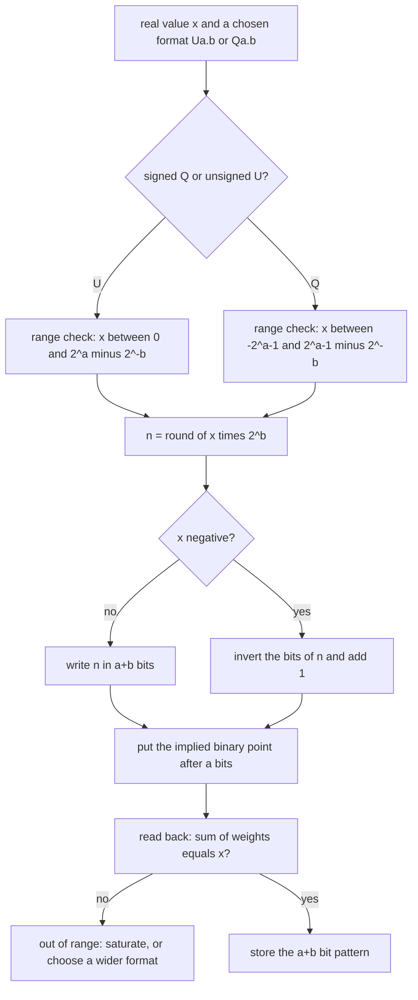

---
tags:
  - ECE2050
  - fractional-numbers
date: 2026-09-16
aliases:
  - 定点数
  - 定点表示法
  - Fixed-Point Numbers
  - Fixed-Point Representation
  - Q 格式
---

> [!NOTE] Where this fits · 定位
> 第 7 分区「Fractional Numbers」的第一篇：前面 [[Binary Number System]]、[[Number Base Conversion]]、
> [[Two's Complement Representation]] 处理的都是**整数位串**，这里回答讲义 p.50 的提问 —— *What about fractions?*
> 定点 (fixed-point) 是最直接的答案：小数点位置**固定**且隐含，代价是整数位/小数位个数**必须事先约定**。
> 前置：[[Binary Number System]]（负指数位权 $2^{-1},2^{-2}$）、[[Two's Complement Representation]]（Q 格式负数）。
> 下游：[[Floating-Point Numbers]] —— 它要解决的正是定点最致命的弱点：动态范围太窄。

> [!SUMMARY] Quick recall · 英文速览
> A fixed-point format assigns a fixed number of bits to the fractional part. Its scale determines resolution, while total width and signedness determine the representable range.

## Core Definition · 核心定义

小数点的两种处理方式（讲义 p.51）：**fixed-point 的小数点固定**，**floating-point 的小数点浮动**（浮到最高位 1 的右边，见 [[Floating-Point Numbers]]）。本篇只讨论前者的编码规则。

定点数的定义（讲义 p.52，$6.75$ 用 4 个整数位 + 4 个小数位）：

$$
6.75 = 0110.1100 = (0\times 2^{3})+(1\times 2^{2})+(1\times 2^{1})+(0\times 2^{0})
+(1\times 2^{-1})+(1\times 2^{-2})+(0\times 2^{-3})+(0\times 2^{-4})
$$

- 意义：binary point 之后的位不再是"占位符"，而是**负指数位权** $\dots,2^{-1},2^{-2},2^{-3},\dots$
  （讲义 p.7 的 binary point 概念直接延伸到小数）。
- 数值校验：$4+2+0.5+0.25 = 6.75$ ✓；把同一串当整数读是 $0110\,1100_2 = 108$，$108/2^{4} = 6.75$ ✓ ——
  **两种读法必须给出同一个数**，这就是"定点数 = 整数 + 固定缩放"的来源。

两种格式的记号（讲义 p.53–54）：

| 格式            | 含义                                                  | 位宽    | 隐含小数点位置   |
| ------------- | --------------------------------------------------- | ----- | --------- |
| $\text{U}a.b$ | 无符号 (unsigned)，$a$ 个整数位 + $b$ 个小数位                  | $a+b$ | 第 $a$ 位之后 |
| $Qa.b$        | 二补码 (two's complement)，$a$ 个整数位（**含符号位**）+ $b$ 个小数位 | $a+b$ | 第 $a$ 位之后 |

把位串看成一个整数 $n$（$Qa.b$ 就是补码整数），两种格式共用一条换算：

$$
x = \frac{n}{2^{b}}, \qquad
\Delta = 2^{-b}, \qquad
\text{U}a.b:\ n\in[0,\,2^{a+b}-1],\qquad
Qa.b:\ n\in[-2^{a+b-1},\,2^{a+b-1}-1]
$$

- 意义：定点数的**分辨率 (resolution / step) 是常数** $\Delta = 2^{-b}$，与数值大小无关；范围写成
  $\text{U}a.b:[0,\,2^{a}-2^{-b}]$、$Qa.b:[-2^{a-1},\,2^{a-1}-2^{-b}]$。
- 数值校验（U4.4）：$\Delta = 2^{-4} = 0.0625$，最大 $= 2^{4}-2^{-4} = 16-0.0625 = 15.9375 = 255/16$ ✓（即 `1111 1111`）。
- 数值校验（Q4.4）：范围 $[-2^{3},\,2^{3}-2^{-4}] = [-8,\,7.9375]$ ✓（从 `1000 0000` 到 `0111 1111`）。

![[fixed-point-format.svg]]
*图 1 — (a) U4.4 的八条位权 $2^{3}\dots2^{-4}$：同一个 $6.75$ 在 U4.4 里是 `0110.1100`，把隐含小数点
左移一位（U3.5）位串整体左移一位变成 `110.11000`，右移两位（U6.2）变成 `000110.11` —— 数值不变，
步长从 $2^{-4}$ 变成 $2^{-5}$ / $2^{-2}$。(b) Q4.4 只改了一件事：最高位权重从 $+2^{3}$ 变成 $-2^{3}$，
于是 $6.75$ 的 `0110 1100` 取反加一即得 $-6.75$ 的 `1001 0100`；回读 $-8+1+0.25 = -6.75$。*

## Assumptions and Validity · 适用前提

> [!IMPORTANT] 定点数的"值"不是位串自带的，而是**约定**出来的
> 位串里**没有**任何东西标记小数点位置（讲义 p.52：*Binary point is implied*；
> *The number of integer and fraction bits must be agreed upon beforehand*）。
> 同一个 `0110 1100`，按 U4.4 读是 $6.75$，按 U6.2 读是 $108/4 = 27$。
> **格式是接口约定的一部分**：发送方与接收方必须用同一套 $(a,b)$ 和同一个 U/Q。

1. **位宽固定**：$a+b$ 就是寄存器位数（8/16/32 位常见，讲义 p.53；U8.8 常见于传感器、音频、像素，
   U16.16 用于更高精度信号处理）。想改小数位数只能换格式或移位，不能"临时多留几位小数"。
2. **固定的一对权衡**：$\Delta = 2^{-b}$，$b$ 越大越精细，整数位 $a$ 就越少、范围越小；反之范围大而精度粗。
   U4.4 是 $\Delta = 0.0625$、范围 $[0,15.9375]$，$Q1.15$ 是 $\Delta = 2^{-15}$、范围只有 $[-1,1)$ 左右。
3. **Q 格式的 $a$ 含符号位**：$Qa.b$ 的有效整数范围是 $[-2^{a-1},\,2^{a-1}-2^{-b}]$，最小值比最大值"多一个步长"
   （Q4.4 的 $-8$），与 [[Two's Complement Representation]] 的非对称范围完全一致。
4. **讲义 p.54 的 Q1.15 写法要纠正**：讲义写 *Q1.15 (aka Q15) is common for signal processing (1, -1]*
   不严谨。正确范围是 $[-1,\ 1-2^{-15}] = [-1,\ 0.999969482421875]$：$1.0$ **恰好不可表示**，
   $1.0\times2^{15} = 32768$ 需要 16 位，截断成 `1000 0000 0000 0000` 后回读是 $-1.0$（见例题 4）。
5. **溢出不会报错**：定点加法器只给出低 $a+b$ 位，即"回绕 (wrap)"。要得到可用的声音/图像必须显式加
   饱和逻辑 (saturating arithmetic)（讲义 p.55），见推导 §4 与图 2。

## Derivation · 推导过程

### 1. 从位权到"整数缩放"：为什么 $x = n/2^{b}$

把 $a+b$ 位串按位置 $k=a-1,\dots,-b$ 编号，第 $k$ 位的权重是 $2^{k}$；把整串当无符号整数读得
$n=\sum_k d_k 2^{k+b}$（整数读法等于把小数点"当成在第 0 位之后"）。两式相除：

$$
x=\sum_{k=-b}^{a-1} d_k 2^{k} = \frac{1}{2^{b}}\sum_{k=-b}^{a-1} d_k 2^{k+b} = \frac{n}{2^{b}}
$$

- 意义：**定点数 = 整数 + 固定的 $2^{b}$ 缩放因子**。同格式的定点加法与整数加法是同一条电路；
  定点乘法才需要额外右移 $b$ 位（本课不展开）。
- 数值校验：$6.75 \to n = 6.75\times16 = 108 = 0110\,1100_2$ ✓，回读 $108/16 = 6.75$ ✓。

### 2. 同一数值、不同约定：U4.4 / U3.5 / U6.2

给定 $x$ 与格式 $\text{U}a.b$，只需 **$n = \mathrm{round}(x\cdot 2^{b})$**，再写成 $a+b$ 位：

$$
6.75\times 2^{4} = 108 \Rightarrow \texttt{0110 1100}\ (a{=}4),\qquad
6.75\times 2^{5} = 216 \Rightarrow \texttt{1101 1000}\ (a{=}3),\qquad
6.75\times 2^{2} = 27 \Rightarrow \texttt{0001 1011}\ (a{=}6)
$$

- 意义：$(a,b)$ 决定"哪些位是整数、哪些位是小数"，不改变数值，只改变步长与范围。
- 数值校验：$108/16 = 6.75$ ✓、$216/2^{5} = 216/32 = 6.75$ ✓、$27/2^{2} = 27/4 = 6.75$ ✓。
- 规律：$b$ 每减 1，$n$ 就右移 1 位（同时引入 1 bit 的取整风险）；$n$ 必须装得进 $a+b$ 位 ——
  $6.75$ 不能写成 U2.6，因为 $6.75\times2^{6} = 432 > 2^{8}-1 = 255$。

### 3. Q 格式的负数：取反加一，与补码同源

最小位权是 $-2^{a-1}$，所以整串的总值就是补码值。求 $-x$ 的做法与 [[Two's Complement Representation]]
的 *reverse the sign* 完全一样（讲义 p.54）：**invert the bits，add one to the LSB**。

$$
6.75 = \texttt{0110 1100} \xrightarrow{\text{invert}} \texttt{1001 0011}
\xrightarrow{+1} \texttt{1001 0100} = -6.75
$$

- 意义：定点负号复用补码硬件，"取负"不需要单独的取绝对值/比较电路。
- 数值校验：按位权回读 `1001 0100`：$-2^{3}+2^{0}+2^{-2} = -8+1+0.25 = -6.75$ ✓；
  再取一次负号：`1001 0100` → invert `0110 1011` → $+1$ → `0110 1100` $= 108/16 = 6.75$ ✓。

### 4. 溢出：回绕 (wrap) 与饱和 (saturate)

U4.4 的两个操作数是 $12 = \texttt{1100 0000}$（整数 $192$）与 $7.5 = \texttt{0111 1000}$（整数 $120$）：

$$
192+120 = 312 = 1\,\texttt{0011 1000}_2 \quad(\text{需要 9 位，器件只有 8 位})
$$

- **回绕**：丢弃第 9 位，保留低 8 位 `0011 1000` $= 56$，回读 $56/16 = 3.5$。真实和 $19.5$，误差 $16.0$ ——
  不是"精度差一点"，而是量级完全错（音频里是爆音 click，视频亮区里是一个黑点，讲义 p.55）。
- **饱和**：检测到溢出后直接把结果钳到最大码 `1111 1111` $= 255/16 = 15.9375$，误差 $3.5625$，
  但**方向不变、没有跳变**（峰值被削平，而不是翻转成一个小值）。
- 讲义 p.55 的简写要注意：讲义写 $\texttt{1100 0000} + \texttt{0111 1000} = \texttt{1111 1111}$ 与
  $12+7.5 = 15.9375$。这两行**只有按饱和加法读才成立**：普通二进制加法的真实结果是 9 位的
  $1\,\texttt{0011 1000}$，讲义省略了"溢出 → 钳位"这一步，也没有写出真实和 $19.5$。照抄成普通加法会得到
  $3.5$（回绕）或 $19.5$（无限位宽），都无法解释 `1111 1111`。

![[saturating-arithmetic.svg]]
*图 2 — 横轴是"真实和"，纵轴是 U4.4 读回来的值：只有和不超过 $15.9375$ 时两条曲线重合（输出 $=$ 输入）；
超过之后回绕曲线（红色）断崖式跌回 $3.5$，饱和曲线（绿色）走平在 $15.9375$。工作点 $12+7.5 = 19.5$ 上的
红/绿两个圆点就是"爆音 vs. 削顶"的区别，与例题 3 的算式一一对应。*

## Method and Steps · 求解步骤与方法

**十进制小数 → 定点位串（编码）**

1. 选定格式：先定 U 还是 Q，再定 $(a,b)$，并校验范围 —— U 要求 $0\le x\le 2^{a}-2^{-b}$，
   Q 要求 $-2^{a-1}\le x\le 2^{a-1}-2^{-b}$。
2. 缩放：$n = \mathrm{round}(x\cdot 2^{b})$（乘 $2^{b}$ 就是左移 $b$ 位）。
3. 若为 Q 且 $x<0$：先把 $|x|$ 编成 $a+b$ 位，再**取反加一**。
4. 写成 $a+b$ 位，4 位一组书写，并记住隐含小数点在整数第 $a$ 位之后。
5. 回读校验：按位权求和（或算 $n/2^{b}$）必须回到 $x$。

**定点位串 → 十进制（解码）**

1. 按约定切分：整数段 $a$ 位、小数段 $b$ 位。
2. U 格式：整数读法得 $n$，值 $= n/2^{b}$。
3. Q 格式：先看最高位；是 1 就用"取反加一"求出幅值，值 $=$ 负的幅值$/2^{b}$。
4. 量级自检：最小值应为 $-2^{a-1}$，步长应为 $2^{-b}$。

## Worked Example · 例题

**Example 1 — $6.75$ 的三种无符号格式（讲义 p.53）**

题目：把 $6.75$ 分别写成 U4.4、U3.5、U6.2。

解：
1. $6.75 = 4+2+0.5+0.25 = 110.11_2$（整数部分 $6 = 110_2$，小数部分 $0.75 = 0.11_2$）。
2. U4.4：$n = 6.75\times16 = 108$，8 位 `0110 1100`，小数点在第 4 位后 → `0110.1100`。
3. U3.5：$n = 6.75\times32 = 216$，8 位 `1101 1000`，小数点在第 3 位后 → `110.11000`。
4. U6.2：$n = 6.75\times4 = 27$，8 位 `0001 1011`，小数点在第 6 位后 → `000110.11`。

**数值校验 (Numerical check)**：$108/16 = 6.75$ ✓，$216/32 = 6.75$ ✓，$27/4 = 6.75$ ✓；
按位权展开 U4.4：$0\cdot8+1\cdot4+1\cdot2+0\cdot1+1\cdot0.5+1\cdot0.25+0+0 = 6.75$ ✓。
三者步长为 $0.0625$ / $0.03125$ / $0.25$，最大值为 $15.9375$ / $7.96875$ / $63.75$。

**Example 2 — $-6.75$ 的 Q4.4（讲义 p.54）**

题目：写出 $-6.75$ 的 Q4.4 编码，并回读验证。

解：
1. 先编 $+6.75$：$n = 108 = \texttt{0110 1100}$。
2. 取反：`1001 0011`；LSB 加 1：`1001 0011 + 1 = 1001 0100`。
3. 小数点放在 4 位之后：`1001.0100`，数值 $-6.75$。

**数值校验 (Numerical check)**：按位权回读 $-2^{3}+2^{0}+2^{-2} = -8+1+0.25 = -6.75$ ✓；
再取一次负号 → `0110 1100` $= 108/16 = 6.75$ ✓（往返一致）。量级自检：$-6.75/0.0625 = -108$ 是整数 ✓。

**Example 3 — $12+7.5$ 的回绕与饱和（讲义 p.55）**

题目：两个 U4.4 数 $12$ 与 $7.5$ 相加，硬件只有 8 位。分别给出回绕结果与饱和结果。

解：
1. 编码：$12\times16 = 192 = \texttt{1100 0000}$；$7.5\times16 = 120 = \texttt{0111 1000}$。
2. 真实和：$192+120 = 312 = 19.5\times16$，二进制 $1\,\texttt{0011 1000}$ —— **需要 9 位**。
3. 回绕：丢弃第 9 位，得 `0011 1000` $= 56$，回读 $56/16 = 3.5$。
4. 饱和：溢出标志置位 → 输出最大码 `1111 1111` $= 255$，回读 $255/16 = 15.9375$。

**数值校验 (Numerical check)**：$312 = 256+56 \Rightarrow$ 低 8 位 $= 312-256 = 56$，$56/16 = 3.5$ ✓；
$255/16 = 16-1/16 = 15.9375$ ✓。误差对比：回绕 $|3.5-19.5| = 16$，饱和 $|15.9375-19.5| = 3.5625$ ——
饱和误差小 $16/3.5625 = 4.49$ 倍，更重要的是**误差方向单调**，不会把亮区翻成黑点。

**Example 4 — Q1.15 里为什么没有 $+1.0$（讲义 p.54 的范围纠正）**

题目：$Q1.15$（Q15）讲义标注范围为 $(1,-1]$。检验 $x = 1.0$ 能否表示。

解：
1. $n = 1.0\times2^{15} = 32768$，16 位写法是 `1000 0000 0000 0000`。
2. 寄存器只有 16 位，这一串在补码里是 $-32768$。
3. 回读：$-32768/2^{15} = -1.0$ —— 想写 $+1.0$，得到 $-1.0$。

**数值校验 (Numerical check)**：最大可表示码是 `0111 1111 1111 1111` $= 32767$，
$32767/32768 = 0.999969482421875 = 1-2^{-15}$ ✓，故范围为 $[-1,\ 1-2^{-15}]$，**不是** $[-1,+1]$；
$+1.0$ 恰好越界并回绕到 $-1.0$ ✓ —— 这正是图 2 的回绕在音频 DSP 里的经典事故。

## Pitfalls · 常见误区

> [!WARNING] 定点数的错误几乎都来自"忘了约定"和"忘了溢出"

1. **不写 $(a,b)$ 就读位串**。错在：看到 `0110 1100` 就说它是 $6.75$（或 $108$）。正确：先问格式 —— 同一串在 U4.4 / Q4.4 是 $6.75$（最高位 0，正数），在 U6.2 是 $27$，在 U1.7 是 $0.84375$；位串本身不携带小数点。
2. **把 U 格式当 Q 格式**。错在：$12 = \texttt{1100 0000}$ 在 U4.4 是 $12$。正确：同一串在 Q4.4 是 $-8+4 = -4$，先确认最高位是不是符号位。
3. **Q 格式的范围写成 $[-2^{a-1}+2^{-b},\,2^{a-1}-2^{-b}]$**。错在：把 Q4.4 的最小值记成 $-7.9375$。正确：$a$ 含符号位，最小值是 $-2^{a-1} = -8$，负侧比正侧多一个步长。
4. **以为定点不能表示小数**。错在：认为"只有浮点才有小数"。正确：定点完全能表示小数，只是范围窄、步长固定 —— U4.4 覆盖 $0\dots15.9375$，步长 $0.0625$。
5. **把溢出当成"误差小"**。错在：$12+7.5 = 3.5$ 只当作精度损失。正确：那是回绕，偏差 $16.0$ 且方向翻转；要么饱和，要么换更宽的格式。
6. **相信讲义 Q1.15 的 $(1,-1]$**。错在：以为 $+1.0$ 可以表示。正确：$[-1,\ 1-2^{-15}]$，$+1.0$ 会回绕成 $-1.0$（例题 4）。

## Scaling belongs to the representation · 定点缩放与英文理解

A fixed-point word is an integer code with an agreed scale. If the stored signed integer is $q$ and there are $F$ fractional bits, the represented value is $x=q2^{-F}$. The hardware does not store a physical dot. The dot is part of the interface contract between the producer and consumer of the bits.

Addition requires compatible scales. Multiplication adds the fractional-bit counts: multiplying codes with $F_A$ and $F_B$ fractional bits creates a product with $F_A+F_B$ fractional bits. Reducing that product to a target format requires a shift plus a stated rounding rule and a range check. A cast or assignment does not automatically preserve the physical value.

**Worked application — coefficient multiplication.** 采用本篇含符号位的 Q4.4 约定，$1.5$ 存 $q_A=24$=`00011000`，$-0.75$ 存 $q_B=-12$=`11110100`。16 位乘积 code $=-288$，有 8 位小数，故真值 $-288/256=-1.125$。回到 Q4.4，应除 code 以 16，得 −18，编码 `11101110`，$-18/16=-1.125$，本例恰好无舍入误差。

In English: the intermediate product is wider and has twice the fractional precision. Rescaling removes four fractional positions in this example. The exact divisibility makes the result independent of whether truncation or round-to-nearest is selected here; that is not true for every input pair.

**English exam question:** Does adding more fractional bits always improve a fixed-width format?

**Answer:** It improves resolution by reducing the least significant step, but leaves fewer integer positions and narrows the representable range. A suitable format must cover both the expected amplitude and the required resolution.

See [[Signed Binary Multiplication and Division]], [[Combinational Multiplier]], and [[VHDL Language and Modeling]] for width, signed type, and resize behavior. Always state the Q-format convention before counting sign and integer bits.

## Connections · 相关笔记

- 上游 (upstream)：[[Binary Number System]]（位权 $2^{k}$ 与 binary point）、[[Number Base Conversion]]（反复乘 2 取整写出 $6.75 = 110.11_2$）。
- 上游 (upstream)：[[Two's Complement Representation]] —— Q 格式的负数是补码，取反加一与非对称范围直接继承。
- 下游 (downstream)：[[Floating-Point Numbers]] —— 定点"步长固定、范围窄"正是浮点存在的理由。
- 平行 (parallel)：[[Bits and Bytes]]（$a+b$ 位宽与精度/量化的权衡）、[[Binary Arithmetic]]（定点加法就是该位宽下的二进制加法）。

---
索引：[[ECE2050 Knowledge Tree]] · [[Glossary]]
