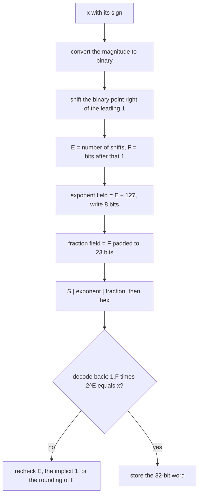

---
tags:
  - ECE2050
  - fractional-numbers
date: 2026-09-16
aliases:
  - 浮点数
  - 浮点表示法
  - IEEE 754
  - Floating-Point Numbers
  - Floating-Point Representation
---

> [!NOTE] Where this fits · 定位
> 第 7 分区「Fractional Numbers」的第二篇，也是第二章的收尾重点（❗）。[[Fixed-Point Numbers]] 已证明：定点数把小数点钉死，代价是**范围与精度只能二选一**（U4.4 只有 $0\dots15.9375$）。
> 浮点 (floating-point) 让二进制点**浮动**（讲义 p.51/p.57：*binary point floats to the right of the most significant 1*），用阶码把"小数点在哪"也编进位串，同时拿到大范围与稳定的相对精度。
> 前置：[[Fixed-Point Numbers]]、[[Binary Number System]]、[[Bits and Bytes]]。

> [!SUMMARY] Quick recall · 英文速览
> Floating-point values combine a sign, an exponent, and a significand to cover a wide dynamic range. IEEE 754 single precision also defines special encodings for zero, infinity, and NaN.

## Core Definition · 核心定义

浮点数就是**二进制版的科学计数法**（讲义 p.57）：十进制写 $273 = 2.73\times10^{2}$，二进制写 $228 = 1.11001\times2^{7}$。通式 $\pm M\times B^{E}$，其中 $M$ 是尾数 (mantissa)、$B$ 是基数 (base)、$E$ 是阶码 (exponent)；十进制例子里 $M = 2.73$、$B = 10$、$E = 2$，二进制里 $B = 2$ 且规格化后 $M = 1.\text{xxx}$。

$$
\pm M\times B^{E}
\qquad\Longrightarrow\qquad
x = (-1)^{S}\times 1.F \times 2^{\,E_{\text{stored}}-127}
$$

- 意义：把一个数拆成"**有效数字**"与"**量级**"两部分 —— 有效数字决定**精度**，阶码决定**范围**。
  定点的"量级"是位权硬编码的，浮点则把它变成可存储的数据。
- 数值校验：$228 = 1110\,0100_2$，把点左移到最高位 1 之后（移 7 位）得 $1.11001_2\times2^{7}$，
  回乘 $1.78125\times128 = 228$ ✓。

**IEEE 754 单精度 (binary32, 讲义 p.59)**：32 位分成三个字段，

| 字段 | 位号 | 内容 | 说明 |
|---|---|---|---|
| sign $S$ | 31 | $0$ = 正，$1$ = 负 | 符号与数值分离（同 [[Sign-Magnitude Representation]] 的思路） |
| exponent | 30…23 | **偏移阶码**，存 $E + 127$ | bias $= 127 = \texttt{0111 1111}$，字段范围 $[0,255]$ |
| fraction | 22…0 | 规格化后**小数点之后的 23 位** | 前导 $1.$ 隐含不存（implicit leading 1） |

- 意义：**23 位尾数 + 1 个隐含前导 1 = 24 位有效精度**；阶码用无符号的偏移码表示，$E_{\text{stored}}\in[0,255]$
  映射到 $E\in[-127,+128]$，但字段 $0$ 与 $255$ 被端点保留（见下表），所以规格化数的实际阶码是 $[-126,+127]$。
- 数值校验：$1.11001_2 = 1+0.5+0.25+0.03125 = 1.78125$，$1.78125\times2^{7} = 228$ ✓；
  阶码字段 $127+7 = 134 = \texttt{1000 0110}_2$ ✓（与图 1 中 228 的位串一致）。

![[ieee754-single-format.svg]]
*图 1 — 32 位字段布局：bit 31 是符号、bits 30…23 是偏移阶码（存 $E+127$）、bits 22…0 是 23 位尾数；
虚线小框标出那个**不存进位串**的前导 $1.$。下面两行是已核对的例题：$228$ 的
`0 10000110 11001000000000000000000` $= 0x43640000$，$-58.25$ 的 `1 10000100 11010010000000000000000` $= 0xC2690000$。*

## Assumptions and Validity · 适用前提

> [!IMPORTANT] 整套编码都建立在"**规格化 (normalized)**"这个前提上
> 只有规格化数才满足"最高位有效数字是 1"，才有"前导 1 不用存"这句话。一旦放弃该前提（阶码字段全 0），
> 隐含的 1 就变成 $0$，那批数叫 **非规格化数 (denormal / subnormal)**，精度逐位下降，直到
> $2^{-149}\approx1.4\times10^{-45}$ —— 这一档**超出讲义范围**，但要知道它存在。

1. **三个字段各有保留值**（讲义 p.62）：

   | 数 | 符号 | 阶码字段 | 尾数字段 |
   |---|---|---|---|
   | $0$（$+0$ 与 $-0$） | 任意 | `0000 0000` | 全 0 |
   | $\pm\infty$ | 0 / 1 | `1111 1111` | 全 0 |
   | NaN（不是一个数） | 任意 | `1111 1111` | 非 0 |

2. **原码位串比较要区分正负**：非负有限值的 binary32 位串按无符号排序与数值排序一致；
   两个负有限值的顺序相反，因为更大的幅值对应更小的数值。异号先判符号；$+0/-0$ 数值相等，NaN 另行处理。
3. **浮点数不是实数**：它只有 $2^{32}$ 种位模式（正负零与不同NaN模式不等于同数量的不同实数），相邻可表示数之间的间隔（ULP）随量级变化，所以
   某些计算会出现如 binary64 的 `0.1 + 0.2 != 0.3`；具体结果取决于格式和每步舍入。比较经过舍入的计算结果时，是否采用 `==` 或容差应由问题语义决定（见例题 4）。
4. **字段端点被占用**：$E = -127$（字段 0）与 $E = +128$（字段 255）不能表示规格化数。讲义 p.60 写
   *the range of the biased exponent: [-127, +128]* 说的是**字段映射范围**；规格化数的实际阶码是 $[-126,+127]$。

## Derivation · 推导过程

### 1. 为什么需要浮点：定点的范围太窄

U4.4 的可表示幅值只有 $[0.0625,\ 15.9375]$（$255$ 个码、约 $2.4$ 个十进制数量级）；binary32 的规格化数覆盖
$2^{-126}\approx1.18\times10^{-38}$ 到 $(2-2^{-23})\times2^{127}\approx3.40\times10^{38}$：

$$
\log_{10}\frac{3.4028\times10^{38}}{1.1755\times10^{-38}} = 38.53+37.93 = 76.46\ \text{decades}
$$

- 意义：同样的位宽，浮点用阶码买到约 $76.5$ 个数量级的范围，代价是**绝对**精度随量级浮动。
- 数值校验：$\log_{10}(255) = 2.406$，$76.46/2.406 \approx 31.8$ —— 浮点单精度的动态范围约为 U4.4 的 **32 倍** ✓。

![[floating-point-dynamic-range.svg]]
*图 2 — 对数幅值数轴：binary32 的规格化区间从 $2^{-126}=1.18\times10^{-38}$ 直到 $3.40\times10^{38}$
（约 $76.5$ 个数量级），例 1、例 2 的 $228$ 与 $58.25$ 都挤在中间；下方红色窄条是 Q4.4 这类定点，只有
$2.4$ 个数量级。最左端是 $0$（阶码全 0），越出 $3.40\times10^{38}$ 后阶码字段饱和为全 1，进入 $\pm\infty$/NaN。*

### 2. 规格化：把二进制点搬到最高位 1 的右边

以 $228$ 与 $58.25$ 为例（讲义 p.58–61）：

$$
228_{10} = 1110\,0100_2 = 1.11001_2\times2^{7},
\qquad
58.25_{10} = 111010.01_2 = 1.1101001_2\times2^{5}
$$

- 整数部分用"除以 2 取余"（[[Number Base Conversion]]）：$228 = 128+64+32+4 = 1110\,0100_2$；
  小数部分用"乘 2 取整"：$0.25\times2 = 0.5\to0$、$0.5\times2 = 1.0\to1$，故 $0.25 = 0.01_2$ ✓。
- **规格化 = 把点左移到最高位 1 的右边**，移了几位就是阶码：$1110\,0100$ 移 7 位 → $E = 7$；
  $111010.01$ 移 5 位 → $E = 5$。
- 数值校验：$1.11001_2 = 1.78125$，$\times2^{7} = 228$ ✓；$1.1101001_2 = 1.8203125$，$\times2^{5} = 58.25$ ✓。

### 3. 为什么可以不存前导 1

规格化后尾数一定是 $1.f_{22}\dots f_{0}$，整数部分**恒为 1**，无需浪费一位（讲义 p.59：
*So, no need to store it: implicit leading 1*）。

$$
\text{有效精度} = 1\ (\text{隐含}) + 23\ (\text{存储}) = 24\ \text{位}
$$

- 意义：白赚 1 位精度，代价是"$0$ 与很小的数"必须另开一档（denormal）来表示。
- 数值校验：$24$ 位有效精度对应 $24\log_{10}2 = 7.22$ 位十进制有效数字 ✓ —— 这就是 `float` 常说的"约 7 位有效数字"。

### 4. 偏移阶码：为什么存的是 $E+127$

$$
E_{\text{stored}} = E + \text{bias} = E + 127,\qquad
E = 7 \Rightarrow 134 = \texttt{1000 0110}_2,\qquad
E = 5 \Rightarrow 132 = \texttt{1000 0100}_2
$$

- 数值校验：$127+7 = 134$ ✓、$127+5 = 132$ ✓；反向 $134-127 = 7$、$132-127 = 5$ ✓。
- **为什么用偏移（讲义 p.60）**，两个理由：
  1. **阶码永远非负** —— 8 位字段可直接当无符号整数用，因此**正有限浮点数**可按无符号位串排序；负值需反转排序，零与 NaN 需按浮点语义处理。校验：$228 \to 0x43640000 = 1\,130\,627\,072$、$58.25 \to 0x42690000 = 1\,114\,177\,536$，前者更大而 $228 > 58.25$ ✓（若阶码用补码存，负阶码最高位是 1，无符号比较立刻失效）。
  2. **为特殊值统一留出端点** —— bias 是编码约定；IEEE 754 把最小字段
     让给 $0$ 与 denormal、最大字段让给 $\pm\infty$ 与 NaN，普通数占 $[-126,+127]$，两端刚好不浪费。

### 5. 精度与动态范围

$$
\text{ULP}(1.0) = 2^{-23}\approx1.19\times10^{-7},\qquad
x_{\min}^{\text{normal}} = 2^{-126}\approx1.18\times10^{-38},\qquad
x_{\max} = (2-2^{-23})\times2^{127}\approx3.40\times10^{38}
$$

- 意义：**相对精度恒定、绝对精度浮动**。$1.0$ 附近最小间隔是 $2^{-23}$；到 $2^{20}$ 附近间隔变成
  $2^{-3} = 0.125$ —— 这就是"大数吃小数"（$10^{8}+1 = 10^{8}$，该处 ULP $\approx 8$）。
- 数值校验：$2^{-23} = 1.1920928955078125\times10^{-7}$ ✓；$2^{-126} = 1.1754943508222875\times10^{-38}$ ✓；
  $(2-2^{-23})\times2^{127} = 3.4028234663852886\times10^{38}$ ✓。

## Method and Steps · 求解步骤与方法

**十进制 → IEEE 754 单精度（编码，5 步）**

1. 定符号位 $S$：负数 $S = 1$，之后只处理绝对值。
2. 绝对值转二进制：整数部分除 2 取余，小数部分乘 2 取整。
3. 规格化：左移到最高位 1 的右边，得 $1.F\times2^{E}$，数出阶码 $E$。
4. 阶码字段 $= E + 127$，写成 8 位二进制。
5. 尾数字段 $= F$ 补 0 到 23 位；拼成 `S | exponent | fraction`，转十六进制并回读校验。

**IEEE 754 单精度 → 十进制（解码，4 步）**

1. 拆三段：bit 31 / bits 30…23 / bits 22…0。
2. $E = \text{字段} - 127$；先查端点字段（全 0 → $0$ 或 denormal；全 1 → $\pm\infty$ 或 NaN）。
3. 还原尾数 $1.F$（**记得补上隐含的 1**）。
4. 值 $= (-1)^{S}\times1.F\times2^{E}$，并用"量级"自检：结果应落在 $2^{E}$ 与 $2^{E+1}$ 之间。

## Worked Example · 例题

**Example 1 — $228$ 的 IEEE 754 单精度（讲义 p.59）**

题目：用 32 位浮点表示 $228_{10}$。

解：
1. $228 = 128+64+32+4 = 1110\,0100_2$，$S = 0$（正数）。
2. 规格化：$1110\,0100 = 1.11001\times2^{7}$，故 $E = 7$、$F = 11001$。
3. 阶码字段：$127+7 = 134 = \texttt{1000 0110}_2$。
4. 尾数字段：`11001` 后补 18 个 0 → `11001000000000000000000`。
5. 拼接：`0 10000110 11001000000000000000000` = `0100 0011 0110 0100 …` $= 0x43640000$。

**数值校验 (Numerical check)**：回读 $1.11001_2 = 1.78125$，$1.78125\times2^{7} = 228$ ✓；
阶码 $134-127 = 7$ ✓；十六进制字段拆解与第 5 步逐位一致 ✓。

**Example 2 — $-58.25$ 的 IEEE 754 单精度（讲义 p.61）**

题目：写出 $-58.25_{10}$ 的 binary32 编码。

解：
1. 绝对值：$58 = 111010_2$，$0.25 = 0.01_2$ → $58.25 = 111010.01_2$，$S = 1$。
2. 规格化：$111010.01 = 1.1101001\times2^{5}$，$E = 5$、$F = 1101001$。
3. 阶码字段：$127+5 = 132 = \texttt{1000 0100}_2$。
4. 尾数字段：`1101001` 后补 16 个 0 → `11010010000000000000000`。
5. 拼接：`1 10000100 11010010000000000000000` = `1100 0010 0110 1001 …` $= 0xC2690000$。

**数值校验 (Numerical check)**：$1.1101001_2 = 1.8203125$，$1.8203125\times2^{5} = 58.25$ ✓，符号位 1 → $-58.25$ ✓；
$132-127 = 5$ ✓；与例 1 对比，$228$ 的阶码字段 $134 > 132$ 也正确反映了量级 ✓。

**Example 3 — 反解：`0x43640000` 是多少？**

题目：把 `0x43640000` 拆字段还原成十进制。

解：
1. 二进制：`0100 0011 0110 0100 0000 0000 0000 0000` → `0 | 10000110 | 11001000000000000000000`。
2. $S = 0$（正）；阶码字段 $= 134$ → $E = 134-127 = 7$。
3. 尾数 $= 1.11001$（补上隐含的 1）。
4. 值 $= 1.78125\times2^{7} = 228.0$。

**数值校验 (Numerical check)**：$228 \to 0x43640000 \to 228.0$ 往返一致 ✓（讲义 p.59 的原例就是 $228$）。
若忘记隐含的 1（把尾数当 $0.11001$），会算成 $0.78125\times128 = 100$，与 $228$ 相差 $2.28$ 倍 —— 这就是最经典的错法。

**Example 4 — 为什么 $0.1$ 存不精确**

题目：写出 $0.1$ 的 binary32 编码，并算出存储误差。

解：
1. $0.1 = 0.0001100110011\dots_2$（因为 $0.1 = 1.6\times2^{-4}$，而 $1.6 = 1.1001100110011\dots_2$ 无限循环）。
2. 规格化：$1.10011001100110011001101\times2^{-4}$（23 位尾数按就近舍入，末位进 1）。
3. 阶码字段：$127+(-4) = 123 = \texttt{0111 1011}_2$。
4. 拼接：`0 01111011 10011001100110011001101` $= 0x3DCCCCCD$。

**数值校验 (Numerical check)**：该位串的真实值是 $0.10000000149011612$，误差 $1.49011612\times10^{-9}$；
此处 ULP $= 2^{-4-23} = 2^{-27} = 7.4505806\times10^{-9}$，误差 $\approx 0.2$ ULP ✓（符合"就近舍入"）；
相对误差 $1.49\times10^{-8}\approx2^{-26}$，落在 $2^{-24}$ 之内 ✓。结论：`0.1` 打印成 `0.1` 只是
最短十进制输出对该存储值的显示。binary64 中 `0.1 + 0.2 == 0.3` 为假；
若每步严格按 binary32 round-to-nearest 舍入，该比较可为真，不能把这个反例当成所有格式的定律。

## Pitfalls · 常见误区

> [!WARNING] 浮点的每一个坑都能追溯到"位串只是近似值"

1. **忘记隐含的前导 1**。错在：解码时把尾数当 $0.F$。正确：normal finite values 用 $1.F$；subnormal 用 $0.F$ 并采用其指定阶码（例3是normal）。
2. **把偏移阶码当补码读**。错在：看到 `1000 0110` 去求补码。正确：直接算 $\text{字段}-127 = 7$；字段 $0$ 与 $255$ 是保留值。
3. **以为浮点能精确表示小数**。错在：把 `0.1` 当成精确的 $1/10$。正确：存进去的是 $0.10000000149011612$（例 4）。
4. **用 `==` 比较浮点数**。错在：`if (x == 0.3)`。正确：按任务语义选择精确比较或有依据的绝对/相对容差；金额常用有规定scale的定点/整数。
5. **大数吃小数**。错在：$10^{8}+1$ 期望得 $100000001$。正确：该处 ULP $\approx 8$，加 1 被舍掉，结果仍是 $10^{8}$。
6. **NaN 不等于自身**。错在：`x == NaN` 恒为假还不自知。正确：用 `x != x`（或 `isnan(x)`）判 NaN，且 NaN 会**传染**；
   另外 $+0$ 与 $-0$ 相等，但 $1/(+0) = +\infty$、$1/(-0) = -\infty$。

## Decode the format before the fields · 先确认格式再读字段

Floating-point decoding has two levels. First identify the format: field widths, bias, normalization rule, and special encodings. Then decode the fields under that format. The bias 127 belongs to binary32; it is not a universal property of every biased system or every custom floating-point word.

The significand controls relative precision, while the exponent changes the scale. In the interval $[2^e,2^{e+1})$, adjacent normal binary32 values differ by $2^{e-23}$. Consequently a fixed increment that is visible near one can disappear at a much larger magnitude. More range does not imply that every integer within that range is represented exactly.

**Worked application — changing spacing.** 在 $1\le x<2$ 内，binary32 spacing 为 $2^{-23}$；在 $2^{24}\le x<2^{25}$ 内，spacing 为 $2^{24-23}=2$。因此 $2^{24}$ 与 $2^{24}+2$ 可表示，而中间整数 $2^{24}+1$ 不可精确表示。round-to-nearest, ties-to-even 把该中点取成 $2^{24}$。这来自相邻数间距，不是加法器漏掉一次进位。

In English: the stored precision is fixed in significant bits, so absolute spacing grows with the exponent. To assess rounding, locate the two neighboring representable values and apply the stated rounding rule.

**English exam question:** A generic eight-bit biased field stores `10000010` with bias 63. Must its decoded value be 3 because binary32 uses bias 127?

**Answer:** No. The specified bias is 63, so the value is $130-63=67$. With binary32's bias 127 the same exponent field would decode to 3 for a normal value. The complete floating-point number would also require its sign and fraction fields.

For ordering, positive finite bit patterns increase with value; negative finite patterns increase with magnitude and therefore reverse numeric order. NaNs need separate handling. Compare [[Number Systems]] for bias and [[Magnitude Comparator]] for the distinction between raw-code and numeric comparisons.

## Custom 16-bit format · 自定义十六位格式

The supplied custom format has one sign bit, four exponent bits, eleven fraction bits, and bias seven. It is **not IEEE binary16**, which uses one sign bit, five exponent bits, ten fraction bits, and bias fifteen. Field width alone does not identify a format.

For a normal value in the custom model, $x=(-1)^s(1+F/2^{11})2^{E-7}$; use only the special-value rules explicitly specified for that format. IEEE zero/subnormal/infinity conventions cannot be inferred from the word “16-bit”.

**Worked check.** 取s=1、E=1001₂=9、F=01000000000₂=512，值为 $-(1+512/2048)2^{9-7}=-1.25\times4=-5$。把bias错用15会得到−0.01953125，错误来自format，不是补码符号处理。

## Connections · 相关笔记

- 上游 (upstream)：[[Fixed-Point Numbers]] —— "固定步长 vs. 浮动步长"就是本篇的出发点与对照物。
- 上游 (upstream)：[[Binary Number System]]（二进制小数与 binary point）、[[Number Base Conversion]]（乘 2 取整写小数）。
- 上游 (upstream)：[[Bits and Bytes]] —— 32 位字段划分与位序（MSB 在左）是读懂图 1 的前提。
- 平行 (parallel)：[[Sign-Magnitude Representation]] —— 浮点"符号位 + 幅值"是原码思路的现代版本，而
  [[Two's Complement Representation]] 的补码在这里被**换成偏移码**，正好说明补码不是唯一选择。

---
索引：[[ECE2050 Knowledge Tree]] · [[Glossary]]
