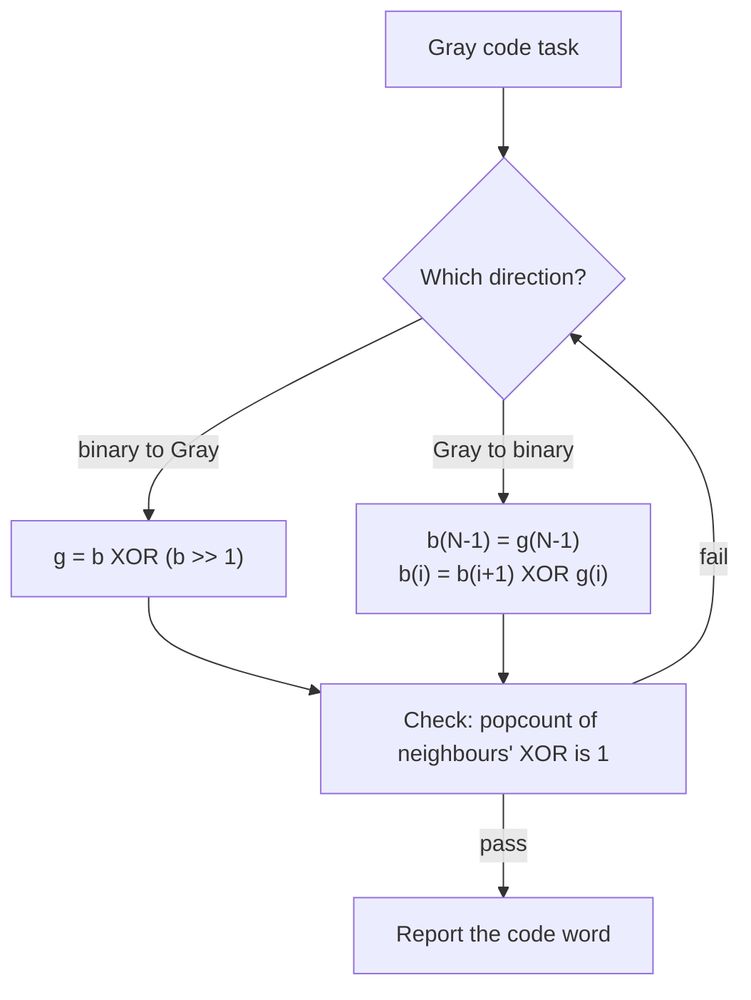

---
tags:
  - ECE2050
  - codes
date: 2026-09-16
aliases:
  - 格雷码
  - 格雷编码
  - 循环码
  - Gray Code
  - Reflected Binary Code
---

> [!NOTE] Where this fits · 定位
> 第 8 分区 Codes 的第二篇（讲义 p.64, p.67–68）。它和 [[Binary Coded Decimal]] 一起回答了同一个问题的两面：
> **一串 bit 代表什么，完全由编码规则决定**。BCD 关心"十进制数字怎么摆"，格雷码关心"码字**顺序**怎么排"。
> 前置：[[Number Systems]]（位权制 positional/weighted 与非位权制 non-weighted 的分界，讲义 p.64 就把格雷码列为后者的例子）、
> [[Bits and Bytes]]（4 bit = 1 nibble = 16 个码字）。

> [!SUMMARY] Quick recall · 英文速览
> Adjacent Gray-code words differ in one bit, including the wraparound in a reflected sequence. This property is useful when assigning neighboring cells in a Karnaugh map.

## Core Definition · 核心定义

**格雷码 (Gray code)**：一种码字排列方式，使得**序列中相邻的两个码字只差 1 位**（讲义 p.67：
*Only a single bit change from one code word to the next in sequence*）。因为最后一项与第一项也只差 1 位，
它也叫做**循环码 (cyclic code)**；又因为它由"镜像反射"构造出来，也叫 **reflected binary code**。

衡量"差几位"的工具是**汉明距离 (Hamming distance)**：

$$
d(x,y)=\sum_{i}\left(x_i \oplus y_i\right)=\mathrm{popcount}(x \oplus y)
$$

- 意义：两个等长码字之间有多少位不同。$d = 1$ 就是"只变一位"。
- 数值校验：`0001` 与 `0011`：$0001 \oplus 0011 = 0010$，其中 1 的个数为 1 → $d = 1$ ✓；
  `0000` 与 `0011`：$0000 \oplus 0011 = 0011$，1 的个数为 2 → $d = 2$ ✓。

4 位格雷码的完整序列（16 个码字，已逐项复核）：

| $k$ | 0 | 1 | 2 | 3 | 4 | 5 | 6 | 7 |
|---|---|---|---|---|---|---|---|---|
| 码字 | `0000` | `0001` | `0011` | `0010` | `0110` | `0111` | `0101` | `0100` |

| $k$ | 8 | 9 | 10 | 11 | 12 | 13 | 14 | 15 |
|---|---|---|---|---|---|---|---|---|
| 码字 | `1100` | `1101` | `1111` | `1110` | `1010` | `1011` | `1001` | `1000` |

- 相邻距离：15 组相邻码字逐对异或取 popcount，结果**全部为 1** ✓。
- 循环性：首尾 `1000` 与 `0000` 只差最高位，$d = 1$ ✓ —— 序列可以首尾相接成一个环。
- $k$ 同时也是该码字代表的数值（格雷码序列是有序的：第 $k$ 项对应 $k$）。

![[gray-code-sequence.svg]]
*图 1 — (a) 16 个码字依次排列（蛇形两行），每个间隔标出汉明距离，**全部是 1**；右侧竖箭头是
$k=7 \to k=8$ 的衔接，左侧双向箭头是首尾相接（`1000` 回到 `0000`，同样只差 1 位）。(b) 对比计数时
每一位的翻转代价：自然二进制在进位处会一次翻多位（`0111 -> 1000` 一次翻 4 位），格雷码每一步恒为 1 位；
小方框给出反射构造法。*

## Assumptions and Validity · 适用前提

> [!IMPORTANT] 格雷码是**非位权码 (non-positional / non-weighted code)**（讲义 p.64）
> 位权公式在格雷码上**不成立**：`0011` 按 $8/4/2/1$ 算是 3，但在 4 位格雷码序列里它排第 2 位，
> 代表的是 **2**。也就是说，格雷码的"值"来自它在序列里的**位置**，而不是各位的权值之和。
> 结论：单个格雷码字本身不携带数值信息，必须配一张对应表（或下面两个换算公式）才能知道它代表什么。

- 成立条件 1：优势只在**相邻**码字之间成立。任意挑两个格雷码字，距离不受约束 ——
  `0000` 与 `0011` 的距离就是 2。所以它适合"逐格移动"的场合，不适合任意寻址。
- 成立条件 2：位宽固定且两端一致。4 位格雷码表只覆盖 $[0,15]$，超出范围要加宽位宽。
- 代价：格雷码不是位权数，**不能直接做算术**；要运算必须先解码成二进制，算完再编码回去。
- 失效边界：格雷码本身**不是**检错码也不是纠错码 —— 它只是把"相邻变化"的代价压到 1 bit，
  真正要发现错误还得靠 [[Parity Bit]]、[[Cyclic Redundancy Check]] 这类手段。

## Derivation · 推导过程

### 1. 反射构造法 (reflection)：为什么相邻只差 1 位

$$
G_1 = \texttt{0},\ \texttt{1};
\qquad
G_n = \underbrace{\texttt{0}\!+\!G_{n-1}}_{\text{原序列，前面加 0}}
\ \Big\|\
\underbrace{\texttt{1}\!+\!\mathrm{reverse}(G_{n-1})}_{\text{镜像，前面加 1}}
$$

- 意义：$n$ 位格雷码 = "前半段照抄 $n-1$ 位序列并在最高位补 0" + "后半段把 $n-1$ 位序列倒过来并在最高位补 1"。
- 三处相邻关系都要成立，所以它必然只变 1 位：
  ① 前半段内部：就是 $G_{n-1}$，按归纳假设只变 1 位；
  ② 后半段内部：$G_{n-1}$ 的镜像，镜像不改变相邻距离，仍然只变 1 位；
  ③ 接缝处：`0…` 与 `1…` 只差**新增的最高位**（后面的位是同一个 $G_{n-1}$ 的末项），$d = 1$ ✓。
- 数值校验：$G_1 = 0, 1$ → $G_2 = \texttt{00},\texttt{01}\ |\ \texttt{11},\texttt{10}$ ✓（`01→11` 只差最高位）；
  $G_3 = \texttt{000},\texttt{001},\texttt{011},\texttt{010}\ |\ \texttt{110},\texttt{111},\texttt{101},\texttt{100}$ ✓；
  $G_4$ 就是本篇的 16 项序列表 ✓。
- 首尾为什么也相连：$G_n$ 的第一项是 `00…0`，最后一项是 `10…0`（镜像的末项），只差最高位 → $d = 1$ ✓（循环性）。

### 2. 二进制 → 格雷码：$g = b \oplus (b \gg 1)$

$$
g = b \oplus (b \gg 1), \qquad g_{N-1} = b_{N-1},\quad g_i = b_{i+1}\oplus b_i
$$

- 意义：每一位格雷码是"二进制本位"与"它左边一位"的异或 —— 相邻两位相同时写 0，不同时写 1；
  最高位没有左邻，直接抄下来。
- 为什么能消掉多位跳变：二进制计数在进位时（如 `0111 → 1000`）有多位同时翻转；
  异或取"相邻位之差"后，**这一整串翻转在格雷码里只表现为最高位的一次翻转** ✓。
- 数值校验：$b = 1011$：$b \gg 1 = 0101$，$1011 \oplus 0101 = 1110$ → $g = 1110$ ✓；
  $b = 011$（3）：$011 \oplus 001 = 010$ → $g = 010$ ✓（与 verify 报告一致）。

### 3. 格雷码 → 二进制：前缀异或

$$
b_{N-1} = g_{N-1}, \qquad b_i = b_{i+1} \oplus g_i
\qquad\Longleftrightarrow\qquad
b = g \oplus (g \gg 1) \oplus (g \gg 2) \oplus \cdots
$$

- 意义：从最高位往右逐位"累积异或"（prefix XOR）：每往右走一位，就把目前得到的二进制位与当前格雷位异或一次。
- 数值校验：$g = 1110$：$b_3 = 1$；$b_2 = 1\oplus 1 = 0$；$b_1 = 0\oplus 1 = 1$；$b_0 = 1\oplus 0 = 1$ → $b = 1011$ ✓
  （与前一节的编码结果 $1011 \to 1110$ 首尾闭环）。
- 再验一个小的：$g = 010$（3 位）：$b_2 = 0$，$b_1 = 0\oplus1 = 1$，$b_0 = 1\oplus0 = 1$ → $b = 011 = 3$ ✓
  （即 $k=3$ 的码字确实是 `010`，与上文序列一致）。

### 4. 为什么通信与位置检测偏爱它（讲义 p.68）

讲义的判据：*the probability of making a symbol detection error is inversely proportional to the
symbol distance* —— 接收端把噪声污染后的符号判错的概率，与符号之间的距离成反比。
格雷码把所有**相邻**符号的距离都做到最小（1 bit），于是"差一点点就判错"的那种错误只会赔上 1 个 bit。

![[gray-code-symbol-mapping.svg]]
*图 2 — 4-PSK 星座图的两种标注。(a) 自然二进制 `00 01 10 11`：四个相邻对里有两个相差 2 bit，
噪声把接收点推到隔壁判决区时会一次错 2 bit。(b) 格雷码 `00 01 11 10`：四个相邻对全部相差 1 bit，
任何"判到隔壁"的错误都只错 1 bit —— 这正是格雷码在数字通信里的价值。*

同一个道理在**物理位置检测**上更直观：旋转编码器的码盘读数在相邻格之间变化时，
如果多位同时要翻转，各 bit 的翻转时刻不可能严格同时，中间会短暂出现一个**谁也不是的伪码**。

- 讲义 p.68 的例子（不用格雷码）：从 $011$ 走到 $100$ 要同时翻 3 位；
  由于翻转有先后，中间可能瞬时读到 `010`、`001`、`101`、`110`、`111` 中的任意一个 —— 都是完全错误的读数。
- 用格雷码：$011$ 的下一格是 $010$（3 位序列 `000 001 011 010 …` 中 $k=2$ 与 $k=3$），
  `011 → 010` 只翻最低位，**不存在"多位同时翻转"的危险窗口** ✓。
- 其它应用：K-map（卡诺图）的行列排列按格雷码排，使相邻格只差一个变量（Ch4 内容）；
  数字通信的星座图映射；FIFO/异步接口里的指针编码（超出本讲义）。

## Method and Steps · 求解步骤与方法

1. **要写序列**：用反射构造法 —— 取上一级序列，前半补 `0`，后半取镜像补 `1`。
2. **二进制 → 格雷码**：$g = b \oplus (b \gg 1)$，位宽不变（最高位直接抄）。
3. **格雷码 → 二进制**：从最高位起做前缀异或 $b_i = b_{i+1}\oplus g_i$。
4. **自检**：相邻（含首尾）码字两两异或后 popcount 必须恒为 1；正反两个公式必须能互相还原。
5. **用在通信/编码器上**：把"物理相邻的符号或位置"按格雷码顺序分配码字，而不是按自然二进制顺序。

## Worked Example · 例题

**Example 1 — 写出 4 位格雷码序列并核对相邻距离（讲义 p.67）**

题目：给出 4 位格雷码的 16 个码字，并逐对核对相邻距离（含首尾）。

解：用反射构造法从 $G_3$ 生成 $G_4$：

1. 前半段 = `0` + $G_3$ = `0000 0001 0011 0010 0110 0111 0101 0100`；
2. 后半段 = `1` + reverse($G_3$) = `1100 1101 1111 1110 1010 1011 1001 1000`；
3. 接起来就是表里的 16 项。

**数值校验 (Numerical check)**：
- 相邻异或：`0000⊕0001 = 0001`（1 位）、`0001⊕0011 = 0010`（1 位）、… 15 组全部 popcount = 1 ✓；
- 首尾：`1000 ⊕ 0000 = 1000` → popcount = 1 ✓（循环性成立）；
- 反向确认：把序列按"前缀异或"解码，正好还原 $0,1,2,\dots,15$ ✓（第 $k$ 项对应 $k$）。

**Example 2 — $1011$ 与 $1110$ 的双向互算（公式练习）**

题目：二进制 $1011$ 的格雷码是多少？格雷码 $1110$ 还原成二进制是多少？

解：
1. 编码：$b = 1011$，$b \gg 1 = 0101$，$g = 1011 \oplus 0101 = 1110$。
2. 解码：$b_3 = g_3 = 1$；$b_2 = b_3 \oplus g_2 = 1\oplus1 = 0$；$b_1 = b_2 \oplus g_1 = 0\oplus1 = 1$；$b_0 = b_1 \oplus g_0 = 1\oplus0 = 1$。

**数值校验 (Numerical check)**：
- 编码结果 $g = 1110$ → 查序列表，`1110` 是 $k=11$ 的码字，代表 11；而 $1011_2 = 11$ ✓；
- 解码结果 $b = 1011 = 11$ ✓ —— 两个方向首尾闭环，说明公式互为逆运算；
- 距离校验：$1011 \oplus 1110 = 0101$ → popcount = 2（编码前后距离为 2，这很正常：
  公式保证的是**相邻二进制数**的像相邻，而不是"任意数与它的格雷码"相邻）✓。

**Example 3 — $011 \to 100$：翻转位数对比（讲义 p.68）**

题目：计数器从 3 走到 4。比较自然二进制与格雷码两种方案下，这一刻要翻转多少位，以及可能出现什么中间态。

解：
1. 自然二进制：$011 \to 100$，$011 \oplus 100 = 111$ → popcount = **3**，三位同时要变。
   若三位翻转有先后，中间会瞬时读到 `010`、`001`、`101`、`110`、`111` 之一（讲义列的 5 个中间态）。
2. 格雷码：$g(3) = 011 \oplus 001 = 010$，$g(4) = 100 \oplus 010 = 110$；
   $010 \to 110$ 只翻最高位 → popcount = **1**，没有中间态。

**数值校验 (Numerical check)**：
- $011 \oplus 100 = 111$，popcount $= 3$ ✓（自然二进制这一步要改 3 位）；
- $010 \oplus 110 = 100$，popcount $= 1$ ✓（格雷码只改 1 位）；
- 序列核对：3 位格雷码序列 `000 001 011 010 110 111 101 100` 里，`010` 是 $k=3$、`110` 是 $k=4$，
  两者相邻 ✓，正好对应计数 3 → 4。

## Pitfalls · 常见误区

> [!WARNING] 格雷码的坑几乎都来自"忘了它不是位权码"

1. **把格雷码当位权码读**。错在：看到 `0011` 就算 $2+1 = 3$。
   正确：4 位格雷码里 `0011` 代表 **2**（序列第 2 项）；要读值必须先做前缀异或或查表。
2. **以为"任意两个码字都只差 1 位"**。错在：把相邻性质当成全局性质。
   正确：只有**序列相邻**（含首尾）才保证距离 1；`0000` 与 `0011` 的距离是 2，`0000` 与 `1111` 是 4。
3. **编码/解码公式弄反**。错在：解码时又去算一次 $g \oplus (g \gg 1)$。
   正确：编码是 $g = b\oplus(b\gg1)$；解码是**前缀异或** $b_i = b_{i+1}\oplus g_i$。
   自检：把结果再按另一方向算回去，应还原原数（$1011 \leftrightarrow 1110$）。
4. **位宽不匹配**。错在：对 4 位二进制只取 3 位格雷码，或在移位时把最高位"移丢"。
   正确：$b \gg 1$ 只在同一位宽内右移，最高位恒有 $g_{N-1} = b_{N-1}$。
5. **把格雷码当检错/纠错码**。错在：以为用了格雷码就能发现传输错误。
   正确：它只是让"相邻误判"只错 1 bit；检错要另加 [[Parity Bit]] 或 [[Cyclic Redundancy Check]]。
6. **该用的时候用错地方**。错在：给"随机跳变的地址"编格雷码（没有相邻关系可用）。
   正确：格雷码的价值只在有序、逐步变化的量：位置读数、计数器、星座图映射、K-map 排布。

## Gray code across logic and timing · 格雷码、逻辑与时序

Reflected binary Gray code preserves one-bit changes between adjacent entries of its defined sequence. It does not guarantee that arbitrary jumps between nonadjacent values change only one bit. That condition is essential when explaining why a position encoder can avoid mixed intermediate binary readings during a one-step movement.

Gray code is not a fixed-weight sum. Decode it to binary before performing ordinary numeric arithmetic. For bits indexed from MSB to LSB, $g_{N-1}=b_{N-1}$ and $g_i=b_{i+1}\oplus b_i$. The inverse keeps the MSB and then accumulates XORs from the most significant side.

**Worked application — reading an encoder.** binary 7=`0111`，8=`1000`，跨一步会有 4 位改变。对应 Gray 为 `0100` 与 `1100`，只有 MSB 改变。若跳过一个位置由 7 到 9，Gray 9=`1101`，与 Gray 7 相差 2 位；可见 single-bit-change 只保证相邻状态。将 `1100` 反解：binary MSB=1，依次 $1\oplus1=0$、$0\oplus0=0$、$0\oplus0=0$，得到 8。

In English: a one-bit transition reduces the ambiguity of sampling adjacent position codes. It does not remove metastability or validate arbitrary multi-bit transfers between clock domains. Physical synchronization and transition assumptions still matter.

**English exam question:** Why are K-map headings ordered 00, 01, 11, 10?

**Answer:** Successive headings differ in one variable, including the wraparound pair 10 and 00. Adjacent cells can therefore be combined by eliminating exactly the changing variable. Ordinary binary order would place some two-bit changes next to each other.

This connects the same code property to [[Karnaugh Map]], [[Counters]], and [[Metastability and Clock Domain Crossing]]. Distinguish Gray sequence design from generic state encoding in [[State Encoding and Unused States]].

## Connections · 相关笔记

- 上游 (upstream)：[[Number Systems]] —— 位权制/非位权制的分界，讲义 p.64 直接把格雷码列为非位权码的例子。
- 上游 (upstream)：[[Bits and Bytes]] —— 4 bit = 1 nibble = 16 个码字，是 4 位序列的规模来源。
- 平行 (parallel)：[[Binary Coded Decimal]] —— 同样是 4 位码，8421 是**有权码**、格雷码是**非位权码**，两者对照最能看清"码"与"数"的区别。
- 下游 (downstream)：[[Parity Bit]] —— 格雷码管"错误传播"（把误判压到 1 bit），奇偶校验管"错误检测"（发现有没有错）。
- 下游 (downstream)：[[Cyclic Redundancy Check]] —— 同样面向"多位错误"的问题，但用的是模 2 长除法而不是码字排序。
- 补充对照：[[Binary Number System]] —— 格雷码必须经它才能参与算术：先解码成二进制，算完再编码回去。

---
索引：[[ECE2050 Knowledge Tree]] · [[Glossary]]
