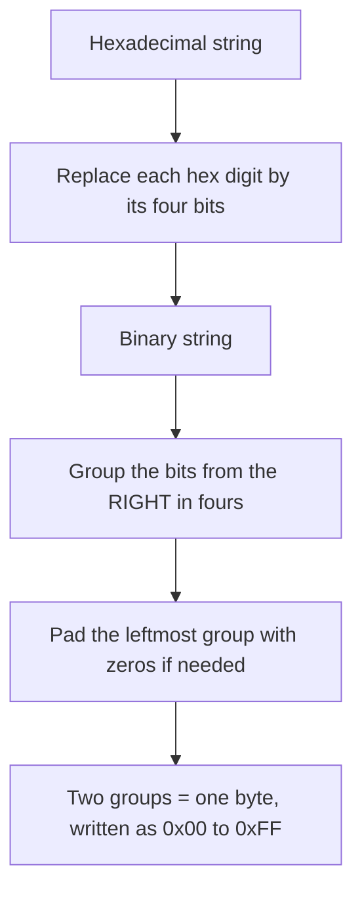

---
tags:
  - ECE2050
  - number-bases
date: 2026-09-16
aliases:
  - 十六进制
  - Hexadecimal
  - Hex
  - Hexadecimal Number System
  - Base-16
---

> [!NOTE] Where this fits · 定位
> 十六进制是二进制的**第二层压缩写法**，也是这一章里"实际工作最常用"的一种：
> $16=2^{4}$，所以 **1 个十六进制位 = 4 bit = 1 nibble**，而**2 个十六进制位恰好是 1 个字节**。
> 内存地址、内存转储 (memory dump)、机器码、颜色码 `#RRGGBB` 全都用它写。
> 前置：[[Number Systems]]、[[Binary Number System]]、[[Octal Number System]]（3-bit 版本的分组思想）。
> 下游：[[Bits and Bytes]]（byte/nibble 的定义）、[[Number Base Conversion]]、
> [[American Standard Code for Information Interchange]]（字符码也是用十六进制记的）。

> [!SUMMARY] Quick recall · 英文速览
> Hexadecimal uses sixteen digits, 0–9 and A–F. Each hex digit corresponds exactly to four binary bits, making long bit strings easier to read.

## Core Definition · 核心定义

**十六进制数制 (hexadecimal number system / base-16)** 的三要素（讲义 p.16）：

| 要素 | 取值 |
|---|---|
| 基数 (base) | $R = 16$ |
| 数码 (digit) | $0$–$9$ 与 `A`,`B`,`C`,`D`,`E`,`F`（共 16 个） |
| 位权 (weight) | $\dots 16^{2},\;16^{1},\;16^{0}\;.\;16^{-1},\;16^{-2}\dots$ |

**字母数码的取值**（必须背下来，它是最容易出错的一格）：

| 字母 | `A` | `B` | `C` | `D` | `E` | `F` |
|---|---|---|---|---|---|---|
| 十进制值 | 10 | 11 | 12 | 13 | 14 | 15 |
| 4 bit | `1010` | `1011` | `1100` | `1101` | `1110` | `1111` |

- 16 个数码里 **10 个是数字、6 个是字母**——讲义 p.73 的 T/F 自测就考这一句
  （*The hexadecimal number system has 16 characters, six of which are alphabetic characters.* 答案为真）。
- 顺带记住：十六进制里 $9+1 = $ `A`（即十进制的 10），进位发生在 `F` 之后：
  `F` $+1 =$ `10`（十六进制的一零 $= 16$）。
- 位权具体值：$\dots 16^{3}=4096,\;16^{2}=256,\;16^{1}=16,\;16^{0}=1$。

**数值校验**（讲义 p.16）：$(E5)_{16} = (E\times16^{1}) + (5\times16^{0}) = (14\times16) + (5\times1) = 224 + 5 = 229 = (229)_{10}$ ✓

**书写惯例**：C / C++ / Java / Python 常用 `0x` 前缀（如 `0x28A`）；Verilog 用宽度与基数形式，
如 `12'h28A`；VHDL 可用 bit-string literal `x"28A"`。汇编语法依 assembler，例如某些语法用 `28Ah`。
本库普通数学正文用 `0x` 或下标 $(\;)_{16}$ 标清基数；代码遵守对应语言的literal语法。

![[hex-memory-address.svg]]
*图 1 — 按字节寻址的内存视图。左侧是地址 `0x0000`–`0x0007`，中间一列是这 8 个字节的内容
（字符串 `ECE2050!`），右边把每个字节**拆成两个 nibble**：高 4 位（bits 7–4，MSB nibble）与
低 4 位（bits 3–0，LSB nibble），每一位都用二进制写出来。对照第一行 `0x45`：
高 nibble `0100` $=4$、低 nibble `0101` $=5$，所以 **2 个十六进制位就是 1 个字节**，
而 **1 个十六进制位就是 1 个 nibble**。最后一字节的地址是 `0x0007`，即"起始地址 $+$ 字节数 $-1$"。*

## Assumptions and Validity · 适用前提

> [!IMPORTANT] 十六进制为什么赢了八进制？因为它与"字节"对齐
> 两条硬理由（都由 $16 = 2^{4}$ 推出）：
> ① **1 个十六进制位 $=$ 4 bit $=$ 1 nibble**，于是 **2 个十六进制位 $=$ 8 bit $=$ 1 byte**，
>     一个字节永远写成**恰好两个**十六进制数字（`00`–`FF`，共 256 个值）；
> ② 内存、指令、字符码都以**字节**为单位编号，用十六进制写地址时高位与低位分得清清楚楚
>     （`0x28A` $=$ `0000 0010 1000 1010`），而八进制按 3 位分组，除不尽 8，
>     跨字节时反而要重新对齐（见 [[Octal Number System]]）。
>
> 所以"看 4 位、写 1 位"这条口诀在十六进制里最值钱：**分组就是换算，不需要任何除法**。

- **适用条件**：串长任意，但二进制 → 十六进制必须**从最右（最低位）开始**每 4 位一组，
  最左不足 4 位时**左侧补 0**。
- **大小写都合法**：`0xcf8e` 与 `0xCF8E` 是同一个数；只是写给人看时习惯大写（或统一小写），
  不要在同一个文件里混用。
- **十六进制不会"表示更多数"**：$N$ 位二进制能表示 $2^{N}$ 个值，写成十六进制只是**换一种写法**，
  值的个数一个也没变。$8$ 位始终是 $256$ 个值，`00`–`FF`。
- **失效边界**：十六进制不是"能直接做十进制算术"的表示法，它没有小数点的十进制语义；
  十进制小数要用 [[Binary Coded Decimal]] 或 [[Floating-Point Numbers]] 表达。

## Derivation · 推导过程

### 1. 十六进制 → 十进制：按位权求和（讲义 p.16）

$$
\begin{aligned}
(E5)_{16}
&= (E\times16^{1}) + (5\times16^{0})\\
&= (14\times16) + (5\times1) = 224 + 5 = (229)_{10}
\end{aligned}
$$

- 意义：还是同一套通式，只是数码 `E` 必须先换成数值 $14$——**字母数码是"值"，不是"字符串"**。
- 数值校验：$14\times16 = 224$ ✓，$224+5 = 229$ ✓；量级校验 $229 < 16^{2} = 256$ ✓（两位数不会超过 256）。

### 2. 十进制 → 十六进制：反复除以 16，**首个余数是 LSD**（讲义 p.18）

余数落在 $[0,15]$，其中 $10$–$15$ 要写成 `A`–`F`。以 $(650)_{10}$ 为例：

| 步骤 | 除法 | 商 | 余数 | 写作 | 含义 |
|---|---|---|---|---|---|
| 1 | $650 \div 16$ | 40 | 10 | `A` | LSD $a_0$ |
| 2 | $40 \div 16$ | 2 | 8 | `8` | $a_1$ |
| 3 | $2 \div 16$ | 0 | 2 | `2` | MSD $a_2$，商为 0 停止 |

读出的结果：$(650)_{10} = (28A)_{16}$ ✓（讲义 p.18 同一张表）。

- 意义：与十进制→八进制完全同构，只是除数从 8 换成 16，并且余数 $10$–$15$ 要多做一次
  "数字 ↔ 字母"的翻译。
- 数值校验：回代 $2\times256 + 8\times16 + 10\times1 = 512 + 128 + 10 = 650$ ✓。

### 3. 十六进制 ↔ 二进制：1 位 = 4 bit（讲义 p.19–20）

**十六进制 → 二进制**：每个十六进制数字换成它自己的 4 位二进制（不足 4 位左侧补 0）。

$$
(CF8E)_{16} = \underbrace{1100}_{C}\;\underbrace{1111}_{F}\;\underbrace{1000}_{8}\;\underbrace{1110}_{E}
= (1100\,1111\,1000\,1110)_2
$$

**二进制 → 十六进制**：从最右边开始每 4 位切一组，最左不足 4 位补 0，再把每组读成一位十六进制。

$$
(1100101001010111)_2 = \underbrace{1100}_{C}\;\underbrace{1010}_{A}\;\underbrace{0101}_{5}\;\underbrace{0111}_{7}
= (CA57)_{16}
$$

- 意义：两个方向都是**局部替换**，可以逐组并行；4 位一组正好是 nibble，所以十六进制与字节结构天然对齐。
- 数值校验：
  - 方向一：$C\to1100$、$F\to1111$、$8\to1000$、$E\to1110$，拼成 16 位 ✓；
    十进制侧 $CF8E_{16} = 12\times4096 + 15\times256 + 8\times16 + 14 = 49152 + 3840 + 128 + 14 = 53134$，
    二进制侧 $32768+16384+2048+1024+512+256+128+8+4+2 = 53134$ ✓ **两条路同值**。
  - 方向二：`1100 1010 0101 0111` 读出 $C,A,5,7$；十进制侧 $12\times4096+10\times256+5\times16+7 = 49152+2560+80+7 = 51799$，二进制侧 $32768+16384+2048+512+64+16+4+2+1 = 51799$ ✓。

### 4. 1 byte = 2 个十六进制位：$00$–$FF$

$$
2\ \text{hex digits} = 8\ \text{bits} = 1\ \text{byte},\qquad 16^{2} = 256 = 2^{8}
$$

- 意义：一个字节的取值范围恰好是 $0x00$–$0xFF$，即十进制 $[0,255]$。这就是**内存转储 (memory dump)**
  的排版方式：左边一列地址、右边每字节两个十六进制位；也是**颜色码** `#RRGGBB` 的由来——
  R、G、B 各占一个字节，`00` 最暗、`FF` 最亮（`#FF0000` 是纯红，`#FFFFFF` 是白）。
- 数值校验：$16^{2} = 256 = 2^{8}$ ✓；`0xFF` $=15\times16+15 = 255$ ✓；
  `#1F6F8B` 拆成三字节 `1F`$=31$、`6F`$=111$、`8B`$=139$，每个都落在 $[0,255]$ ✓。
- 与字符的关系：内存里的字符串本来就是**字节序列**，而 [[American Standard Code for Information Interchange]]
  规定 `'E'` $=0x45$、`'C'` $=0x43$……所以图 1 里那 8 个字节读出来就是 `ECE2050!`。

## Method and Steps · 求解步骤

**A. 十进制 → 十六进制**

1. 反复除以 16，记下每一步的**余数**（$0$–$15$）。
2. 余数 $10$–$15$ **立刻换成** `A`–`F`，不要留成数字（`650` 的第四步余数是 10，必须写成 `A`）。
3. 直到商为 0 停止，余数**从下往上**读。
4. 回代校验：按 $16$ 的幂展开求和。

**B. 十六进制 ↔ 二进制**

1. 十六进制 → 二进制：每位独立换成 4 位，**保留前导零**（`0x0F` $=$ `0000 1111`，不能写成 `1111`）。
2. 二进制 → 十六进制：**从右往左**每 4 位一组，最左不足 4 位左侧补 0。
3. 每组读成 $0$–`F` 中的一个数字；读数时先看是不是 $\ge 10$，是就换成字母。
4. 双向校验：长度关系（4 bit/位）、十进制比对、或"两字节成一对"检查字节边界。

> [!TIP] 心算三个锚点
> ① `0x100 = 256`、`0x1000 = 4096`：看到四位十六进制地址就能估出量级；
> ② 一个字节的**高低 nibble 各是一个十六进制位**：`0x45` 拆成 `4`(高) 与 `5`(低)，
>    高 nibble 权 $16$、低 nibble 权 $1$；
> ③ `0xFF` 是最暗/最亮的边界值 $255$，`0x80` 是 $128$——这两个数在内存与颜色里天天出现。

## Worked Example · 例题

**Example 1 — 十进制转十六进制：$(650)_{10} \to (\;)_{16}$（讲义 p.18）**

题目：把 $(650)_{10}$ 写成十六进制。

解：
1. $650 \div 16 = 40$ 余 $10$ → 写作 `A`（LSD）。
2. $40 \div 16 = 2$ 余 $8$ → 第二位 `8`。
3. $2 \div 16 = 0$ 余 $2$ → 最高位 `2`，停止。
4. 从下往上读：`28A`。

**数值校验 (Numerical check)**：$2\times256 + 8\times16 + A(=10)\times1 = 512+128+10 = 650$ ✓。
反方向再用除以 16 走一遍：余数序列 $10,8,2$ 倒读得 `28A` ✓（讲义 p.18 的表完全相同）。
若把 $10$ 直接写成数字而不是 `A`，会得到非法的 `2810`——这是本例题唯一的坑。

**Example 2 — 十六进制转二进制：$(CF8E)_{16} \to (\;)_2$（讲义 p.19）**

题目：把 $(CF8E)_{16}$ 写成二进制。

解：
1. 四位分别查表：$C\to1100$、$F\to1111$、$8\to1000$、$E\to1110$。
2. 拼接：`1100 1111 1000 1110`（16 位 $=4\times4$ ✓）。

**数值校验 (Numerical check)**：十进制侧 $12\times4096 + 15\times256 + 8\times16 + 14 = 49152+3840+128+14 = 53134$；
二进制侧 $32768+16384+2048+1024+512+256+128+8+4+2 = 53134$ ✓ 同值。
**反向校验**：把 `1100 1111 1000 1110` 从右每 4 位读回 $C,F,8,E$ ✓；
练习用讲义 p.20 的另一个方向：$(1100101001010111)_2 = (CA57)_{16}$，
两边十进制都是 $51799$ ✓。

**Example 3 — 一段 8 字节数据的十六进制地址表**

题目：把字符串 `ECE2050!` 存到从 `0x0000` 开始的内存里，写出地址表，并说明最后一个字节的地址。

解：
1. 先取每个字符的 ASCII 码（十六进制）：`E`$=0x45$、`C`$=0x43$、`E`$=0x45$、`2`$=0x32$、
   `0`$=0x30$、`5`$=0x35$、`0`$=0x30$、`!`$=0x21$。
2. 逐字节排地址（每字节占 1 个地址）：

| 地址 | `0x0000` | `0x0001` | `0x0002` | `0x0003` | `0x0004` | `0x0005` | `0x0006` | `0x0007` |
|---|---|---|---|---|---|---|---|---|
| 字节 | `45` | `43` | `45` | `32` | `30` | `35` | `30` | `21` |
| 字符 | `E` | `C` | `E` | `2` | `0` | `5` | `0` | `!` |

3. 最后一字节地址 $=$ 起始地址 $+$ 字节数 $-1$ $=$ `0x0000` $+ 8 - 1 =$ `0x0007`。

**数值校验 (Numerical check)**：用位权展开核对 `0x0007` $= 0\times16^{3}+0\times16^{2}+0\times16^{1}+7\times16^{0} = 7$ ✓，
与"第 8 个字节（从 0 开始编号）"一致：$0+8-1 = 7$ ✓。
总容量 $8$ 字节 $= 8\times8 = 64$ bit $= 16$ 个十六进制位（表里 8 列各 2 位）✓；
下一个可用地址是 `0x0008`（末尾地址 $+1$），这也是"起始地址 $+$ 长度"的由来。

## Pitfalls · 常见误区

> [!WARNING] 十六进制的坑几乎都在"10 到 15 怎么念"和"从哪里开始分组"

1. **把 `A` 读成十进制的 10 位数字**。错在：把 `0x10` 当成十进制 10。
   正确：`0x10` $= 1\times16 = 16$；十进制的 10 在十六进制里是 `A`。
2. **余数 $10$–$15$ 忘记换成字母**。错在：算出 `2810` 就交卷（Example 1）。
   正确：余数 $\ge 10$ 立刻写 `A`–`F`；回代时再把字母换回数值。
3. **分组方向搞错**。错在：`1100101001010111` 从左往右切 4 位。
   正确：**从最右往左**切；最左不足 4 位时**左侧补 0**（补右边会整体错位 4 位，等于乘了 16）。
4. **丢掉前导零导致字节数量错**。错在：把 `0x0F` 写成 `1111`、把 `0x0045` 写成 `45`。
   正确：写内存/字节数据时**必须补齐到偶数个十六进制位**，否则无法判断这是高字节还是低字节。
5. **以为十六进制"能表示更多数"**。错在：说"一个十六进制位能表示 16 个数，所以比二进制强"。
   正确：$N$ 位的**状态总数**只由位数决定（$2^{N}$）；进制只改变**写法**，不改变信息量。
6. **大小写混用**。错在：同一个内存表里 `0xCf8e` 与 `0XCF8E` 混着写。
   正确：值相同，但排版要统一；比较字符串形式的十六进制时还要先统一大小写。

## Hexadecimal as a hardware reading tool · 十六进制读硬件

Hexadecimal is useful because it exposes four-bit fields without changing the underlying binary pattern. One byte occupies two hex digits. A value written as `0xA6` is still eight binary bits when the container is a byte; it does not become two physical digits inside the circuit.

When a question gives a hex dump, separate address, data, and interpretation. An address locates a byte or word under the stated memory organization. Data is the stored pattern. Signedness, character encoding, and fractional scaling are additional interpretations applied to that pattern. Hex notation alone does not select any of them.

**Worked application — inspect a status byte.** 状态字节 `0xA6` 展开成 `1010 0110`。若 bit 7=ready、bit 2=error、bits 1:0=mode，则 ready=1，error=1，mode=`10`=2。检验 error 可按位 AND `0x04`：`0xA6 AND 0x04 = 0x04`；mode 可取 `0xA6 AND 0x03 = 0x02`。掩码的位置由 bit 编号确定。

In English: a mask keeps selected positions and clears the others. A nonzero masked result says that at least one selected bit is set; it does not necessarily equal the numeric value of the whole field unless the field is aligned to bit zero.

**English exam question:** Is `0xFF` always the decimal integer 255?

**Answer:** It is the unsigned numeric reading of that eight-bit pattern. As an eight-bit two's-complement word it represents −1. As a byte in a character stream its meaning depends on the encoding. The required representation must be stated.

Connect the same reading method to [[Bits and Bytes]], [[Two's Complement Representation]], [[VHDL Language and Modeling]], and [[Memory Arrays and Expansion]].

## Connections · 相关笔记

- 上游 (upstream)：[[Number Systems]] —— 三要素与通式，字母数码只是"值 $\ge 10$ 的数码"。
- 上游 (upstream)：[[Binary Number System]] —— 4-bit 分组的对象。
- 上游 (upstream)：[[Octal Number System]] —— 同一套"$R=2^{k}$ 分组"思想的前一个版本（3 bit）；
  两者对比正好说明"为什么十六进制与字节对齐、八进制不对齐"。
- 下游 (downstream)：[[Bits and Bytes]] —— bit / nibble / byte 与 $2^{N}$、$2^{10}\approx10^{3}$。
- 下游 (downstream)：[[Number Base Conversion]] —— 反复除法、分组法、以十进制为中枢的完整流程。
- 平行 (parallel)：[[American Standard Code for Information Interchange]] —— 字符码表就是用十六进制排的，
  `'A'=0x41`、`'a'=0x61`；内存里的字符串就是它的字节序列。

---
索引：[[ECE2050 Knowledge Tree]] · [[Glossary]]
