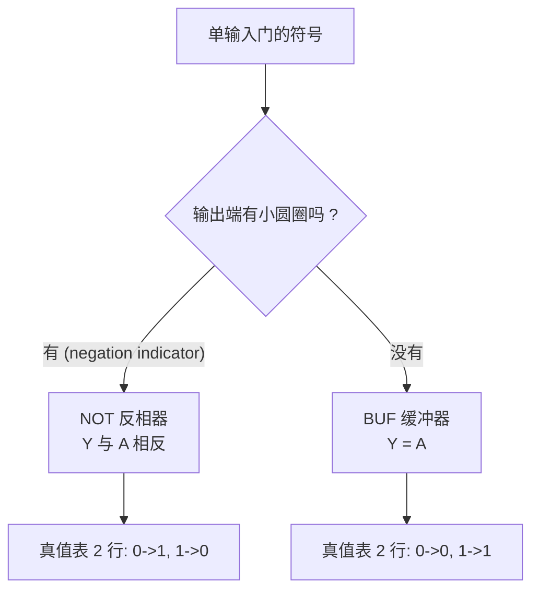

---
tags:
  - ECE2050
  - logic-gates
date: 2026-09-16
aliases:
  - 反相器
  - 非门
  - 反相器与缓冲器
  - Inverter
  - NOT Gate
  - Buffer
---

> [!NOTE] Where this fits · 定位
> 门电路的第一篇，也是**单输入门**的全部内容：反相器 (inverter / NOT gate) 与缓冲器 (buffer / BUF)。
> 前置：[[Logic Gates]]（门的分类、三种描述方式、"$n$ 输入 $2^n$ 行"）。
> 下游：[[NAND Gate]]、[[NOR Gate]]（都是"母门 + 反相器"）、[[Exclusive-NOR Gate]]（XOR + 反相器）；
> 时序图里出现的"沿不重合"问题，细节在 [[Logic Levels]] 与 [[Noise Margin]]。
> 讲义来源：p.4（符号、negation indicator、真值表 / 时序图 / 表达式的定义）、
> p.5（NOT 与 BUF 的对照表）、p.25（T/F 自测第 1、2 题）。

> [!SUMMARY] Quick recall · 英文速览
> An inverter implements NOT: its output is the complement of its input. The small bubble on a logic symbol denotes inversion; a buffer preserves the logic value.

## Core Definition · 核心定义

**反相器 (inverter)** 执行**取反 (inversion / NOT)**：输出是输入的**逻辑反**，英文读作 "NOT A"。

$$Y=\bar A=\overline{A}=A'$$

- 记号：变量上的一条横线 (bar) 表示 **complement（补 / 取反）**，$\bar A$ 读作 "A bar"、
  "NOT A" 或 "the complement of A"（讲义 p.4：*The complement of a variable designated by a bar over the letter*）。
- 意义：输入为 0 时输出 1，输入为 1 时输出 0——**一位的取反**。
- 符号：**三角形 + 输出端的小圆圈**。这个小圆圈叫**负号指示圈 (negation indicator)**，
  它自己不"运算"，只是"把结果取反"的记号（讲义 p.4 的图注就写着 Negation indicator）。

**缓冲器 (buffer, BUF)** 是反相器的"不取反版本"：$Y=A$。符号同样是三角形，但**没有**小圆圈。
它在逻辑上是恒等，工程上用来提供**驱动能力 (drive)**、改善波形、或刻意引入延时。

真值表（讲义 p.5，两行 $=2^1$，这是全部可能）：

| $A$ | NOT $Y=\bar A$ | BUF $Y=A$ |
|---|---|---|
| 0 | 1 | 0 |
| 1 | 0 | 1 |

![[ch3-inverter-symbol.png]]
*图 1 — 讲义 p.4 原图：反相器的符号与输出端的 negation indicator。符号方向永远是从左（输入）
到右（输出），三角形尖端指向输出。*

![[ch3-single-input-gates.png]]
*图 2 — 讲义 p.5 原图：单输入门 NOT / BUF 的符号、表达式与真值表对照。
两张表**只有输出列不同**：$A=0$ 时 NOT 给 1 而 BUF 给 0，这就是"有没有那个小圆圈"的全部差别。*

为什么还要一个"什么都不做"的 BUF（讲义 p.5 把它和 NOT 并排，就是因为二者只差一个圆圈）：

1. **驱动 (drive / fan-out)**：一个门的输出电流有限，带动很多个输入时波形会塌，
   中间插一级 buffer 可以"续力"。
2. **整形 (regeneration)**：长线或噪声把电平拉坏的信号，过一级 buffer 后重新变成干净的两个电平。
3. **延时 (delay)**：需要把某个信号推迟若干 ns 时，串联 buffer 是最省事的办法。

## Assumptions and Validity · 适用前提

> [!IMPORTANT] NOT 门**只能有一个输入**（讲义 p.25 T/F 第 2 题：*A NOT gate cannot have more than one input* → **True**）
> 输入一多，"取反"就没有唯一含义了：$\overline{AB}$ 是 [[NAND Gate]]、$\overline{A+B}$ 是 [[NOR Gate]]，
> 它们各自有自己的名字，不是"多输入 NOT 门"。
> 要对一个多输入函数取反，正确做法是先用 AND / OR 算出函数，再在最后接**一个**反相器。

- 理想假设：延迟为 0、输出严格是输入的补、扇出无限（同 [[Logic Gates]] 的三条理想化）。
- 真实反相器：两个方向的延迟并不相等（$t_{PHL}$ 与 $t_{PLH}$），并且输出电平是**一个范围**而不是一个点，
  这两件事分别属于 [[DC Transfer Characteristic]] 与 [[Logic Levels]] 的内容。
- 失效边界：延迟不改变真值表（功能不变），但会吃掉时序预算；两级反相器串联时延迟叠加（见例题 3）。

## Derivation · 推导过程

### ① 真值表为什么只有 2 行

$n=1\Rightarrow2^1=2$ 行，即**把输入的所有可能取值一个个列完**：
$A=0\Rightarrow Y=\bar0=1$；$A=1\Rightarrow Y=\bar1=0$。

- 意义：单输入门的规格就是"两行表 + 一个表达式 + 一个符号"，与多输入门相比少的是组合数，不是种类。
- 数值校验：两行、两列输入输出，穷举完整 ✓；把输出列取反就得到另一个单输入门：
  NOT 的输出列 `1,0` 恰好是 BUF 输出列 `0,1` 的补 ✓。

### ② 两次取反等于原值：$\overline{\bar A}=A$

反相器的定义是逐位取反，取反两次自然回到原值：

$$Y=\overline{\bar A}=A$$

- 意义：这就是逻辑代数里的**对合律 (involution)**，也是"两个反相器串联 = 一个 buffer"的依据。
- 数值校验：$A=0\to\bar A=1\to\overline{\bar A}=0$ ✓；$A=1\to\bar A=0\to\overline{\bar A}=1$ ✓。
  两种输入都回到原值，所以行为与 BUF 的真值表 `0,0` / `1,1` 完全一致 ✓。
- 但工程上**不能**随手用两个反相器代替 buffer：延迟变成 $2t_{pd}$、晶体管数量翻倍、功耗更大。
  逻辑等价 ≠ 工程等价。

### ③ 时序图怎么读：理想零延迟 vs 真实延迟

讲义 p.4 给时序图的定义：*a graph that displays the relationship of two or more waveforms
with respect to each other on a time basis*——**两个（或多个）波形在时间轴上的相互关系**。
读单输入门的时序图只要盯两件事：**Y 是否与 A 相反**、**沿是否对齐**。

- **理想（零延迟）**：A 的每一个跳变沿处 Y 立刻反向跳变，两个沿重合，看图时一条竖线能同时穿过两条沿。
- **真实（有延迟）**：Y 的跳变落后一个**传播延迟 (propagation delay)** $t_{pd}$，
  逻辑功能不变，但波形整体右移。图 3 用 $A$：$0\sim20$ ns 高、$20\sim40$ ns 低（周期 40 ns、50% 占空比），
  $t_{pd}=4$ ns 画出两种情形。

![[inverter-timing.svg]]
*图 3 — (a) 理想反相器：虚线竖线同时穿过 A 的沿和 Y 的沿，两条沿严格对齐；
(b) 真实反相器：Y 就是同一条波形右移 $t_{pd}=4$ ns，双箭头标出 A 在 20 ns 的下降沿与
Y 在 24 ns 的上升沿之间的时间差。*

- 数值校验：A 的高电平时间是 $80$ ns 里的 $40$ ns（$0\sim20$ 与 $40\sim60$），占空比 $40/80=50\%$；
  理想 Y 的高电平是 $20\sim40$ 与 $60\sim80$，也是 $40$ ns，$50\%$ ✓；
  真实 Y 的高电平是 $0\sim4$、$24\sim44$、$64\sim80$，合计 $4+20+16=40$ ns，仍是 $50\%$ ✓
  ——**延迟不改变占空比，只把整条波形推后**。

## Method and Steps · 求解步骤与方法

1. **确认输入个数是 1**。题目若给两个输入让你"取反"，那就不是 NOT，见误区 1。
2. **看符号判功能**：三角形输出端**有**小圆圈 → NOT（$Y=\bar A$）；**没有**圆圈 → BUF（$Y=A$）。
3. **写表达式 / 填真值表**：两行，输入 $0,1$；NOT 的输出与输入相反，BUF 相同。
4. **画或读时序图**：先找输入的所有跳变沿 → 在每个沿的位置写出 Y 应有的值（理想：同刻反向；真实：滞后 $t_{pd}$ 反向）
   → 用直线把各段连起来。
5. **收尾自检**：Y 的高电平总时长是否等于 A 的低电平总时长（理想情况下）。

## Worked Example · 例题

**Example 1 — 讲义 p.5 的 NOT / BUF 对照表逐行核对**

题目：把 $A$ 依次取 $0,1$，写出 NOT 与 BUF 的输出，并说明两张表的关系。

解：NOT 是取反，$A=0\Rightarrow Y=1$、$A=1\Rightarrow Y=0$；
BUF 是复制，$A=0\Rightarrow Y=0$、$A=1\Rightarrow Y=1$。

**数值校验 (Numerical check)**：把 NOT 的输出列 $1,0$ 逐行取反得到 $0,1$，正是 BUF 的输出列 ✓；
反过来把 BUF 取反就得到 NOT ✓；两表在每一行的输出都**不同**（$0$ vs $1$、$1$ vs $0$），
所以"反相器"与"缓冲器"是功能不同的两个门，不能混写 ✓。

**Example 2 — 读图 3(b)：写出真实反相器的跳变时刻（延伸：传播延迟）**

题目：$A$ 为周期 $40$ ns 的方波，$t=0$ 时由低变高、$t=20$ ns 由高变低、$t=40$ ns 再变高……
反相器的 $t_{pd}=4$ ns，且 $t<0$ 时 $A=0$。求 $Y$ 的前几个跳变时刻与占空比。

解：$Y(t)=\overline{A(t-4\ \text{ns})}$，即"把 A 推后 4 ns 再取反"。

- $t<0$ 时 $A=0\Rightarrow Y=1$，所以 $Y$ 从高电平开始；
- A 在 $0$ ns 上升（$A$ 变 1）→ Y 在 $0+4=4$ ns **下降**；
- A 在 $20$ ns 下降（$A$ 变 0）→ Y 在 $20+4=24$ ns **上升**；
- A 在 $40$ ns 上升 → Y 在 $44$ ns 下降；A 在 $60$ ns 下降 → Y 在 $64$ ns 上升。

**数值校验 (Numerical check)**：$[0,80)$ ns 内 Y 的高电平区间为 $[0,4)$、$[24,44)$、$[64,80)$，
合计 $4+20+16=40$ ns，占空比 $40/80=50\%$，与输入的 $50\%$ 相同 ✓；
每个 Y 的沿都比对应的 A 沿晚 $24-20=4$ ns、$44-40=4$ ns ✓，与 $t_{pd}=4$ ns 一致。

**Example 3 — 两级反相器串联（自算）**

题目：把两个反相器串起来，输入 $A$ 依次取 $0,1$，求最终输出与总延迟（每个 $t_{pd}=4$ ns）。

解：$A\to\bar A\to\overline{\bar A}=A$，所以逻辑上等价于一个 BUF。

**数值校验 (Numerical check)**：$A=0$：$0\to1\to0$，输出 0 ✓；$A=1$：$1\to0\to1$，输出 1 ✓，
两行都与 BUF 的真值表相同 ✓。总延迟 $=2\times4=8$ ns，是单个反相器的两倍——
所以"用两个反相器凑一个 buffer"是有代价的（见推导 ②）。

## Pitfalls · 常见误区

> [!WARNING] 反相器的坑集中在"它只能有一个输入"和"气泡画在哪"

1. **认为 NOT 可以多输入**。错在：写成 $Y=\overline{AB}$ 并叫它"两个输入的 NOT 门"。
   正确：$\overline{AB}$ 是 NAND、$\overline{A+B}$ 是 NOR；NOT 恒为单输入（讲义 p.25 T/F 第 2 题答 True）。
2. **小看 buffer**。错在：认为 $Y=A$ 没有信息量、考试不会考。
   正确：讲义 p.5 专门给出 BUF，它的价值在驱动、整形与延时，而不是逻辑。
3. **气泡位置看错**。输出端的气泡 = 把本门结果取反（NOT / NAND / NOR / XNOR）；
   画在**输入端**的气泡表示该输入**低有效 (active-low)**，含义完全不同，读图时先看气泡在哪一侧。
4. **时序图自相矛盾**。错在：文字里说"有 $t_{pd}$ 延迟"，图上却把 Y 的沿与 A 的沿画在同一时刻。
   正确：理想图沿对齐、真实图沿错开，两者不能混在一张图里（图 3(a) 与 (b) 就是分开画的）。
5. **双重取反写错**。错在：把 $\overline{\bar A}$ 直接写成 $\bar A$（少了一条横线）。
   正确：两条横线长度不同，$\overline{\bar A}=A$，而 $\bar A$ 是取反一次的结果。
6. **以为反相器的输出会跟着输入连续变化**。错在：把数字反相器当成模拟放大器。
   正确：反相器的输出只有两个合法电平（高 / 低），输入在中间过渡带时的行为由传输特性决定，
   见 [[DC Transfer Characteristic]]。

## Inversion, assertion, and physical delay · 取反、有效状态与延迟

An inverter computes the Boolean complement. An active-low control is a specification saying that LOW asserts an action. These ideas often appear together, but they are not synonyms: an active-low input can feed a larger function, and an inverter can operate on ordinary data without defining any control action.

Two cascaded inverters restore the original steady-state Boolean value because $\overline{\bar A}=A$. Real stages still add delay and loading. “Equivalent to a buffer” therefore refers to functionality, not a promise that the output changes at exactly the same time as the input.

**Worked application — convert a reset request.** reset=1 表示请求复位，而元件有低有效 reset_n 引脚。用 $reset_n=\overline{reset}$，reset=0 时引脚为 1、不复位，reset=1 时引脚为 0、复位。若假设反相器传播延迟为 3 ns，则有效电平约晚 3 ns 到达；实际复位释放还必须满足存储元件的 recovery/removal 条件。

In English: first translate the semantic request into the required pin level, then evaluate timing. The bubble at a reset pin describes an asserted LOW level. A clock bubble describes an edge polarity in a different context, so symbols should be read with their pin roles.

**English exam question:** Does adding two inverters remove a logic hazard by canceling the inversions?

**Answer:** Not in general. The final polarity is restored, but a pulse can propagate through both stages, depending on its width and the gates' physical response. Boolean cancellation does not cancel propagation delays or prove hazard immunity.

Continue with [[Universal Gates and Bubble Pushing]], [[Register Enable and Reset]], [[DC Transfer Characteristic]], and [[Propagation Delay and Logic Hazards]].

## Connections · 相关笔记

- 上游 (upstream)：[[Logic Gates]] —— 门的分类、三种描述方式与 $2^n$ 行规则都在这里，本篇是它的第一个实例。
- 上游 (upstream)：[[Number Systems]]、[[Binary Number System]] —— 0/1 的取值与"取反"的对象定义在这里。
- 下游 (downstream)：[[NAND Gate]]、[[NOR Gate]] —— 都是"母门 + 反相器"，本篇的符号与延迟概念直接复用。
- 下游 (downstream)：[[Exclusive-NOR Gate]] —— XNOR 就是"XOR + 反相器"，同样靠一个气泡完成。
- 平行 (parallel)：[[AND Gate]]、[[OR Gate]] —— 多输入门；与单输入门对照着看，最容易记住"输入个数是定义的一部分"。
- 平行 (parallel)：[[Logic Levels]]、[[DC Transfer Characteristic]] —— 本篇的"延迟"与"两个电平"在那两篇里被展开成电压范围与曲线。

---
索引：[[ECE2050 Knowledge Tree]] · [[Glossary]]
