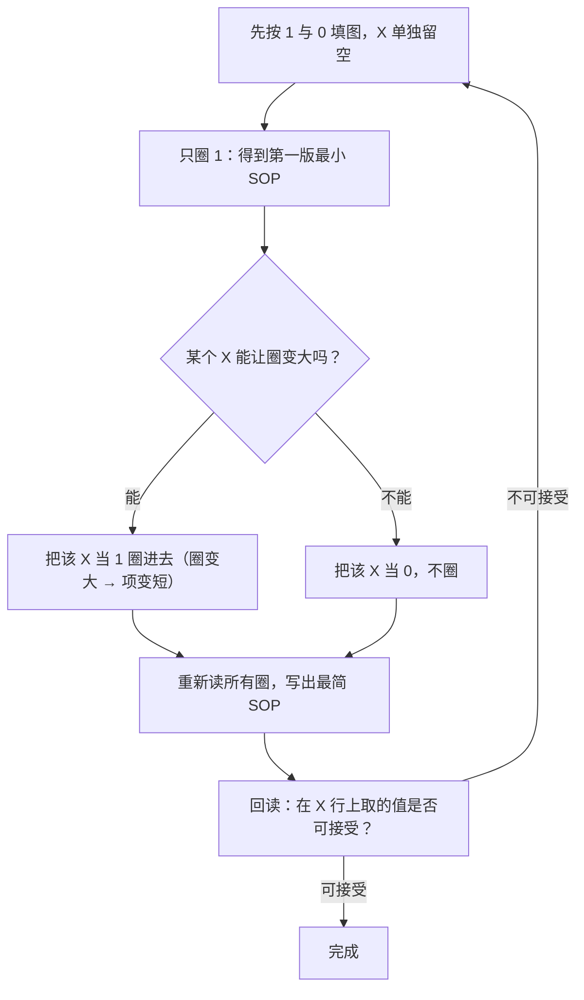

---
tags:
  - ECE2050
  - karnaugh-map
date: 2026-09-16
aliases:
  - 含无关项的卡诺图
  - 无关项
  - 卡诺图无关项
  - Karnaugh Map with Don't Cares
  - Don't Care Conditions
---

> [!NOTE] Where this fits · 定位
> [[Karnaugh Map]] 的**第一个扩展**：真值表里除了 0 和 1，还允许出现 **X（don't care，无关项）**。
> X 是卡诺图里唯一"免费"的资源——**用得好能圈出更大的圈、得到更短的式子**，用得不好则写出多余项。
> 前置：[[Karnaugh Map]]（圈组五规则）、[[Minterm and Maxterm]]（编号与填图）、[[Sum-of-Products Form]]（圈 1 读积项）。
> 下游：[[POS Minimization with Karnaugh Map]]（换成圈 0）、[[Binary Coded Decimal]]（本课最经典的 X 来源）。

> [!SUMMARY] Quick recall · 英文速览
> A don't-care cell may be treated as 0 or 1 when the corresponding input case has no required output. Include it in a group only when doing so helps simplify the implementation.

## Core Definition · 核心定义

**无关项 (don't care)**：真值表里那些"**输出取 0 还是取 1 都无所谓**"的输入组合，记作 **X**。
它既不是 1 也不是 0，而是一个**自由度**：

$$
X \;\equiv\; \text{该行可以是 0，也可以是 1，由化简方便决定}
$$

三类输入组合的对比：

| 行类型 | 含义 | 在卡诺图里怎么用 |
|---|---|---|
| **1** | 该组合必须输出 1 | 必须被某个圈覆盖 |
| **0** | 该组合必须输出 0 | **绝不能**被圈覆盖（SOP 最小化时） |
| **X** | 该组合不会出现，或输出无所谓 | **可圈可不圈**：圈它能合并出更大的圈就圈，否则当 0 处理 |

**X 从哪来**（讲义 p.60–61 的 BCD 例子最典型）：
1. **输入组合物理上不会出现**。BCD 只用 $0000$–$1001$ 表示十进制数字，$1010$–$1111$ 这 6 个码
   永远不会作为输入送到七段译码器上 → 它们的输出随便取。
2. **输出无所谓**。某些组合下后续电路不看这个输出，或该状态被别处屏蔽。

![[ch4-kmap-dont-care.png]]
*图 1 — 讲义 p.59 原图：一张含 7 个 X 的四变量卡诺图（行 `CD`、列 `AB`，按 Gray 码 `00 01 11 10` 排列）。*

## Assumptions and Validity · 适用前提

> [!IMPORTANT] 圈 X 的前提与代价
> ① **只有真的"无关"才能标 X**：如果某个组合会出现、且输出有确定要求，把它标成 X 就是在**掩盖错误**；
> ② 圈了 X 之后，得到的式子在**这些 X 行上的取值由式子决定**，不再受你控制——所以完成化简后要回读一遍，
> 确认"式子在这些行上给出的值是可以接受的"；
> ③ X 的用法**不是**"把所有 X 都圈进去"，而是"**只在能把圈变大时才圈**"（讲义 p.58 原文：
> *Circle a "don't care" (X) only if it helps minimize the equation*）。

- **X 不改变圈组规则**：仍然只能是水平/垂直的矩形、跨度是 2 的幂、尽量大、可以跨边界回绕
  （五条规则见 [[Karnaugh Map]]）。
- **X 行不参与"必须覆盖"的义务**：你不需要为了 X 而多写一项。
- 同一张图上**同时做 SOP 与 POS** 时，X 可以在一处当 1、另一处当 0 —— 只要两边各自自洽即可。

## Derivation · 推导过程

以讲义 p.59 的图为例（7 个 1、2 个 0、7 个 X）：

| $A B C D$ | $Y$ | $A B C D$ | $Y$ |
|---|---|---|---|
| 0000 | 1 | 1000 | 1 |
| 0001 | 0 | 1001 | 1 |
| 0010 | 1 | 1010 | X |
| 0011 | 1 | 1011 | X |
| 0100 | 0 | 1100 | X |
| 0101 | X | 1101 | X |
| 0110 | 1 | 1110 | X |
| 0111 | 1 | 1111 | X |

**第一步：先只圈 1，看能圈多大。** 1 的分布是"左下角一堆 + 顶行两个"，天生零散：

$$
Y_{X=0}=\bar AC+A\bar B\bar C+\bar A\bar B\bar D
$$

**第二步：把 X 当 1，圈出三个大圈。**（图 2 已把三个圈画出来）

| 圈 | 覆盖的格 | 圈内不变的变量 | 读出的积项 |
|---|---|---|---|
| ① | $A=1$ 的全部 8 格（含 6 个 X） | $A=1$ | $A$ |
| ② | $C=1$ 的全部 8 格（含 4 个 X） | $C=1$ | $C$ |
| ③ | 四个角 $0000,0010,1000,1010$（含 1 个 X，**靠回绕**） | $B=0,\ D=0$ | $\bar B\bar D$ |

$$
Y=A+C+\bar B\bar D
$$

- 物理意义：三个圈分别锁住"$A$ 为真""$C$ 为真""$B,D$ 同时为假"三种情况，任一成立输出就是 1；
- **数值校验**：把 $Y=A+C+\bar B\bar D$ 代回全部 16 行——7 个 1 行全得 1 ✓、2 个 0 行
  （$0001$：$A=0,C=0,\bar B\bar D=0\cdot1=0\Rightarrow 0$ ✓；$0100$：$A=0,C=0,\bar B\bar D=0\cdot1=0\Rightarrow 0$ ✓）；
  按索引5,10,11,12,13,14,15排列的7个X行取 $0,1,1,1,1,1,1$，都是允许值 ✓。
- 对比：上述把X固定为0的方案为3项、8个文字；利用X后 **3项、4个文字**。
  本例减少的是literal count，不是乘积项个数；不同X行无需都取相同值。

![[kmap-dont-care.svg]]
*图 2 — 同一张图的两种画法：(a) 按讲义给出 1/0/X 与每格的 minterm 编号；(b) 三个圈——其中两个"吞掉"X 格，
第三个 $\bar B\bar D$ 靠**回绕**把四个角圈在一起，最终读出 $Y=A+C+\bar B\bar D$。*

## Method and Steps · 求解步骤与方法

1. 按真值表填 1、0、X；
2. 先按"只用 1"做一遍，作为基准；
3. 逐个检查 X：**把它当 1 能否与相邻的 1 合并成更大的圈**？能就圈，不能就放着；
4. 读圈写式（圈内不变的变量保留）；
5. **回读 X 行**，确认式子在这些行上给出的值可以接受。

## Worked Example · 例题

**Example 1 — 讲义 p.59：用 X 把零散的 1 合并成大圈**

题目见上面的真值表。解：按图 2 的三个圈得 $Y=A+C+\bar B\bar D$。
**数值校验 (Numerical check)**：16行逐行代入——7个1行全为1 ✓；2个0行全为0 ✓；
7个X行的输出为0,1,1,1,1,1,1（允许）✓。上述基准3项8文字变为3项4文字 ✓。

**Example 2 — 讲义 p.60–61（例题 4-32）：BCD → 七段译码器的段 a**

七段数码管的 **a 段**（顶横）在显示 $0,2,3,5,6,7,8,9$ 时点亮，在 $1,4$ 时熄灭；
BCD 的 $1010$–$1111$ **不是合法数字**，因此输出为 X：

| 数字 | $A B C D$ | 段 a | 数字 | $A B C D$ | 段 a |
|---|---|---|---|---|---|
| 0 | 0000 | 1 | 5 | 0101 | 1 |
| 1 | 0001 | 0 | 6 | 0110 | 1 |
| 2 | 0010 | 1 | 7 | 0111 | 1 |
| 3 | 0011 | 1 | 8 | 1000 | 1 |
| 4 | 0100 | 0 | 9 | 1001 | 1 |
| — | 1010–1111 | X | | | |

解：圈 $A=1$ 的 8 格（含 6 个 X）、圈 $C=1$ 的 8 格、圈 $B=D=1$ 的 4 格、圈 $B=D=0$ 的 4 格：

$$
a=A+C+BD+\bar B\bar D
$$

**数值校验**：逐行代入——8 个"亮"的行全为 1 ✓，$0001$（数字 1）得 $0+0+0+0=0$ ✓，
$0100$（数字 4）得 $0+0+0+0=0$ ✓，$1010$–$1111$ 得 1（X，允许）✓；
最后一式可读作 $a=A+C+(B\odot D)$：**"最高位为 1，或次高位为 1，或 B 与 D 相同"**——
这正好解释了 2/3/6/7 连续点亮、8/9 靠 $A$ 点亮的原因 ✓。

![[ch4-seven-segment-kmap.png]]
*图 3 — 讲义 p.61 原图：例题 4-32 的 BCD→七段译码器真值表与段 a 的卡诺图（$1010$–$1111$ 全为 X）。*

**Example 3 — 反例：什么时候不能把 X 当 1**

若某组合其实**会出现**且要求输出 0（例如译码器要驱动一个报警灯），却被图省事标成 X，
化简后式子在该行可能取 1 → 报警灯误亮。
**校验方法**：把圈出来的式子代回该行；一旦取值与真实要求不符，说明 X 标错了，必须改回 0。

## Pitfalls · 常见误区

> [!WARNING] X 是"自由度"，不是"随便填"
> 判断标准只有一条：**这一行在真实系统里会不会出现、出现了输出是否真的无所谓。**

1. **把 X 当 0 就不管了。** 只圈 1 会得到项数更多的式子；正确做法是先圈 1 作基准，再逐个 X 试"能否让圈变大"。
2. **把 X 当 1 全部圈进去。** 多余的 X 会造出**冗余项**（甚至有圈只覆盖 X）。只有能合并增大圈的 X 才圈。
3. **只圈 X 不圈 1。** 每个 1 至少被圈一次的规则没有变，X 不能替代 1 的义务。
4. **忘了回绕。** $\bar B\bar D$（四个角）必须靠"上下、左右都能相邻"的回绕规则才成立，见 [[Karnaugh Map]]。
5. **X 行"随便"之后不回读。** 圈了 X，式子在那些行上的取值就固定了；写完要回读并确认可接受。
6. **把 X 当成"两个不同的值同时用"。** 同一张图、同一个式子里，一个 X 只能取一个值；
   只有分开做 SOP 与 POS 两份式子时，才允许各取各的。

## Don't-care freedom and invalid-input policy · 自由度与非法输入策略

A don't-care states that the specification accepts either Boolean output on that input row. The implemented circuit still produces one definite steady-state result there. It does not physically output the symbol X or choose a value afresh during each use.

For BCD inputs, treating ten through fifteen as don't-cares is valid only when those codes are excluded or their outputs are unconstrained. If invalid codes must blank a display or raise an alarm, add that requirement to the table before minimizing. A state encoding also needs a deliberate recovery policy if invalid states can occur.

**Worked application.** 段a最简式在非法BCD输入1010上输出1，这在don't-care规范中允许；如果现在要求非法码全灭，则检测 $I_{bad}=A(B+C)$ 并令 $a_{safe}=\bar I_{bad}a$。在1010时Ibad=1，所以强制灭；原来的化简结果并没有“自动失效保护”。

**English exam question:** Must every don't-care cell be used in the final groups?

**Answer:** No. Use only those that improve a cover of required cells; a group covering only don't-cares creates no useful obligation. Check [[Seven-Segment Display and Code Conversion]] for the complete interface and [[State Encoding and Unused States]] for recovery behavior.

## Connections · 相关笔记

- 上游 (upstream)：[[Karnaugh Map]] —— 圈组五规则是这里全部操作的语法；[[Minterm and Maxterm]] —— X 行的编号与填图；
  [[Binary Coded Decimal]] —— $1010$–$1111$ 这 6 个非法码就是本课最标准的 X 来源。
- 下游 (downstream)：[[POS Minimization with Karnaugh Map]] —— 同一张图上换成圈 0，X 同样可以帮你把圈变大；
  [[Seven-Segment Display and Code Conversion]] 给出 Ch6 的完整显示接口、零抑制和码制转换。
- 平行 (parallel)：[[Sum-of-Products Form]] —— X 参与后得到的仍然是最小 SOP，只是"最小"的标准变成了
  "在所有允许的 X 取值里最小"。

---
索引：[[ECE2050 Knowledge Tree]] · [[Glossary]]
