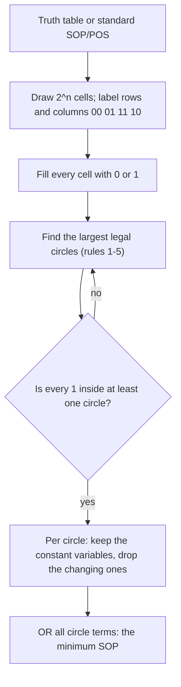

---
tags:
  - ECE2050
  - karnaugh-map
date: 2026-09-16
aliases:
  - 卡诺图
  - K 图
  - Karnaugh Map
  - K-Map
---

> [!NOTE] Where this fits · 定位
> 第四章「Boolean Algebra and Logic Simplification」的**收官方法篇**（讲义 p.47–p.53）。
> [[Boolean Expression Simplification]] 靠公理一条条化简，每一步都得"想到"该用哪条规则；卡诺图把这件苦差事
> 变成**看图圈格**：把真值表排成方格，把相邻的 1 圈在一起，圈出来的就是积项。它不是新代数，
> 只是 [[Minterm and Maxterm]] 的一张**排好序的座位表**。
> 前置：[[Minterm and Maxterm]]、[[Truth Table and Boolean Expression]]、[[Sum-of-Products Form]]、
> [[Product-of-Sums Form]]、[[Gray Code]]（行列为什么按 `00 01 11 10` 排）。
> 下游：[[Karnaugh Map with Don't Cares]]（多一类 X 格）、[[POS Minimization with Karnaugh Map]]（反过来圈 0）。

> [!SUMMARY] Quick recall · 英文速览
> A Karnaugh map arranges truth-table rows in Gray-code order so adjacent cells differ in one variable. Grouping adjacent 1s gives a simplified sum-of-products expression.

## Core Definition · 核心定义

**卡诺图 (Karnaugh map, K-map)** 是把布尔函数的真值表重排成**二维方格**的图。讲义 p.48 的原话：
*a systematic method to simplify Boolean expressions to their simplest SOP/POS expressions,
aka. the minimum expressions*。它只由两条规则定义：

- **一格 = 一种输入组合**。Cells: *each represents a binary value of the input variables*，
  *# of cells: the total # of possible input variable combinations* —— $n$ 个输入就是 $2^n$ 格（3 变量 8 格、4 变量 16 格）。
- **行列编号用格雷码 (Gray code)**：相邻两格的编号只差**一个**变量（讲义 p.48：*Adjacent cells are indexed
  with the Gray code, i.e. only a single variable change between adjacent cells*）。这正是 [[Gray Code]] 在数字逻辑里最重要的用途。

| 变量数 | 图的形状 | 行标签 | 列标签 | 格数 |
|---|---|---|---|---|
| 3 | $2\times4$ | `C` = `0 1` | `AB` = `00 01 11 10` | 8 |
| 4 | $4\times4$ | `CD` = `00 01 11 10` | `AB` = `00 01 11 10` | 16 |

两处最容易出错的地方（图 1(a) 已经把正确答案画出来）：

1. 顺序是 **`00 01 11 10`（格雷码）**，**不是** `00 01 10 11`（自然二进制）。若按后者编号，
   斜对角的两格反而"只差一位"，整张图的相邻关系就散了。
2. 行、列的变量对可以互换：讲义 p.52 把 `CD` 写在行、`AB` 写在列，讲义 p.61 又反过来。
   本库统一写 **`AB` 作列、`C`/`CD` 作行**。**转置不改变任何相邻关系**（左右相邻变成上下相邻），
   圈组与结果完全一样——所以看到排布不同的卡诺图不必慌。

每格的坐标就是它的 **minterm 编号** $m_i$：把该格的 `ABCD` 按二进制读成十进制即可。例如 4 变量图里
`AB = 10`、`CD = 01` 的格子是 $m_{1001}=m_9$（`1001`$=9$）。于是卡诺图就是"$m_0\ldots m_{2^n-1}$ 的座位表"。

![[kmap-rules.svg]]
*图 1 — (a) 两种尺寸的编号布局：每格标出 minterm 编号 $m_i$ 与它的 `ABCD` 编码，行列都按格雷码 `00 01 11 10`，
因此任意两个相邻格（含跨边界相邻）只差一位。(b) 合法与非法圈组对照：$1\times2$ 对、$2\times2$ 方阵、四角回绕
都合法；斜对角、3 格、L 形都不合法。虚线框表示"左右两条边界是接起来的"（回绕）。*

## Assumptions and Validity · 适用前提

> [!IMPORTANT] 卡诺图是"人眼版"的化简算法，不是新的布尔代数
> 图上每一步都能翻译回代数：把相邻两格圈起来，等价于用 $X\bar Y+XY=X$ 消掉一个变量（见推导 1）。
> 所以**卡诺图读出的式子必定与原真值表逐行等价**——它只是把"找 $X\bar Y+XY$"这步交给眼睛去完成。
> 代价是指数增长：手画卡诺图一般只做到 4 变量，5 变量已很勉强。

- **先要有完整的真值表或标准 SOP/POS**：漏掉一行就等于少了一个 1，圈出来的是**另一个函数**（"域 (domain) 完整"见 [[Truth Table and Boolean Expression]]）。
- **"最小"的判据是项数最少，其次 literal 最少**：同一个函数圈 1 得最小 SOP、圈 0 得最小 POS（[[POS Minimization with Karnaugh Map]]），
  两者不一定谁更便宜，要都读一遍再比。
- **只对确定的 0/1 有效**：若某些输入组合根本不会出现、或输出无所谓，别硬填 0/1，应填 X 交给 [[Karnaugh Map with Don't Cares]]。
- **失效边界**：变量数 $\ge6$ 时格子太多、相邻关系肉眼不可靠，应改用软件化的 Quine–McCluskey 算法；卡诺图只适合手算规模。

## Derivation · 推导过程

### 1. 为什么相邻两格能合并：$X\bar Y+XY=X$

相邻（只差一个变量）意味着两格的积项可以写成同一个"其余部分 $X$"乘上"变化那位的两种取值"：

$$
\underbrace{X\bar Y}_{Y=0 \text{ 的格}}+\underbrace{XY}_{Y=1 \text{ 的格}}
=X(\bar Y+Y)=X\cdot 1=X
$$

- **意义**：两格合并后，那个**变来变去**的变量（$Y$）连同它的横线一起消失，只剩两格**共同**的 $X$。圈组五规则的
  第 2–5 条（水平/竖直、2 的幂、尽量大、可回绕）本质上都是"找更多只差一个变量的格"。
- **数值校验**：$B=1,C=1$ 固定时，$A$ 的两种取值给出 $m_7=ABC$ 与 $m_3=\bar ABC$；
  $ABC+\bar ABC = BC(A+\bar A)=BC\cdot1=BC$ ✓（这就是下面例题 1 里的第二个圈）。
- 行列表头之所以必须是格雷码：只有相邻编号**只差一位**，"两格合并消一个变量"才成立；用自然二进制编号，
  相邻两格可能差两三位，$X\bar Y+XY$ 这套就套不上去（[[Gray Code]] 里"相邻只差 1 位"就是为它服务的）。

### 2. 圈多大，就消掉几个变量

一般地，若一个圈内**恰好有 $k$ 个变量在变化**，则这 $k$ 个变量全部消掉，**积项的 literal 数 $=n-k$**：

| 圈的大小 | 变化的变量数 $k$ | 积项 literal 数（$n=4$） | 例子 |
|---|---|---|---|
| 1 格 | 0 | 4 | $A\bar BC\bar D$ |
| 2 格 | 1 | 3 | $\bar ABD$ |
| 4 格 | 2 | 2 | $\bar AC$ |
| 8 格 | 3 | 1 | $B$ |
| 16 格 | 4 | 0 | $Y=1$（全 1） |

- **意义**：圈越大越省。规则 4"每个圈要尽可能大"就是这条的直接推论：$2$ 格的圈留 3 个字母，$4$ 格的圈只留 2 个。
- **数值校验**：例题 1 的 `AB=01` 竖直 2 格圈里 $C$ 在变 → $n-k=3-1=2$ 个 literal，正是 $BC$ ✓；
  例题 3 的 $\bar AC$ 是 4 格圈，$B,D$ 两个变量在变 → $4-2=2$ 个 literal ✓。

### 3. 从一个圈读出积项（本课最核心的一步）

1. 圈里**一直为 1** 的变量 → 写**原变量**（如 $B$）；
2. 圈里**一直为 0** 的变量 → 写**反变量**（如 $\bar D$）；
3. 圈里**又 0 又 1** 的变量 → **直接丢掉**。

把所有圈的积项 **OR** 起来，就是最小 SOP（这就是 [[Sum-of-Products Form]] 的形式）。圈 0 时的对偶规则
（0 写原变量、1 写反变量、再 AND）见 [[POS Minimization with Karnaugh Map]]。

## Method and Steps · 求解步骤与方法

讲义 p.49 的 **圈组五规则**（p.58 会再加第六条，专门管 don't care）：

1. **每个 1 至少被圈一次**（Every 1 must be circled at least once）——漏一个 1 就等于漏一项。
2. **圈只能是水平或竖直的，不能斜着圈**（Circles may be horizontal or vertical, but not diagonal）。
3. **每个圈在每个方向上跨的格数必须是 2 的幂**：1、2、4、8…（Each circle must span a power of 2 cells in each direction）。
4. **每个圈要尽可能大**（Each circle must be as large as possible）。
5. **圈可以跨边界回绕**（A circle may wrap around the edges）：最左列与最右列相邻、最上行与最下行相邻。

> [!TIP] 三个快速判断
> - 圈里**有几个变量在变**，这一项就少几个字母；圈 $2^k$ 格少 $k$ 个字母。
> - 圈只能"成对长大"：能圈 2 就一定要试 4，能圈 4 就一定要试 8，直到再扩就会包进 0 为止。
> - 先圈**只有一种圈法的 1**（被边界或 0 卡死的格），再圈剩下的，能少走回头路。

## Worked Example · 例题

**Example 1 — 3 变量：讲义 p.50**

题目：由下表求真值表对应的最小 SOP。

| $A$ | $B$ | $C$ | $Y$ |
|---|---|---|---|
| 0 | 0 | 0 | 0 |
| 0 | 0 | 1 | 0 |
| 0 | 1 | 0 | 1 |
| 0 | 1 | 1 | 1 |
| 1 | 0 | 0 | 0 |
| 1 | 0 | 1 | 0 |
| 1 | 1 | 0 | 0 |
| 1 | 1 | 1 | 1 |

解：
1. 画 $2\times4$ 框：列 `AB` = `00 01 11 10`，行 `C` = `0`,`1`。
2. 填格：输出为 1 的是 $m_2,m_3,m_7$，其余填 0。
3. 圈：$\{m_2,m_3\}$ 是 `AB=01` 这一列的上下两格 → 2 格圈，$C$ 在变、$A=0,B=1$ 不变 → $\bar AB$；
   $\{m_3,m_7\}$ 是 `C=1` 这一行的左右两格 → 2 格圈，$A$ 在变、$B=1,C=1$ 不变 → $BC$。
4. 两个圈 OR 起来：$Y=\bar AB+BC$。

**数值校验 (Numerical check)**：把两项代回全部 8 行（$m_7\ldots m_0$ 顺序读）：

| $ABC$ | 000 | 001 | 010 | 011 | 100 | 101 | 110 | 111 |
|---|---|---|---|---|---|---|---|---|
| 真值表 $Y$ | 0 | 0 | 1 | 1 | 0 | 0 | 0 | 1 |
| $\bar AB+BC$ | 0 | 0 | 1 | 1 | 0 | 0 | 0 | 1 |

逐列相同 ✓（Python 枚举 8 种输入：真值表 `00110001`，式子 `00110001`，完全一致）。
另一个自检：$\bar AB$ 覆盖 $\{m_2,m_3\}$、$BC$ 覆盖 $\{m_3,m_7\}$，并集 $\{m_2,m_3,m_7\}$ = 真值表里所有 1 ✓；
穷举最小化程序也确认 **2 项 / 4 个 literal 已是最小**（1 项做不到：$m_3$ 不与 $m_0,m_1,m_4,m_5,m_6$ 中任何一个相邻）。

> [!WARNING] 抄式子别丢横线
> 讲义 p.50 的答案写成 $\bar AB+BC$（$A$ 上有一条横线）。从 PDF 里取文字时上划线经常被丢掉，
> 只剩 "AB + BC" ——那对应的是 $m_6,m_7,m_3$，与本题的 1 不符。**算式抄下来一定要用真值表回代一遍。**

![[ch4-kmap-3var-basic.png]]
*图 2 — 讲义 p.50 原图：左边 3 变量真值表、右边同一张表的卡诺图，两个 2 格圈分别读出 $\bar AB$ 与 $BC$。*

**Example 2 — 3 变量：讲义 p.51（6 项压成 3 项）**

题目：化简 $Y=\bar A\bar B\bar C+\bar A\bar BC+\bar AB\bar C+ABC+A\bar B\bar C+A\bar BC$。

解：
1. 六个项对应 $m_0,m_1,m_2,m_4,m_5,m_7=1$，只有 $m_3,m_6$ 是 0。
2. 圈 $\{m_0,m_1,m_4,m_5\}$：`B=0` 的四格构成一个 $2\times2$ 圈，$A,C$ 在变 → $\bar B$。
3. 圈 $\{m_0,m_2\}$：`A=0,C=0` 的两格 → $\bar A\bar C$。
4. 圈 $\{m_5,m_7\}$：`A=1,C=1` 的两格 → $AC$。
5. $Y=\bar B+\bar A\bar C+AC$（讲义 p.51 的答案）。

**数值校验 (Numerical check)**：$\bar B$ 覆盖 $\{0,1,4,5\}$、$\bar A\bar C$ 覆盖 $\{0,2\}$、$AC$ 覆盖 $\{5,7\}$，
并集 $\{0,1,2,4,5,7\}$ 正好是真值表的全部 1（$m_3,m_6$ 为 0）✓。Python 枚举 8 行：
真值表 `11101101`，式子 `11101101`，逐行一致 ✓。代价对比：原来 6 项 18 个 literal，现在 **3 项 5 个 literal**。

![[ch4-kmap-3var-example.png]]
*图 3 — 讲义 p.51 原图：同一个 3 变量图上的第二例，六个圈合并成三个（$\bar B$ 吃掉中间四格）。*

**Example 3 — 4 变量：讲义 p.52**

题目：由下列真值表（讲义把它横过来写：每个变量占一行、16 列对应 $m_0\ldots m_{15}$）求最小 SOP。

| 变量 | $m_0$ | $m_1$ | $m_2$ | $m_3$ | $m_4$ | $m_5$ | $m_6$ | $m_7$ | $m_8$ | $m_9$ | $m_{10}$ | $m_{11}$ | $m_{12}$ | $m_{13}$ | $m_{14}$ | $m_{15}$ |
|---|---|---|---|---|---|---|---|---|---|---|---|---|---|---|---|---|
| $A$ | 0 | 0 | 0 | 0 | 0 | 0 | 0 | 0 | 1 | 1 | 1 | 1 | 1 | 1 | 1 | 1 |
| $B$ | 0 | 0 | 0 | 0 | 1 | 1 | 1 | 1 | 0 | 0 | 0 | 0 | 1 | 1 | 1 | 1 |
| $C$ | 0 | 0 | 1 | 1 | 0 | 0 | 1 | 1 | 0 | 0 | 1 | 1 | 0 | 0 | 1 | 1 |
| $D$ | 0 | 1 | 0 | 1 | 0 | 1 | 0 | 1 | 0 | 1 | 0 | 1 | 0 | 1 | 0 | 1 |
| $Y$ | 1 | 0 | 1 | 1 | 0 | 1 | 1 | 1 | 1 | 1 | 1 | 0 | 0 | 0 | 0 | 0 |

解：
1. 把 1 填进图（行 `CD`、列 `AB`，见下表；讲义 p.52 的图就是这个排布）：

| $CD \backslash AB$ | 00 | 01 | 11 | 10 |
|---|---|---|---|---|
| 00 | 1 | 0 | 0 | 1 |
| 01 | 0 | 1 | 0 | 1 |
| 11 | 1 | 1 | 0 | 0 |
| 10 | 1 | 1 | 0 | 1 |

2. 四个圈：
   - $\{m_3,m_7,m_2,m_6\}$：`A=0`（列 `00`,`01`）且 `C=1`（行 `11`,`10`）→ $2\times2$ 圈 → $\bar AC$；
   - $\{m_5,m_7\}$：`A=0,B=1,D=1`，$C$ 在变 → 2 格圈 → $\bar ABD$；
   - $\{m_8,m_9\}$：`A=1,B=0,C=0`，$D$ 在变 → 2 格圈 → $A\bar B\bar C$；
   - $\{m_0,m_2,m_8,m_{10}\}$：`B=0,D=0` 且 `A,C` 在变 → **四角回绕**的 4 格圈 → $\bar B\bar D$。
3. $Y=\bar AC+\bar ABD+A\bar B\bar C+\bar B\bar D$。

**数值校验 (Numerical check)**：$\bar AC$ 覆盖 $\{2,3,6,7\}$、$\bar ABD$ 覆盖 $\{5,7\}$、$A\bar B\bar C$ 覆盖 $\{8,9\}$、
$\bar B\bar D$ 覆盖 $\{0,2,8,10\}$，并集 $\{0,2,3,5,6,7,8,9,10\}$ 与真值表 16 行的 1 完全吻合 ✓。
Python 枚举 16 种输入：真值表 `1011011111100000`，式子 `1011011111100000`，逐位一致 ✓；
穷举最小化确认它是最小的 **4 项 / 10 个 literal**（其中 $\bar AC$、$A\bar B\bar C$、$\bar ABD$ 都是被孤立 1 逼出来的必需项）。
最后一个格是四角圈：$m_0$ 与 $m_{10}$ 在图上是"斜对角"，但沿着边界回绕后它们是相邻的——这就是规则 5 的价值。

![[ch4-kmap-4var.png]]
*图 4 — 讲义 p.52 原图：4 变量图（行 `CD`、列 `AB`）与四个圈；答案 $\bar AC+\bar ABD+A\bar B\bar C+\bar B\bar D$ 中
三条横线同样会在 PDF 取文字时丢失。*

## Pitfalls · 常见误区

> [!WARNING] 卡诺图的错误几乎都能在图上直接看出来，交卷前按这七条扫一遍

1. **表头写成 `00 01 10 11`**。错在：按自然二进制顺序编号。正确：一律 `00 01 11 10`；
   自检方法是"任意相邻两格（含回绕）异或后只有 1 位为 1"。
2. **斜着圈**。错在：把 $m_0$ 与 $m_3$、$m_5$ 与 $m_{10}$ 这类对角格圈在一起。正确：只允许水平、竖直（回绕也算）。
3. **圈 3 格或 6 格**。错在：跨的格数不是 2 的幂。正确：每个方向上跨 1、2、4、8…格；3 格的"L 形"更不允许（不是矩形）。
4. **忘记回绕**。错在：以为四角、最左/最右列互不相邻，结果多用两三项。正确：边界是接起来的，四角可以合成一个 4 格圈。
5. **圈太小就收手**。错在：看到 2 格圈就写答案，没试 4 格。正确：每条边都往外扩一格试试，扩不进 0 才停。
6. **抄式子丢横线**。错在：把 $\bar AB+BC$ 抄成 $AB+BC$（讲义 p.50）、把 $\bar B\bar D$ 抄成 $BD$（讲义 p.59）。
   正确：抄完用真值表逐行回代。
7. **以为一个 1 只能圈一次**。错在：为避免"重复"而放弃大圈。正确：规则只要求**每个 1 至少被圈一次**，
   共享格不但允许而且常常必需（例题 3 里 $m_7$ 就被两个圈共用）。

## Group meaning and implementation choices · 圈组含义与实现选择

Each power-of-two group removes the variables that change within it. The surviving literals describe every covered row, including wrapped edge cells. Gray-code ordering makes neighboring cells differ in one variable; ordinary binary order does not preserve that adjacency around the map.

An essential prime implicant covers at least one ON cell that no other prime implicant covers. Include it, then cover the remaining required cells. A valid cover is not automatically a minimum cover; compare alternatives under the stated term/literal metric. Physical hazard requirements can justify a redundant consensus group.

**Worked application.** ABCD 域中ON set=0,2,8,10。这四行的B=D=0，而A/C全部组合都出现；四个角回绕成一组，得到 $F=\bar B\bar D$。对索引10=1010代入得1，对索引11=1011因D=1得0。

**English exam question:** Why cannot two diagonal cells be grouped merely because they look close?

**Answer:** A legal adjacent grouping corresponds to variation in exactly the eliminated variables over a rectangular power-of-two set. A diagonal pair usually differs in two variables and cannot remove just one literal. Apply the result to [[Combinational Logic Design]] and verify transient needs with [[Propagation Delay and Logic Hazards]].

## Connections · 相关笔记

- 上游 (upstream)：[[Minterm and Maxterm]] —— 每格就是一个 minterm，编号 $m_i$ 就是格子的名字。
- 上游 (upstream)：[[Truth Table and Boolean Expression]] —— 卡诺图的输入是完整的真值表或标准 SOP/POS。
- 上游 (upstream)：[[Gray Code]] —— 行列编号必须用格雷码，否则"相邻只差一位"不成立，圈组法失效。
- 平行 (parallel)：[[Boolean Expression Simplification]] —— 代数化简靠规则、卡诺图靠眼睛；两者结果必须一致，
  互相验证（代数法适合变量多、卡诺图适合变量少但项多）。
- 平行 (parallel)：[[Sum-of-Products Form]]、[[Product-of-Sums Form]] —— 卡诺图只是产出这两种最小形式的一种手段。
- 下游 (downstream)：[[Karnaugh Map with Don't Cares]] —— 图 1(b) 之外再加一类 X 格，化简空间更大。
- 下游 (downstream)：[[POS Minimization with Karnaugh Map]] —— 同一张图，改成圈 0 就得到最小 POS。

---
索引：[[ECE2050 Knowledge Tree]] · [[Glossary]]
