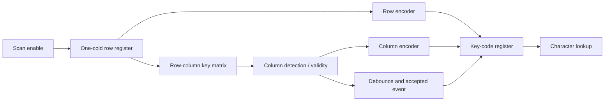

---
tags:
  - ECE2050
  - registers
date: 2026-09-30
aliases:
  - 键盘扫描与编码
  - Keyboard Scanning and Encoding
  - Matrix keypad interface
---

# Keyboard Scanning and Encoding · 键盘扫描与编码

> [!SUMMARY] Quick recall · 英文速览
> A matrix keypad turns a row-column connection into a key code. Scanning identifies the active row; encoding identifies the row and column; a register preserves the accepted code. A key event and a sustained key level are different specifications.

## Core Definition · 核心定义

r 行、c 列 matrix keypad 把每个按键放在交叉点，闭合时连接一行与一列。课程 8×8 模型有 64 个位置；row 与 column 各用 3 位编码，组合为 6-bit key code。

$$K=8R+C,\qquad R,C\in\{0,\ldots,7\}.$$

这只是按位置生成地址；ROM 可以再把地址转换成 ASCII、数字或其他字符码。key code 不一定就是 [[American Standard Code for Information Interchange|ASCII]]，例如位置 20 不必对应字符代码 20。

## Mechanism · 扫描机制

课程示例把 `11111110` 装入八位环形寄存器，每次 scan event 移动唯一的 0，轮流激活一行。列线上有规定的上拉/输入接口；按键把被选行 LOW 传到相应列，形成 one-cold column signal。

The initial one-cold pattern is essential. Eight flip-flops alone do not guarantee that exactly one row is selected. All-zero initialization would select every row in this active-low model; all-one initialization would select none.

1. 只激活一行，等待行驱动与列输入稳定。
2. 检查是否有有效 column closure，并保留当前 row identity。
3. [[Encoder and Priority Encoder]] 将行列 one-cold 信息转换成 binary codes。
4. 经过 debounce/valid 条件后，接受一个 load event。
5. [[Register Enable and Reset]] 保存六位 code，后续扫描不能覆盖它，除非接受另一个事件。

This diagram describes information flow. It does not specify push-pull wiring, diode placement, or a safe multi-key electrical interface.

## Timing Derivation · 扫描与分频

若 scan step rate 为 $f_{step}$、每步一行，则完整 eight-row scan rate 为 $f_{frame}=f_{step}/8$。一整轮在 $8/f_{step}$ 秒内完成。

**Example.** $f_{step}=5$ kHz 时，每行 slot=200 μs、完整扫描周期=1.6 ms、frame rate=625 Hz。等待检测的时间随按下相位变化，最长接近一轮，再加稳定与 debounce 时间；不能把 5 kHz 当成每个键的完整重复检查频率。

From a 100 MHz source, a modulo-20000 accepted count cycle produces one scan-enable event every $20000/10^8=200$ μs. It can be a one-cycle pulse, not a 50% square wave.

16-bit preset count 方案用 $P=65536-20000=45536=\texttt{0xB1E0}$，从 P 数到 65535 后在下一事件加载 P；包括两端共 20000 个状态。同步设计优先使用 shared clock + enable，不把可能有毛刺的 decoder 输出直接作为新 clock。

## Debounce and Capture · 去抖与捕获

机械接点会在一次按下期间多次开闭 (contact bounce)。课程用两个 one-shots 产生延迟捕获脉冲，并在捕获期间 inhibit scan，使行列 code 保持一致。

The delay must match the intended settling/debounce model. A monostable pulse is not a general proof that every switch has finished bouncing. A digital alternative synchronizes the sampled input and accepts a new state only after the specified number of consecutive stable samples.

若要求“按住只产生一次”，必须在 accepted press 后等待 release 才重新武装。若要求 auto-repeat，应另外定义 repeat delay/rate。debounce 和重复策略解决的是两个不同问题。

异步按钮先做 [[Metastability and Clock Domain Crossing]] 处理；多位 row/column code 应在有效窗口整体捕获，而不是对六位分别做独立两级同步后就假设它们一致。

## Worked Examples · 例题

**Location encoding.** 零基 row=2、column=4，binary row=`010`、column=`100`，合并 `010100`，$K=8\times2+4=20$。若图中行列标签为 1–8，则位置名称是第 3 行第 5 列，不能把这些显示标签直接编码为 3 与 5。

**JK key register.** 对每位目标 $D_i$ 与高有效 load E，保持/加载 recurrence 为 $Q_i^+=\bar E Q_i+ED_i$。用 JK 的一组实现是：

$$J_i=ED_i,\qquad K_i=E\bar D_i.$$

E=0 时 J=K=0，保持；E=1,D=0 时 reset；E=1,D=1 时 set。六组相同单元保存 6-bit code，所有单元共用 clock；load 优先级与 reset 需另行定义。

**No key versus first key.** `000000` 可以代表 row0,column0；若无按键时编码器也输出零，需要独立 valid。否则系统无法区分“没有键”和“第一个键”。

## Multi-key Boundary · 多键边界

课程基本模型假设一个稳定按键。多个闭合键可能造成多条 column 有效；priority encoder 只选一个地址，不会恢复全部按键。无适当隔离的矩阵还可能产生 ghost keys，其行为取决于开关、二极管与驱动方式。

Do not claim rollover support from a single-key truth table. Specify whether simultaneous keys are prohibited, prioritized, or independently reported. Electrical row-driver design and logical encoding both need to match that choice.

## Exam English and Review · 答题与复习

**Q: Why is the scan temporarily inhibited during key-code capture?** The accepted row and column must refer to the same scan position. Holding the scan state prevents the row identity from changing while the code settles and is loaded.

**Q: Does an 8×8 keyboard require an eight-bit key-code register?** No. It has 64 positions, so six binary bits suffice: three for the row and three for the column. Validity and any modifier information need separate specification.

**Q: Why is a scan-enable pulse not automatically a clock signal?** It marks an update event in the shared-clock design. Its width and duty cycle follow the count/decode implementation; a clock interface has additional timing requirements.

- Establish active row/column polarity and initialization.
- Convert physical labels into zero-based encoded addresses.
- Check scan-step rate, full-frame rate, and accepted-event behavior separately.
- Trace press, bounce, sustained hold, and release.
- Verify register load/hold/reset and the no-key validity case.

## Connections · 相关笔记

[[Ring and Johnson Counters]], [[Shift Registers]], [[Encoder and Priority Encoder]], [[One-Shots and Pulse Applications]], [[Cascaded Counters and Digital Clocks]], [[JK and T Flip-Flops]], [[Read-Only Memory and Programmable Logic Arrays]], [[Digital Logic Troubleshooting]].

---
索引：[[ECE2050 Knowledge Tree]] · [[Glossary]]
