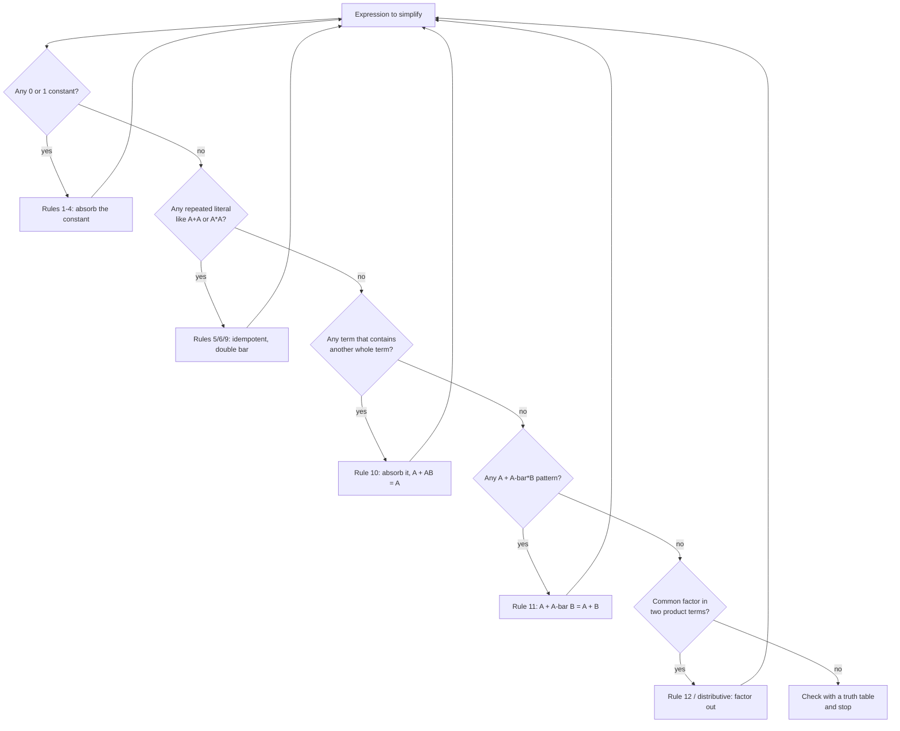

---
tags:
  - ECE2050
  - boolean-algebra
date: 2026-09-16
aliases:
  - 布尔代数定律与规则
  - 布尔代数规则
  - Laws of Boolean Algebra
  - Rules of Boolean Algebra
---

> [!NOTE] Where this fits · 定位
> 第 4 章第四篇（讲义 p.18–19，及 p.22–27 用到的规则）。公理（第 4-03）是出发点，
> 这一篇把实际改式子时**最常用的工具**整理成三条定律 + 十二条规则，并且每条都给出对偶式。
> 前置：[[Boolean Axioms]]（A1–A5 与对偶性）、[[Boolean Equation]]（被操作的对象）。
> 下游：[[Proof by Perfect Induction]]（怎么证明这些规则）、[[Boolean Expression Simplification]]（拿它们化简）、[[DeMorgan's Theorems]]。

> [!SUMMARY] Quick recall · 英文速览
> Commutative, associative, distributive, and other Boolean identities let you rewrite expressions without changing their outputs. Check the input domain and apply each identity exactly.

## Core Definition · 核心定义

### 三条定律 (laws, 讲义 p.19)

| 定律 | OR 形式 | AND 形式 | 直觉 |
|---|---|---|---|
| 交换律 (commutative) | $A+B=B+A$ | $AB=BA$ | OR/AND 门都是**对称**的：两个输入引脚互换，输出不变 |
| 结合律 (associative) | $A+(B+C)=(A+B)+C$ | $A(BC)=(AB)C$ | 三输入门等于两个二输入门级联；先算哪一对无所谓 |
| 分配律 (distributive) | $A(B+C)=AB+AC$ | $AB+AC=A(B+C)$ | 与算术一样：$A$ 分别乘进去、或提出来 |

- 意义：这三条让"加括号/换顺序"成为合法操作 —— 化简时几乎每一步都在用它们。
- 数值校验：取 $A=1,B=0,C=1$ —— 交换律 $1+0=0+1=1$ ✓、$1\cdot0=0\cdot1=0$ ✓；
  结合律 $1+(0+1)=1+1=1$、$(1+0)+1=1+1=1$ ✓；分配律 $1(0+1)=1\cdot1=1$、$1\cdot0+1\cdot1=1$ ✓。

### 十二条规则 (rules, Floyd 编号)

| # | 式子 | 对偶式 | 直觉 / 一句证明要点 |
|---|---|---|---|
| 1 | $A+0=A$ | $A\cdot1=A$ | 加 0 等于没加（OR 的恒等元 identity element） |
| 2 | $A\cdot1=A$ | $A+0=A$ | 乘 1 等于没乘（AND 的恒等元），是 Rule 1 的对偶 |
| 3 | $A+1=1$ | $A\cdot0=0$ | OR 只要有一项是 1 就"封顶"为 1，$A$ 说什么都不影响 |
| 4 | $A\cdot0=0$ | $A+1=1$ | AND 只要有一项是 0 就整体归零，是 Rule 3 的对偶 |
| 5 | $A+A=A$ | $A\cdot A=A$ | 幂等 (idempotent)：同一个条件说两遍，还是那一个条件 |
| 6 | $A\cdot A=A$ | $A+A=A$ | 同上取对偶；布尔代数里没有系数（不是 $2A$、不是 $A^2$） |
| 7 | $A+\bar A=1$ | $A\bar A=0$ | 一个条件与它的否定**必有一个**成立 |
| 8 | $A\bar A=0$ | $A+\bar A=1$ | 一个条件与它的否定**不可能同时**成立（对偶） |
| 9 | $\bar{\bar A}=A$ | $\bar{\bar A}=A$（自对偶） | 取反两次回到原值（对合 involution） |
| 10 | $A+AB=A$ | $A(A+B)=A$ | **吸收律**：$A$ 已经决定结果，$B$ 是多余信息；代数：$A(1+B)=A\cdot1=A$ |
| 11 | $A+\bar AB=A+B$ | $A(\bar A+B)=AB$ | $A$ 不成立时由 $\bar AB$ 顶上，于是 $B$ 单独决定结果；代数：$(A+\bar A)(A+B)$ |
| 12 | $(A+B)(A+C)=A+BC$ | $AB+AC=A(B+C)$ | **分配律的展开/提取**：$AA+AC+AB+BC=A+AC+AB+BC=A+BC$ |

> [!IMPORTANT] 第 10–12 条才是化简主力
> Rule 1–9 大多是"整理"（去掉 0/1、合并相同项、消掉双重否定），它们让式子变短但**不减少变量**。
> 真正能把变量"吃掉"的是：
> - **Rule 10（吸收）** $A+AB=A$ —— 直接删掉整个乘积项；
> - **Rule 11** $A+\bar AB=A+B$ —— 消掉反变量，把两项并成一项；
> - **Rule 12（分配律反向）** $A+BC=(A+B)(A+C)$、$AB+AC=A(B+C)$ —— 提取公因子，是"合并同类项"的唯一手段。
> 第 4-05 会专门给这三条各写两种证明，第 4-07 的每个化简例题几乎都要用到它们。

> [!WARNING] 布尔加法 $1+1=1$，不是 $2$
> Rule 3 与 Rule 5 合起来说明：$+$ 是 OR，只回答"成不成立"，不累加数量。
> 所以 $A+A=A$（不是 $2A$）、$A+1=1$（不是 $A+1$ 还能再化简成别的）、$1+1=1$。
> 只要还按算术去想，Rule 3/5 就会写错。
> 讲义 p.18 把这件事命名为 **Boolean addition**（等价于 OR）与 **Boolean multiplication**（等价于 AND）。

## Assumptions and Validity · 适用前提

- 成立条件 1：变量只在 $\{0,1\}$ 上取值 —— 这不是"取值很小"，而是"值域只有两个元素"（见 [[Boolean Axioms]] 的 A1）。
- 成立条件 2：规则里的 $A,B,C$ 是**任意**布尔表达式（不只是单个变量），所以可以整体代入。
  例如 Rule 10 代入 $A\to X+\bar Y$ 得到 $(X+\bar Y)+(X+\bar Y)Z=X+\bar Y$。
- 成立条件 3：每一步改写都是**等价变形**（等式两边对所有输入都相同），所以化简不会改变功能。
- 失效边界：这些规则只保证**逻辑等价**，不保证电路同样好 —— 门数、级数（延迟）、扇出要另外算（见 [[Boolean Expression Simplification]]）。
  另外 Rule 12 在**普通算术里不成立**（$2+3\times4=14$ 而 $(2+3)(2+4)=30$），它是布尔代数特有的。

## Derivation · 推导过程

### 1. 规则从公理来：以 Rule 5 ($A+A=A$) 为例

一条"看起来显然"的规则也可以由公理推出来（讲义 p.20 的 Method 2）：

$$
\begin{aligned}
A+A&=(A+A)\cdot1 &&\text{Rule 2（}X=X\cdot1\text{）}\\
&=(A+A)(A+\bar A) &&\text{Rule 7（}1=A+\bar A\text{）}\\
&=A+A\bar A &&\text{Rule 12 反向（}(X+Y)(X+Z)=X+YZ\text{）}\\
&=A+0 &&\text{Rule 8（}A\bar A=0\text{）}\\
&=A &&\text{Rule 1（}X+0=X\text{）}
\end{aligned}
$$

- 意义：每条规则都不是"新假设"，而是公理的推论；想确认某一步合不合法，就去追它来自哪条公理/规则。
- 数值校验：$A=0$ 时上式每一行都是 $0$（$0+0=0$、$0\cdot1=0$、$(0+0)(0+1)=0$、$0+0\cdot1=0$、$0+0=0$）✓；
  $A=1$ 时每一行都是 $1$ ✓ —— 5 步分别成立，整条链成立。

### 2. 为什么 Rule 12 值得单独记

对 $A(B+C)=AB+AC$ 我们很熟；Rule 12 是它的**另一种展开**：

$$
(A+B)(A+C)=AA+AC+AB+BC=A+AC+AB+BC=A(1+C+B)+BC=A\cdot1+BC=A+BC
$$

它把"两个和式相乘"变成"一个和 + 一个积"，是化简里**合并项**的关键（也正是 [[Product-of-Sums Form]] 化简的入口）。

### 3. 布尔加法/乘法的两个"取值问题"（讲义 p.18）

- **和项 (sum term)** $=0$ 的条件：和项就是一个 OR，$=0$ 意味着**每一项都是 0**。
  对 $\bar A+\bar B+C+\bar D=0$ 来说：$\bar A=0\Rightarrow A=1$，$\bar B=0\Rightarrow B=1$，$C=0$，$\bar D=0\Rightarrow D=1$。
- **积项 (product term)** $=1$ 的条件：积项就是一个 AND，$=1$ 意味着**每一项都是 1**。
  对 $A\bar B C\bar D=1$ 来说：$A=1$，$\bar B=1\Rightarrow B=0$，$C=1$，$\bar D=1\Rightarrow D=0$。

> [!WARNING] 讲义 p.18 的抽取文本丢了横线
> `.scratch/extract/ECE2050-Chap4.txt` 里 p.18 的两个式子只剩 `A + B + C + D = 0` 与 `A B C D = 1`，
> 横线全部丢失。本篇按**自洽原则**写出：和项取整条 OR 的否定形式、积项取交替形式，
> 使答案唯一且可枚举验证（见例题 4）。原文的横线位置以课堂讲义为准。

## Method and Steps · 求解步骤与方法

1. **先看结构**：式子是 SOP（乘积之和）还是 POS（和之积）？决定优先用哪条规则。
2. **扫一遍 0 与 1**：有常量就用 Rule 1–4 立刻消掉。
3. **扫重复项**：$A+A$、$A\cdot A$、$\bar{\bar A}$ → Rule 5/6/9；出现 $A+\bar A$、$A\bar A$ → Rule 7/8。
4. **找公因子**：有 $AC+AB$ 就提取成 $A(C+B)$（Rule 12 的反向 / 分配律）；有 $A+AB$ 就直接用 Rule 10 吸收。
5. **处理反变量项**：出现 $A+\bar AB$ 就用 Rule 11 变成 $A+B$。
6. **每一步在右边标注规则名**（讲义 p.32 的写法规范），最后枚举校验。

## Worked Example · 例题

**Example 1 — 用 Rule 12 + 7 + 2 化简（自算，讲义 p.31 例 1 的同型题）**

题目：化简 $Y=A\bar B+A B$。

解：

$$
\begin{aligned}
Y&=A\bar B+AB &&\\
&=A(\bar B+B) &&\text{分配律反向（提取 }A\text{）}\\
&=A\cdot1 &&\text{Rule 7（}\bar B+B=1\text{）}\\
&=A &&\text{Rule 2（}A\cdot1=A\text{）}
\end{aligned}
$$

**数值校验 (Numerical check)**（4 行全枚举）：

| $A$ | $B$ | $A\bar B$ | $AB$ | $Y$ | $A$ |
|---|---|---|---|---|---|
| 0 | 0 | 0 | 0 | 0 | 0 ✓ |
| 0 | 1 | 0 | 0 | 0 | 0 ✓ |
| 1 | 0 | 1 | 0 | 1 | 1 ✓ |
| 1 | 1 | 0 | 1 | 1 | 1 ✓ |

化简前后 4 行完全一致 ✓ —— "有 $A$ 就行，$B$ 随便"。

**Example 2 — 用 Rule 11 消掉反变量**

题目：化简 $Y=A+\bar AB$，并说明它的意思。

解：

$$
\begin{aligned}
Y&=A+\bar AB &&\\
&=(A+\bar A)(A+B) &&\text{Rule 12 反向（}X+YZ=(X+Y)(X+Z)\text{）}\\
&=1\cdot(A+B) &&\text{Rule 7（}A+\bar A=1\text{）}\\
&=A+B &&\text{Rule 2（}1\cdot X=X\text{）}
\end{aligned}
$$

- 意义：$A$ 成立时结果为 1；$A$ 不成立时第一项为 0、第二项变成 $B$ —— 所以 $\bar AB$ 里的 $\bar A$ 条件可以省掉，答案就是 $A+B$。
- **数值校验 (Numerical check)**：

| $A$ | $B$ | $A$ | $\bar A B$ | $A+\bar AB$ | $A+B$ |
|---|---|---|---|---|---|
| 0 | 0 | 0 | 0 | 0 | 0 ✓ |
| 0 | 1 | 0 | 1 | 1 | 1 ✓ |
| 1 | 0 | 1 | 0 | 1 | 1 ✓ |
| 1 | 1 | 1 | 0 | 1 | 1 ✓ |

**Example 3 — 真/假判断

题目：判断下列说法。

| 命题 | 判断 | 理由 |
|---|---|---|
| 布尔加法等价于 OR | **真** | 讲义 p.18：Boolean addition = OR operation |
| 布尔加法等价于 NOR | **假** | NOR 是 OR 再取反（见 [[NOR Gate]]），布尔加法不含取反 |
| $1+1=2$ | **假** | Rule 3：$A+1=1$，取 $A=1$ 得 $1+1=1$ |
| $A+A=2A$ | **假** | Rule 5：$A+A=A$，布尔代数没有系数 |
| 交换律、结合律、分配律都是布尔代数的定律 | **真** | 讲义 p.19 三条定律 |
| $A\cdot0=0$ 与 $A+1=1$ 互为对偶 | **真** | 把 $\cdot\leftrightarrow+$、$0\leftrightarrow1$ 互换即得（第 4-03） |

**数值校验 (Numerical check)**：把 $A=0/1$ 代入 —— $1+1=1$ ✓；$0+0=0$ ✓；$1\cdot0=0$ ✓；$1+1=1$ ✓；
六条判断与两行真值表全部一致。

**Example 4 — 讲义 p.18：让和项为 0、积项为 1（附枚举）**

题目 (a)：求使 $\bar A+\bar B+C+\bar D=0$ 的 $(A,B,C,D)$。
题目 (b)：求使 $A\bar B C\bar D=1$ 的 $(A,B,C,D)$。

解：

(a) 和项（OR）为 0 ⟺ 每一项为 0：$\bar A=0\to A=1$；$\bar B=0\to B=1$；$C=0$；$\bar D=0\to D=1$。
(b) 积项（AND）为 1 ⟺ 每一项为 1：$A=1$；$\bar B=1\to B=0$；$C=1$；$\bar D=1\to D=0$。

**数值校验 (Numerical check)**：对 4 个变量枚举全部 $2^4=16$ 行 ——
$\bar A+\bar B+C+\bar D=0$ 只在 $(1,1,0,1)$ 这一行成立（唯一解）✓；
$A\bar B C\bar D=1$ 只在 $(1,0,1,0)$ 这一行成立（唯一解）✓。

## Pitfalls · 常见误区

> [!WARNING] 化简的错法几乎都来自"把布尔当算术"或"用错规则的方向"

1. **把 $A+A$ 写成 $2A$**。错在：套算术加法。正确：Rule 5，$A+A=A$；布尔代数里没有系数，
   也不存在 $A^2$（Rule 6：$A\cdot A=A$）。
2. **Rule 12 只记一半**。错在：只记得 $A(B+C)=AB+AC$，遇到 $(A+B)(A+C)$ 就想展开成四项硬算。
   正确：直接写 $A+BC$（Rule 12），这是**布尔代数特有**的一条。
3. **忘掉 Rule 11 的适用形状**。错在：看到 $A+\bar AB$ 只想着吸收（Rule 10 用不上，因为第二项里有 $\bar A$）。
   正确：Rule 11 把它变成 $A+B$；注意 $A+AB$ 才用 Rule 10，两条别混。
4. **把规则用在非等价的位置**。错在：把 $\overline{A+B}$ 里的 $A$ 用 Rule 3 改成 1（横线内不能单独替换常量）。
   正确：改写要整个子表达式等价，或在 DeMorgan 拆括号之后再做（见 [[DeMorgan's Theorems]]）。
5. **以为化简得越短电路一定越好**。错在：只数文字个数。正确：还要看门的种类与级数（延迟）；
   例如 POS 形式直接对应 AND-OR 结构，有时比更短的 SOP 更好实现（见 [[Sum-of-Products Form]]、[[Product-of-Sums Form]]）。
6. **不写用了哪条规则**。错在：一步跨太多，出错时无法定位。正确：按讲义 p.32 的规范，每步右侧标注规则名。

## Choose the rule by structure · 看结构选择化简规则

Name the pattern before applying a rule. Absorption removes a more restrictive condition already covered by a broader condition: A+AB=A. The product AB cannot be true when A is false, so it adds no new ON rows. This reasoning is often clearer than treating the identity as an isolated formula to memorize.

The consensus term in AB+NOT A·C+BC is redundant for the steady-state Boolean function. Its removal does not necessarily preserve transient behavior: BC can bridge a path-delay gap during a change of A. Minimal literal count and hazard-free operation are different design objectives.

**Worked application.** 门控报警 $Y=A+AB+\bar AC$：先 absorption 得 $A+\bar AC$；再用 $X+\bar XY=X+Y$ 得 $A+C$。A=0 时两个式子都等于 C，A=1 时都为1，形成完整的两类逻辑解释。

**English exam question:** Why might a physically useful term be Boolean redundant?

**Answer:** Boolean algebra compares stable output values. A redundant term can still provide an additional physical path that suppresses a glitch while another path changes. Check [[Boolean Expression Simplification]] for equivalence and [[Propagation Delay and Logic Hazards]] for the timing requirement before choosing the final circuit.

## Connections · 相关笔记

- 上游 (upstream)：[[Boolean Axioms]] —— 12 条规则全部由 A1–A5 推出；对偶性则解释了为什么它们成对出现。
- 上游 (upstream)：[[Boolean Equation]] —— 化简的对象：用输入表达输出的方程。
- 平行 (parallel)：[[Proof by Perfect Induction]] —— 每条规则都可以用真值表穷举验证；变量多时才改用代数。
- 下游 (downstream)：[[DeMorgan's Theorems]] —— 处理"长横线"的规则，与这 12 条配合使用。
- 下游 (downstream)：[[Boolean Expression Simplification]] —— 把本篇的规则用到讲义 p.31–33 的四个例题上。
- 平行 (parallel)：[[NOR Gate]]、[[NAND Gate]] —— 布尔加法的"取反版"就是 NOR；$1+1=1$ 在门级就是 OR 的真值行。

---
索引：[[ECE2050 Knowledge Tree]] · [[Glossary]]
