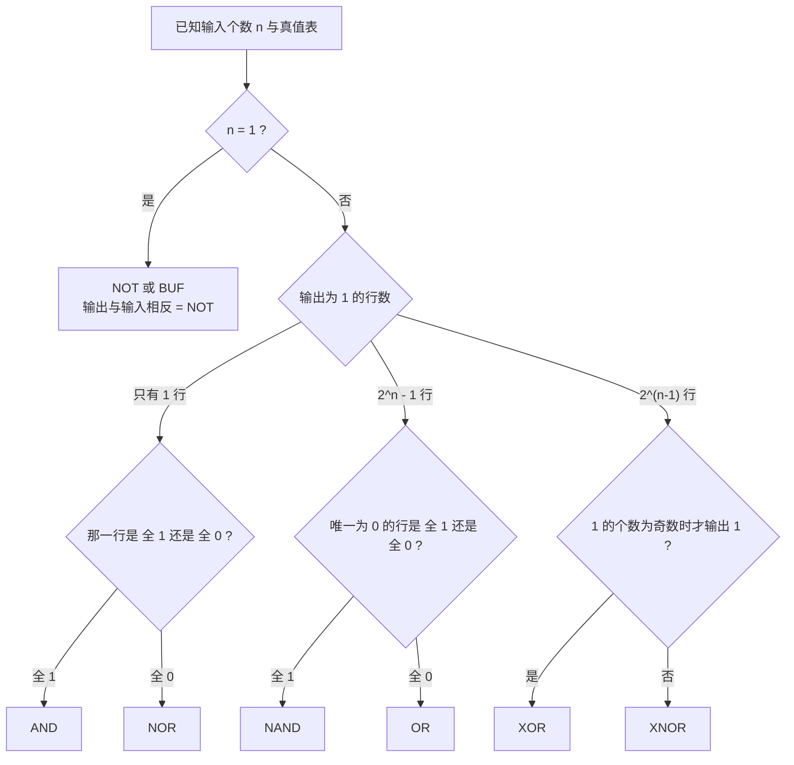

---
tags:
  - ECE2050
  - logic-gates
date: 2026-09-16
aliases:
  - 逻辑门
  - 门电路
  - Logic Gates
  - Logic Gate
---

> [!NOTE] Where this fits · 定位
> 第三章的**总览篇**。前一章 [[Number Systems]] / [[Binary Number System]] 把信息变成了 0/1 位串，
> 这一篇回答"0/1 用什么**器件**去算"——逻辑门 (logic gate)。
> 后面七篇 [[Inverter]]、[[AND Gate]]、[[OR Gate]]、[[NAND Gate]]、[[NOR Gate]]、
> [[Exclusive-OR Gate]]、[[Exclusive-NOR Gate]] 各讲一个门，本篇只讲它们**共有的框架**：
> 怎么分类、怎么描述、符号怎么读、真值表怎么排。
> 讲义来源：p.3（定义与分类）、p.4 / p.6 / p.8（三种描述方式反复出现）、p.8–9（气泡与"How to verify/prove?"）、
> p.12–13（两输入 / 多输入门总表与行序规则）。

> [!SUMMARY] Quick recall · 英文速览
> Logic gates implement basic Boolean functions such as NOT, AND, OR, NAND, NOR, XOR, and XNOR. Truth tables specify their ideal behavior; real gates add voltage limits and delay.

## Core Definition · 核心定义

**逻辑门 (logic gate)** 是执行一个**逻辑函数 (logic function)** 的电路元件：把 0/1 输入映射成 0/1 输出。
讲义 p.3 列出的逻辑函数是 inversion (NOT)、AND、OR、NAND、NOR 等，并按**输入个数**先分成两大类：

| 类别 | 门 | 输入数 | 逻辑表达式 | 输出为 1 的条件 | 讲义页 |
|---|---|---|---|---|---|
| 单输入 (single-input) | NOT 反相器 | 1 | $Y=\bar A$ | 输入为 0 | p.4–5 |
| 单输入 | BUF 缓冲器 | 1 | $Y=A$ | 输入为 1 | p.5 |
| 两输入 / 多输入 | AND | $\ge 2$ | $Y=AB$ | **全部**输入为 1 | p.6, p.12 |
| 两输入 / 多输入 | OR | $\ge 2$ | $Y=A+B$ | **任一**输入为 1 | p.7, p.12 |
| 两输入 / 多输入 | NAND | $\ge 2$ | $Y=\overline{AB}$ | 不全是 1 | p.8, p.12 |
| 两输入 / 多输入 | NOR | $\ge 2$ | $Y=\overline{A+B}$ | 全部输入为 0 | p.9, p.12 |
| 两输入 / 多输入 | XOR | $\ge 2$ | $Y=A\oplus B$ | 输入**不同**（有奇数个 1） | p.10, p.12 |
| 两输入 / 多输入 | XNOR | $\ge 2$ | $Y=\overline{A\oplus B}$ | 输入**相同**（有偶数个 1） | p.10, p.12 |

- NAND / NOR / XNOR 都是"某个母门 + 反相"：符号输出端的**小圆圈 (bubble)** 就是负号指示圈
  (negation indicator)，它把母门的结果整体取反。
- 记号约定：输出写在右边，用 $Y$（也常写 $F$ 或 $Z$）；输入用 $A,B,C,\dots$；
  bar（变量上的横线）表示 complement，$\bar A$ 与 $\overline{A}$ 是同一个意思。

同一个门有三种**等价**的描述方式（讲义 p.4、p.6、p.8 每讲一个门就重复这三样，p.24 章末复习也列了这三样）：

| 描述方式 | 中文 | 回答什么问题 | 什么时候最好用 |
|---|---|---|---|
| truth table | 真值表 | 每种输入组合对应什么输出 | 输入少（行数 $2^n$ 小）、要穷举证明 |
| timing diagram | 时序图 | 输入随时间变化时输出怎么跟着变 | 看延迟、看"门控"、看波形对齐 |
| logic expression | 逻辑表达式 | 输出与输入的代数关系 | 推导、化简、嵌进更大的电路 |

![[logic-gate-symbols.svg]]
*图 1 — 八种基本门的标准符号 (distinctive shape) 与表达式，一行一个：NOT / BUF 是单输入，
其余六个都是两输入。注意气泡只出现在 NOT / NAND / NOR / XNOR 上——有气泡就一定取反，
表达式的横线长度也正好覆盖气泡所"管辖"的那部分运算。*

![[ch3-two-input-gates.png]]
*图 2 — 讲义 p.12 原图：两输入门总表（AND / OR / NAND / NOR / XOR / XNOR 的符号、表达式与 4 行真值表）。
这是本章最该背下来的一张表：六个门的输入列完全一样，差别只在输出列。*

## Assumptions and Validity · 适用前提

> [!IMPORTANT] 本篇描述的是**理想门 (ideal gate)**，三条理想化必须记住
> ① 输出只有两个离散电平 0 / 1 —— 真实门的高、低电平各自是一个**电压范围**（不是单点），见 [[Logic Levels]]；
> ② **延迟为 0** —— 真实门有传播延迟 (propagation delay)，时序图上的沿不会重合，见 [[Inverter]] 的推导 ③；
> ③ 扇出无限、输入不取电流 —— 一个输出可以接任意多个输入。
> 真值表 / 表达式 / 时序图描述的是门的**功能规范 (functional spec)**，不包含电平与时序细节。

- 分类前提：「输入数 $\ge2$」是**定义**而不是习惯：讲义 p.6–p.9 每个门的小标题都写着 "Inputs $\ge2$"，
  只有 p.5 的 NOT / BUF 是单输入。所以"三输入 NOT"这种东西不存在（见 [[Inverter]] 的误区 1）。
- 计数前提：每个输入只有 0/1 两种取值且**互相独立**，于是 $n$ 个输入恰好 $2^n$ 种组合——真值表的行数由此而来。
- 逻辑约定前提：本篇采用**正逻辑 (positive logic)**：高电平 = 1、低电平 = 0。
  若改成**负逻辑**（低有效，low-active），同一个物理门的**功能表述会互换**：正逻辑下做 AND 的电路，
  在负逻辑下其功能写作 OR。这就是符号上气泡的第二种含义——除了"取反"，它还表示"低有效"。
- 失效边界：输入悬空、两个门的输出短接在一起、输出又反馈回输入（组合环路）都超出理想门假设；
  合法的连接规则见 Ch4 的 [[Combinational Circuit]]。

## Derivation · 推导过程

### ① 为什么 $n$ 个输入正好有 $2^n$ 种组合

每个输入 2 种取值，$n$ 个输入互相独立，按乘法原理把各自的选择数相乘：

$$N_{\text{rows}}=\underbrace{2\times2\times\cdots\times2}_{n\ \text{个}}=2^{n}$$

- 意义：真值表的**行数只由输入个数决定，与是哪种门无关**；行号就是输入组合的二进制值。
- 数值校验（逐条对回讲义）：$n=1\Rightarrow2^1=2$ 行——p.4 / p.5 的 NOT 表正好 2 行；
  $n=2\Rightarrow2^2=4$ 行——p.12 的每个门 4 行；$n=3\Rightarrow2^3=8$ 行——p.13 的 AND3 与 XOR3 各 8 行；
  继续推算 $n=4\Rightarrow16$ 行、$n=8\Rightarrow256$ 行 ✓。

### ② 三种描述方式其实是一件事

- **真值表 → 表达式**：把输出为 1 的每一行写成一个乘积项（该行取 1 的变量写原变量、取 0 的写反变量），
  再把各项相加，得到 SOP（Ch4 [[Sum-of-Products Form]]）。
  例（讲义 p.12 的 XOR 列）：输出为 1 的行是 $01$ 与 $10$，于是 $Y=\bar AB+A\bar B$。
- **真值表 → 时序图**：时序图就是"把真值表沿时间轴摊开"。任一时刻读出 $(A,B)$，
  拿这个组合去查真值表的对应行，就是该时刻的 $Y$（[[AND Gate]] / [[OR Gate]] 两篇的时序图就是按这个规则画的）。
  校验：$t=15$ ns 处若 $A=1,B=0$，查 AND 表第 3 行 $(10)$ 得 $Y=0$ ✓；
  $t=30$ ns 处若 $A=1,B=1$，查第 4 行 $(11)$ 得 $Y=1$ ✓。
- **表达式 → 真值表**：把 4 行输入逐个代入表达式求值即可（这就是 Ch4 完全归纳法的算法）。

### ③ 表的行按二进制顺序列出（讲义 p.13）

两输入按 $00,01,10,11$；三输入按 $000,001,010,011,100,101,110,111$——即从全 0 数到全 1。

- 意义：这样**不漏行、不重复**，而且行号 = 输入组合的整数值，查表时可以直接"数"出来。
- 数值校验：两输入 4 行正好是 $0,1,2,3$；三输入 8 行正好是 $0\sim7$，第一行全 0、最后一行全 1 ✓。
  讲义 p.13 底部那句话就是这个规则：*Truth table rows are listed in binary order.*

### ④ 气泡与"怎么验证"（讲义 p.8–9 的 How to verify/prove?）

NAND / NOR 的符号是"母门 + 输出气泡"。要证明 $Y=\overline{AB}$ 真的等于"先 AND 再取反"，
最直接的办法是**穷举真值表**（perfect induction，Ch4 [[Proof by Perfect Induction]]）：

| $A$ | $B$ | $AB$ | $\overline{AB}$ | $\bar A+\bar B$ |
|---|---|---|---|---|
| 0 | 0 | 0 | 1 | 1 |
| 0 | 1 | 0 | 1 | 1 |
| 1 | 0 | 0 | 1 | 1 |
| 1 | 1 | 1 | 0 | 0 |

逐行比对第 4、5 列 → 完全相同，所以 $\overline{AB}=\bar A+\bar B$。这正是 DeMorgan 定理
（Ch4 [[DeMorgan's Theorems]]）在门级的样子，也是"气泡可以从输出端搬到输入端"的原因。

## Method and Steps · 求解步骤与方法

1. **数输入个数 $n$**：$n=1$ 只可能是 NOT / BUF；$n\ge2$ 属于后面六个门。
2. **算行数 $2^n$**，按**二进制顺序**（全 0 → 全 1）把输入列写满。
3. **填输出列**：能写表达式就直接代入；只有文字描述就按"输出为 1 的条件"逐行判。
4. **对号入座**（下面的流程图）：数一数输出为 1 的行数，再看那几行长什么样。
5. **三重复核**：符号（形状 + 气泡）↔ 表达式 ↔ 真值表必须三者一致；行数必须是 $2^n$。

数值校验：$n=2$ 时六个门输出为 1 的行数分别是 AND 1、OR 3、NAND 3、NOR 1、XOR 2、XNOR 2，
其中 $3=2^2-1$、$2=2^{2-1}$ ✓；$n=3$ 时分别是 1、7、7、1、4、4，同样满足 $2^3-1=7$、$2^{3-1}=4$ ✓。

## Worked Example · 例题

**Example 1 — 同一组输入读出六个门（讲义 p.12 总表逐行核对）**

题目：$A,B$ 按二进制顺序取 $00,01,10,11$，写出 AND、OR、NAND、NOR、XOR、XNOR 六列输出。
已知六个门的输入列相同，只是"输出为 1 的条件"不同。

解：逐行按条件判——AND 要全 1；OR 要有 1；NAND 是 AND 取反；NOR 是 OR 取反；
XOR 要两个输入不同；XNOR 要两个输入相同。

| $A$ | $B$ | AND $AB$ | OR $A+B$ | NAND $\overline{AB}$ | NOR $\overline{A+B}$ | XOR $A\oplus B$ | XNOR $\overline{A\oplus B}$ |
|---|---|---|---|---|---|---|---|
| 0 | 0 | 0 | 0 | 1 | 1 | 0 | 1 |
| 0 | 1 | 0 | 1 | 1 | 0 | 1 | 0 |
| 1 | 0 | 0 | 1 | 1 | 0 | 1 | 0 |
| 1 | 1 | 1 | 1 | 0 | 0 | 0 | 1 |

**数值校验 (Numerical check)**：六个门正好是 AND/NAND、OR/NOR、XOR/XNOR 三对互补门，
所以**每一行都有且仅有 3 个 1**（$00$ 行是 NAND、NOR、XNOR；$01$ 行是 OR、NAND、XOR；
$10$ 行同 $01$；$11$ 行是 AND、OR、XNOR）✓；
按列数 1 的个数：$1,3,3,1,2,2$，与流程图的分支行数完全吻合 ✓。

**Example 2 — 行数 $2^n$（讲义 p.13 的 AND3 与 XOR3）**

题目：讲义 p.13 给出 AND3 ($Y=ABC$) 与 XOR3（odd parity：奇数个 1 时输出 1）两张表。
它们各有几行？若把输入换成 5 个呢？

解：$n=3\Rightarrow2^3=8$ 行；$n=5\Rightarrow2^5=32$ 行。行数与门的种类无关。

**数值校验 (Numerical check)**：讲义 p.13 两张表都是 8 行、行序为 $000\to111$ ✓；
AND3 的 8 行里只有 $111\to1$（1 行 = $2^0$）✓；
XOR3 的 8 行里是 $001,010,100,111$ 四行为 1，$4=2^{3-1}$ ✓；
而 $n=5$ 时 $2^5=32=8\times4$，正好是 $n=3$ 的四倍 ✓。

![[ch3-multiple-input-gates.png]]
*图 3 — 讲义 p.13 原图：多输入门（AND3 与 XOR3）。注意它的行序就是从 $000$ 数到 $111$，
AND3 只有 1 行是 1、XOR3 有 4 行是 1——"数 1 的行数"是认门的最快办法。*

**Example 3 — 从真值表反推门（自算）**

题目：某门的 4 行输出依次为 `1,0,0,1`（输入按 $00,01,10,11$），它是什么门？

解：输出为 1 的行是 $00$ 与 $11$，共 2 行 $=2^{2-1}$，所以是 XOR / XNOR 之一；
再看规律：两行都是"输入相同"（$00$ 相同、$11$ 相同）→ 是 **XNOR**（相等检测器）。

**数值校验 (Numerical check)**：XNOR 的表达式 $Y=\overline{A\oplus B}$：
$A\oplus B$ 在 $00$、$11$ 两行为 0，取反得 1；在 $01$、$10$ 两行为 1，取反得 0 →
输出列 `1,0,0,1` 与题目完全一致 ✓。

## Pitfalls · 常见误区

> [!WARNING] 总览篇翻车几乎都在"行数"和"名字"两件事上

1. **多输入门只写 4 行真值表**。错在：三输入 AND 也照抄两输入的 4 行。
   正确：$n$ 个输入 $\Rightarrow2^n$ 行，AND3 必须写 8 行（讲义 p.13）。
2. **把 XOR 当成"有 1 就出 1"**。错在：把 $A\oplus B$ 与 $A+B$ 混为一谈。
   正确：$1+1=1$ 但 $1\oplus1=0$——OR 是"有 1 就 1"，XOR 是"1 的个数为奇数才 1"。
3. **不把 BUF 当逻辑门**。正确：BUF 也是门（$Y=A$），它不改变逻辑值，负责**驱动与整形**，
   在讲义 p.5 与 NOT 并排列出（见 [[Inverter]]）。
4. **凭形状猜门**。D 形是 AND 家族、弧形是 OR 家族，**带气泡的那个取反**；
   IEEE 矩形符号用 `&`（AND）、`>=1`（OR，至少一个 1）、`=1`（XOR）标注，含义与形状符号一一对应。
5. **以为气泡一定代表电路里真有一个反相器**。气泡只是"取反 / 低有效"的**记号**；
   在负逻辑约定下，同一个门的功能表述会与正逻辑互换（AND ↔ OR）。
6. **忘了题目问的是哪种描述方式**。真值表、时序图、表达式三者等价，但考的是**转换能力**：
   题目要时序图就画波形，要表达式就写 $Y=\dots$，不能拿另一种形式顶替。

## Gates as functions and interfaces · 门的功能与接口

A gate symbol answers a Boolean question, but a working connection must also satisfy electrical and timing requirements. Truth-table equivalence means that two implementations settle to the same logical output for each input combination. It does not imply equal delay, drive strength, switching power, or sensitivity to a transition glitch.

Read a gate diagram from its input conditions toward the output. A bubble indicates inversion at that boundary. It does not necessarily mean that the external control is active-low; active polarity describes which voltage asserts the required action. The specification and the symbol must be interpreted together.

**Worked application — select the needed primitive.** A、B 表示两个条件。要求“至少一个满足”用 OR，输入 11 时输出 1；要求“恰好一个满足”用 XOR，11 时输出 0；要求“两个都满足”用 AND。对 00/01/10/11 三种输出列依次为 OR=`0111`，XOR=`0110`，AND=`0001`。仅检查 01 会误以为 OR 与 XOR 等价，应专门检查 11。

In English: choose test inputs that distinguish the candidate functions. A single counterexample disproves equivalence, whereas a proof of equivalence requires every valid input combination or an algebraic identity.

**English exam question:** Can any Boolean function be built using only AND gates?

**Answer:** No. AND-only networks cannot generate inversion or arbitrary OR behavior from uncomplemented inputs. NAND alone or NOR alone is functionally complete because each can construct NOT and the other required operations.

The construction is detailed in [[Universal Gates and Bubble Pushing]]. Connect behavior to [[Combinational Logic Design]], physical settling to [[Propagation Delay and Logic Hazards]], and practical failure isolation to [[Digital Logic Troubleshooting]].

## Connections · 相关笔记

- 上游 (upstream)：[[Number Systems]]、[[Binary Number System]] —— 0/1 与二进制位串的定义在这里，门是对它们做运算的器件。
- 上游 (upstream)：[[Bits and Bytes]] —— "$n$ 位有 $2^n$ 种组合"的计数思想与真值表行数同源。
- 下游 (downstream)：[[Inverter]]、[[AND Gate]]、[[OR Gate]]、[[NAND Gate]]、[[NOR Gate]]、[[Exclusive-OR Gate]]、[[Exclusive-NOR Gate]] —— 七个门逐个展开，本篇是它们的共同约定。
- 下游 (downstream)：[[Combinational Circuit]]（Ch4）—— 门连成网就是组合电路，本篇的理想门假设在那里被正式化。
- 平行 (parallel)：[[Logic Levels]]、[[Noise Margin]] —— 本篇假定 0/1 是理想电平，它们讲真实电压范围与噪声容限；
  读时序图时若发现"沿不重合"，就属于那两篇的范畴。

---
索引：[[ECE2050 Knowledge Tree]] · [[Glossary]]
