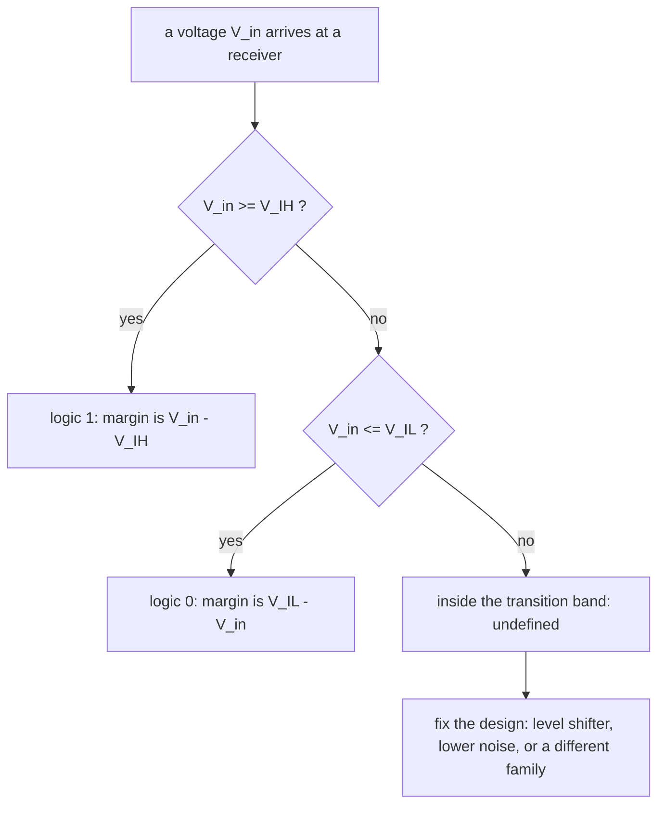

---
tags:
  - ECE2050
  - logic-levels
date: 2026-09-16
aliases:
  - 逻辑电平
  - 逻辑电平与电压范围
  - Logic Levels
  - Logic Level
---

> [!NOTE] Where this fits · 定位
> 第 3 章从「逻辑函数」走向「物理实现」的第一步。[[Logic Gates]] 与 [[Inverter]] 把 AND/OR/NOT
> 当作抽象的 0/1 运算；真实电路里只有**电压**。本篇回答讲义 p.15 的两个提问 —— *What about 4.99 volts?*
> 与 *What about 3.2 volts?* —— 并给出讲义 p.18 的四个关键参数 $V_{IL}$、$V_{IH}$、$V_{OL}$、$V_{OH}$。
> 前置：[[Logic Gates]]（门 = 逻辑函数）、[[Inverter]]（NOT 与 buffer 是最简单的门）。
> 下游：[[Noise Margin]] 用这四个数算"还能容忍多少噪声"，[[DC Transfer Characteristic]] 说明这四个数
> 究竟从哪条曲线上读出来。

> [!SUMMARY] Quick recall · 英文速览
> Digital 0 and 1 are represented by voltage ranges rather than exact voltages. Input and output thresholds specify which levels a logic family can reliably recognize and produce.

## Core Definition · 核心定义

**逻辑电平 (logic level)**：用**离散的电压区间**而不是连续电压值来表示逻辑 1 与 0 的约定（讲义 p.15 提出、
p.16 用 *Range of voltages for 1 and 0* 给出答案）。

理想化的说法是单点（讲义 p.15）：

$$
0 = \text{ground (GND)} = 0\ \text{V}, \qquad 1 = V_{DD} = 5\ \text{V}
$$

但单点无法回答 "4.99 V 是 1 还是 0"：任何真实电路的电压都在抖动、衰减、被干扰，
所以**每个逻辑值都必须占一段电压区间**。区间由四个参数划出（讲义 p.18，全部是数据手册的**最坏情况保证**）：

| 参数 | 全称 | 含义 | 方向 | 由谁保证 |
|---|---|---|---|---|
| $V_{OL}$ | max output LOW | 输出低电平的**最高**电压 | $V_{out}\le V_{OL}$ 即合法 0 | 驱动器 (driver) |
| $V_{OH}$ | min output HIGH | 输出高电平的**最低**电压 | $V_{out}\ge V_{OH}$ 即合法 1 | 驱动器 (driver) |
| $V_{IL}$ | max input LOW | 仍被读成 0 的**最高**输入电压 | $V_{in}\le V_{IL}\Rightarrow 0$ | 接收器 (receiver) |
| $V_{IH}$ | min input HIGH | 开始被读成 1 的**最低**输入电压 | $V_{in}\ge V_{IH}\Rightarrow 1$ | 接收器 (receiver) |

四个数必须满足的**核心不等式**：

$$
V_{OL} < V_{IL} < V_{IH} < V_{OH}
$$

- 意义：两个"输出极限"包住两个"输入门限"。落在 $[V_{IL},\,V_{IH}]$ 之间的电压叫**过渡带**
  (transition band / forbidden region)，它**不对应任何逻辑值** —— 这是本篇最重要的一句话。
- 数值校验：讲义 p.23 的四行逻辑门家族表全部满足这条链 ——
  TTL：$0.4<0.8<2.0<2.4$ ✓；CMOS：$0.33<1.35<3.15<3.84$ ✓；
  LVTTL：$0.4<0.8<2.0<2.4$ ✓；LVCMOS：$0.36<0.9<1.8<2.7$ ✓。
- 注意 CMOS/LVCMOS 的 $V_{OH}$（3.84 V / 2.7 V）明显**低于** $V_{DD}$（5 V / 3.3 V）：
  "输出为 1"从来不等于"输出等于电源电压"。

![[logic-level-ranges.svg]]
*图 1 — (a) 一条竖直电压轴上的四个参数与中间的过渡带（斜率填充区）：$V_{OH}$ 之上是驱动器保证的 1，
$V_{OL}$ 之下是保证的 0，$V_{IL}$ 与 $V_{IH}$ 之间是接收器无法判定的过渡带；TTL 5 V 的具体数字标在右侧。
(b) 用讲义 p.23 的实测值画出两个真实家族：TTL(5 V) 与 LVCMOS(3.3 V) 的四个数与各自的过渡带宽度
（TTL 1.2 V = $V_{DD}$ 的 24%，LVCMOS 0.9 V = 27%）。*

## Assumptions and Validity · 适用前提

> [!IMPORTANT] 四个参数是**保证边界**，不是典型值
> 数据手册给的是最坏情况：$V_{OL}$、$V_{IL}$ 取 **max**，$V_{OH}$、$V_{IH}$ 取 **min**。
> 只要驱动器输出落在 $[V_{OH},V_{DD}]$、接收器输入落在 $[V_{IH},V_{DD}]$，接口**一定**工作；
> 用实验室测到的典型值（例如空载时驱动器输出 4.9 V）算余量，等于把保证当运气。

1. **正逻辑约定 (positive logic)**：高电压 = 1，低电压 = 0。讲义 p.8–p.9 的**气泡 (negation
   indicator)** 表示负逻辑端的取反；本课默认正逻辑，遇到气泡先确认极性。
2. **单电源、以地为参考**：本文假设 $V_{SS}=\text{GND}=0$ V。若器件有负电源或多电源域，
   "0 V" 与 "1" 的绝对电压要重新对照表格。
3. **输入范围比输出范围更窄**（讲义 p.16：*Different ranges for inputs and outputs to allow for
   noise*）：接收器比发送器更"挑剔"，两个范围之间的缝隙就是留给噪声的预算，见 [[Noise Margin]]。
4. **$V_{DD}$ 本身有容差**（讲义 p.23）：TTL 4.75–5.25 V、CMOS 4.5–6 V、LVTTL/LVCMOS 3–3.6 V。
   所有门槛值都是在整个 $V_{DD}$ 区间内都要满足的。
5. **失效边界**：过渡带内的电压不是"随机判成 0 或 1"，而是**无定义** —— 可能振荡、
   可能让 CMOS 输入级上下管同时导通而持续耗流，属于设计上必须避免的工作点。
6. **本文只讲 DC（静态）**：上升/下降时间、传播延迟、扇出属于时序与驱动能力，不在本篇范围。

## Derivation · 推导过程

### 1. 为什么单点不行，必须用区间

真实门的电压传输特性是**连续曲线**（见 [[DC Transfer Characteristic]]），增益有限，曲线在 $V_{DD}/2$
附近有一段过渡区。把这条曲线"翻译"成数字接口，就得到两个输入门槛：曲线左端平台对应 $V_{IL}$ 以下
（一定读成 0），右端平台对应 $V_{IH}$ 以上（一定读成 1）。输出侧同理给出 $V_{OL}$ 与 $V_{OH}$。
于是"逻辑值"在电压轴上变成三段：**0 区间 / 过渡带 / 1 区间**（图 1a）。

- 意义：接口规范只需要四个数就能描述一条曲线，因为曲线两端是平的、中间是陡的。
- 数值校验（用讲义 p.23 的 TTL 行）：0 区间 $[0,\,0.4]$ V、过渡带 $[0.8,\,2.0]$ V、
  1 区间 $[2.4,\,5]$ V；三段之外还剩下 $[0.4,0.8]$ 与 $[2.0,2.4]$ 两条缝，那正是两个噪声容限。

### 2. 两个范围之间的缝隙 = 噪声预算

接收端的要求（$V_{IH}$）比发送端的保证（$V_{OH}$）**低**，差额

$$
NM_H = V_{OH}-V_{IH}, \qquad NM_L = V_{IL}-V_{OL}
$$

就是信号在传输途中允许"退化"的额度。数值校验（讲义 p.23 的 TTL 行）：
$NM_H = 2.4-2.0 = 0.4$ V、$NM_L = 0.8-0.4 = 0.4$ V，都是正数 —— 这就是不等式
$V_{OL}<V_{IL}<V_{IH}<V_{OH}$ 的工程含义。完整推导见 [[Noise Margin]]。

### 3. $V_{DD}$ 缩放：从 5 V 到 1.0 V（讲义 p.21–p.22）

七十、八十年代 $V_{DD}=5$ V，此后一路降到 3.3 / 2.5 / 1.8 / 1.5 / 1.2 / 1.0 V，讲义给的两个理由：

- **避免烧毁微小的晶体管 (avoid frying tiny transistors)**：特征尺寸缩小后栅氧更薄，
  5 V 的电场会把栅氧击穿、并加速热载流子退化，可靠性不允许。
- **省功耗 (save power)**：CMOS 动态功耗 $P = C\,V_{DD}^{2}f$，与 $V_{DD}$ **平方**成正比。

数值校验（代入具体数字）：

- $5\ \text{V}\to1.0\ \text{V}$：电压降到 $1.0/5 = 0.2$，功耗降到 $0.2^{2} = 0.04$，
  即同样电路**省 96%、约 25 倍**。
- $5\ \text{V}\to3.3\ \text{V}$：$(3.3/5)^{2} = 0.4356$，省 $1-0.4356 = 56.4\%$。
- $5\ \text{V}\to1.8\ \text{V}$：$(1.8/5)^{2} = 0.1296$，省 $87.0\%$。

代价是**噪声容限的绝对值一起变小**：3.3 V 的 LVCMOS 只有 $NM_H=0.9$ V、$NM_L=0.54$ V，而 5 V 的
TTL 已经"只有" 0.4 V。讲义 p.21 因此特别提醒：*Be careful connecting chips with different supply
voltages* —— 不同供电的芯片互连必须先查表（例 2）。

## Method and Steps · 求解步骤与方法

**判断一个输入电压 $V_{in}$ 的逻辑值**（以接收端的表格为准）：

1. 找到接收器件的 $V_{IH}$ 与 $V_{IL}$（注意是**输入**参数，不是输出的）。
2. 若 $V_{in}\ge V_{IH}$ → 逻辑 1；若 $V_{in}\le V_{IL}$ → 逻辑 0。
3. 若 $V_{IL}<V_{in}<V_{IH}$ → **无定义**，判为设计缺陷而不是"猜一个值"。
4. 记录余量：$V_{in}-V_{IH}$（读 1 时）或 $V_{IL}-V_{in}$（读 0 时），并和数据手册的 $NM$ 对照。

**检查两个芯片能否直连（接口兼容性）**：

1. 驱动器侧：读出 $V_{OH}$ 与 $V_{OL}$。
2. 接收器侧：读出 $V_{IH}$ 与 $V_{IL}$。
3. 要求 $V_{OH}\ge V_{IH}$ 且 $V_{OL}\le V_{IL}$，两个不等式**同时**成立才算兼容。
4. 两个差额就是 $NM_H$、$NM_L$；任何一个为负 → 必须加电平转换 (level shifter)。

## Worked Example · 例题

**Example 1 — 讲义 p.15 的两个提问：4.99 V 与 3.2 V 是什么？**

题目：一个 5 V 系统里，接收到的电压是 4.99 V 或 3.2 V，它们分别是 1 还是 0？再问：同样两个电压送到
3.3 V 的 LVCMOS 输入端呢？

解：

1. 5 V TTL 输入：$V_{IH}=2.0$ V。$4.99 \ge 2.0$ → **1**；$3.2 \ge 2.0$ → **1**。
2. 5 V CMOS 输入：$V_{IH}=3.15$ V。$4.99 \ge 3.15$ → **1**；$3.2 \ge 3.15$ → 勉强 **1**。
3. LVCMOS 3.3 V 输入：$V_{IH}=1.8$ V，两者都 $\ge 1.8$ → 都是 **1**（该器件 $V_{DD}=3.3$ V，
   4.99 V 已超电源，实际会打到输入保护二极管，这里只做门限判断）。

**数值校验 (Numerical check)**：把三个 $V_{IH}$ 与两个电压逐一代入 ——
$4.99-2.0 = 2.99$ V ✓、$4.99-3.15 = 1.84$ V ✓、$4.99-1.8 = 3.19$ V ✓；
$3.2-2.0 = 1.20$ V ✓、$3.2-3.15 = 0.05$ V（只有 50 mV！）、$3.2-1.8 = 1.40$ V ✓。
结论：**同一个 3.2 V 对 TTL 有 1.20 V 余量，对 5 V CMOS 只剩 0.05 V** —— 逻辑值取决于接收端的表，
不取决于电压本身。

**Example 2 — 讲义 p.23 的互连检查：3.3 V 器件能驱动 5 V 器件吗？**

题目：LVCMOS（3.3 V，$V_{OH}=2.7$、$V_{OL}=0.36$）分别驱动 (i) 5 V TTL 输入、(ii) 5 V CMOS 输入、
(iii) 另一个 LVCMOS 输入。判断是否兼容并给出余量。

解：

1. (i) 5 V TTL：需要 $V_{IH}=2.0$、$V_{IL}=0.8$。高电平 $2.7\ge2.0$ ✓、低电平 $0.36\le0.8$ ✓ → **兼容**。
2. (ii) 5 V CMOS：需要 $V_{IH}=3.15$。高电平 $2.7\ge3.15$ ✗ → **不兼容**（差 0.45 V）：
   驱动器连"最低的高电平"都到不了对方的门限，必须加电平转换。
3. (iii) LVCMOS 输入：需要 $V_{IH}=1.8$、$V_{IL}=0.9$。$2.7\ge1.8$ ✓、$0.36\le0.9$ ✓ → **兼容**。

**数值校验 (Numerical check)**：(i) $NM_H = 2.7-2.0 = 0.7$ V、$NM_L = 0.8-0.36 = 0.44$ V，均为正 ✓；
(ii) $2.7-3.15 = -0.45$ V < 0 ✗；(iii) $NM_H = 2.7-1.8 = 0.9$ V、$NM_L = 0.9-0.36 = 0.54$ V，
正好复现讲义 p.23 表里 LVCMOS 行的两个噪声容限 ✓。

**Example 3 — $V_{DD}$ 缩放的收益与代价（讲义 p.21–p.22）**

题目：把 5 V 系统换成 1.0 V 系统，动态功耗变化多少？若阈值按 $V_{DD}$ 比例缩放，3.3 V 的 LVCMOS
搬到 1.8 V 后噪声容限还剩多少？

解：

1. 功耗：$P\propto V_{DD}^{2}$，$(1.0/5)^{2} = 0.04$ → 省 96%（约 25 倍）。
2. 比例缩放因子 $k = 1.8/3.3 = 0.5455$。
3. 阈值缩放：$V_{IL} = 0.9k = 0.491$、$V_{IH} = 1.8k = 0.982$、$V_{OL} = 0.36k = 0.196$、
   $V_{OH} = 2.7k = 1.473$（V）。

**数值校验 (Numerical check)**：$NM_H = 1.473-0.982 = 0.491$ V，与 $0.9\times0.5455 = 0.491$ V 一致 ✓；
$NM_L = 0.491-0.196 = 0.295$ V，与 $0.54\times0.5455 = 0.295$ V 一致 ✓。
即**噪声预算从 0.9 V 缩到约 0.49 V**（低压版本的 $NM$ 不是数据手册数字，此处只演示"按比例缩放"这一
假设；$\text{LVCMOS}$ 的真实门槛由 JEDEC 按 $V_{DD}$ 的百分比另行规定）。

## Pitfalls · 常见误区

> [!WARNING] 逻辑电平的错，几乎都错在"用错表"和"用错值"

1. **把 $V_{IH}$ 当成输出的高电平**。错在：看到 $V_{IH}=2.0$ V 就说"TTL 输出 2.0 V 就算 1"。
   正确：$V_{IH}$/$V_{IL}$ 是**接收端**的门限，$V_{OH}$/$V_{OL}$ 才是**发送端**的保证；
   TTL 的 $V_{OH}=2.4$ V 比 $V_{IH}=2.0$ V 高，正是那 0.4 V 的高电平噪声容限。
2. **以为逻辑 1 必须等于 $V_{DD}$**。错在：认为 "1 = 5 V"，量到 2.4 V 就说信号坏了。
   正确：1 是一个**区间** $[V_{OH}, V_{DD}]$；TTL 的 $V_{OH}$ 只有 2.4 V，仍是合法的高电平。
3. **用典型值代替最坏情况**。错在：拿空载实测的 4.9 V 去算"余量 2.9 V"。
   正确：设计必须用 $V_{OH}(\min)$、$V_{IH}(\min)$、$V_{IL}(\max)$、$V_{OL}(\max)$，
   这样算出来的 0.4 V 才是**任何工艺角、任何温度**下都成立的保证。
4. **认为过渡带里的电压"总会被判成某个值"**。错在：以为 1.5 V 输入 TTL 会稳定读成 0 或 1。
   正确：过渡带内逻辑值**无定义**，可能振荡、可能让 CMOS 输入级直通耗流，属于必须排除的工作点。
5. **不看表就把 3.3 V 器件接到 5 V 输入**。错在：以为"电压低一点也能被识别成 1"。
   正确：LVCMOS 的 $V_{OH}=2.7$ V < 5 V CMOS 的 $V_{IH}=3.15$ V，直连**必然失败**（例 2(ii)）；
   但同一驱动器接 5 V TTL（$V_{IH}=2.0$ V）却没问题 —— 兼容性是一对器件的性质。
6. **把"电平兼容"当成"能驱动"**。错在：门限都对得上就认为可以直接连。
   正确：还要看驱动电流、扇出、容性负载与上升时间；本篇只解决 DC 电平这一层。

## Electrical validity and logical assertion · 电气有效与逻辑有效

A logic threshold belongs to a receiving interface, while a guaranteed output level belongs to a driving interface. Connecting two devices requires comparing those guarantees. Equal supply voltages are neither a proof of compatibility nor a necessary condition for compatibility; the relevant output and input limits must match under the stated operating conditions.

The undefined input band does not mean that a gate has a stable third Boolean state. It means the Boolean interpretation is not guaranteed there. A simulator's X is a model of uncertainty, and a tri-state Z describes a disconnected output driver. Neither is a new arithmetic digit between zero and one.

**Worked application — level compatibility.** 假设 driver 保证 $V_{OH(min)}=2.9$ V、$V_{OL(max)}=0.3$ V，receiver 要求 $V_{IH(min)}=2.0$ V、$V_{IL(max)}=0.8$ V。HIGH 余量 0.9 V、LOW 余量 0.5 V，静态兼容。若另一 receiver 的 $V_{IH(min)}=3.5$ V，则 HIGH 余量 −0.6 V，不能保证高电平被识别；不能只写“都是数字器件所以能接”。

In English: these are assumed interface limits for this example, not specifications for an unnamed logic family. The compatibility check concerns static voltage levels; timing, output-current capability, and permissible input voltage remain separate requirements.

**English exam question:** Does a 1.5 V input always represent logic 0?

**Answer:** No. Its interpretation depends on the receiver's specified thresholds. It could be a valid LOW, a valid HIGH, or lie in the undefined band. A voltage without interface limits is insufficient to assign a guaranteed Boolean value.

Connect [[Noise Margin]], [[DC Transfer Characteristic]], [[Tri-State Buffers and Bus Drivers]], and [[Digital Logic Troubleshooting]] to keep static validity, disconnection, and fault observations distinct.

## Connections · 相关笔记

- 上游 (upstream)：[[Logic Gates]] —— 门定义了"要做哪种逻辑函数"，本篇定义"用什么电压表示结果"。
- 上游 (upstream)：[[Inverter]] —— NOT 与 buffer 是最简单的门，也是读懂电压传输曲线的起点。
- 下游 (downstream)：[[Noise Margin]] —— 由本篇四个参数直接算出 $NM_H$、$NM_L$。
- 下游 (downstream)：[[DC Transfer Characteristic]] —— 说明 $V_{IL}/V_{IH}/V_{OL}/V_{OH}$ 如何从
  $V_{out}$–$V_{in}$ 曲线上读出来，以及 $V_{DD}$ 缩放如何压缩整条曲线。
- 平行 (parallel)：[[Bits and Bytes]]（1 bit 的抽象容量）、[[Binary Number System]]（0/1 的数学含义）——
  它们描述**信息**，本篇描述承载信息的**电压**。

---
索引：[[ECE2050 Knowledge Tree]] · [[Glossary]]
