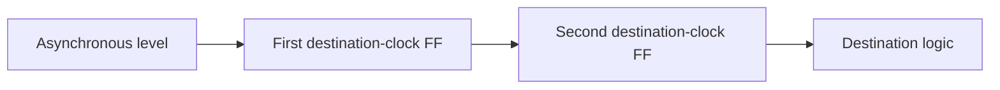

---
tags:
  - ECE2050
  - timing
date: 2026-09-30
aliases:
  - 亚稳态与时钟域跨越
  - Metastability and Clock Domain Crossing
  - CDC and synchronizers
---

# Metastability and Clock Domain Crossing · 亚稳态与时钟域跨越

> [!SUMMARY] Quick recall · 英文速览
> Sampling an asynchronous transition can violate setup/hold and leave a flip-flop temporarily metastable. A synchronizer reduces the chance that this uncertainty reaches downstream logic; it cannot promise zero risk.

## Core Definition · 核心定义

亚稳态 (metastability) 是存储元件暂时未解析成可靠 0/1 的物理状态。异步按钮、其他 clock domain 的信号或 reset release 都可能在 aperture 附近变化；不能因为仿真只显示 0/1 就认为实物没有风险。

## Mechanism · 两级同步器

第一级采异步输入；第二级在下一个目标 clock 边沿采第一级，让第一级获得接近一个周期的解析时间。下游只能使用第二级输出。

This block diagram shows a single-bit level synchronizer. Place the stages close and avoid combinational logic between them when applying this pattern. Exact reliability depends on clock/data rates, device parameters, and available resolution time; no universal MTBF number follows from “two stages”.

## Validity Boundaries · 适用边界

- 单位 level：若保持足够久，可让目标域采到稳定值。
- Narrow pulse：可能整个脉冲落在采样边沿之间，完全漏掉。
- Multi-bit word：逐位同步可能采出混合新旧值，不能保证 atomicity。
- Mechanical button：同步减少亚稳传播，debounce 处理多次接触跳变，是不同问题。

For event transfer, use a specified pulse-stretching, toggle, or handshake scheme. For multi-bit data, use a stable-data handshake or an asynchronous FIFO as appropriate. These are extensions beyond the basic one-bit classroom circuit.

## Worked Examples · 例题

**Pulse loss.** 目标周期 T=10 ns，输入脉冲在 2–5 ns 为 HIGH，采样边沿在 0、10、20 ns。即使脉冲很干净，所有采样看到 LOW，事件漏掉。两级同步器不能恢复一个从未采到的 pulse。

**Mixed binary count.** 异步读取 0111→1000 的四位，路径不同可混成 0000 或 1111。[[Gray Code]] 每次合法相邻变化只改一位，减少混合码问题，但仍要同步和保证采样/传输约束，不能直接当作万能 CDC 方案。

**Button.** 50 MHz clock 下，机械抖动 2 ms 相当于 100,000 周期。两级 FF 只提供几十 ns 的同步过程，不会自动消除 2 ms 的多次翻转。计数稳定时间的 debounce logic 才处理这个规格。

## Method and Exam English · 方法与答题

Identify source and destination clocks, classify level versus pulse versus word, then choose an interface that preserves the information. A synchronizer is an interface design, not merely an extra flip-flop placed anywhere.

**Question:** Does reducing the clock frequency make an asynchronous input obey setup and hold?

**Answer:** It may provide more resolution time, but the input can still change arbitrarily close to a capture edge. The asynchronous relationship remains and must be handled explicitly.

## Connections · 相关笔记

[[Setup and Hold Timing]], [[Register Enable and Reset]], [[Gray Code]], [[Digital Abstraction and System Design]], [[One-Shots and Pulse Applications]], [[Testbench and Functional Verification]].

---
索引：[[ECE2050 Knowledge Tree]] · [[Glossary]]
