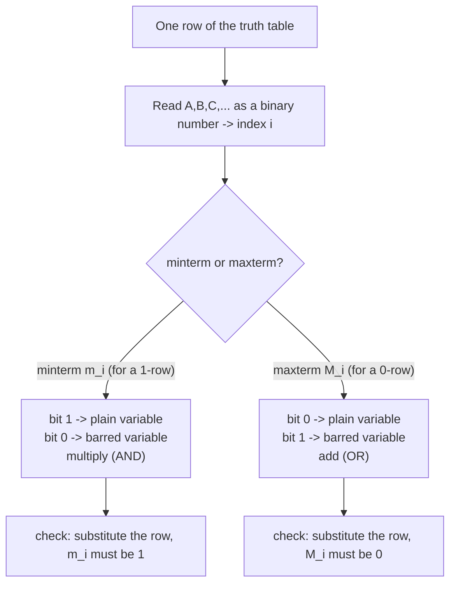

---
tags:
  - ECE2050
  - boolean-algebra
date: 2026-09-16
aliases:
  - 最小项与最大项
  - 最小项
  - 最大项
  - Minterm and Maxterm
  - Minterm
  - Maxterm
---

> [!NOTE] Where this fits · 定位
> 第 4 章从"化简"转入"标准形式"的桥梁（讲义 p.34–35）。前面 [[Boolean Expression Simplification]]
> 讲怎么把式子写短，这一篇先停下来把**式子的零件命名**：literal、implicant、minterm、maxterm。
> 有了这套命名，下一篇 [[Sum-of-Products Form]] 才能说"取输出为 1 的行，每行一个 minterm"，
> [[Product-of-Sums Form]] 才能说"取输出为 0 的行，每行一个 maxterm"。
> 前置：[[Boolean Equation]]（什么叫"用输入表达输出"）、[[Laws and Rules of Boolean Algebra]]（Rule 7 会被用来证 $M_i=\bar m_i$）。

> [!SUMMARY] Quick recall · 英文速览
> A minterm is 1 on exactly one truth-table row; a maxterm is 0 on exactly one row. Their row numbers let a Boolean function be written in canonical SOP or POS form.

## Core Definition · 核心定义

讲义 p.35 一口气给了五个术语，它们是**层层包含**的关系：

| 术语 | 定义（讲义 p.35） | 例子 |
|---|---|---|
| **补变量 (complement)** | 带横线的变量：变量取反 | $\bar A,\ \bar B,\ \bar C$ |
| **文字 (literal)** | 变量**或**它的补：$A$ 与 $\bar A$ 都算 | $A,\bar A,B,\bar B,C,\bar C$ |
| **蕴含项 (implicant)** | literal 的**乘积**（AND），不含 OR | $AB\bar C,\ \bar AC,\ BC$ |
| **最小项 (minterm)** | **包含全部输入变量**的乘积，记 $m_i$ | $\bar A\bar B\bar C,\ A\bar BC,\ ABC$ |
| **最大项 (maxterm)** | **包含全部输入变量**的和（OR），记 $M_i$ | $(A+B+C),\ (A+\bar B+C),\ (\bar A+\bar B+\bar C)$ |

- 包含关系：minterm 一定是 implicant（因为它就是 literal 的乘积），反之不然 ——
  $\bar AC$ 只有 2 个 literal，缺了 $B$，所以是 implicant 但不是 minterm。
- "包含全部输入变量"里的"全部"由**定义域 (domain)** 决定：domain 是 $\{A,B,C\}$ 时，
  每个 minterm 必须有 3 个 literal（每个变量以原变量或反变量各出现一次）。
- 数值校验（domain 判据）：$Y=\bar AC+BC$ 的 domain 是 $\{A,B,C\}$，$\bar AC$ 与 $BC$ 都只有 2 个 literal
  → 它们只是 implicant，**不是** minterm；把它们补成 $\bar AC(B+\bar B)$ 与 $BC(A+\bar A)$ 才是 minterm 之和。

> [!IMPORTANT] 编号就是"把行号写成二进制"
> 把输入变量按字母顺序从左到右排好（最左是最高位 MSB），某一行写成一个二进制数，
> 这个数的十进制值就是编号 $i$：
> - **minterm $m_i$**：变量取 **1 写原变量**、取 **0 写反变量**，例如行 $A B C = 0\,0\,1$ → $m_1=\bar A\bar BC$；
> - **maxterm $M_i$**：**恰好相反** —— 取 **0 写原变量**、取 **1 写反变量**，同一行 → $M_1=A+B+\bar C$。
> 一个函数有多少种输入组合，就有多少个 minterm 和多少个 maxterm：$n$ 个变量 → 各 $2^n$ 个。

3 变量的完整对照表（"1 的行号"与"0 的行号"两列是这一篇的核心）：

| $i$ | $A$ $B$ $C$ | minterm $m_i$ | maxterm $M_i$ | $m_i$ 在行 $i$ | $M_i$ 在行 $i$ |
|---|---|---|---|---|---|
| 0 | 0 0 0 | $\bar A\bar B\bar C$ | $A+B+C$ | 1 | 0 |
| 1 | 0 0 1 | $\bar A\bar BC$ | $A+B+\bar C$ | 1 | 0 |
| 2 | 0 1 0 | $\bar AB\bar C$ | $A+\bar B+C$ | 1 | 0 |
| 3 | 0 1 1 | $\bar ABC$ | $A+\bar B+\bar C$ | 1 | 0 |
| 4 | 1 0 0 | $A\bar B\bar C$ | $\bar A+B+C$ | 1 | 0 |
| 5 | 1 0 1 | $A\bar BC$ | $\bar A+B+\bar C$ | 1 | 0 |
| 6 | 1 1 0 | $AB\bar C$ | $\bar A+\bar B+C$ | 1 | 0 |
| 7 | 1 1 1 | $ABC$ | $\bar A+\bar B+\bar C$ | 1 | 0 |

![[minterm-maxterm-table.svg]]
*图 1 — (a) 3 变量、(b) 2 变量的 minterm / maxterm 对照表。阴影行 $i$ 同时是 $m_i$ **唯一取 1** 的行
和 $M_i$ **唯一取 0** 的行（最右两列），所以 $M_i=\bar m_i$：把 $m_i$ 取反（De Morgan 拆横线、
乘号变加号）就得到 $M_i$。*

## Assumptions and Validity · 适用前提

> [!IMPORTANT] 三条必须成立的前提
> ① **domain 固定**：所有项用的是同一组输入变量，符号统一（$A$ 还是 $\bar A$ 由行决定，不换变量名）。
> ② **每个 minterm / maxterm 恰好含 $n$ 个 literal**，每个变量出现且只出现一次。
> ③ **编号法一致**：变量顺序（谁当 MSB）一旦定下就不能中途更换，否则 $m_i$ 的 $i$ 会变。

- "每个 minterm 只在**一行**取 1"：2 变量时 $m_2=AB'$ 在 $(1,0)$ 为 1，在另外 3 行都是 0（共 4 行）；
  3 变量时 $m_2=\bar AB\bar C$ 在 `010` 为 1，在另外 7 行都是 0（共 8 行）。
  数学上这就是 $2^n-1$ 行为 0 而 1 行为 1 ✓。
- "每个 maxterm 只在**一行**取 0"：3 变量时 $M_2=A+\bar B+C$ 只在 `010` 处三项全 0 → 结果为 0，
  其它 7 行至少有一项为 1 → 结果为 1 ✓（OR 只要一个 1 就是 1）。
- 失效边界：如果一个乘积项**没有**包含全部变量（比如 $\bar AC$），它就不止在一行为 1
  （$B$ 取 0 或 1 都是 1），那就不是 minterm。同理 $(A+\bar B)$ 不是 maxterm。
- 术语的适用范围：minterm / maxterm 是**形状**的名字，与函数无关；
  同一个 $m_5$ 可以出现在任何函数的 SOP 里，也可以完全不出现。

## Derivation · 推导过程

### 1. 为什么 minterm 只能在一行为 1

$n$ 个 literal 全部相乘，要结果为 1，必须**每一个** literal 都为 1 ——
而每个 literal 正好规定了一个变量的取值（原变量要求 1、反变量要求 0）。
$n$ 个变量、每个都被规定死，于是只有唯一一种输入组合能满足 → 只有 1 行为 1。

- 意义：minterm 是"行号的选择器"（row selector）：$m_i$ 就是"当前输入等于第 $i$ 行"这个事件的布尔表达式。
- 数值校验：$m_5=A\bar BC$，枚举 8 行得 $0,0,0,0,0,1,0,0$ —— 只有第 5 行是 1 ✓。

### 2. 为什么 maxterm 只能在一行为 0（以及 $M_i=\bar m_i$）

maxterm 是**和**：要结果为 0，必须每一项都为 0，也就是每个变量都被"反向"规定死 → 同样唯一。
把两者的关系写成公式：

$$
M_i = \overline{m_i}
$$

- 意义：$M_i$ 就是 $m_i$ 的反函数。因为 $m_i$ 只在一行为 1，所以 $\overline{m_i}$ 只在一行为 0 —— 这正是 maxterm。
- 推导（用 [[DeMorgan's Theorems]]）：以 $i=2$ 为例，$m_2=\bar AB\bar C$，取反后拆横线（乘变加、各自取反）：

$$
\overline{m_2}=\overline{\bar A\cdot B\cdot\bar C}=\bar{\bar A}+\bar B+\bar{\bar C}=A+\bar B+C=M_2
$$

- 数值校验：枚举 8 行，$m_2 = 0,0,1,0,0,0,0,0$，$M_2 = 1,1,0,1,1,1,1,1$ ——
  两列逐位相反 ✓；且 $m_2$ 唯一取 1 的行是第 2 行、$M_2$ 唯一取 0 的行也是第 2 行 ✓。
- 顺带得到两个计数事实：$\sum_i m_i = 1$（所有 minterm 之和恒为 1，因为每一行恰好有一个 minterm 为 1）、
  $\prod_i M_i = 0$（所有 maxterm 之积恒为 0）。

### 3. 2 变量的表（讲义 p.36–37 直接用到的两个表）

| $i$ | $A$ $B$ | minterm $m_i$ | maxterm $M_i$ | $m_i$ 在行 $i$ | $M_i$ 在行 $i$ |
|---|---|---|---|---|---|
| 0 | 0 0 | $\bar A\bar B$ | $A+B$ | 1 | 0 |
| 1 | 0 1 | $\bar AB$ | $A+\bar B$ | 1 | 0 |
| 2 | 1 0 | $A\bar B$ | $\bar A+B$ | 1 | 0 |
| 3 | 1 1 | $AB$ | $\bar A+\bar B$ | 1 | 0 |

- 讲义 p.36 的表：$Y=F(A,B)=\bar AB+AB$ 只在 $m_1,m_3$ 两行取 1 → 写作 $Y=\sum m(1,3)$；
- 讲义 p.37 的表：同一个函数用 maxterm 写，取 0 的两行是 $M_0=A+B$ 与 $M_2=\bar A+B$
  → $Y=\prod M(0,2)$。两种写法枚举 4 行都得 $0,1,0,1$ ✓。

## Method and Steps · 求解步骤与方法

1. **数变量定 domain**：写出全部输入变量（如 $\{A,B,C,D\}$），确定变量顺序（最左 = MSB）。
2. **算行号 $i$**：把该行的 0/1 序列按二进制读成十进制。
3. **写 minterm**：**1 → 原变量，0 → 反变量**，全部相乘，记作 $m_i$。
4. **写 maxterm**：**0 → 原变量，1 → 反变量**，全部相加，记作 $M_i$（与第 3 步正好互补）。
5. **自检**：把这一行的取值代进去 —— minterm 必须算出 1，maxterm 必须算出 0；
   再随手代一行别的，minterm 必须算出 0、maxterm 必须算出 1。

## Worked Example · 例题

**Example 1 — 从一行写出 minterm 与 maxterm（4 变量）**

题目：某 4 变量函数的 domain 是 $\{A,B,C,D\}$。对于输入 $A=1,B=0,C=1,D=1$：
(a) 写出它的 minterm 与编号；(b) 写出它的 maxterm 与编号。

解：
1. 行值写成二进制 `1011` $= 8+0+2+1 = 11$ → $i=11$。
2. minterm：取 1 的写原变量、取 0 的写反变量 → $m_{11}=A\bar BCD$。
3. maxterm：取 0 的写原变量、取 1 的写反变量 → $M_{11}=\bar A+B+\bar C+\bar D$。

**数值校验 (Numerical check)**：代入 $(1,0,1,1)$：
$m_{11}=1\cdot\bar 0\cdot1\cdot1=1\cdot1\cdot1\cdot1=1$ ✓；
$M_{11}=\bar 1+0+\bar 1+\bar 1=0+0+0+0=0$ ✓。
再代入 $(0,1,0,0)$（`0100` $=4$）：$m_{11}=0\cdot1\cdot0\cdot0=0$ ✓，$M_{11}=1+1+1+1=1$ ✓。
枚举全部 16 行：$m_{11}$ 只在第 11 行为 1、$M_{11}$ 只在第 11 行为 0 ✓。

**Example 2 — 术语辨认（讲义 p.35 的分类练习）**

题目：domain 为 $\{A,B,C\}$。判断下列各项分别是 literal、implicant、minterm 还是 maxterm：
(a) $\bar A$；(b) $B\bar C$；(c) $A\bar BC$；(d) $(A+\bar B+C)$；(e) $(A+\bar B)$。

解：
1. (a) $\bar A$ 是**补变量**，也是一个 **literal**（literal = 变量或其补）。
2. (b) $B\bar C$ 是 literal 的乘积 → **implicant**；只有 2 个 literal、缺 $A$ → 不是 minterm。
3. (c) $A\bar BC$ 含全部 3 个变量 → **minterm**，行值是 `101` $=5$，即 $m_5$。
4. (d) 含全部 3 个变量的和 → **maxterm**；它是"取 0 写原变量"，对应行 `010` → $M_2=A+\bar B+C$。
5. (e) $(A+\bar B)$ 是和、但缺 $C$ → 只是"和项"，**不是** maxterm（它在 2 行为 0）。

**数值校验 (Numerical check)**：(e) 在 $(A,B,C)=(0,1,0)$ 与 $(0,1,1)$ 两行都等于 0
（$0+\bar 1=0$）→ 有两行为 0，违反"maxterm 只在一行为 0" ✓ 判定正确。
(c) 在 8 行上为 $0,0,0,0,0,1,0,0$，只在第 5 行为 1 ✓。

**Example 3 — 验证 $M_5=\overline{m_5}$**

题目：用 De Morgan 证明 $M_5=\overline{m_5}$，并用真值表核对。

解：
1. 行 `101` 的 minterm 是 $m_5=A\bar BC$，maxterm 是 $M_5=\bar A+B+\bar C$。
2. 取反并拆横线：$\overline{m_5}=\overline{A\bar BC}=\bar A+\bar B+\bar C$ ✗ ——
   注意这一步**没有**直接得到 $M_5$，需要小心反变量的反：

$$
\overline{A\bar BC}=\bar A+\overline{\bar B}+\bar C=\bar A+B+\bar C=M_5
$$

**数值校验 (Numerical check)**：枚举 8 行，
$m_5=0,0,0,0,0,1,0,0$，$M_5=1,1,1,1,1,0,1,1$，两者**逐位相反** ✓；
$M_5$ 唯一取 0 的行是第 5 行，与 $m_5$ 唯一取 1 的行一致 ✓。

## Pitfalls · 常见误区

> [!WARNING] 六个易错点

1. **两者的取反规则记混**。错在：写 maxterm 时也用"1 → 原变量"。
   正确：minterm 是 **1 → 原变量**、maxterm 是 **0 → 原变量**，两者互补；
   记忆法：那一行的 minterm 要"在这一行等于 1"，maxterm 要"在这一行等于 0"，
   代进去算一遍就不会记错。
2. **变量顺序换来换去**。错在：写 $m_i$ 时用 $A$ 当 MSB，写另一个时用 $C$ 当 MSB。
   正确：整个题只用一种顺序（通常按字母序），编号 $i$ 才有唯一含义。
3. **把 implicant 当 minterm**。错在：看到 $\bar AC$ 就说是 minterm。
   正确：minterm 必须含 domain 里**每一个**变量；$\bar AC$ 缺 $B$，只是 implicant。
4. **把 maxterm 写成"乘积"**。错在：$(A+B+C)$ 里是 OR、外面是 AND，写成 $ABC$ 就全错了。
   正确：maxterm = 和项，多个 maxterm 之间才是 AND（见 [[Product-of-Sums Form]]）。
5. **下标从 1 开始数**。错在：把第一行 `000` 编号成 $m_1$。
   正确：`000` 是 $m_0$（$0$ 也是合法的编号），$n$ 变量共 $2^n$ 个 minterm，编号 $0 \sim 2^n-1$。
6. **以为 $\sum m(\cdot)$ 里没列的 minterm 可以随便**。错在：漏写一项。
   正确：没有被列出的 minterm 在这些行上取 0，函数值由列出的项完全决定；
   漏写等于偷偷把函数改了（自查：穷举 $2^n$ 行）。

## Row identities and polarity · 行编号与取补方向

A minterm is true on exactly one row; a maxterm is false on exactly one row. Their subscripts refer to the same input pattern, not to whether the overall function is one or zero there. For the same variable order, maxterm M_i is the complement of minterm m_i.

In a minterm, a row bit zero requires a complemented literal. In a maxterm, a row bit zero requires an uncomplemented literal so that this sum evaluates to zero on the selected row. The reversed rule follows directly from the desired output at that row.

**Worked application.** 变量顺序 ABC，索引5是101：$m_5=A\bar BC$；$M_5=\bar A+B+\bar C$。在101时前者1、后者0。在100时 m5=0，M5因 $\bar C=1$ 得1。补关系逐行成立。

**English exam question:** Why is a decoder useful for generating a canonical SOP?

**Answer:** An enabled active-high binary decoder generates one minterm per output line. OR the lines corresponding to the function's ON set. With active-low outputs, combine the complemented minterms using the appropriate NAND form. Continue to [[Decoder]] and [[Read-Only Memory and Programmable Logic Arrays]].

## Connections · 相关笔记

- 上游 (upstream)：[[Boolean Equation]] —— 先有"用输入表达输出"的方程概念，才有"项的形状"这个概念。
- 上游 (upstream)：[[DeMorgan's Theorems]] —— 证明 $M_i=\overline{m_i}$ 的工具：拆横线、乘变加。
- 上游 (upstream)：[[Laws and Rules of Boolean Algebra]] —— Rule 7（$A+\bar A=1$）是"补变量"的来源。
- 下游 (downstream)：[[Sum-of-Products Form]] —— 把输出为 1 的那些行的 $m_i$ **OR** 起来，就是标准 SOP。
- 下游 (downstream)：[[Product-of-Sums Form]] —— 把输出为 0 的那些行的 $M_i$ **AND** 起来，就是标准 POS。
- 下游 (downstream)：[[Truth Table and Boolean Expression]] —— 真值表与 $\sum m(\cdot)$、$\prod M(\cdot)$ 的双向翻译。
- 平行 (parallel)：[[Boolean Expression Simplification]] —— 化简关心"式子有多短"，本篇关心"零件叫什么"。

---
索引：[[ECE2050 Knowledge Tree]] · [[Glossary]]
