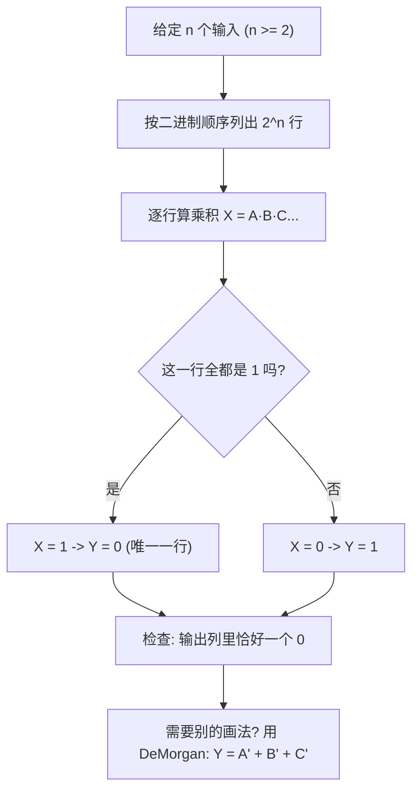

---
tags:
  - ECE2050
  - logic-gates
date: 2026-09-16
aliases:
  - 与非门
  - NAND 门
  - NAND Gate
  - NAND Operation
---

> [!NOTE] Where this fits · 定位
> 这一篇是 Ch3 门电路家族的第一个**组合门 (composite gate)**：把 AND 和一个反相器接起来就是
> NAND (NOT-AND)。讲义 p.8 只给了符号、真值表、逻辑表达式和时序图，然后在页面下方直接问
> **"How to verify/prove?"** —— 本篇用三条互相独立的路径回答它：定义式、逐行穷举、德摩根改写。
> 前置：[[AND Gate]]（$Y=AB$）、[[Inverter]]（三角形后的气泡 = 取反）。
> 下游：[[NOR Gate]]（与 NAND 对偶的另一个门）、[[DeMorgan's Theorems]]（Ch4：$\overline{AB}=\bar A+\bar B$，
> 让 NAND 等价于"反相输入的 OR"）。
> 平行：[[Logic Gates]]（章总览：真值表 / 时序图 / 表达式三种描述方式）。

> [!SUMMARY] Quick recall · 英文速览
> NAND complements AND, so its output is 0 only when every input is 1. NAND is a universal gate because suitable NAND networks can implement other Boolean functions.

## Core Definition · 核心定义

**NAND gate（与非门）**：输出是两个（或更多）输入之**积**的**反**。

$$Y=\overline{A\cdot B}=\overline{AB}$$

- 意义：先做 AND（全 1 才得 1），再把结果取反 —— 于是输出"**只有全 1 时才为 0**"，其余三行都是 1。
- 符号 (symbol)：AND 的形状（D 形）后面加一个**气泡 (bubble)** —— 气泡就是电路图里的 negation indicator，
  它永远画在**输出**一侧，表示"对这个门的输出取反"。表达式里的长横线 (bar) 与气泡是同一件事。
- 名称里的 "N" 只在**输出**上取反，与输入无关：$Y=\overline{AB}\ne\bar A\bar B$。

**两输入真值表**（行按二进制顺序列出，讲义 p.12/p.13 的约定）：

| $A$ | $B$ | $A\cdot B$ | $Y=\overline{AB}$ |
|---|---|---|---|
| 0 | 0 | 0 | **1** |
| 0 | 1 | 0 | **1** |
| 1 | 0 | 0 | **1** |
| 1 | 1 | 1 | **0** |

- $n$ 个输入共有 $2^n$ 种组合：两输入 4 行，三输入 8 行（见下文 Example 1 的 NAND3）。
- 逻辑表达式也可以写成一句话读法："**Y is LOW only when all inputs are HIGH**"。

![[nand-gate-timing.svg]]
*图 1 — $A$（周期 4）、$B$（周期 2）与 $Y=\overline{A\cdot B}$ 的时序图，同一时间轴上并排画出
AND 的输出 $A\cdot B$（蓝）作对照。灰底的两格是 $A\cdot B=1$ 的时刻（第 4、8 格），NAND 在那里把 1 翻成 0；
其余各格两者互补 —— 这就是讲义 p.8 "How to verify/prove?" 的图形答案：NAND = AND + 反相器。*

## Assumptions and Validity · 适用前提

> [!IMPORTANT] 三条前提，决定这个式子什么时候成立
> ① **输入数 $\ge 2$**：AND 的语义是"所有输入都为 1"，一个输入无所谓"所有"，所以 NAND/NOR 的最小形式是两输入；
> 单输入的反相器是另一个门（[[Inverter]]）。
> ② **取反在最外层**：$\overline{AB}$ 的横线盖住整个乘积，只对乘积结果取反，**不是**分别对 $A$、$B$ 取反。
> ③ **理想门假设**：真值表与表达式描述的是**稳态 (steady state)**；真实门有传播延迟 (propagation delay)，
> 输入跳变后输出要过一小段时间才稳定（时序图的沿对齐是理想化画法，见 [[Inverter]] 的延迟讨论）。

- 记号的坑：$\overline{AB}$ 与 $\overline{A}\overline{B}$ 是两个不同的函数 ——
  前者是 NAND，后者是 NOR 的德摩根形式（见下文 ③ 与 [[DeMorgan's Theorems]]）。
- 有效边界：输入必须是**合法的逻辑电平**（明确的高/低）。悬空或处在过渡带的输入不属于本篇的 0/1 世界，
  那是 [[Logic Levels]] 的内容。

## Derivation · 推导过程

### ① 从 AND 出发接一个反相器

把 AND 的输出 $X=AB$ 送进反相器（$Y=\overline{X}$），立刻得到

$$Y=\overline{AB}$$

- 意义：NAND 不是新发明的运算，它只是**两个已学门的串联**，所以它的真值表可以把 AND 的真值表整列取反得到。
- 数值校验（取 $A=1,B=1$）：$X=1\cdot1=1\Rightarrow Y=\bar1=0$ ✓（与真值表第 4 行一致）；
  取 $A=1,B=0$：$X=1\cdot0=0\Rightarrow Y=\bar0=1$ ✓（第 3 行一致）。

### ② 逐行穷举 (perfect induction)

不需要任何定理，把 $2^2=4$ 种输入全代一遍就能确认定义式：

| $A$ | $B$ | $X=AB$ | $Y=\bar X=\overline{AB}$ | 与真值表一致？ |
|---|---|---|---|---|
| 0 | 0 | 0 | 1 | ✓ |
| 0 | 1 | 0 | 1 | ✓ |
| 1 | 0 | 0 | 1 | ✓ |
| 1 | 1 | 1 | 0 | ✓ |

- 意义：这就是 Ch4 的**完全归纳法 (perfect induction)** 的雏形
  （链 [[Proof by Perfect Induction]]）：变量少时，穷举所有行就是最硬的证明。
- 数值校验：四行全部一致，且"输出 0 的行数 = 1"，正是 AND 的"输出 1 的行数 = 1"取反的结果 ✓。

### ③ 用德摩根定理改写成"反相输入的 OR"

$$\overline{AB}=\bar A+\bar B$$

- 意义：同一个 NAND 门有两种等价画法 —— 一个 D 形门带输出气泡，或者一个 OR 门带**两个输入气泡**。
  这条式子是 Ch4 德摩根定理的第一条（链 [[DeMorgan's Theorems]]），也是"气泡搬家 (bubble pushing)"的合法依据。
- 数值校验（取 $A=1,B=0$）：左边 $=\overline{1\cdot0}=\bar0=1$；右边 $=\bar1+\bar0=0+1=1$ ✓（两式相等）。
- 逐行核对（Python 复核全部 4 行）：四行中 $\overline{AB}$ 与 $\bar A+\bar B$ 全部相等 ✓。

### ④ 工程直觉：为什么数字电路偏爱 NAND

CMOS 工艺里，"先 AND 再取反"比"直接 AND"便宜：AND 门内部其实就是 NAND 加一个反相器。
所以**凡是能用 NAND 搭的逻辑，实际芯片里往往真的全用 NAND 搭**（NAND 与 NOR 是通用门 universal gate，
Ch5 会系统讲怎么只用一个门型实现任意逻辑）。

## Method and Steps · 求解步骤与方法

1. **数输入**：确定 $n$（NAND 要求 $n\ge 2$），准备 $2^n$ 行的表。
2. **列行**：按二进制顺序从 $00\cdots0$ 列到 $11\cdots1$（讲义 p.13 的约定："truth table rows are listed in binary order"）。
3. **算乘积列**：逐行算 $X=A\cdot B\cdots$（只要有**一个** 0，$X$ 就是 0）。
4. **取反得输出**：$Y=\bar X$ —— 全 1 的那一行变 0，其余行变 1。
5. **回读检查**：输出列里 1 的个数应等于 $2^n-1$，0 的个数应等于 1（NAND 的特征签名）。
6. **必要时改写**：要画成 OR 形状时用 $\overline{AB}=\bar A+\bar B$（[[DeMorgan's Theorems]]）。

## Worked Example · 例题

**Example 1 — 三输入 NAND3 的真值表（讲义 p.13 的 AND3 表加气泡）**

题目：讲义 p.13 中间那张表是三输入 AND3，$Y=ABC$，只有 $111$ 一行输出 1。求三输入 NAND3 的真值表。

解：对 AND3 的输出列整列取反（气泡的作用）：

| $A$ | $B$ | $C$ | $ABC$（p.13 的 AND3） | $Y=\overline{ABC}$（NAND3） |
|---|---|---|---|---|
| 0 | 0 | 0 | 0 | 1 |
| 0 | 0 | 1 | 0 | 1 |
| 0 | 1 | 0 | 0 | 1 |
| 0 | 1 | 1 | 0 | 1 |
| 1 | 0 | 0 | 0 | 1 |
| 1 | 0 | 1 | 0 | 1 |
| 1 | 1 | 0 | 0 | 1 |
| 1 | 1 | 1 | 1 | **0** |

**数值校验 (Numerical check)**：$2^3=8$ 行齐全 ✓；输出列恰好一个 0（在 $111$）✓；
用 Python 逐行复核 $Y=\lnot(A\land B\land C)$：八行全部一致 ✓；
$n$ 输入的通式 $Y=\overline{A\cdot B\cdots}$，输入每多一个，表的行数翻倍而"0 的行数"始终是 1 ✓。

![[ch3-multiple-input-gates.png]]
*图 2 — 讲义 p.13 原图：多输入门的三组符号、表达式与真值表，行都按二进制顺序列出。
左表是 NOR3（$Y=\overline{A+B+C}$，只有 $000$ 输出 1），中间是本例用的 AND3（$Y=ABC$），
右表是三输入 XOR（奇数个 1 输出 1，见 [[Exclusive-OR Gate]]）。NAND3 就是中间那张 AND3 的输出加一个气泡，
即本例题表格的最后一列。*

**Example 2 — 从波形读出 NAND 的输出（自算，配合图 1）**

题目：图 1 中 $A$ 的波形是 `0011 0011`、$B$ 是 `0101 0101`（每格 1 个时间单位）。求 $Y$ 的波形。

解：逐格先算 $A\cdot B$ 再取反：

| 格 | 1 | 2 | 3 | 4 | 5 | 6 | 7 | 8 |
|---|---|---|---|---|---|---|---|---|
| $A$ | 0 | 0 | 1 | 1 | 0 | 0 | 1 | 1 |
| $B$ | 0 | 1 | 0 | 1 | 0 | 1 | 0 | 1 |
| $A\cdot B$ | 0 | 0 | 0 | 1 | 0 | 0 | 0 | 1 |
| $Y=\overline{AB}$ | 1 | 1 | 1 | **0** | 1 | 1 | 1 | **0** |

**数值校验 (Numerical check)**：$Y=$ `1110 1110` ✓；$A$ 两格一个周期、$B$ 一格一个周期，
于是四种输入组合 $(00,01,10,11)$ 恰好各出现两次，波形把真值表的两组"1,1,1,0"重复了一遍 ✓；
$Y$ 与 $A\cdot B$ 逐格相加恒为 1（互补）✓ —— 与图 1 中两条输出波形的关系一致。

**Example 3 — 德摩根改写：把 NAND 画成"反相输入的 OR"（自算）**

题目：用 $\overline{AB}=\bar A+\bar B$ 重新计算 Example 2 的每一格，确认结果不变。

解：$\bar A$ 是 `1100 1100`，$\bar B$ 是 `1010 1010`，两者按位 OR：`1110 1110` ✓ 与 Example 2 的 $Y$ 完全相同。

**数值校验 (Numerical check)**：OR 的每一格只要有一个 1 就是 1，因此只有 $A=B=1$ 的格子（第 4、8 格）为 0 ✓；
这就是"两个输入气泡 + OR 门"的波形解释，与 [[DeMorgan's Theorems]] 的 $\overline{AB}=\bar A+\bar B$ 逐行一致 ✓。

## Pitfalls · 常见误区

> [!WARNING] NAND 的错几乎都出在"取反加在哪一层"
> 1. **写成 $\bar A\bar B$**。错在：把横线拆到两个变量上。正确：$\overline{AB}=\bar A+\bar B$（德摩根），
>    分别取反后是 **OR**，不是 AND。代入 $A=1,B=0$ 立刻看出：$\overline{AB}=1$ 而 $\bar A\bar B=0$。
> 2. **把气泡画在输入端**。错在：画成"D 形门 + 两个输入气泡"，那其实是 $\bar A\cdot\bar B$（= NOR）。
>    正确：NAND 的气泡在**输出**；要把气泡搬到输入侧，必须**同时把 AND 换成 OR**（德摩根），画法才等价。
> 3. **表格行序乱写**。错在：随手按 $00,01,11,10$ 列行。正确：按二进制顺序 $000\to111$，
>    这样"输出 0 的唯一一行"永远出现在表的最后一行，检查起来最快。
> 4. **以为 NAND 可以只有一个输入**。错在：把反相器叫成"单输入 NAND"。正确：AND/NAND 要求输入 $\ge 2$，
>    单输入的门只有 NOT 和 BUF（[[Inverter]]）。
> 5. **把 NAND 当成"先取反，再 AND"**。错在：$\overline{AB}\ne\bar A\bar B$（见第 1 条）。
>    正确：顺序是 **先 AND，后取反**，口诀 "AND then invert"。
> 6. **忘记检查行数**。错在：三输入只写了 4 行。正确：$n$ 输入必有 $2^n$ 行，写完先数行数。

> [!TIP] 一秒判 NAND
> 看到"**只有全 1 时输出 0**"（或"输出 0 的行只有一行"）就是 NAND；看到"只要有一个 0 就输出 1"也是 NAND
> （同一句话的两种说法）。反过来"全 1 才输出 1"是 AND。

## NAND as a complete construction set · NAND 的功能完备性

NAND is functionally complete because it can construct inversion and conjunction, then use DeMorgan's theorem to construct disjunction. Tie both inputs together to obtain $\overline{AA}=\bar A$. Invert a NAND output to obtain AND. With complemented inputs, NAND produces $\overline{\bar A\bar B}=A+B$.

A NAND-NAND implementation of SOP deliberately uses two inversions. The first level produces complemented products. The second level complements their AND, which becomes an OR of the original products. Do not insert extra output inversion after the final NAND unless the specification requires the complemented function.

**Worked application — three NAND gates.** 实现 $Y=AB+CD$：$n_1=\overline{AB}$，$n_2=\overline{CD}$，$Y=\overline{n_1n_2}=AB+CD$。取 ABCD=1100，n1=0、n2=1、Y=1；取 1010，两乘积都 0，n1=n2=1，Y=0。中间低电平代表“该乘积已满足”，因此第二级的输出极性要沿式子检查。

In English: the NAND network preserves the function of the two-level SOP. Its physical delay and input count must still be evaluated against available gates and the timing specification.

**English exam question:** How many two-input NAND gates are sufficient to construct a two-input OR if only uncomplemented A and B are available?

**Answer:** Three: one NAND with tied A inputs to generate $\bar A$, one with tied B inputs to generate $\bar B$, and a final NAND of those complements. The resulting output is $A+B$.

For diagram transformations use [[Universal Gates and Bubble Pushing]] and [[DeMorgan's Theorems]]. The same primitive becomes a memory element only with a suitable feedback topology, as explained in [[Set-Reset Latch]].

## Connections · 相关笔记

- 上游 (upstream)：[[AND Gate]] —— $Y=AB$ 是 NAND 的内核，NAND 只是它的输出取反。
- 上游 (upstream)：[[Inverter]] —— 气泡/横线（取反）的定义与符号来源。
- 下游 (downstream)：[[DeMorgan's Theorems]] —— $\overline{AB}=\bar A+\bar B$ 把 NAND 与"反相输入的 OR"连起来。
- 下游 (downstream)：[[NOR Gate]] —— 与 NAND 对偶的门（AND↔OR、0↔1 互换），两篇要对照记忆。
- 平行 (parallel)：[[Logic Gates]] —— 三种描述方式（真值表 / 时序图 / 表达式）与符号约定。
- 平行 (parallel)：[[Logic Levels]] —— 本篇假设输入已是合法 0/1；电平范围与噪声容限由它负责。

---
索引：[[ECE2050 Knowledge Tree]] · [[Glossary]]
