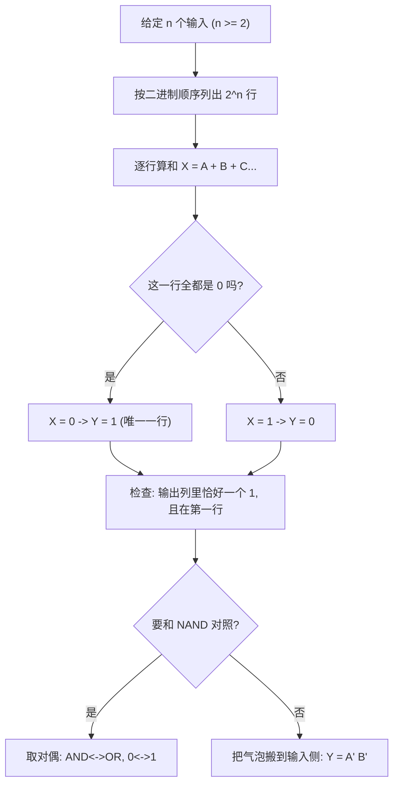

---
tags:
  - ECE2050
  - logic-gates
date: 2026-09-16
aliases:
  - 或非门
  - NOR 门
  - NOR Gate
  - NOR Operation
---

> [!NOTE] Where this fits · 定位
> 这一篇与 [[NAND Gate]] 是**一对对偶门**：NAND 是 AND 的输出加气泡，NOR 是 OR 的输出加气泡。
> 讲义 p.9 同样只给符号、真值表、表达式和时序图，并在页面上问 **"How to verify/prove?"**；
> 本篇用定义式、逐行穷举、德摩根改写三条路回答，并给出与 NAND 的对称对照。
> 前置：[[OR Gate]]（$Y=A+B$）、[[Inverter]]（气泡 = 取反）。
> 下游：[[DeMorgan's Theorems]]（Ch4：$\overline{A+B}=\bar A\bar B$，NOR = 反相输入的 AND）、
> [[Boolean Axioms]]（Ch4：对偶性 duality 把 NAND 与 NOR 一一配对）。
> 平行：[[Logic Gates]]（章总览：三种描述方式与符号约定）。

> [!SUMMARY] Quick recall · 英文速览
> NOR complements OR, so its output is 1 only when every input is 0. NOR is also a universal gate for building Boolean functions.

## Core Definition · 核心定义

**NOR gate（或非门）**：输出是两个（或更多）输入之**和**的**反**。

$$Y=\overline{A+B}$$

- 意义：先做 OR（只要有一个 1 就得 1），再把结果取反 —— 于是输出"**只有全 0 时才为 1**"，其余行都是 0。
- 符号 (symbol)：OR 的弧形形状后面加一个**气泡 (bubble)**；气泡 = negation indicator，与表达式上的长横线等价。
- 一句话读法："**Y is HIGH only when all inputs are LOW**"。

**两输入真值表**（行按二进制顺序列出）：

| $A$ | $B$ | $A+B$ | $Y=\overline{A+B}$ |
|---|---|---|---|
| 0 | 0 | 0 | **1** |
| 0 | 1 | 1 | **0** |
| 1 | 0 | 1 | **0** |
| 1 | 1 | 1 | **0** |

- $n$ 输入共有 $2^n$ 行；$n$ 输入的 NOR 只在**全 0 那一行**输出 1（见 Example 1 的 NOR3）。
- NOR 与 NAND 的对称（对偶性）：$\text{NOR}(A,B)=\overline{\text{NAND}(\bar A,\bar B)}$ ——
  把 NAND 真值表的**输入列与输出列同时取反**，得到的就是 NOR 表（下文 ④）。
  数值核对：$\overline{\text{NAND}(\bar A,\bar B)}=\overline{\overline{\bar A\bar B}}=\bar A\bar B$，正是 $\overline{A+B}$ ✓。

![[nor-gate-timing.svg]]
*图 1 — $A$（周期 4）、$B$（周期 2）与 $Y=\overline{A+B}$ 的时序图，并排画出 OR 的输出 $A+B$（蓝）作对照。
灰底的两格是 $A+B=0$（第 1、5 格，两个输入同时为 0），只有那里 NOR 的输出气泡把 0 抬成 1 ——
对应真值表的第一行（$A=B=0$）。*

## Assumptions and Validity · 适用前提

> [!IMPORTANT] 三条前提，与 NAND 完全对称
> ① **输入数 $\ge 2$**：OR 的语义是"至少一个输入为 1"，单输入退化成缓冲/反相，不属于 NOR。
> ② **取反在最外层**：$\overline{A+B}$ 的横线盖住整个和，不是分别对 $A$、$B$ 取反 ——
> $\overline{A+B}=\bar A\bar B$，而 $\bar A+\bar B=\overline{AB}$（[[DeMorgan's Theorems]]）。
> ③ **理想门假设**：真值表/表达式描述稳态；真实门的传播延迟让输出的跳变晚于输入跳变
> （延迟的物理来源见 [[Inverter]]，更细的电压层面见 [[DC Transfer Characteristic]]）。

- 记号的坑：$\overline{AB}$ 是 NAND、$\overline{A+B}$ 是 NOR；**横线盖住的东西不同，门就不同**。
- 有效边界：输入必须是合法逻辑电平；处在过渡带或悬空的输入不进本篇的 0/1 世界（[[Logic Levels]]）。

## Derivation · 推导过程

### ① 从 OR 出发接一个反相器

把 OR 的输出 $X=A+B$ 送进反相器（$Y=\bar X$）：

$$Y=\overline{A+B}$$

- 意义：NOR 也是"两个已学门的串联"，真值表可由 OR 的真值表整列取反得到。
- 数值校验（取 $A=0,B=0$）：$X=0+0=0\Rightarrow Y=\bar0=1$ ✓（真值表第 1 行）；
  取 $A=0,B=1$：$X=0+1=1\Rightarrow Y=\bar1=0$ ✓（第 2 行）。

### ② 逐行穷举 (perfect induction)

| $A$ | $B$ | $X=A+B$ | $Y=\bar X=\overline{A+B}$ | 与真值表一致？ |
|---|---|---|---|---|
| 0 | 0 | 0 | 1 | ✓ |
| 0 | 1 | 1 | 0 | ✓ |
| 1 | 0 | 1 | 0 | ✓ |
| 1 | 1 | 1 | 0 | ✓ |

- 意义：四行一次代完，不用任何定理（链 [[Proof by Perfect Induction]]）。
- 数值校验：输出列恰好一个 1，位置在 $A=B=0$ ✓；这正是 OR 输出列"三个 1"取反后的结果 ✓。

### ③ 德摩根改写：NOR = "反相输入的 AND"

$$\overline{A+B}=\bar A\bar B$$

- 意义：同一个 NOR 门可以画成"OR + 输出气泡"，也可以画成"两个输入气泡 + AND 门"。
  这是 Ch4 德摩根定理的第二条（链 [[DeMorgan's Theorems]]），也是气泡搬家的依据。
- 数值校验（取 $A=0,B=1$）：左边 $=\overline{0+1}=\bar1=0$；右边 $=\bar0\cdot\bar1=1\cdot0=0$ ✓。
- 逐行核对（Python 复核全部 4 行）：$\overline{A+B}$ 与 $\bar A\bar B$ 四行全等 ✓。

### ④ 与 NAND 的对偶 (duality)

把布尔式里的 **AND ↔ OR**、**0 ↔ 1** 同时互换，得到的式子叫**对偶式 (dual)**：

| NAND 一侧 | 对偶操作 | NOR 一侧 |
|---|---|---|
| $Y=\overline{AB}$（全 1 时输出 0） | AND↔OR、0↔1 | $Y=\overline{A+B}$（全 0 时输出 1） |
| 符号：D 形 + 输出气泡 | 形状对偶 | 符号：弧形 + 输出气泡 |
| $\overline{AB}=\bar A+\bar B$ | 两边取对偶 | $\overline{A+B}=\bar A\bar B$ |

- 意义：NAND 与 NOR 的每一条性质都能"翻译"过去；记住一个，另一个就免费得到（链 [[Boolean Axioms]]）。
- 数值校验：NAND 的输出列 `1,1,1,0`，逐位取反得 `0,0,0,1`，正是 NOR 的输出列 ✓（两表互补）。

### ⑤ 工程直觉：为什么 NOR 常被"NAND + 反相器"替代

CMOS 里 NAND 的串联管在**下拉 (pull-down)** 一侧（NMOS 串起来仍然够强），
而 NOR 的串联管在**上拉 (pull-up)** 一侧（PMOS 本来就弱，串起来更慢）。
所以同一工艺下 NAND 往往比 NOR 快、面积也更划算 —— 这也是后面组合逻辑综合时偏爱 NAND 的原因
（通用门的系统用法见 Ch5）。

## Method and Steps · 求解步骤与方法

1. **数输入**：$n\ge 2$，准备 $2^n$ 行。
2. **列行**：二进制顺序 $00\cdots0\to11\cdots1$（讲义 p.13 的约定）。
3. **算和列**：$X=A+B+\cdots$（只要有**一个** 1，$X$ 就是 1）。
4. **取反得输出**：$Y=\bar X$ —— 全 0 的那一行变 1，其余行变 0。
5. **回读检查**：输出列里 1 的个数应为 1，且一定落在**第一行**（全 0 行）。
6. **要换画法**时用 $\overline{A+B}=\bar A\bar B$ 改成"反相输入的 AND"（[[DeMorgan's Theorems]]）。

## Worked Example · 例题

**Example 1 — 两输入 NOR 与三输入 NOR3（讲义 p.12 / p.13 原表）**

题目：讲义 p.12 的第五张表是 NOR2（$Y=\overline{A+B}$）；p.13 最左边的表是三输入 NOR3。逐行核对这两张表。

解（p.12 的 NOR2，行按二进制顺序）：

| $A$ | $B$ | $A+B$ | $Y=\overline{A+B}$（讲义 p.12） |
|---|---|---|---|
| 0 | 0 | 0 | 1 |
| 0 | 1 | 1 | 0 |
| 1 | 0 | 1 | 0 |
| 1 | 1 | 1 | 0 |

解（p.13 左表的 NOR3，$Y=\overline{A+B+C}$）：

| $A$ | $B$ | $C$ | $A+B+C$ | $Y=\overline{A+B+C}$ |
|---|---|---|---|---|
| 0 | 0 | 0 | 0 | **1** |
| 0 | 0 | 1 | 1 | 0 |
| 0 | 1 | 0 | 1 | 0 |
| 0 | 1 | 1 | 1 | 0 |
| 1 | 0 | 0 | 1 | 0 |
| 1 | 0 | 1 | 1 | 0 |
| 1 | 1 | 0 | 1 | 0 |
| 1 | 1 | 1 | 1 | 0 |

**数值校验 (Numerical check)**：NOR2 输出列 `1,0,0,0` ✓、NOR3 输出列 `1,0,0,0,0,0,0,0` ✓；
用 Python 逐行复核 $Y=\lnot(A\lor B\lor C)$ 全部 8 行一致 ✓；
"1 的个数 = 1"且都在第一行（全 0 行）—— 这正是 NOR 的签名 ✓。

![[ch3-two-input-gates.png]]
*图 2 — 讲义 p.12 原图：六个两输入门（从左到右依次是 AND、OR、XOR、NAND、NOR、XNOR）的符号、表达式与真值表，
NOR 是第五张表，它的 $Y$ 列只有第一行（$A=B=0$）为 1；紧挨着它左边的第四张是 NAND，两列恰好互补 —— 对照着看最省力。*

**Example 2 — 从波形读出 NOR 的输出（自算，配合图 1）**

题目：图 1 中 $A=$ `0011 0011`、$B=$ `0101 0101`。求 $Y$ 的波形，并指出 $Y=1$ 的格子。

解：先算 $A+B$ 再取反：

| 格 | 1 | 2 | 3 | 4 | 5 | 6 | 7 | 8 |
|---|---|---|---|---|---|---|---|---|
| $A$ | 0 | 0 | 1 | 1 | 0 | 0 | 1 | 1 |
| $B$ | 0 | 1 | 0 | 1 | 0 | 1 | 0 | 1 |
| $A+B$ | 0 | 1 | 1 | 1 | 0 | 1 | 1 | 1 |
| $Y=\overline{A+B}$ | **1** | 0 | 0 | 0 | **1** | 0 | 0 | 0 |

**数值校验 (Numerical check)**：$Y=$ `1000 1000` ✓；$Y=1$ 只出现在第 1、5 格，而这两格恰好是
$(A,B)=(0,0)$ ✓；$Y$ 与 $A+B$ 逐格互补（相加恒为 1）✓ —— 与图 1 的两条波形一致。

**Example 3 — 真假判断题（讲义 p.25 Quiz 原题）**

题目：判断并说明理由。
(a) "A NOR gate can be considered as an OR gate followed by an inverter."
(b) "If any input to an OR gate is zero, the output is zero."

解：
(a) **True**。$Y=\overline{A+B}$ 就是先把两个输入 OR 起来，再取反；气泡即那个反相器。
(b) **False**。OR 输出为 0 的条件是**所有**输入都为 0，不是"任意一个为 0"。
   反例：$A=1,B=0\Rightarrow A+B=1$，输出是 1 而不是 0。

**数值校验 (Numerical check)**：(a) 逐行：$A+B$ 列 `0,1,1,1` 取反得 `1,0,0,0`，与 NOR2 真值表相同 ✓；
(b) 在 $A=1,B=0$ 这一行，$A+B=1$ ✓，"任一输入为 0 则输出为 0"被这一行直接推翻 ✓
（OR 的真值表里输出为 1 的行有 3 行，只有全 0 行是 0）。

## Pitfalls · 常见误区

> [!WARNING] NOR 最容易被"顺手写错一个符号"
> 1. **$\overline{A+B}$ 写成 $\bar A+\bar B$**。错在：横线被拆开。正确：$\overline{A+B}=\bar A\bar B$（德摩根），
>    而 $\bar A+\bar B=\overline{AB}$ 是 NAND 的改写。代入 $A=1,B=0$：$\overline{A+B}=0$ 但 $\bar A+\bar B=1$。
> 2. **与 NAND 记混**。错在：把"全 0 才输出 1"记成"全 1 才输出 1"。正确：NAND 唯一输出 0 的行是全 1 行；
>    NOR 唯一输出 1 的行是全 0 行（两表逐位互补）。
> 3. **气泡画错边**。错在：把 NOR 画成"输入带气泡的 OR"。正确：NOR 的气泡在**输出**；
>    输入带气泡的 OR 等价于 NAND（$\bar A+\bar B=\overline{AB}$）。
> 4. **把 NOR 当成"两个输入都为 0 才输出 1 的 OR"**。错在：OR 本身在全 0 时输出 0。
>    正确：NOR = OR **之后**再取反，全 0 行才因此变成 1。
> 5. **三输入只写 4 行**。错在：把 NOR3 当两输入处理。正确：$n$ 输入 $2^n$ 行，NOR3 有 8 行，
>    且只允许一行（$000$）为 1。
> 6. **用 OR 的 T/F 结论直接推 NOR**。错在：把"OR 有 1 就出 1"照搬到 NOR。正确：NOR 恰好相反 ——
>    有 1 就出 **0**。

> [!TIP] 与 NAND 一起记的"对偶口诀"
> 把 NAND 的每句话做两个替换就得到 NOR：**AND→OR**、**0→1**。
> "NAND：全 1 出 0" → "NOR：全 0 出 1"；"$\overline{AB}=\bar A+\bar B$" → "$\overline{A+B}=\bar A\bar B$"。

## NOR implementation and zero conditions · NOR 实现与零条件

NOR is functionally complete and is naturally paired with product-of-sums expressions. A NOR-NOR network inverts each first-level sum, then complements the OR of those inversions. DeMorgan's theorem recovers the AND of the original sums.

NOR's output is TRUE when none of its inputs is TRUE. This makes it useful for an “all clear” condition. In a real system the meaning of each input must be specified: a LOW wire does not automatically mean the corresponding fault is absent if the fault input itself is active-low.

**Worked application — NOR-NOR POS.** 实现 $Y=(A+B)(C+D)$：$n_1=\overline{A+B}$、$n_2=\overline{C+D}$，末级 $Y=\overline{n_1+n_2}$。取 1001，两和项均为 1，n1=n2=0，Y=1；取 1000，第二个和项为 0，n2=1，Y=0。最后一级不能改成 NAND，否则不再保持 POS 函数。

In English: a first-level NOR reports that a clause is false. The final NOR is HIGH only when neither clause is false, which is exactly the conjunction of the original clauses.

**English exam question:** Can an XOR replace a NOR because both output zero for some mixed inputs?

**Answer:** No. For inputs 00, NOR outputs 1 and XOR outputs 0. For 01, NOR outputs 0 and XOR outputs 1. A replacement must match every specified row, not merely one shared output value.

Apply this reasoning to [[Product-of-Sums Form]], [[POS Minimization with Karnaugh Map]], [[Universal Gates and Bubble Pushing]], and [[Set-Reset Latch]]. Cross-coupling changes the system from a feedforward function into a state-dependent network.

## Connections · 相关笔记

- 上游 (upstream)：[[OR Gate]] —— $Y=A+B$ 是 NOR 的内核。
- 上游 (upstream)：[[Inverter]] —— 气泡（取反）的符号与含义。
- 下游 (downstream)：[[DeMorgan's Theorems]] —— $\overline{A+B}=\bar A\bar B$ 是 NOR 的第二种画法。
- 下游 (downstream)：[[Boolean Axioms]] —— 对偶性 (duality) 解释了 NAND 与 NOR 为什么一一对应。
- 平行 (parallel)：[[NAND Gate]] —— 本篇的对偶门，建议两篇的表格并排背。
- 平行 (parallel)：[[Logic Levels]] —— 输入必须是合法电平，NOR 才有确定的输出。

---
索引：[[ECE2050 Knowledge Tree]] · [[Glossary]]
