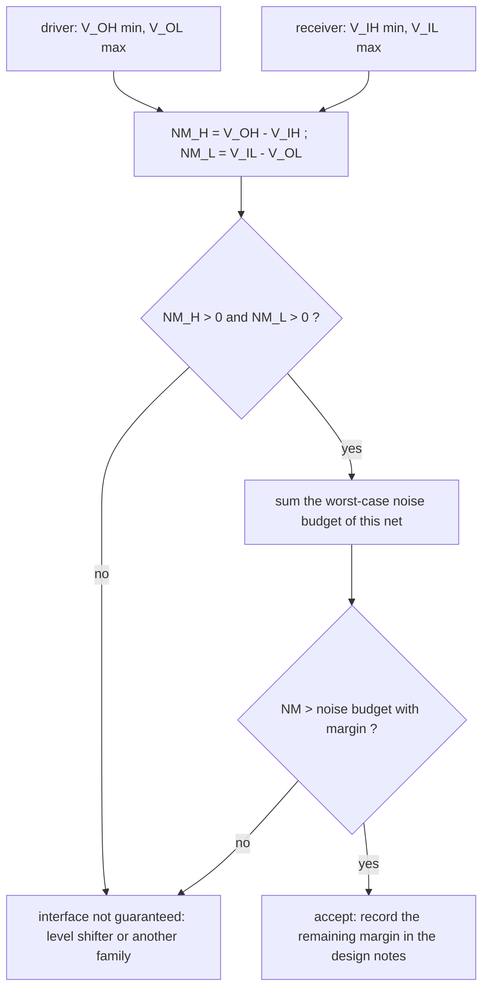

---
tags:
  - ECE2050
  - logic-levels
date: 2026-09-16
aliases:
  - 噪声容限
  - 噪声裕度
  - Noise Margin
  - Noise Margins
---

> [!NOTE] Where this fits · 定位
> 上一篇 [[Logic Levels]] 用 $V_{IL}$、$V_{IH}$、$V_{OL}$、$V_{OH}$ 划出了 0 与 1 的电压区间；
> 本篇回答"这些区间之间的缝隙是干什么用的"。讲义 p.17 先定义**噪声**（*anything that degrades the
> signal*）并给出 5 V→4.5 V 的压降例子，p.18 给出两个指标
> $NM_H=V_{OH}-V_{IH}$、$NM_L=V_{IL}-V_{OL}$，p.23 的家族表则给出四组可复算的数字。
> 前置：[[Logic Levels]]（四个参数的方向与含义）。
> 下游：[[DC Transfer Characteristic]] —— 噪声容限本质上就是那条曲线上的一段**水平余量**。

> [!SUMMARY] Quick recall · 英文速览
> Noise margin is the guaranteed voltage gap between a driver's output level and a receiver's input threshold. Calculate high and low margins separately for a specified pair of devices.

## Core Definition · 核心定义

**噪声 (noise)**：任何使信号退化的因素（讲义 p.17：*Anything that degrades the signal*）：

- 导线/通路的**电阻** (resistance) 造成的压降 —— 讲义 p.17 的例子：驱动器输出 5 V，
  但长线的电阻让接收端只拿到 **4.5 V**；
- **电源噪声** (power supply noise)：$V_{DD}$ 抖动直接搬动输出高电平；
- **邻线耦合** (coupling to neighboring wires)：容性/感性串扰 (crosstalk)；
- 其它：漏电、反射、地弹 (ground bounce)、温度漂移……

**噪声容限 (noise margin / noise immunity)**：在逻辑值被读错之前，信号还能退化多少。两个方向各一个指标
（讲义 p.18）：

$$
NM_H = V_{OH}-V_{IH}, \qquad NM_L = V_{IL}-V_{OL}
$$

| 指标 | 算式 | 物理意义 | 被破坏的典型机制 |
|---|---|---|---|
| 高电平噪声容限 $NM_H$ | $V_{OH}(\min)-V_{IH}(\min)$ | 驱动器保证的最差高电平，比接收端要求的最低高电平高出多少 | 压降、漏电、串扰把 1 **拉低** |
| 低电平噪声容限 $NM_L$ | $V_{IL}(\max)-V_{OL}(\max)$ | 接收端能容忍的最高低电平，比驱动器保证的最差低电平高出多少 | 串扰、地弹、耦合把 0 **抬高** |

- 意义：$NM$ 是**接口**（一对器件）的性质，不是单个器件的性质；两个数都必须 $>0$，
  否则接口在数据手册范围内就可能读错。
- 数值校验（讲义 p.23 的 TTL 行，$V_{OH}=2.4$、$V_{IH}=2.0$、$V_{IL}=0.8$、$V_{OL}=0.4$）：
  $NM_H = 2.4-2.0 = 0.4$ V ✓、$NM_L = 0.8-0.4 = 0.4$ V ✓ —— 都是正数，接口成立。

![[noise-margin.svg]]
*图 1 — 四条保证线画在同一根竖直电压轴上：驱动器的 $V_{OH}/V_{OL}$（实线）与接收器的 $V_{IH}/V_{IL}$
（虚线）。绿色阴影带 + 双向箭头就是两个噪声容限。(a) TTL 5 V：$NM_H = NM_L = 0.4$ V，
两个带子一样宽；(b) LVCMOS 3.3 V：$NM_H = 0.9$ V 明显大于 $NM_L = 0.54$ V，说明"能容忍多少噪声"
两个方向并不对称。中间的斜线区是过渡带，不对应任何逻辑值。*

## Assumptions and Validity · 适用前提

> [!IMPORTANT] 噪声容限是**最坏情况下的 DC 余量**
> 算式里的四个数必须取自数据手册的边界：$V_{OH}(\min)$、$V_{IH}(\min)$、$V_{IL}(\max)$、
> $V_{OL}(\max)$，并且在同一 $V_{DD}$、同一温度、同一负载条件下。$NM$ 的**单位是伏特**，
> 它回答"幅度最多能退化多少伏"，不回答"能忍受多久"。

1. **必须成对计算**：$NM_H$ 用的是发送端的 $V_{OH}$ 与接收端的 $V_{IH}$；换接收器就要重算
   （同一个 LVCMOS 驱动器对 5 V TTL 有 $0.7$ V 余量，对 5 V CMOS 却是 $-0.45$ V，见 [[Logic Levels]]）。
2. **只覆盖 DC 幅度**：毛刺 (glitch)、抖动 (jitter)、振铃 (ringing)、反射属于 AC/时序问题，
   即使 $NM$ 很大也可能把电路打错；$NM$ 也不是"可以任意叠加"的预算，它是余量上限。
3. **两个方向都可能更糟**：上、下拉网络的强度不对称（CMOS 的 $p$ 管比 $n$ 管弱），
   所以 $NM_H \ne NM_L$ 很常见（CMOS 5 V：0.69 V vs 1.02 V）。
4. **噪声源要按最坏情况求和**：压降、串扰、电源噪声同时出现且同向时才是真正的挑战（见例 3）。
5. **失效边界**：如果算出的 $NM\le0$，说明这套接口在手册范围内就**没有**保证，
   不能说"实测能跑就行"—— 换家族或加电平转换才是正确做法。

## Derivation · 推导过程

### 1. 从讲义 p.17 的例子看"退化"与"读错"的距离

讲义给的例子：驱动器输出 $5$ V，长线电阻后接收端只有 $4.5$ V。先把两件事分开：

- **能不能读对**：接收端看到 $4.5$ V，只要 $4.5 \ge V_{IH}$ 就仍被读成 1。
  对讲义 p.23 的三个家族都成立：$4.5\ge2.0$（TTL）✓、$4.5\ge3.15$（CMOS 5 V）✓、
  $4.5\ge1.8$（LVCMOS）✓ —— 这个例子里的信号**没有**被读错。
- **还有多少余量**：设计余量不能用"典型 5 V"算，必须用 $V_{OH}(\min)$。
  TTL 的 $V_{OH}(\min)=2.4$ V，所以允许的下降量只有 $2.4-2.0 = 0.4$ V：

$$
\underbrace{5.0}_{\text{典型输出}} - \underbrace{4.5}_{\text{接收端}} = 0.5\ \text{V}
\;>\; \underbrace{0.4\ \text{V}}_{NM_H(\text{TTL})}
\quad\Longrightarrow\quad \text{若输出恰好落在 }V_{OH}(\min)\text{，这个压降就会读错}
$$

- 意义：同一个 0.5 V 压降，用典型值看很安全（$5\to4.5$ 只掉 10%），
  用最坏情况看已经超出 TTL 的 $NM_H$。**噪声容限是保证，不是测量值。**
- 数值校验：$4.5-2.0 = 2.5$ V（用实测值算的"余量"）、$2.4-2.0 = 0.4$ V（手册保证的余量）、
  $0.5 > 0.4$ ✓ —— 三个数放一起就能看出为什么必须用第二个。

### 2. 为什么 $NM_H$ 与 $NM_L$ 要分开看

逻辑 1 与逻辑 0 的**破坏机制不同**：1 被拉低（对地漏电、负载电流在电阻上的压降、耦合到相邻的低电平线），
0 被抬高（耦合到相邻的高电平线、地弹、衬底噪声）。同时，输出级的上下管强度、输入级的开关阈值
也都不是对称的，于是：

$$
NM_H = V_{OH}-V_{IH} \ne NM_L = V_{IL}-V_{OL}
$$

- 数值校验（讲义 p.23）：TTL $0.4/0.4$（对称）、LVTTL $0.4/0.4$（与 TTL 相同的门限，但电源只有 3.3 V）、
  CMOS 5 V $3.84-3.15 = 0.69$ 与 $1.35-0.33 = 1.02$（**不对称**，低电平余量反而更大）、
  LVCMOS 3.3 V $2.7-1.8 = 0.9$ 与 $0.9-0.36 = 0.54$。
  只报一个数（例如只说"TTL 噪声容限 0.4 V"）会漏掉另一半风险。

### 3. 两个容限之和与 $V_{DD}$ 的关系

把两个定义相加：

$$
NM_H+NM_L = (V_{OH}-V_{OL}) - (V_{IH}-V_{IL})
$$

- 意义：$V_{DD}$ 这块"电压预算"被三样东西分掉 —— 输出摆幅的损失、过渡带宽度、两个噪声余量。
  接口越理想（输出轨到轨、过渡带极窄），留给噪声的比例越大；完整讨论见 [[DC Transfer Characteristic]]。
- 数值校验（TTL）：$(2.4-0.4)-(2.0-0.8) = 2.0-1.2 = 0.8 = 0.4+0.4$ ✓；
  （LVCMOS）：$(2.7-0.36)-(1.8-0.9) = 2.34-0.9 = 1.44 = 0.9+0.54$ ✓。

### 4. 相对余量：把 $NM$ 换算成 $V_{DD}$ 的百分比

低压器件必须看比例，因为噪声（串扰、地弹）未必按比例缩小：

| 家族 | $V_{DD}$ | $NM_H$ | $NM_L$ | $NM_H/V_{DD}$ | $NM_L/V_{DD}$ |
|---|---|---|---|---|---|
| TTL | 5 V | 0.4 V | 0.4 V | 8.0% | 8.0% |
| CMOS | 5 V | 0.69 V | 1.02 V | 13.8% | 20.4% |
| LVTTL | 3.3 V | 0.4 V | 0.4 V | 12.1% | 12.1% |
| LVCMOS | 3.3 V | 0.9 V | 0.54 V | 27.3% | 16.4% |

- 意义：LVTTL 的绝对 $NM$ 与 TTL 完全相同（都是 0.4 V），但电源从 5 V 降到 3.3 V，
  相对余量从 8.0% 提高到 12.1% —— 这就是 $V_{DD}$ 缩放时代"门限值不完全跟着电源缩小"的结果。
- 数值校验：$0.4/5 = 8.0\%$ ✓、$0.4/3.3 = 12.12\%$ ✓、$0.9/3.3 = 27.27\%$ ✓、$0.54/3.3 = 16.36\%$ ✓。

## Method and Steps · 求解步骤与方法

1. 确定**驱动器**（发送端）：读出 $V_{OH}(\min)$ 与 $V_{OL}(\max)$。
2. 确定**接收器**（接收端）：读出 $V_{IH}(\min)$ 与 $V_{IL}(\max)$。
3. 代入 $NM_H = V_{OH}-V_{IH}$、$NM_L = V_{IL}-V_{OL}$，得到两个以 V 为单位的余量。
4. 与**实际噪声预算**比较：把同方向的所有退化量（IR 压降、串扰、电源噪声、地弹）按最坏情况相加。
5. 判定：$NM$ 必须**严格大于**噪声预算；$NM\le0$ 直接判为接口不成立。
6. 不通过时的手段：换逻辑家族（CMOS/LVCMOS 余量更大）、降低串扰（加间距/地线）、
   加电平转换或缓冲器 (level shifter / buffer)。

## Worked Example · 例题

**Example 1 — 讲义 p.17 的 5 V→4.5 V 例子：会发生什么？**

题目：一个 TTL 驱动器经长线接到 TTL 接收器，驱动器典型输出 5 V，接收端实测 4.5 V。
(i) 逻辑值对吗？(ii) 这个网络还有多少设计余量？(iii) 如果压降再增加到 0.5 V 会怎样？

解：

1. 接收端 $4.5$ V，TTL 的 $V_{IH}=2.0$ V，$4.5 \ge 2.0$ → 仍读成 **1** ✓（不是故障）。
2. 设计余量取驱动器的最差输出 $V_{OH}(\min)=2.4$ V：允许的退化只有 $2.4-2.0 = 0.4$ V。
   实测压降 $5.0-4.5 = 0.5$ V。
3. 若驱动器真的落在 $V_{OH}(\min)$，接收端只拿到 $2.4-0.5 = 1.9$ V $<2.0$ V → 读错。

**数值校验 (Numerical check)**：$2.4-0.5 = 1.9$ V、$V_{IH}-1.9 = 0.1$ V，缺口 $0.1$ V ✓；
反过来核对余量 $NM_H = 0.4$ V、压降 $0.5$ V，$0.4-0.5 = -0.1$ V —— 与"缺口 0.1 V"完全一致 ✓。
TTL 的 $NM_L$ 同样是 $0.8-0.4 = 0.4$ V，所以低电平方向也一样不宽裕。

**Example 2 — 讲义 p.23 四个家族的噪声容限（数值校验表）**

题目：用讲义 p.23 的逻辑门家族表逐行算出 $NM_H$ 与 $NM_L$。

解（四行依次代入 $NM_H = V_{OH}-V_{IH}$、$NM_L = V_{IL}-V_{OL}$）：

| 家族 | $V_{DD}$ | $V_{IL}$ | $V_{IH}$ | $V_{OL}$ | $V_{OH}$ | $NM_H$ | $NM_L$ |
|---|---|---|---|---|---|---|---|
| TTL | 5 V (4.75–5.25) | 0.8 | 2.0 | 0.4 | 2.4 | $2.4-2.0=0.4$ V | $0.8-0.4=0.4$ V |
| CMOS | 5 V (4.5–6) | 1.35 | 3.15 | 0.33 | 3.84 | $3.84-3.15=0.69$ V | $1.35-0.33=1.02$ V |
| LVTTL | 3.3 V (3–3.6) | 0.8 | 2.0 | 0.4 | 2.4 | $2.4-2.0=0.4$ V | $0.8-0.4=0.4$ V |
| LVCMOS | 3.3 V (3–3.6) | 0.9 | 1.8 | 0.36 | 2.7 | $2.7-1.8=0.9$ V | $0.9-0.36=0.54$ V |

**数值校验 (Numerical check)**：$2.4-2.0 = 0.4$ ✓、$0.8-0.4 = 0.4$ ✓；
$3.84-3.15 = 0.69$ ✓、$1.35-0.33 = 1.02$ ✓；$2.7-1.8 = 0.9$ ✓、$0.9-0.36 = 0.54$ ✓。
一致性自查：$NM_H+NM_L$ 应等于 $(V_{OH}-V_{OL})-(V_{IH}-V_{IL})$ ——
TTL $(2.4-0.4)-(2.0-0.8) = 2.0-1.2 = 0.8 = 0.4+0.4$ ✓；
CMOS $(3.84-0.33)-(3.15-1.35) = 3.51-1.80 = 1.71 = 0.69+1.02$ ✓；
LVCMOS $(2.7-0.36)-(1.8-0.9) = 2.34-0.90 = 1.44 = 0.9+0.54$ ✓。

**Example 3 — 噪声预算：这个网络该选哪个家族？**

题目：某 5 V 单板上的网络，最坏情况下高电平方向的退化有：导线与接触电阻压降 0.30 V、
邻线串扰 $+0.15$ V、电源噪声 $0.10$ V。分别用 TTL、CMOS(5 V)、LVCMOS(3.3 V) 的 $NM_H$ 判断是否通过。

解：

1. 噪声预算（同方向相加）：$0.30+0.15+0.10 = 0.55$ V。
2. TTL：$NM_H = 0.4$ V，$0.55 > 0.4$ → **不通过**（缺口 0.15 V）。
3. CMOS 5 V：$NM_H = 0.69$ V，$0.55 < 0.69$ → **通过**，余量 $0.69-0.55 = 0.14$ V。
4. LVCMOS 3.3 V：$NM_H = 0.9$ V，$0.55 < 0.9$ → **通过**，余量 $0.9-0.55 = 0.35$ V
   （但还要核对它能否驱动 5 V 输入，见 [[Logic Levels]] 例 2）。

**数值校验 (Numerical check)**：$0.30+0.15+0.10 = 0.55$ ✓；
$0.55-0.4 = +0.15$ V（超出 → 失败）、$0.69-0.55 = 0.14$ V ✓、$0.9-0.55 = 0.35$ V ✓；
相对余量：TTL 的 $0.4/5 = 8.0\%$ 小于噪声 $0.55/5 = 11\%$，而 LVCMOS 的 $0.9/3.3 = 27.3\%$
远大于 $0.55/3.3 = 16.7\%$ —— 两种看法给出同一个结论。

## Pitfalls · 常见误区

> [!WARNING] 噪声容限的错，几乎都错在"用了典型值"和"只算一个方向"

1. **用典型输出算余量**。错在：拿 $5$ V 输出减 $V_{IH}=2.0$ V 得出"余量 3 V"。
   正确：用 $V_{OH}(\min)=2.4$ V，余量是 $0.4$ V —— 相差 7.5 倍，这个差别决定板子能不能量产。
2. **只算 $NM_H$ 或只算 $NM_L$**。错在：TTL 两个都是 0.4 V 就以为所有家族都对称。
   正确：CMOS 5 V 是 0.69 V 与 1.02 V，LVCMOS 是 0.9 V 与 0.54 V；
   低电平方向可能才是短板（LVCMOS 的 $NM_L$ 只有 $NM_H$ 的 60%）。
3. **认为 $NM$ 越大越应该选**。错在：为了大余量一律上 5 V CMOS。
   正确：$NM$ 只是接口指标之一，还要看速度、功耗、$V_{DD}$ 兼容性；
   3.3 V 器件驱动 5 V CMOS 输入时 $NM_H$ 是 **负的**，余量再大也不能直连。
4. **把 $NM$ 当"绝对保护"叠加使用**。错在：认为 0.4 V 的余量可以同时吸收 0.4 V 的压降、
   0.4 V 的串扰、0.4 V 的地弹。正确：所有同方向的退化要**相加**后与 $NM$ 比较（例 3）。
5. **忘了 $NM$ 是 DC 指标**。错在：$NM$ 通过就认为信号万无一失。
   正确：反射、振铃、抖动、毛刺是 AC 现象，需要看时序与信号完整性；$NM$ 只管幅度。
6. **看到实测波形正常就认为余量为正**。错在：把实验室里的一块板当保证。
   正确：$NM<0$ 的接口在手册范围内就没有承诺，换家族或加电平转换才是工程做法。

## Noise margins are interface budgets · 噪声容限是接口预算

High noise margin is the guaranteed driver's minimum HIGH voltage minus the receiver's minimum recognized HIGH input. Low noise margin is the receiver's maximum recognized LOW input minus the driver's maximum LOW voltage. The driver and receiver may be different devices, so do not select all four quantities automatically from one transfer curve.

A positive margin is a static voltage budget. It does not guarantee correct sampling of a short pulse or immunity to arbitrary disturbances. Pulse duration, path delay, and the sampling event belong to the dynamic model. Negative margin already fails the guaranteed static interface, before timing is considered.

**Worked application — asymmetric disturbance.** 假设 $V_{OH(min)}=3.0$ V、$V_{IH(min)}=2.2$ V，则 $NM_H=0.8$ V；$V_{IL(max)}=0.7$ V、$V_{OL(max)}=0.2$ V，则 $NM_L=0.5$ V。HIGH 上叠加 −0.6 V 后为 2.4 V，仍有效；LOW 上叠加 +0.6 V 后为 0.8 V，已超过 LOW 保证范围。平均余量 0.65 V 不能代替逐极性检查。

In English: the less tolerant polarity limits a common symmetric disturbance specification. The two budgets remain separate when disturbances have different directions or amplitudes.

**English exam question:** Why should worst-case guaranteed voltages be used instead of typical output voltages?

**Answer:** Typical values do not guarantee every allowed device and operating condition. Noise margin is intended to establish a reliable interface, so it uses the specified output and input bounds for the conditions under analysis. A typical-value calculation is only an estimate.

Use [[Logic Levels]] for the voltage meanings, [[DC Transfer Characteristic]] for curve interpretation, and [[Setup and Hold Timing]] for the independent dynamic constraint. [[Digital Logic Troubleshooting]] connects a measured voltage to a possible interface failure.

## Connections · 相关笔记

- 上游 (upstream)：[[Logic Levels]] —— $V_{IL}/V_{IH}/V_{OL}/V_{OH}$ 的定义与方向是本文两个公式的全部输入。
- 上游 (upstream)：[[Inverter]] —— buffer/NOT 的输出级结构决定了 $V_{OH}$ 与 $V_{OL}$ 能有多接近电源轨。
- 下游 (downstream)：[[DC Transfer Characteristic]] —— 把 $V_{out}$–$V_{in}$ 曲线画出来后，
  $NM_H$、$NM_L$ 就是曲线两端的两段**水平余量**；过渡带越窄，两段余量之和越大。
- 平行 (parallel)：[[Logic Gates]]（逻辑函数本身与电压无关，接口才关心电平）、
  [[Bits and Bytes]]（1 bit 的信息在物理层要花多少电压余量来保护）。

---
索引：[[ECE2050 Knowledge Tree]] · [[Glossary]]
