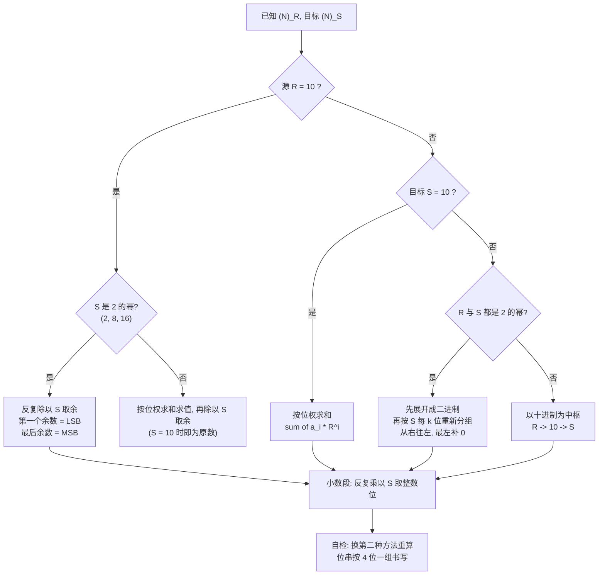

---
tags:
  - ECE2050
  - number-conversion
date: 2026-09-16
aliases:
  - 数制转换
  - 进制转换
  - Number Base Conversion
  - Base Conversion
  - Radix Conversion
---

> [!NOTE] Where this fits · 定位
> 第二章的**中枢技能**：前面几篇各自定义了一种进制，这一篇只讲它们之间的**翻译规则**。
> 后面全部内容（[[Bits and Bytes]] 的 nibble / byte、补码的手算、定点与浮点的小数位）
> 都默认你已能在 base-2 / 8 / 10 / 16 之间自由换算。
> 前置：[[Number Systems]]（位权通式 $(N)_R=\sum_i a_iR^i$）、[[Decimal Number System]]、
> [[Binary Number System]]、[[Octal Number System]]、[[Hexadecimal Number System]]。
> 讲义来源：p.10–13（二进制 ↔ 十进制）、p.15–20（八 / 十六进制与分组法）。

> [!SUMMARY] Quick recall · 英文速览
> Convert between bases by preserving the numeric value while changing the digit representation. Positional expansion, repeated division or multiplication, and binary grouping handle different cases.

## Core Definition · 核心定义

**数制转换 (number base conversion)** 就是把同一个**数值**用另一种基数的位权展开重新写一遍：
**数值不变，写法变**。$19_{10}$ 与 $10011_2$ 是同一个数的两种写法。

| 名字 | base | 数码 | 本库写法 |
|---|---|---|---|
| binary | 2 | `0` `1` | `1101 0110`、$(1101\,0110)_2$ |
| octal | 8 | `0`–`7` | $(547)_8$ |
| decimal | 10 | `0`–`9` | $(359)_{10}$ |
| hexadecimal | 16 | `0`–`9`、`A`–`F` | `0x28A`、$(28A)_{16}$ |

四个方向 = 四套算法，这是本篇的骨架：

1. **base-$R$ → decimal**：按位权求和（base-2 / 8 / 16 通用）。
2. **decimal → base-$R$**：法一"找最大的 $R$ 的幂相减"；法二"反复除以 $R$ 取余"。
3. **base-$2^k$ ↔ binary**：整体分组——八进制 **3 bit** 一组、十六进制 **4 bit** 一组。
4. **base-$R$ → base-$S$**（两边都不是十进制）：以 decimal 为**中枢 (pivot)** 绕一步。

- 下标不可省：同一串 `11` 在 base-2 是 3、base-8 是 9、base-16 是 17，必须写
  $(11)_2$、$(11)_8$、$(11)_{16}$ 消歧。
- 小数点 (radix point) 把数分成两段，两段算法**完全不同**：整数段"除以 $R$ 取余"，小数段"乘以 $R$ 取整"。

## Assumptions and Validity · 适用前提

> [!IMPORTANT] 三条前提，缺一条算法就失效
> ① 被转换的数必须是**位权制 (positional / weighted)** 的数——通式 $\sum_i a_iR^i$ 才成立；
> Gray code 这类非位权码没有"按位权求和"这回事（见 [[Number Systems]]）。
> ② 分组法只对 **base $=2^k$** 成立：$8=2^3$、$16=2^4$，所以 3 / 4 位一组可以；
> 十进制 $10\ne 2^k$，**不能**分组（把 $568_{10}$ 按 3 位切开毫无意义）。
> ③ 整数段一定转得完（反复除法必然到商 0）；**小数段可能永远转不完**——
> $0.1_{10}$ 的二进制是无限循环小数，只能取有限位。

- 适用范围：整数部分的转换是**精确恒等式**，不是近似；讲义 p.10–20 的全部例子都属此类。
- 失效边界：小数段不终止时必须声明截断位数与误差；位宽固定时还要保证结果放得下
  （放不下就是溢出，见 [[Binary Arithmetic]]）。

## Derivation · 推导过程

### ① base-$R$ → decimal：按位权求和

$$
(N)_R=\sum_i a_iR^i
\qquad\Longrightarrow\qquad
(N)_{10}=\sum_i a_i\times R^i
$$

- 意义：每一位的"面值" = 该位**数码 × 该位权**，各位面值相加就是数值。这是位权制的定义式，
  不需要任何技巧，只需要会算 $R^i$。
- 数值校验（三个进制各一例，讲义 p.10 / p.15 / p.16）：
  $(10011)_2=1\times16+0\times8+0\times4+1\times2+1\times1=19$ ✓；
  $(2374)_8=2\times512+3\times64+7\times8+4\times1=1024+192+56+4=1276$ ✓；
  $(E5)_{16}=14\times16+5\times1=224+5=229$ ✓（注意 $E=14$，不是 5 也不是 15）。

### ② decimal → base-$R$：为什么"第一个余数就是 LSB"

设 $N=a_{n-1}R^{n-1}+a_{n-2}R^{n-2}+\dots+a_1R+a_0$，两边对 $R$ 取余——除 $a_0$ 外每项都含因子 $R$：

$$
N \bmod R=a_0,
\qquad
\left\lfloor \frac{N}{R}\right\rfloor=a_{n-1}R^{n-2}+\dots+a_1
$$

- 意义：**一次除法就把最低位 (LSD) 挤出来**，商正好是"把 $N$ 右移一位"的结果；把商当新的 $N$
  重复，依次得到 $a_1,a_2,\dots$，所以**第一个余数是 LSB，最后得到的余数是 MSB**。
- 数值校验（$53_{10}\to$ 二进制，讲义 p.12）：$53=2\times26+\mathbf{1}$、$26=2\times13+\mathbf{0}$、
  $13=2\times6+\mathbf{1}$、$6=2\times3+\mathbf{0}$、$3=2\times1+\mathbf{1}$、$1=2\times0+\mathbf{1}$。
  余数按产生顺序是 $1,0,1,0,1,1$（LSB → MSB），**倒过来读**得 `110101`；
  回代 $1\times32+1\times16+0\times8+1\times4+0\times2+1=53$ ✓
- 同一题的**法一**（找最大的 $2$ 的幂相减）：$53-32=21$、$21-16=5$、$5-4=1$、$1-1=0$，
  用到的幂是 $32,16,4,1$ 即 $2^5,2^4,2^2,2^0$ → `110101` ✓。两种方法必须吐出**同一个串**。

### ②' 小数部分：反复乘以 $R$ 取整数位

设 $F=0.a_{-1}a_{-2}\dots$，则 $F\times R=a_{-1}+0.a_{-2}a_{-3}\dots$：乘 $R$ 把小数点右移一位，
**整数部分就是下一位小数位**，剩下的纯小数继续乘。

- 意义：整数段用除法"从 LSB 往上剥"，小数段用乘法"从 MSB 往右剥"，方向正好相反。
- 数值校验（$0.6875_{10}$，自算）：$0.6875\times2=\mathbf{1}.375$、$0.375\times2=\mathbf{0}.75$、
  $0.75\times2=\mathbf{1}.5$、$0.5\times2=\mathbf{1}.0$ → 取整得 $0.1011_2$；
  回代 $2^{-1}+2^{-3}+2^{-4}=0.5+0.125+0.0625=0.6875$ ✓（余数到 0，说明这次**转完了**）。

### ③ base-$2^k$ ↔ binary：分组即转换

因为 $8=2^3$、$16=2^4$，一个八进制位正好覆盖 3 个二进制位的**全部** $2^3=8$ 种组合，
十六进制位覆盖 $2^4=16$ 种。所以"一个 3-bit 组读出的十进制值"**就是**那一位八进制数码。

**整数部分从 binary point 向左每 $k$ 位一组，最左不足时补 0；小数部分从点向右分组，最右不足时补 0。**

- 意义：分组法把 $O(n)$ 次幂运算换成 $O(n/k)$ 次查表，这是八 / 十六进制便于阅读二进制位串的主要原因之一
  （讲义 p.22：压缩二进制）。
- 数值校验（讲义 p.20 原文例子）：$(1100\,1010\,0101\,0111)_2$ 按 4-bit 分组 $1100\to C$、
  $1010\to A$、$0101\to 5$、$0111\to 7$ → $CA57_{16}$；按 3-bit 分组（左侧补两个 0）$001\to1$、
  $100\to4$、$101\to5$、$001\to1$、$010\to2$、$111\to7$ → $145127_8$。
  两条路同值：`0xCA57` $=51799=$ `0o145127` ✓

![[base-conversion-grouping.svg]]
*图 1 — 同一串 16 位二进制 `1100 1010 0101 0111` 的两种读法：按 4 位分组得 `CA57`，
按 3 位分组（最左不足 3 位，补两个 0）得 `145127`。(b) 面板单独强调"最左一组补 0"——
本图只含整数，所以从右往左分组；小数部分应从点向右分组。*

### ④ base-$R$ → base-$S$：以 decimal 为中枢

任意 $R$ 到 $S$ 的转换可通过位权值、整数除法/小数乘法完成，也可在目标进制中直接累积。
这里选择 decimal 作为便于人工核算的中间表示，并非理论上必须先写成十进制：

$$
(N)_R \xrightarrow{\ \text{①按位权求和}\ } (N)_{10} \xrightarrow{\ \text{②反复除以 }S\ } (N)_S
$$

- 意义：十进制是所有进制的**通用接口 (pivot)**，这也是人类只需要一套十进制直觉的原因。
- 数值校验：$(7526)_8\to$ 十六进制。按位权求和：$7\times512+5\times64+2\times8+6=3584+320+16+6=3926$；
  再反复除以 16：$3926=16\times245+\mathbf{6}$、$245=16\times15+\mathbf{5}$、$15=16\times0+\mathbf{15}(F)$
  → 余数顺序 $6,5,F$ → $F56_{16}$ ✓
  捷径复核（两边都是 2 的幂，可直接分组）：$(7526)_8=$ `111 101 010 110`，重新按 4 位分组
  `1111 0101 0110` $=F56_{16}$ ✓。位权易错：$8^3=512$，$7\times512=3584$ 才是最高位的面值。

> [!TIP] 什么时候可以跳过十进制
> 只要 $R$ 与 $S$ **都是 2 的幂**，就可以先把 $R$ 展开成二进制、再按 $S$ 重新分组，完全不用碰十进制。
> $R$ 或 $S$ 里出现 10，就必须老老实实走中枢。

## Method and Steps · 求解步骤与方法

1. **先写下标**：源基数 $R$、目标基数 $S$ 各是多少？这一步能省掉一半错误。
2. **查表选算法**（见下面的流程图）：$R=10$ 用"除以 $S$ 取余"；$S=10$ 用"按位权求和"；
   两边都是 2 的幂用"分组"；其余情况"以十进制为中枢"。
3. **整数段**：反复除法，余数**按产生顺序 = LSB → MSB**，写完倒序读。
4. **小数段**：反复乘法，取整位按产生顺序就是第一位小数往后，直接顺序读；到余数为 0 或达到所需位数为止。
5. **收尾三查**：① 位串按 **4 位一组**书写；② 换第二种方法或转回源进制复核；③ 数位数
   （例如 $359<8^3$，八进制最多 3 位）。

## Worked Example · 例题

**Example 1 — $53_{10}\to$ 二进制（讲义 p.12，两种方法都要会）**

题目：把 $(53)_{10}$ 写成二进制。已知 $2^5=32\le53<64=2^6$，结果不超过 6 位。

解一（找最大的 $2$ 的幂相减）：$2^5=32$ 放得下 → $53-32=21$；$2^4=16$ 放得下 → $21-16=5$；
$2^3=8$ 放不下 → 该位 0；$2^2=4$ 放得下 → $5-4=1$；$2^1=2$ 放不下 → 该位 0；$2^0=1$ 放得下 → $1-1=0$。
位串：$2^5\,2^4\,2^3\,2^2\,2^1\,2^0=1\,1\,0\,1\,0\,1$ → `110101`。

解二（反复除以 2 取余）：$53/2=26$ 余 **1** → $26/2=13$ 余 **0** → $13/2=6$ 余 **1** →
$6/2=3$ 余 **0** → $3/2=1$ 余 **1** → $1/2=0$ 余 **1**。
余数按产生顺序是 `1 0 1 0 1 1`（LSB → MSB），**倒序读**得 `110101`。

**数值校验 (Numerical check)**：$1\times32+1\times16+0\times8+1\times4+0\times2+1=53$ ✓；
两种方法给出同一串 `110101` ✓；$2^5\le53<2^6$ 与"结果 6 位"一致 ✓。

**Example 2 — $359_{10}\to$ 八进制、$650_{10}\to$ 十六进制（讲义 p.17 / p.18）**

解：$359=8\times44+\mathbf{7}$、$44=8\times5+\mathbf{4}$、$5=8\times0+\mathbf{5}$ → 余数顺序 $7,4,5$
→ $(547)_8$；$650=16\times40+\mathbf{10}$、$40=16\times2+\mathbf{8}$、$2=16\times0+\mathbf{2}$
→ 余数顺序 $10,8,2$，其中 $10$ 写作 `A` → $(28A)_{16}$。

**数值校验 (Numerical check)**：$5\times64+4\times8+7=320+32+7=359$ ✓；
$2\times256+8\times16+10=512+128+10=650$ ✓；位数自检 $8^2\le359<8^3$ → 3 位八进制 ✓，
$16^2\le650<16^3$ → 3 位十六进制 ✓。

**Example 3 — 小数 $0.6875_{10}\to$ 二进制（自算）**

解（反复乘以 2 取整数位）：$0.6875\times2=1.375$ → 取整 **1**，余 $0.375$；
$0.375\times2=0.75$ → 取整 **0**，余 $0.75$；$0.75\times2=1.5$ → 取整 **1**，余 $0.5$；
$0.5\times2=1.0$ → 取整 **1**，余 $0$，**停止**。按顺序读：$0.1011_2$。

**数值校验 (Numerical check)**：$2^{-1}+2^{-3}+2^{-4}=0.5+0.125+0.0625=0.6875$ ✓；
第 4 步余数变成 0，说明该数在二进制下**有限**（分母 $16=2^4$）✓。
反例：$0.1_{10}$ 永远乘不到 0，只能截断——小数转换必须说明"取几位"。

**Example 4 — $(1101\,0110)_2$ 的三路复核**

解：**→ 十进制** $128+64+16+4+2=214$；**→ 十六进制**（4 bit 一组，从右往左）`1101`$=D$、`0110`$=6$
→ $D6_{16}$；**→ 八进制**（3 bit 一组，最左补 0）`011`$=3$、`010`$=2$、`110`$=6$ → $326_8$。

**数值校验 (Numerical check)**：$D6_{16}=13\times16+6=214$ ✓；$326_8=3\times64+2\times8+6=192+16+6=214$ ✓；
三条路给出同一个值 214，即 `0xD6` $=$ `0o326` $=$ `214` ✓。

## Pitfalls · 常见误区

> [!WARNING] 转换本身不难，翻车几乎都翻在"顺序"和"方向"上

1. **余数顺序写反**。错在：把 $53$ 的余数按产生顺序直接抄成 `101011`。
   正确：**第一个余数是 LSB**，要倒序读，答案是 `110101`。
   自检：按位权加回去，$101011_2=43\ne53$，一眼可见。
2. **分组方向搞错 / 忘记补 0**。错在：从左往右分组，或最左不足 3 位时不补 0。
   正确：$1100\,1010\,0101\,0111$ 的八进制是 $001|100|101|001|010|111=145127_8$；
   漏补 0 或分组错位会读出 `145227`（$=0xCA97=51863$，与 $0xCA57=51799$ **不是同一个数**）。
3. **对十进制也用分组法**。错在：把 $568_{10}$ 按 3 位切开。
   正确：分组法的依据是 $8=2^3$、$16=2^4$；$10$ 不是 2 的幂，十进制只能按位权或用除法。
4. **小数段也用除法**。错在：把 $0.6875$ 反复除以 2 去找小数位。
   正确：小数段必须**乘以** $R$ 并取整数部分；整数段才用除法取余。
5. **不写下标**。错在：写"11 就是 3"。正确：$(11)_2=3$、$(11)_8=9$、$(11)_{16}=17$。
6. **十六进制字母当十进制数字**。错在：算 $(E5)_{16}$ 时把 `E` 当成 5 或 15。
   正确：`A`–`F` 对应 $10$–$15$，$E=14$，所以 $(E5)_{16}=14\times16+5=229$。

## Conversion, encoding, and approximation · 转换、编码与近似

A radix conversion preserves the mathematical value. Changing an encoding, such as binary to BCD, preserves a specified semantic value but uses a different code structure. Truncating or rounding a fractional expansion can change the value. These three operations must not be described as if they were interchangeable.

A reduced rational fraction $p/q$ has a terminating base-$R$ expansion exactly when every prime factor of $q$ is also a prime factor of $R$. In binary, the reduced denominator must be a power of two. This explains why $3/8$ terminates and $1/10$ repeats. The denominator test is a mathematical criterion; it does not assume any particular computer format.

**Worked application — a repeating fraction.** 将 $0.2_{10}=1/5$ 转二进制，连续乘 2：0.4→0，0.8→0，1.6→1（留 0.6），1.2→1（留 0.2）。余数回到 0.2，故 $0.2=0.00110011\ldots_2$。保留 8 位并截断得 $0.00110011_2=51/256=0.19921875$，误差为 $0.00078125<2^{-8}$。

In English: the recurrence of the same fractional remainder proves repetition. Eight-bit truncation retains the first eight fractional bits and always rounds a nonnegative value downward. Rounding to nearest uses the omitted bits as well and has a different error bound.

**English exam question:** Why can an exact decimal fraction become an inexact binary fraction?

**Answer:** Termination depends on the radix. A denominator containing a factor of five cannot divide a power of two, so its binary expansion repeats. A finite binary register must then approximate it, even when the decimal notation is short.

Use this reasoning in [[Fixed-Point Numbers]] and [[Floating-Point Numbers]]. When reading [[VHDL Language and Modeling]], distinguish conversion of a type from a numeric resize or a change of scaling.

## Connections · 相关笔记

- 上游 (upstream)：[[Number Systems]] —— 位权通式 $\sum_i a_iR^i$ 与"位权制"这个前提都在这里。
- 上游 (upstream)：[[Decimal Number System]]、[[Binary Number System]] —— 转换的两端定义在这里。
- 上游 (upstream)：[[Octal Number System]]、[[Hexadecimal Number System]] —— 决定分组法的 $k=3$ / $k=4$。
- 下游 (downstream)：[[Bits and Bytes]] —— nibble / byte 就是"4 位 / 8 位一组"，$2^N$ 与范围直接读出。
- 下游 (downstream)：[[Binary Arithmetic]] —— 竖式要在同一个进制里做，结果常缩写成十六进制。
- 平行 (parallel)：[[Octal Number System]] 与 [[Hexadecimal Number System]] —— 只差分组宽度（3 vs 4 bit），
  最容易互相写串；两者的位权展开（本篇 ①②）与分组（本篇 ③）是两套不同的算法。

---
索引：[[ECE2050 Knowledge Tree]] · [[Glossary]]
