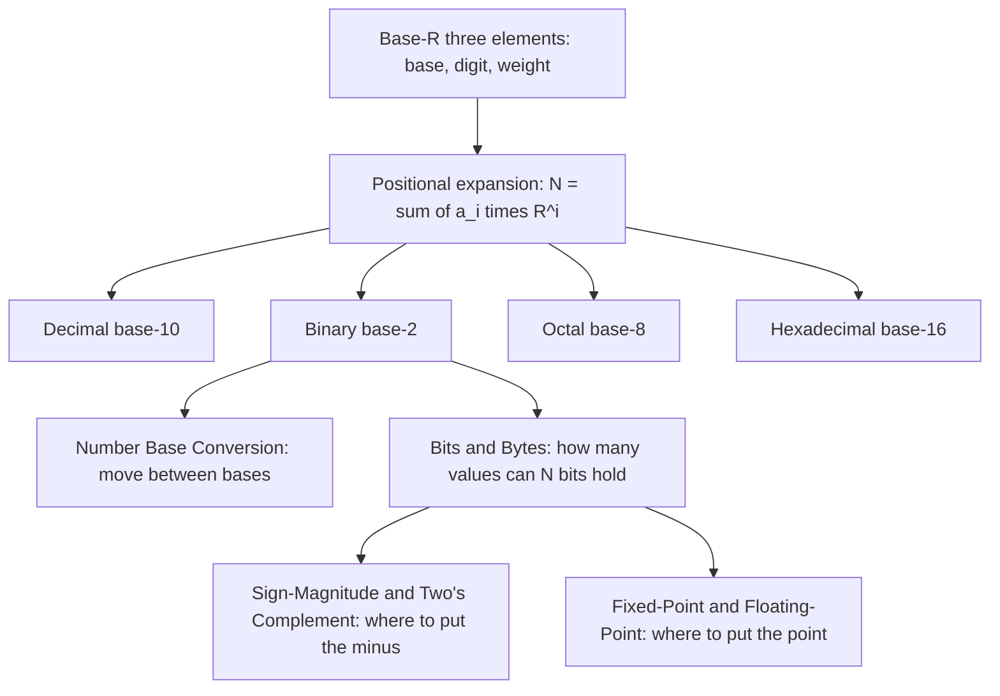

---
tags:
  - ECE2050
  - number-foundations
date: 2026-09-16
aliases:
  - 数制
  - 数制系统
  - 记数制
  - Number Systems
  - Number System
---

> [!NOTE] Where this fits · 定位
> 第二章的**入口篇**，只回答一个问题：一串符号凭什么能读出一个数值？答案是 **base-$R$ 三要素**
> （基数 base、数码 digit、位权 weight）。[[Decimal Number System]]、[[Binary Number System]]、
> [[Octal Number System]]、[[Hexadecimal Number System]] 都是它的四个实例；
> [[Number Base Conversion]] 负责它们之间的换算；本章后面所有内容（补码、定点、浮点、编码）
> 都建在"位串 = 加权和"这**一个**式子上。
> 前置：无（本课第一站，只需会十进制四则运算）。
> 下游：[[Number Base Conversion]]、[[Bits and Bytes]]、[[Two's Complement Representation]]。

> [!SUMMARY] Quick recall · 英文速览
> A positional number system is defined by its base, allowed digits, and place weights. The same value can have different digit strings in decimal, binary, octal, and hexadecimal.

## Core Definition · 核心定义

**数制 (number system)** 是"书写数字的体系"——讲义 p.3 的原话是 *a system of writing to express numbers*。
同一个数值可以用不同的体系写出来：

- 日常生活：base-10（长度、金额）、base-12（一打、钟面小时）、base-60（分秒、角度）。
  这些都是**历史约定，不是数学必然**（讲义 p.3：*Daily life: 10, 12, 60, …*）。
- 计算机系统：base-2 / base-8 / base-16（讲义 p.3），因为它们与二进制位恰好对齐。

**Base-$R$ 三要素**（讲义 p.5，必须逐条记住）：

| 要素 | 记号 | 约束 | base-10 | base-2 |
|---|---|---|---|---|
| 基数 (base / radix) | $R$ | $R \ge 2$ 的整数 | $R = 10$ | $R = 2$ |
| 数码 (digit) | $a_i$ | $a_i \in [0,\,R-1]$ | $0,1,\dots,9$ | $0,1$ |
| 位权 (weight) | $R^{i}$ | 第 $i$ 位整体乘 $R^{i}$ | $\dots 10^{2},\,10^{1},\,10^{0}$ | $\dots 2^{2},\,2^{1},\,2^{0}$ |

**通式 (positional expansion)**：一个有 $n$ 位整数、$m$ 位小数的 $R$ 进制数

$$
(N)_R \;=\; \sum_{i=-m}^{\,n-1} a_i R^{i}
\;=\; a_{n-1}R^{n-1} + \dots + a_1R^{1} + a_0R^{0} + a_{-1}R^{-1} + \dots + a_{-m}R^{-m}
$$

- **意义**：一个位串的数值 $=$ 每一位的（数码 $\times$ 位权）**之和**。位权只由**位置** $i$ 决定，
  与这一位写的是什么数码无关；数码只决定"这一份位权要不要、要几份"。
- **记号**：下标 $(\;)_{R}$ 用来标明基数，$(N)_{10}$ 可以省下标，其他场合**必须写**。
- **数值校验**（讲义 p.6）：$(568.23)_{10} = 5\times10^{2} + 6\times10^{1} + 8\times10^{0} + 2\times10^{-1} + 3\times10^{-2} = 500 + 60 + 8 + 0.2 + 0.03 = 568.23$ ✓

**小数点 (radix point)** 是 $i \ge 0$ 与 $i < 0$ 的分界：左边最低位的权是 $R^{0}=1$，
右边最高位的权是 $R^{-1}=1/R$。二进制下叫 **binary point**（见 [[Binary Number System]]）。

![[positional-weights.svg]]
*图 1 — (a) $(568.23)_{10}$ 每一位的位权：柱子的高度就是位权 $10^{i}$（对数刻度，所以每往右一位矮一截），
柱顶写着"数码 $\times$ 位权 $=$ 该位贡献"，五段贡献相加正好还原 568.23。(b) 同样的画法换成 base-2：
位权序列变成 $2^{1},2^{0},2^{-1},2^{-2},2^{-3}$，被点亮的位（$2^{1}$、$2^{-1}$、$2^{-3}$）相加 $= 2.625$；
空位（虚线柱，数码 0）**不是不存在的位置**，只是"这个位置上没有贡献"——这正是后面读二进制、读补码、
读定点数时共同的读法。*

## Assumptions and Validity · 适用前提

> [!IMPORTANT] 位权制 (positional / weighted) 与非位权制 (non-positional / non-weighted)
> 讲义 p.64 把数制分成两类，判据只有一句话：**符号的值是否由位置决定**。
> - **位权制**：值 $=\sum a_iR^{i}$，符号的价值随位置指数变化。十进制、二进制、八进制、十六进制都属于此类。
> - **非固定加权编码**：码字不能用一组固定位置权重直接相加得到所代表的数。
>   [[Gray Code]] 必须先按其转换规则解码；各位仍有不同的编码作用，并不是位置无关。
>   reflected binary Gray sequence 可首尾相邻，但不能把所有名为 cyclic code 的编码都当成 Gray code。
>
> 这个分界不是文字游戏：它决定了你**能不能用 $\sum a_iR^{i}$ 去算它**。看到 gray code 这类码字却套通式，
> 得到的数字没有任何意义。

- **基数必须 $R \ge 2$**：$R=1$ 只有数码 0，无法表示任意整数；$R=0$ 无意义。
- **数码必须在 $[0, R-1]$ 内**：`19` 不是合法的八进制串，`102` 不是合法的二进制串。
  越界数码说明"这串数字属于别的进制"，而不是"这个数制允许它"。
- **"decimal number" 不等于"带小数点的数"**：讲义 p.6 特意提醒
  *decimal numbers mean any base 10 numbers, not just those with a decimal point*。
  $568$ 是 decimal number，$568.23$ 也是；判断依据是**基数 $=10$**，不是"有没有小数点"。
- **失效边界**：通式只描述"值"；它不描述**位宽**（几位）、不描述**符号**（负数怎么写）、
  也不描述**小数点的位置约定**。这三件事分别由 [[Bits and Bytes]]、
  [[Sign-Magnitude Representation]] / [[Two's Complement Representation]]、
  [[Fixed-Point Numbers]] 负责——本课程把它们一层层加上去。

## Derivation · 推导过程

### 1. 从"位置决定倍率"推出通式

把"位权制"这个想法写成式子只需要三步：

1. **定位置编号**：小数点左边第 0 位（最右的整数位）权为 $R^{0}=1$；往左每移一位指数 $+1$，
   往右每移一位指数 $-1$。于是 $n$ 位整数 $+$ $m$ 位小数一共用到指数 $i = n-1,\dots,1,0,-1,\dots,-m$。
2. **定每一份的量**：第 $i$ 位的一份就是 $R^{i}$，写上数码 $a_i$ 就表示拿了 $a_i$ 份，即 $a_iR^{i}$。
3. **求和**：把每一份加起来，得到 $(N)_R=\sum_{i=-m}^{n-1} a_iR^{i}$。

- 意义：这是一个**齐次加权和**——每一个位置只贡献自己的那一份，位置之间没有耦合。
  正因为如此，"换基数"才可以逐位/逐组进行（见 [[Number Base Conversion]] 的分组法）。
- 数值校验（用 binary point 检验指数编号）：$(10.101)_2$ 中从左到右的指数应为 $1,0,-1,-2,-3$，
  代入得 $1\times2 + 0\times1 + 1\times0.5 + 0\times0.25 + 1\times0.125 = 2.625$ ✓（讲义 p.7 同值）。

### 2. 同一串数字，不同基数就是不同的数

通式里 $R$ 是自由参数，所以**同一串符号在不同基数下是不同数值**。以 `1011` 为例：

| 记号 | 展开 | 数值 |
|---|---|---|
| $(1011)_2$ | $1\times8 + 0\times4 + 1\times2 + 1\times1$ | $11$ |
| $(1011)_8$ | $1\times512 + 0\times64 + 1\times8 + 1\times1$ | $521$ |
| $(1011)_{16}$ | $1\times4096 + 0\times256 + 1\times16 + 1\times1$ | $4113$ |

- 意义：**没有下标就没有数值**。三位数字完全一样，结果差了 374 倍（$4113/11$）。
- 数值校验：$512+8+1=521$ ✓；$4096+16+1=4113$ ✓（用 Python 复核：`int('1011',2)=11`、
  `int('1011',8)=521`、`int('1011',16)=4113`）。
- 位权下滑的速度也不同：base-10 每往右一位"矮"到 $1/10$，base-2 只"矮"到 $1/2$。
  这就是图 1(a) 与图 1(b) 两条阶梯斜率不同的原因，也是"二进制写起来长"的根源。

### 3. 位宽与范围：全章导航表

通式只给"值"，不给"能表示多少"。$N$ 位能装下多少个不同的位串，取决于**怎么解释最高位**：

| 位宽 $N$ | 无符号 unsigned $[0,\,2^{N}-1]$ | 原码 sign-magnitude $[-(2^{N-1}-1),\,2^{N-1}-1]$ | 补码 two's complement $[-2^{N-1},\,2^{N-1}-1]$ |
|---|---|---|---|
| 4 | $[0,\,15]$ | $[-7,\,7]$ | $[-8,\,7]$ |
| 8 | $[0,\,255]$ | $[-127,\,127]$ | $[-128,\,127]$ |
| 16 | $[0,\,65535]$ | $[-32767,\,32767]$ | $[-32768,\,32767]$ |
| 32 | $[0,\,4294967295]$ | $[-2147483647,\,2147483647]$ | $[-2147483648,\,2147483647]$ |

- 意义：**同样的 $N$ 位，三种解释方式覆盖三段不同的范围**；位数决定"有多少个码字"，解释方式决定"码字怎么映射到数"。
- 数值校验（$N=8$）：$2^{8}=256$ 个码字；无符号 $[0,255]$；原码 $\pm(2^{7}-1)=\pm127$；
  补码下界 $-2^{7}=-128$。三者都是 256 个码字，只是分配方式不同 ✓。
- 阅读顺序：位宽与容量 $\to$ [[Bits and Bytes]]；负号怎么放 $\to$ [[Sign-Magnitude Representation]]、
  [[Two's Complement Representation]]；小数点怎么放 $\to$ [[Fixed-Point Numbers]]、[[Floating-Point Numbers]]。

## Method and Steps · 求解步骤

拿到任意一串带下标（或已约定基数）的符号，按下面五步读值：

1. **确认基数 $R$**：看下标；没有下标就按上下文（本题默认十进制）。
2. **检查数码合法性**：每一位都必须落在 $[0, R-1]$ 内，否则这串符号在该进制下非法。
3. **给每一位编号**：以小数点为界，向左 $i = 0,1,2,\dots$，向右 $i = -1,-2,\dots$。
4. **逐位写"数码 $\times$ 位权"**，注意**不要漏掉数码为 0 的位置**（它们贡献 0，但占着位权）。
5. **求和并回代校验**：把结果与量级估计对一下（位数 $\times$ 最高位权是上界）。

> [!TIP] 三秒钟估个量级
> 一个 $n$ 位整数的数量级大约由最高位权 $R^{n-1}$ 决定：$(1011)_2$ 不超过 $2^{4}=16$，$(1011)_{16}$
> 不超过 $16^{4}=65536$，$(1011)_{8}$ 不超过 $8^{4}=4096$。心算出的结果如果比上界还大，一定是位权写错了。

## Worked Example · 例题

**Example 1 — 按位权展开 $(568.23)_{10}$（讲义 p.6）**

题目：把 $(568.23)_{10}$ 写成各路位权贡献之和。

解：
1. 整数部分 $568$，小数部分 $23$，小数点在 $8$ 与 $2$ 之间。
2. 逐位写：$5\times10^{2} + 6\times10^{1} + 8\times10^{0} + 2\times10^{-1} + 3\times10^{-2}$。
3. 化简每一份：$500 + 60 + 8 + 0.2 + 0.03$。

**数值校验 (Numerical check)**：$500+60+8+0.2+0.03 = 568.23$ ✓，与 $2^{-1}=0.5$、$10^{-2}=0.01$ 的
位权定义一致（$2\times0.1=0.2$、$3\times0.01=0.03$）。

**Example 2 — 同一串 `1011` 在三种基数下分别是多少**

题目：分别求 $(1011)_2$、$(1011)_8$、$(1011)_{16}$。

解：
1. base-2：$1\times8 + 0\times4 + 1\times2 + 1\times1 = 8+2+1 = 11$。
2. base-8：$1\times512 + 0\times64 + 1\times8 + 1\times1 = 512+8+1 = 521$。
3. base-16：$1\times4096 + 0\times256 + 1\times16 + 1\times1 = 4096+16+1 = 4113$。

**数值校验 (Numerical check)**：用 Python 复核 `int('1011',2) = 11`、`int('1011',8) = 521`、
`int('1011',16) = 4113` ✓。三个结果的数量级都低于各自的最高位权（$16$、$8^{4}=4096$、$16^{4}=65536$）✓。
结论：**同一串符号 + 不同下标 = 不同的数**，这也是本库把下标写死的理由。

**Example 3 — 判断一串符号属于哪个数制（合法性检查）**

题目：`2374`、`19`、`1011` 这三个串，哪些能当八进制读？

解：
1. `2374`：四位都是 $0$–$7$ ✓，可以读作 $(2374)_8$。
2. `19`：出现数码 $9 > 8-1 = 7$ ✗，不可能是八进制（也不可能是二进制）。
3. `1011`：只有 $0$ 和 $1$，八进制、二进制、十六进制都合法——**必须靠上下文或下标消歧**。

**数值校验 (Numerical check)**：$(2374)_8 = 2\times512 + 3\times64 + 7\times8 + 4\times1 = 1024+192+56+4 = 1276$ ✓
（讲义 p.15 同值）。而 `19` 若按十进制读是 19，按十六进制读是 $1\times16+9=25$——正因为合法，
才更需要下标。

## Pitfalls · 常见误区

> [!WARNING] 本章后面 17 篇笔记的绝大多数错误，最初都源于下面这几条

1. **不写下标**。错在：写"$1011 = 11$"就交卷。正确做法：只要基数不是 10（或不是题面默认），
   一律写 $(1011)_2$；本库正文里的二进制/十六进制常量也一律带下标或 `0x` 前缀。
2. **把数码当数值**。错在：看到 $(1011)_2$ 里的 `1` 就当成 1。正确做法：那个 `1` 代表 $2^{3}=8$，
   数值由**位置**决定；同一位上写 `0` 时贡献为 0，但位置本身仍然存在（图 1 里的虚线柱）。
3. **越界数码仍然照算**。错在：把 `19` 当八进制展开成 $1\times8+9$。正确做法：先做合法性检查，
   数码 $\ge R$ 就说明基数判断错了。
4. **把"decimal number"理解成"带小数点的数"**。错在：认为 568 不是 decimal number。
   正确：decimal 说的是**基数 10**（讲义 p.6）。
5. **对非位权码套用通式**。错在：把 gray code 的 `1100` 当二进制算出 12。正确：gray code 是
   非位权码（讲义 p.64），它的位串是码字不是加权和，见 [[Gray Code]]。
6. **以为"位数越多越精确"**。错在：忽略"位宽决定范围、约定决定含义"这两件事是分开的。
   正确：$N$ 位只有 $2^{N}$ 个码字，能表示什么完全取决于如何解释（表 3 的三种解释）。

## Representation choices · 表示法与英文理解

A base tells you how positional weights grow; an encoding tells you what a bit pattern means. These are separate decisions. The string `10000010` is not enough to determine a value until the problem states whether it is unsigned, two's complement, sign-magnitude, or biased. A stored pattern has no intrinsic signedness.

Biased representation stores an offset from the value. If the unsigned stored integer is $u$ and the bias is $B$, then

$$u=x+B,\qquad x=u-B.$$

Here $B$ is a specified integer offset, not a sign bit. For an unrestricted $N$-bit biased integer encoding, the range is $[-B,2^N-1-B]$. A floating-point exponent can use the same mechanism while reserving some field values for special purposes. Therefore the range of a general biased integer must not be copied blindly into IEEE 754.

**Worked application — decode before calculating.** 8 位偏移码 bias $B=63$，码字 `10000010`。先按无符号位权读 $u=128+2=130$，再减偏移：$x=130-63=67$。同一码字若按 8 位补码读，则 $130-256=-126$。差别来自表示规则，不是计算器出错。回代 $67+63=130$，恢复原码字。

**English exam question:** An eight-bit biased system has bias 63. What does `10000010` represent, and what is its range?

**Answer:** The stored unsigned integer is 130. Subtracting the bias gives 67. With all 256 codes available, values range from $0-63=-63$ to $255-63=192$. The most significant bit must not be interpreted as a two's-complement sign bit.

When revising, explain one pattern in at least two encodings. This trains the distinction between a number, its representation, and the width of its container. Follow [[Floating-Point Numbers]] for biased exponents, [[State Encoding and Unused States]] for semantic state codes, and [[Memory Arrays and Expansion]] for storage organization.

## Connections · 相关笔记

- 下游 (downstream)：[[Decimal Number System]] —— base-10 实例，也是人机之间的接口语言。
- 下游 (downstream)：[[Binary Number System]] —— base-2 实例，数字系统的内部语言。
- 下游 (downstream)：[[Octal Number System]]、[[Hexadecimal Number System]] —— 二进制的"压缩写法"。
- 下游 (downstream)：[[Number Base Conversion]] —— 把通式反过来用，从数值求位串。
- 下游 (downstream)：[[Bits and Bytes]] —— 位宽 $N$ 决定容量 $2^{N}$ 与范围 $[0,2^{N}-1]$。
- 平行 (parallel)：[[Gray Code]] —— 非位权制的代表，与"位权"这套语言正好相反。
- 平行 (parallel)：[[Two's Complement Representation]] —— 把最高位的位权改成负的 $-2^{N-1}$，
  就得到补码；它是"位权"思想最漂亮的一次推广。

---
索引：[[ECE2050 Knowledge Tree]] · [[Glossary]]
