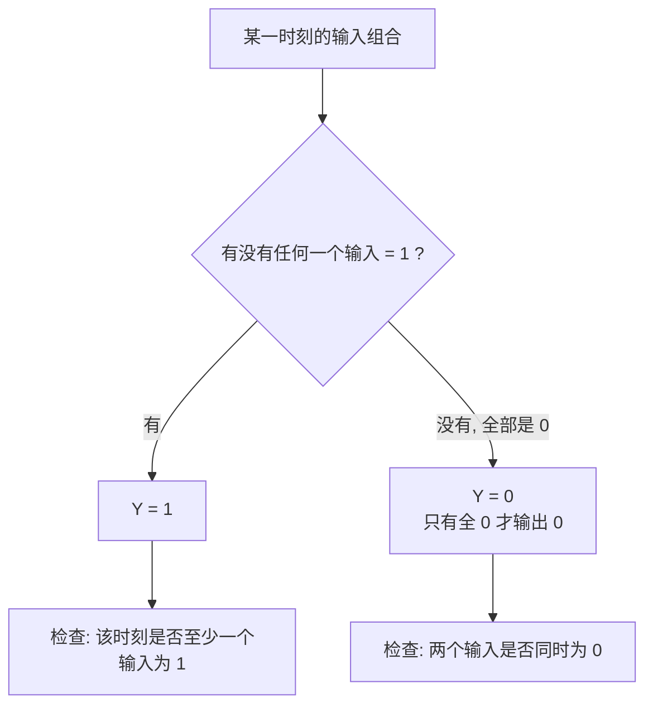

---
tags:
  - ECE2050
  - logic-gates
date: 2026-09-16
aliases:
  - 或门
  - OR 门
  - OR Gate
  - OR Operation
---

> [!NOTE] Where this fits · 定位
> [[AND Gate]] 的**对偶门 (dual)**：AND 要求"全部为 1"，OR 只要"有一个为 1"。
> 前置：[[Logic Gates]]（分类与三种描述方式）、[[Inverter]]（取反记号）。
> 下游：[[NOR Gate]]（OR + 气泡）、[[Exclusive-OR Gate]]（"有 1 就 1" 与 "奇数个 1" 的分水岭）、
> [[Sum-of-Products Form]]（SOP 的最外层运算就是 OR）。
> 讲义来源：p.7（定义与 Inputs $\ge2$）、p.12（两输入门总表中的 OR）、p.25（T/F 自测第 3 题）。

> [!SUMMARY] Quick recall · 英文速览
> An OR gate outputs 1 when at least one input is 1. Boolean OR is inclusive: two high inputs still produce a single high output.

## Core Definition · 核心定义

**或门 (OR gate)** 只要**任一输入为 1**，输出就为 1；只有**全部输入为 0** 时才输出 0：

$$Y=A+B \qquad(\text{读作 } A \text{ OR } B)$$

- 输入个数 $\ge2$（讲义 p.7，与 AND 相同）。
- 这里的 "$+$" 是**布尔加 (logical OR / Boolean sum)**，不是算术加：
  $1+1=1$，**没有进位**，也不会等于 2（对照 [[Binary Arithmetic]] 的 $1+1=10_2$，那是算术加）。
- 符号：**弧形（弯背 + 尖头）**；IEEE 矩形符号在框内写 `>=1`，意思是"1 的个数 $\ge1$"。

两输入真值表（4 行 $=2^2$，讲义 p.12）：

| $A$ | $B$ | $Y=A+B$ |
|---|---|---|
| 0 | 0 | 0 |
| 0 | 1 | 1 |
| 1 | 0 | 1 |
| 1 | 1 | 1 |

![[ch3-two-input-gates.png]]
*图 1 — 讲义 p.12 原图：两输入门总表。**OR 在总表第二列**：弧形符号、$Y=A+B$、
4 行真值表里**只有第一行 $00$ 输出 0**。把它与左列 AND 逐行对比：两列恰好互为"镜像"——
AND 只有 1 行是 1，OR 只有 1 行是 0。*

## Assumptions and Validity · 适用前提

> [!IMPORTANT] "任一为 1 就为 1"的关键，在**唯一那一行 0**
> OR 的 $2^n$ 行里只有**全 0** 那行输出 0，其余 $2^n-1$ 行全是 1。
> 所以"某个输入是 0"根本不是输出为 0 的理由——这就是讲义 p.25 T/F 第 3 题设的陷阱：
> *If any input to an OR gate is zero, the output is zero* → **False**（反例：$A=0,B=1\Rightarrow Y=1$）。

- 输入个数 $\ge2$；$n$ 个输入写作 $Y=A+B+C+\cdots$，行数仍是 $2^n$，**只有全 0 行是 0**。
- 布尔加与算术加的唯一差别出现在 $1+1$：布尔 $1+1=1$，算术 $1+1=10_2$。
  也就是说"或"是**饱和**的——再怎么加也不会超过 1。
- 理想门假设与 [[Logic Gates]] 一致：延迟为 0、输出只有 0/1 两个电平、扇出无限。
- 失效边界：输入悬空时判据失效（悬空既不是 1 也不是 0）；多输入 OR 的"1 很多"并不意味着输出会"更强"，
  输出永远只是 0 或 1 两个值。

## Derivation · 推导过程

### ① 从"任一为 1"导出 4 行真值表

| 行 | $A$ | $B$ | 判断 | $Y$ |
|---|---|---|---|---|
| 1 | 0 | 0 | 没有一个是 1 | 0 |
| 2 | 0 | 1 | $B=1$，条件成立 | 1 |
| 3 | 1 | 0 | $A=1$，条件成立 | 1 |
| 4 | 1 | 1 | 两个都是 1，条件更成立 | 1 |

- 意义：**输出为 0 的行只有 1 行**（全 0 那行），输出为 1 的行有 $2^n-1$ 行——这是 OR 的"指纹"。
- 数值校验：4 行 $=2^2$ ✓；1 行为 0、$2^2-1=3$ 行为 1 ✓；
  用 $A+B$ 重算输出列得 $0,1,1,1$ ✓（注意第 4 行是 $1+1=1$，不是 2）。

### ② $n$ 输入推广：$Y=A+B+C+\cdots$，行数 $2^n$，只有全 0 行是 0

- 意义："有 1 就 1"在 $n$ 个输入下不变，只是或项变长；真值表按 $2^n$ 行、二进制顺序排。
- 数值校验：三输入 OR3 共 $2^3=8$ 行，只有 $000$ 一行输出 0，其余 $8-1=7=2^3-1$ 行输出 1 ✓；
  四输入 OR4 是 $2^4=16$ 行、15 行输出 1 ✓——行数与 OR 的"1 的行数"都随 $n$ 变化，
  但"**0 的行数恒为 1**"这条性质不变 ✓。

### ③ 对偶性：AND 的"零元"与 OR 的"壹元"

把 $0$、$1$ 与 AND、OR 互换，两条式子是**对偶**的：

$$A\cdot 0=0 \quad(\text{AND 被 0 门控}) \qquad\leftrightarrow\qquad A+1=1 \quad(\text{OR 被 1 强制拉高})$$

- 意义：AND 里那个"说了算"的输入值是 0，OR 里是 1；所以 AND 做**掩码清零**、OR 做**置位 (set)**。
- 数值校验：$A=0$ 时 $0\cdot0=0$、$0+1=1$；$A=1$ 时 $1\cdot0=0$、$1+1=1$ ✓——
  无论 $A$ 取什么，$A\cdot0$ 恒为 0、$A+1$ 恒为 1，与真值表逐行一致 ✓（Ch4 会有完整的定律表 [[Laws and Rules of Boolean Algebra]]）。

### ④ 时序图怎么读

- 方法：**先把两个输入为 0 的时间段找出来**，只有这些时间段 Y 才是 0；
  其余任何一段（哪怕只有一个输入是 1）Y 都是 1。
- 图 2 用的是与 [[AND Gate]] 完全相同的一组 A / B 波形，唯一变化的是输出：AND 只取"同时为 1"的重叠段，
  OR 取"至少一个为 1"的全部时间段——把两张图叠起来看，OR 的 1 区间正好覆盖 AND 的 1 区间。

![[or-gate-timing.svg]]
*图 2 — OR 的时序图：A 在 $10\sim40$ ns 为 1、B 在 $20\sim60$ ns 为 1，输出 Y 从 $10$ ns 一直保持到
$60$ ns 为 1——$10\sim20$ ns 只有 A 是 1、$40\sim60$ ns 只有 B 是 1，都足以让 Y 为 1（绿色带）。
只有 $0\sim10$ ns 与 $60\sim80$ ns 两段（两个输入都是 0）Y 才为 0，浅红色带与带下短标签标出的正是这两段。*

## Method and Steps · 求解步骤与方法

1. **数输入个数 $n$**（必须 $\ge2$），把真值表 $2^n$ 行按二进制顺序写满。
2. **填输出列**：只有"全 0"那一行写 0，其余全部写 1。
3. **写表达式**：把各输入相加，$Y=A+B$（三输入 $Y=A+B+C$），并提醒自己 $1+1=1$。
4. **读 / 画时序图**：找出两个输入**同时为 0** 的时间段，这些段 Y 为 0；其余时间 Y 全为 1。
5. **自检**：输出为 0 的行数是不是正好 1 行？行数是不是 $2^n$？表达式里的"+"没有进位吧？

## Worked Example · 例题

**Example 1 — 讲义 p.12 的 OR 列 + p.25 陷阱题判定**

题目：(a) $A,B$ 按 $00,01,10,11$ 排列，写出 OR 输出；(b) 判断讲义 p.25 第 3 题
*If any input to an OR gate is zero, the output is zero* 的真假并给出反例。

解：(a) 只有 $00$ 行输出 0，其余三行输出 1：`0,1,1,1`。
(b) 该命题**为假**——"某个输入为 0"只是必要条件之一，只有**所有**输入都为 0 才输出 0。

**数值校验 (Numerical check)**：反例取 $A=0,B=1$，按定义 $Y=A+B=0+1=1\ne0$，命题被推翻 ✓；
再逐行核对 4 行：$0+0=0$、$0+1=1$、$1+0=1$、$1+1=1$ ✓——4 行里 3 行为 1，与"只有 1 行为 0"一致 ✓。

**Example 2 — 三输入 OR3（自算，与讲义 p.13 的 AND3 / XOR3 同一种行序）**

题目：$Y=A+B+C$，输入按二进制顺序取 $000\sim111$，求 8 行输出。

解：只有 $000$ 行三个输入全为 0，输出 0；其余 7 行输出 1。

**数值校验 (Numerical check)**：行数 $2^3=8$ ✓；输出为 0 的行数 $1$ ✓，为 1 的行数 $8-1=7=2^3-1$ ✓；
逐行重算：$000\to0$；$001,010,011,100,101,110,111$ 各有至少一个 1，全部为 1 ✓。
与讲义 p.13 的 AND3（只有 $111\to1$，1 行是 1）对照：两者的"1 的行数"分别是 7 与 1，
相加 $7+1=8$，正好把 8 行分完 ✓——这两个门在同一张表上是互补的。

**Example 3 — 布尔加 ≠ 算术加（自算）**

题目：分别用布尔加与算术加计算 $1+1$、$1+1+1$，并说明差别。

解：布尔加 $1+1=1$、$1+1+1=1$（OR 是"有没有 1"，不是"有几个 1"）；
算术加 $1+1=10_2$、$1+1+1=11_2$（有进位，见 [[Binary Arithmetic]]）。

**数值校验 (Numerical check)**：用真值表反查：$A=1,B=1$ 时 $Y=A+B=1$ ✓，与 $1+1=1$ 一致；
三输入时 $111$ 行 $Y=1$ ✓，而算术结果是 $3_{10}=11_2$——如果 OR 的 $+$ 也按算术进位，
$111$ 行就会得到 3，而 OR 的输出只能是 0 或 1，矛盾 ✓。
所以布尔式 $Y=A+B$ 里的 "$+$" 只表示 OR，与 [[Binary Arithmetic]] 的加法符号必须分清。

## Pitfalls · 常见误区

> [!WARNING] OR 有两个高频陷阱：一个是"某个输入为 0"，一个是"$+$"

1. **讲义 p.25 T/F 第 3 题**：*If any input to an OR gate is zero, the output is zero* → **False**。
   正确：只有**全部**输入为 0 时输出才为 0；反例 $A=0,B=1\Rightarrow Y=1$。
2. **把 OR 与 XOR 混为一谈**。错在：认为"有 1 就 1"对两个门都成立。
   正确：OR 是 $1+1=1$，XOR 是 $1\oplus1=0$（要**奇数个** 1）——差别恰好出现在两个输入都为 1 的那一行。
3. **把布尔加的 $1+1=1$ 按算术算成 2 或 $10_2$**。正确：布尔运算的结果只能是 0 或 1，
   没有进位、不会进位、也不会"溢出"。
4. **三输入 OR 只写 4 行**。正确：$n$ 个输入 $\Rightarrow2^n$ 行；OR3 是 8 行，其中 7 行是 1。
5. **把 OR 说成"全 1 才 1"**。那是 [[AND Gate]]；OR 与 AND 互为**对偶 (dual)**：
   把 $Y=A\cdot B$ 里的 AND 换成 OR、$0$ 换成 $1$、$1$ 换成 $0$，就得到 $Y=A+B$
   （Ch4 的公理对偶性 [[Boolean Axioms]] 讲的就是这个）。真值表层面用 DeMorgan 也能验证：
   $\overline{\bar A\cdot\bar B}=A+B$——把 AND 的两个输入和输出全部取反，就是 OR。
6. **以为"输入越多输出越大"**。正确：多输入只是让"全 0"这一种情形更难出现，
   输出值域始终是 $\{0,1\}$——$2^n$ 行里永远只有 1 行是 0。

## Inclusive OR in specifications · 题目中的包含或

Logical OR is inclusive: any one TRUE input is sufficient, and multiple TRUE inputs are also allowed. Natural-language “or” can be ambiguous, so an exam specification containing “exactly one” requires XOR-like behavior rather than ordinary OR. “At least one” requires OR.

OR combines Boolean conditions, not physical output pins. Two gate outputs wired together do not implement an OR function when they are ordinary push-pull drivers. A defined OR gate has separate inputs and one output driver. Special shared-bus arrangements need their own electrical model and enable protocol.

**Worked application — alarm aggregation.** smoke、overheat、manual=1 各表示报警条件，$A=smoke+overheat+manual$。输入 110 表示两种故障同时发生，A=1，应持续报警。若误用三输入 XOR，110 中两个 1 得输出 0，恰好在双故障时撤销报警。枚举 000、100、110、111，OR 输出 0、1、1、1；XOR 为 0、1、0、1。

In English: when simultaneous causes should reinforce an action, count-free Boolean OR is appropriate. It reports whether the set of asserted causes is nonempty; it does not report how many causes are present.

**English exam question:** Why is $1+1=1$ valid in Boolean algebra but not in binary integer arithmetic?

**Answer:** In a Boolean expression “+” denotes OR, so two TRUE conditions still produce TRUE. Integer addition produces the value two, represented as `10` in binary with a carry. The same written symbol denotes different operations in the two contexts.

Compare [[Exclusive-OR Gate]], [[Boolean Equation]], and [[Half Adder and Full Adder]]. For physical sharing, follow [[Tri-State Buffers and Bus Drivers]].

## Connections · 相关笔记

- 上游 (upstream)：[[Logic Gates]] —— 门的分类、$2^n$ 行规则与三种描述方式。
- 上游 (upstream)：[[Inverter]] —— 气泡与取反记号；NOR 就是"OR 加一个气泡"。
- 下游 (downstream)：[[NOR Gate]] —— $Y=\overline{A+B}$，本篇的真值表逐行取反即得。
- 下游 (downstream)：[[Exclusive-OR Gate]] —— 与 OR 只差 $11$ 那一行，是高频混淆点。
- 下游 (downstream)：[[Sum-of-Products Form]]（Ch4）—— SOP 的最外层运算就是 OR（各乘积项相加）。
- 平行 (parallel)：[[AND Gate]] —— 对偶门，两篇的时序图共用同一组 A / B 波形，最好并排看。
- 平行 (parallel)：[[Binary Arithmetic]] —— 算术加的 $1+1=10_2$ 与本篇的布尔加 $1+1=1$ 必须分清。

---
索引：[[ECE2050 Knowledge Tree]] · [[Glossary]]
