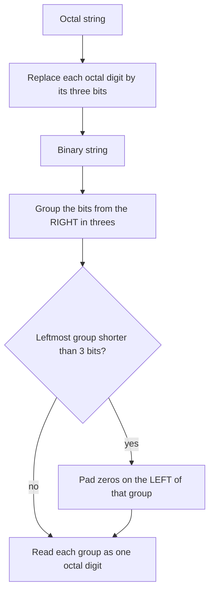

---
tags:
  - ECE2050
  - number-bases
date: 2026-09-16
aliases:
  - 八进制
  - 八进制数制
  - Octal
  - Octal Number System
  - Base-8
---

> [!NOTE] Where this fits · 定位
> 八进制是二进制的**第一层压缩写法**：$8=2^{3}$，所以**1 个八进制位恰好等于 3 个二进制位**，
> "看 3 位、写 1 位"就是换算的全部。它在本章里的实战价值只有一个，但非常大——
> **Linux 文件权限 `rwx` 就是三位一组的八进制**（`chmod 755`），讲义 p.22 把它点名为八进制的典型用途。
> 前置：[[Number Systems]]（三要素）、[[Binary Number System]]（$2^{i}$ 位权与分组思路）。
> 下游：[[Number Base Conversion]]、[[Bits and Bytes]]、[[Hexadecimal Number System]]（4-bit 版本）。

> [!SUMMARY] Quick recall · 英文速览
> Octal is base 8 and uses digits 0 through 7. Each octal digit corresponds to three binary bits, which also explains its use in Unix permission notation.

## Core Definition · 核心定义

**八进制数制 (octal number system / base-8)** 的三要素（讲义 p.15）：

| 要素 | 取值 |
|---|---|
| 基数 (base) | $R = 8$ |
| 数码 (digit) | $0,1,2,3,4,5,6,7$（共 8 个，**没有 8 和 9**） |
| 位权 (weight) | $\dots 8^{2},\;8^{1},\;8^{0}\;.\;8^{-1},\;8^{-2},\;8^{-3}\dots$ |

位权的具体值（后面每一步都会用到）：

$$
\dots,\;8^{4}=4096,\;8^{3}=512,\;8^{2}=64,\;8^{1}=8,\;8^{0}=1,\;8^{-1}=0.125,\;8^{-2}=0.015625,\dots
$$

- **意义**：八进制的位权同样是 $R^{i}$（[[Number Systems]] 的通式），只是每往左一位**乘 8**，
  比二进制（乘 2）快、比十进制（乘 10）慢。
- **数值校验**（讲义 p.15）：$(2374)_8 = 2\times512 + 3\times64 + 7\times8 + 4\times1 = 1024+192+56+4 = 1276$ ✓（逐步展开见推导第 1 节）

**书写惯例**：本库正文用下标 $(\;)_{8}$ 标明八进制；C / Java / Python 里八进制字面量写成前导 `0`
（如 `0644`、`0755`），另有 `0o644` 这种更现代的写法。**前导 0 是"这是八进制"的标记，不是补位。**

![[linux-file-permissions.svg]]
*图 1 — 三位一组的八进制实战（Linux 文件权限）。上半部分是 `644` / `755` / `754` 三个例子：
每个八进制数字正对着**三个二进制位**，三个位自上而下依次对应 `r`(read, 权 4)、`w`(write, 权 2)、
`x`(execute, 权 1)，所以 1 个八进制数字就是一组 `rwx`；数字下面标出它的 $4/2/1$ 分解
（$6=4+2$、$7=4+2+1$、$5=4+1$）。下半部分给出 **0–7 与 `rwx` 的完整对照表**——
这正是 3 bit 能表示的全部 8 种组合，也是"1 个八进制位 $=$ 3 bit"最直接的证据。*

## Assumptions and Validity · 适用前提

> [!IMPORTANT] 为什么八进制能"分组即换算"？因为 $8 = 2^{3}$
> 八进制和十六进制的换算之所以不需要乘除，只有一条理由：**基数是 2 的整数次幂**。
> 对八进制有
> $$8^{1} = 2^{3} \;\Longrightarrow\; \text{1 个八进制位} \;\equiv\; \text{3 个二进制位}$$
> 于是一串二进制 `111 101 010 110` 可以**直接**被读成八进制 $7526$：
> 每 3 个二进制位内部是一个 $0\dots7$ 的三位二进制数，它的值就正好等于对应的八进制数字
> （$111_2 = 7$、$101_2 = 5$、$010_2 = 2$、$110_2 = 6$）。**分组不改变数值，只是换了写法。**
>
> 反过来，如果基数的关系不是乘方（例如十进制与二进制、八进制与十六进制），就**不能分组**，
> 必须走"按位权求和"或"反复除法"，见 [[Number Base Conversion]]。

- **存在理由（讲义 p.22）**：二进制太长、太难校对，于是用"a more convenient/compact way to
  represent large binary numbers"来压缩——八进制把 3 个二进制位收成 1 个符号，
  长度缩到 1/3。讲义给的例子就是 *Octal: file permission in Linux*。
- **历史背景**：早期计算机的字长常是 12 / 24 / 36 位（3 的倍数），八进制一次刚好写完一个字，
  因此 Unix 把它固定在权限、`umask`、设备号这些接口上，一直沿用至今。
  （十六进制在 8 位字节普及后成为主流，见 [[Hexadecimal Number System]]。）
- **分组的前提**：位数必须是 3 的倍数；不足时**在最左边补 0**（补在最右边会改变数值）。
- **失效边界**：八进制**不表示**"3 位一组的十进制"；它仍然是位权制，
  对 gray code 那类非位权码不能分组（见 [[Gray Code]]）。

## Derivation · 推导过程

### 1. 八进制 → 十进制：按位权求和（讲义 p.15）

$$
\begin{aligned}
(2374)_8
&= (2\times8^{3}) + (3\times8^{2}) + (7\times8^{1}) + (4\times8^{0})\\
&= (2\times512) + (3\times64) + (7\times8) + (4\times1)\\
&= 1024 + 192 + 56 + 4 = (1276)_{10}
\end{aligned}
$$

- 意义：与十进制、二进制完全同一套规则，只是把 $10^{i}$ / $2^{i}$ 换成 $8^{i}$。
- 数值校验：$1024+192=1216$，$1216+56=1272$，$1272+4=1276$ ✓；量级校验：
  4 位八进制的上界是 $8^{4}-1 = 4095$，$1276$ 落在区间内 ✓。

### 2. 十进制 → 八进制：反复除以 8，**首个余数是 LSD**（讲义 p.17）

$$
N = 8\,q_0 + r_0,\qquad r_0 = N \bmod 8 \;\Longrightarrow\; r_0 \text{ 是最低八进制位 (LSD)}
$$

不断对商重复，直到商为 0，再把余数**从下往上**读。以 $(359)_{10}$ 为例：

| 步骤 | 除法 | 商 | 余数 | 含义 |
|---|---|---|---|---|
| 1 | $359 \div 8$ | 44 | 7 | LSD $a_0 = 7$ |
| 2 | $44 \div 8$ | 5 | 4 | $a_1 = 4$ |
| 3 | $5 \div 8$ | 0 | 5 | MSD $a_2 = 5$，商为 0 停止 |

读出的结果：$(359)_{10} = (547)_8$ ✓（讲义 p.17 同一张表）。

- 意义：**第一个余数是最低位**——因为它就是 $N \bmod 8$，也就是"这个数里零出来的、不够再凑一个 8 的部分"。
- 数值校验：回代 $5\times64 + 4\times8 + 7\times1 = 320 + 32 + 7 = 359$ ✓；
  另一种看法：$359 = 8\times44 + 7 = 8\times(8\times5+4)+7 = 5\times8^{2}+4\times8+7$ ✓（把商继续展开就得到位权形式）。

### 3. 八进制 ↔ 二进制：1 位 = 3 bit（讲义 p.19–20）

**八进制 → 二进制**：把每个八进制数字换成它自己的 3 位二进制（不足 3 位在左边补 0）。

$$
(7526)_8 = \underbrace{111}_{7}\;\underbrace{101}_{5}\;\underbrace{010}_{2}\;\underbrace{110}_{6}
= (111\,101\,010\,110)_2
$$

**二进制 → 八进制**：**从最右边开始**每 3 位切一组，最左边不足 3 位就补 0，再把每组读成一位八进制。

$$
(100110011010)_2 = \underbrace{100}_{4}\;\underbrace{110}_{6}\;\underbrace{011}_{3}\;\underbrace{010}_{2} = (4632)_8
$$

- 意义：两个方向都**只做局部替换**，不涉及任何跨组的进位，所以可以逐组并行地做（硬件上就是接线）。
- 数值校验：
  - 方向一：$7\to111$、$5\to101$、$2\to010$、$6\to110$，拼起来 `111 101 010 110`，
    每 3 位一读即 $7,5,2,6$ ✓；十进制侧核对 $7526_8 = 7\times512+5\times64+2\times8+6 = 3584+320+16+6 = 3926$，
    而 $(111101010110)_2 = 2048+1024+512+256+64+16+4+2 = 3926$ ✓ **两条路同值**。
  - 方向二：`100110011010` 共 12 位，从右每 3 位切恰好 4 组 `100 | 110 | 011 | 010`，读出 $4,6,3,2$；
    位数不是 3 的倍数时要补零，例如 `1001100110` 从右切成 `1 | 001 | 100 | 110`，最左组补 0 成 `001`，
    读出 $1,1,4,6 = (1146)_8$（补零只补在最左边那一组，补右边会整体错位）。
  - 校验 $(4632)_8 = 4\times512+6\times64+3\times8+2 = 2458 = (100110011010)_2$ ✓；
    补零的例子同法核对 $(1146)_8 = 512+64+32+6 = 614 = (1001100110)_2$ ✓。

### 4. 为什么是 3 位，而不是 4 位

$$
8 = 2^{3}\;\Rightarrow\;3\text{ bit/位};\qquad 16 = 2^{4}\;\Rightarrow\;4\text{ bit/位}
$$

- 意义：**压缩比由 $\log_2 R$ 决定**。八进制 3 bit（压缩到 1/3）、十六进制 4 bit（压缩到 1/4，
  而且正好对齐一个半字节 nibble）；而十进制不是 2 的幂，只能走麻烦的反复除法。
- 数值校验：十进制的 $568$ 写成二进制是 10 位 `10 0011 1000`；按 3 位分组补零 `1 000 111 000`
  → `001 000 111 000` → $(1070)_8$（4 位数字）；按 4 位分组 → `0010 0011 1000` → $0x238$（3 位数字）✓
  十六进制更短——这就是它最终胜出的原因。

## Method and Steps · 求解步骤

**A. 十进制 → 八进制**

1. 反复除以 8，记下每一步的**余数**（一定是 $0$–$7$）。
2. 直到商为 0 停止。
3. 余数**从下往上**读，得到八进制串（**不要**从上往下读）。
4. 回代校验：按 $8$ 的幂展开求和，看是否等于原数。

**B. 八进制 ↔ 二进制**

1. 八进制 → 二进制：每位独立替换成 3 位（$0\to000,\;7\to111$），**保留前导零**；
   结果长度一定是 $3\times$ 原位数（这个长度本身就是校验）。
2. 二进制 → 八进制：**从右往左**每 3 位一组，最左不足 3 位左侧补 0。
3. 每组按位权 $4/2/1$ 读出 $0$–$7$ 中的一个数字。
4. 双向校验：把结果再转回去，或者两边都转成十进制比对。

> [!TIP] 把 0–7 的 3 位表背下来，权限就是"念一遍"
> | 八进制 | 0 | 1 | 2 | 3 | 4 | 5 | 6 | 7 |
> |---|---|---|---|---|---|---|---|---|
> | 3 bit | `000` | `001` | `010` | `011` | `100` | `101` | `110` | `111` |
> | rwx | `---` | `--x` | `-w-` | `-wx` | `r--` | `r-x` | `rw-` | `rwx` |
>
> 因为 $r=4$、$w=2$、$x=1$，所以 `6` 一定是 `rw-`、`5` 一定是 `r-x`；看到 `chmod 755` 直接念 `rwxr-xr-x`。

## Worked Example · 例题

**Example 1 — 十进制转八进制：$(359)_{10} \to (\;)_{8}$（讲义 p.17）**

题目：把 $(359)_{10}$ 写成八进制。

解：
1. $359 \div 8 = 44$ 余 $7$ → LSD $= 7$。
2. $44 \div 8 = 5$ 余 $4$ → 第二位 $= 4$。
3. $5 \div 8 = 0$ 余 $5$ → 最高位 $= 5$，停止。
4. 从下往上读：$547$。

**数值校验 (Numerical check)**：$5\times64 + 4\times8 + 7 = 320+32+7 = 359$ ✓。
注意顺序陷阱：若按"从上往下"读会得到 $(745)_8 = 7\times64+4\times8+5 = 485 \ne 359$ ✗，
所以必须认准"**首个余数是 LSD**"。

**Example 2 — 八进制转二进制：$(7526)_8 \to (\;)_2$（讲义 p.19）**

题目：把 $(7526)_8$ 写成二进制。

解：
1. 逐位替换：$7\to111$、$5\to101$、$2\to010$、$6\to110$。
2. 拼接：`111 101 010 110`（12 位 $=3\times4$ ✓）。

**数值校验 (Numerical check)**：十进制侧 $7\times512+5\times64+2\times8+6 = 3584+320+16+6 = 3926$；
二进制侧 $2048+1024+512+256+64+16+4+2 = 3926$ ✓ 同值。
再反向核对：把 `111 101 010 110` 从右切 3 位读回 $7,5,2,6$ ✓。

**Example 3 — `chmod 754` 展开成 rwx 串（八进制的日常用法）**

题目：`chmod 754 file` 之后，文件所有者 / 同组用户 / 其他用户分别有什么权限？

解：
1. 三个八进制位分别对应三组用户：$7$ = owner、$5$ = group、$4$ = others。
2. 每位按 $4/2/1$ 展开成 3 bit，再按 `r/w/x` 读：
   - $7 = 4+2+1$ → `111` → `rwx`（读 $+$ 写 $+$ 执行）
   - $5 = 4+1$ → `101` → `r-x`（读 $+$ 执行，**没有写**）
   - $4 = 4$ → `100` → `r--`（只读）
3. 拼起来：`rwxr-xr--`。

**数值校验 (Numerical check)**：$7+5+4=16$ 是"数字之和"，**没有意义**；
正确的校验是逐位展开：$7 = 4+2+1$ ✓、$5 = 4+1$ ✓、$4 = 4$ ✓，
再用图 1 下半部分的 0–7 对照表回查 `111->rwx`、`101->r-x`、`100->r--` ✓。
对照讲义 p.22 的另外两例：`644` $= (110\,100\,100)_2$ $=$ `rw-r--r--`（owner 读写、其余只读）、
`755` $= (111\,101\,101)_2$ $=$ `rwxr-xr-x` ✓。

## Pitfalls · 常见误区

> [!WARNING] 八进制的坑集中在"顺序"和"边界"两件事上

1. **余数顺序写反**。错在：$359 \to 8$ 的余数依次 $7,4,5$，就写成 $(745)_8$。
   正确：**首个余数是 LSD**，必须**从下往上**读成 $547$（Example 1 已给出反例数值 $485 \ne 359$）。
2. **分组方向搞错**。错在：二进制转八进制时**从左往右**切 3 位。
   正确：必须**从右（最低位）往左**切；最左不足 3 位时**左侧补 0**，补右侧会改变数值。
3. **在八进制里写 8 或 9**。错在：把十进制 $359$ 的余数表读成"含 8/9 的八进制数"。
   正确：八进制数码只有 $0$–$7$；出现 8 或 9 说明它根本不是八进制数（可能是十进制或十六进制）。
4. **把 `chmod` 的三位顺序记成 rwx 的顺序**。错在：以为 `754` 是"r=7、w=5、x=4"。
   正确：三位依次是 **owner / group / others**；每一位内部才是 `r w x`（$4/2/1$）。
5. **把 C/Java 里的前导 `0` 当补位**。错在：以为 `010` 就是十进制 10。
   正确：前导 `0` 表示**八进制字面量**，`010` $= (10)_8 = 8$；`0x10` 才是十六进制 $=16$。
   这条在 `chmod`、`umask`、文件模式里天天出现。
6. **以为八进制比十六进制"更省"**。错在：忽略压缩比是 $\log_2 R$。
   正确：八进制 3 bit/位（长度 $\div3$），十六进制 4 bit/位（长度 $\div4$）且与 nibble/byte 对齐，
   所以现代内存地址一律用十六进制（见 [[Hexadecimal Number System]]）。

## Grouping around the radix point · 八进制分组与英文理解

Octal is a compact notation for binary because one octal digit represents exactly three bits. Grouping changes the notation without changing the value. Group integer bits from the radix point toward the left, and fractional bits from the point toward the right. Padding is allowed only at the outer ends of those groups.

A useful English distinction is “leading zeros” versus “trailing zeros.” Leading zeros on the integer side do not change its value. Trailing zeros on the fractional side do not change its value either. Inserting a zero next to the radix point can move existing bits to different weights and therefore change the value.

**Worked application — a fractional input.** 将 $11010.1011_2$ 化成八进制：整数补成 `011 010`，小数补成 `101 100`，得到 $32.54_8$。展开验证：$3\times8+2+5/8+4/64=26.6875$。二进制展开也为 $16+8+2+1/2+1/8+1/16=26.6875$。

In English: the padded groups are 011, 010, 101, and 100, so the octal digits are 3, 2, 5, and 4. The final zero in the fractional group contributes zero at a new, smaller weight; it does not move the existing fractional bits.

**English exam question:** Can `11010.1011` be divided into three-bit groups starting at the far left?

**Answer:** No. The radix point fixes the weight alignment. Grouping from the far left can cross the point or associate digits with the wrong powers. Always create separate integer and fractional groups outward from the point.

Use [[Number Base Conversion]] to compare grouping with repeated division and multiplication. In [[Exam Review and Problem Solving]], show the groups explicitly so that the conversion can be checked without reconstructing your reasoning.

## Connections · 相关笔记

- 上游 (upstream)：[[Number Systems]] —— 基数 / 数码 / 位权三要素与通式。
- 上游 (upstream)：[[Binary Number System]] —— 3-bit 分组的对象就是二进制位串。
- 下游 (downstream)：[[Number Base Conversion]] —— 反复除法、分组法、小数部分的完整算法族。
- 平行 (parallel)：[[Hexadecimal Number System]] —— 同一套"$R=2^{k}$ 分组"思想，$k=4$；
  两者常一起出现在权限、地址、颜色码里。
- 平行 (parallel)：[[Bits and Bytes]] —— 一个字节 8 bit，按 3-bit 分组除不尽，正说明八进制与字节"不对齐"。

---
索引：[[ECE2050 Knowledge Tree]] · [[Glossary]]
