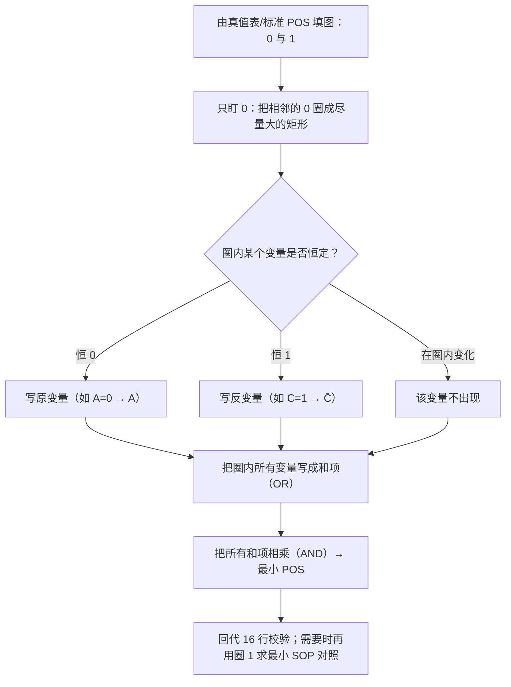

---
tags:
  - ECE2050
  - karnaugh-map
date: 2026-09-16
aliases:
  - 卡诺图 POS 最小化
  - 卡诺图求最小或与式
  - 用卡诺图求 POS
  - POS Minimization with Karnaugh Map
  - K-Map POS Minimization
---

> [!NOTE] Where this fits · 定位
> [[Karnaugh Map]] 的**第二个扩展**：同样是圈格，但这次**圈 0**，读出来的就是**最小 POS（或与式）**。
> 讲义 p.54 一句话点题：*In SOP minimization, we focus on those 1's; in POS minimization,
> we focus on those 0's*。它和圈 1 是**对偶操作**：一张图、两种读法，SOP 与 POS 的最小式同时到手。
> 前置：[[Karnaugh Map]]（圈组五规则）、[[Product-of-Sums Form]]（maxterm 与标准 POS）、[[DeMorgan's Theorems]]（两种读法为什么等价）。
> 平行：[[Karnaugh Map with Don't Cares]]（X 在圈 0 时同样可用）。

> [!SUMMARY] Quick recall · 英文速览
> To minimize a product-of-sums expression, group the 0 cells of a Karnaugh map. Each group yields a sum term, and the resulting terms are ANDed together.

## Core Definition · 核心定义

**卡诺图 POS 最小化**：把函数值为 **0** 的格圈起来，**每个圈读成一个 maxterm（和项）**，
再把这些和项 **AND（相乘）**起来：

$$
F=\prod_{\text{每个 0 圈}} M_k
$$

**从圈读 maxterm 的规则**（与读积项逐条相反）：

| 变量在圈内的取值 | minterm 里怎么写（圈 1 时） | **maxterm 里怎么写（圈 0 时）** |
|---|---|---|
| 恒为 **1** | 写原变量 $X$ | 写**反**变量 $\bar X$ |
| 恒为 **0** | 写反变量 $\bar X$ | 写**原**变量 $X$ |
| 圈内变化 | 该变量消失 | 该变量消失 |

一句话记忆：**圈 0 时，变量取 0 写原变量、取 1 写反变量**（因为"和项为 0"的条件恰好与它能"选中"的那一行互补）。

## Assumptions and Validity · 适用前提

> [!IMPORTANT] 它为什么成立：POS 就是对 $F'$ 做 SOP
> 标准 POS 取的是**输出为 0 的那些行**：$F=\prod M(\text{0 行})$。而对 $F'$ 做 SOP 最小化得到的
> $F'_{\min}$ 覆盖的正是这些 0 行，于是
> $$F=\left(F'_{\min}\right)'$$
> 再由 [[DeMorgan's Theorems]] 把"积之和"翻转成"和之积"：
> $\overline{X_1+X_2+\cdots}=\bar X_1\bar X_2\cdots$、$\overline{X_1X_2\cdots}=\bar X_1+\bar X_2+\cdots$。
> **所以圈 0 读 maxterm 不是新规则，是"对反函数做 SOP"的自然结果。**

- 圈的**五条规则一字不变**（水平/垂直、跨度为 2 的幂、尽量大、可回绕、每格至少圈一次——这里"每格"指每个 0）。
- **每个 0 必须至少被圈一次**；1 不需要管。
- 含 X 时，**X 可圈可不圈**，规则同 [[Karnaugh Map with Don't Cares]]（只在能合并时圈）。
- 同一张图可以**同时**给出最小 POS（圈 0）与最小 SOP（圈 1），两者描述同一个函数，都合法。

## Derivation · 推导过程

以讲义 p.56 的例题为例：标准 POS 的六个和项说明函数在 **$m(1,2,3,4,9,12)$ 这 6 行上为 0**，
其余 10 行为 1。填成四变量卡诺图（行 `CD`、列 `AB`，Gray 码排列）：

| $AB\backslash CD$ | 00 | 01 | 11 | 10 |
|---|---|---|---|---|
| **00** | 1 | **0** | **0** | **0** |
| **01** | **0** | 1 | 1 | 1 |
| **11** | **0** | 1 | 1 | 1 |
| **10** | 1 | **0** | 1 | 1 |

**（1）圈 0（求最小 POS）**：

| 圈 | 覆盖 | 圈内 $A,B,C,D$ | 读出的和项 |
|---|---|---|---|
| ① | $0010,0011$ | $A=0,B=0,C=1\ (D\ \text{变})$ | $A+B+\bar C$ |
| ② | $0001,1001$ | $B=0,C=0,D=1\ (A\ \text{变})$ | $B+C+\bar D$ |
| ③ | $0100,1100$ | $B=1,C=0,D=0\ (A\ \text{变})$ | $\bar B+C+D$ |

$$
\boxed{F_{\min\text{-POS}}=(A+B+\bar C)(B+C+\bar D)(\bar B+C+D)}
$$

**（2）同一张图圈 1（求最小 SOP）**：$B=1$ 的两行四列与 $A=1,C=1$ 的四格、外加 $B=C=D=0$ 的一对

$$
F_{\min\text{-SOP}}=\bar B\bar C\bar D+BD+BC+AC
$$

**数值校验 (Numerical check)**：把两个式子各自代回**全部 16 行**——
6 个 0 行全得 0 ✓、10 个 1 行全得 1 ✓，且两式逐行完全一致 ✓
（`verify_ch34.py` 对 16 行逐行比对通过）。**同一个函数、两种形式，圈法不同而已。**

![[kmap-pos-minimization.svg]]
*图 1 — 同一张卡诺图的两种读法：(a) 圈 **0** → 每个圈读成一个 maxterm，三个和项相乘得最小 POS；
(b) 圈 **1** → 每个圈读成一个积项，四项相或得最小 SOP。*

## Method and Steps · 求解步骤与方法

1. 把函数填成卡诺图（1 与 0；有 X 就先留着）；
2. **只圈 0**（先找最大的圈：8 格 → 4 格 → 2 格）；
3. 每个圈按上表读成一个**和项**；
4. 所有和项 **AND** 起来 → 最小 POS；
5. **回代校验**：0 行必须全 0、1 行必须全 1；需要 SOP 时在**同一张图**上再圈 1。

## Worked Example · 例题

**Example 1 — 讲义 p.56：同一张图同时给出最小 POS 与最小 SOP**

题目：把标准 POS $\prod M(1,2,3,4,9,12)$ 化成 (a) 最小 POS、(b) 标准 SOP、(c) 最小 SOP。
解：

- (a) 圈 0 得 $F=(A+B+\bar C)(B+C+\bar D)(\bar B+C+D)$；
- (b) 标准 SOP = 把 10 个 1 行全部写成 minterm 再 OR：
  $\sum m(0,5,6,7,8,10,11,13,14,15)$（每一项含全部四个变量）；
- (c) 圈 1 得 $F=\bar B\bar C\bar D+BD+BC+AC$。

**数值校验**：三个式子逐行代入完全一致 ✓；项数 (a) 3 项 / (c) 4 项，都远少于标准 SOP 的 10 项 ✓。

![[ch4-kmap-pos-to-sop.png]]
*图 2 — 讲义 p.56 原图：练习题给出的六个 maxterm、先填 0 再填 1、然后分别读出最小 POS 与最小 SOP。*

**Example 2 — 三变量 POS：圈 0 与圈 1 得到一对互补形式**

> [!NOTE] 关于讲义 p.55 的例题 4-34 / 4-35
> 讲义这两题的和项在下标与横线在文本抽取中残缺（`========== PAGE 55 ==========` 只剩
> "000 001 010 011 110" 与 "X000 0010 1001 0100 1100" 两组编号），因此本篇给出一个**完全自洽、
> 可逐行验证**的三变量例题；讲义原图见下方图 3。

题目：$F=\prod M(0,1,2,4)$，即 $F$ 在 $m_0,m_1,m_2,m_4$ 四行为 0，其余（$m_3,m_5,m_6,m_7$）为 1。
解：填 2×4 卡诺图（行 $A$，列 $BC$ 按 `00 01 11 10`）：

| $A\backslash BC$ | 00 | 01 | 11 | 10 |
|---|---|---|---|---|
| **0** | **0**($m_0$) | **0**($m_1$) | 1($m_3$) | **0**($m_2$) |
| **1** | **0**($m_4$) | 1($m_5$) | 1($m_7$) | 1($m_6$) |

**圈 0**：$\{m_0,m_1\}$ 相邻 → 读 $A+B$；$\{m_0,m_2\}$ 靠**列回绕**相邻 → 读 $A+C$；
$\{m_0,m_4\}$ 上下相邻 → 读 $B+C$：

$$
F_{\min\text{-POS}}=(A+B)(A+C)(B+C)
$$

**圈 1**（同一张图）：$\{m_3,m_7\}=BC$、$\{m_5,m_7\}=AC$、$\{m_6,m_7\}=AB$：

$$
F_{\min\text{-SOP}}=AB+AC+BC
$$

**数值校验**：两式在 8 行上逐行一致——0 行 $m_0,m_1,m_2,m_4$ 全为 0 ✓、1 行全为 1 ✓；
$AB+AC+BC$ 正是"三输入多数表决"，与 [[Boolean Equation]] 里全加器的进位式 $C_{out}=AB+AC_{in}+BC_{in}$ 同形 ✓。

![[ch4-kmap-pos-example.png]]
*图 3 — 讲义 p.55 原图：例题 4-34/4-35 的 POS 卡诺图（圈 0 读 maxterm）。*

## Pitfalls · 常见误区

> [!WARNING] 圈 0 的两大坑：读成 maxterm 却按 minterm 的规则写变量
> 一句话区分：**圈 1 时"1 写原变量"，圈 0 时"0 写原变量"** —— 两种读法互为镜像。

1. **圈 0 却按 minterm 规则写变量。** 圈 0 时变量取 **0 写原变量**、取 1 写反变量；
   写反了会得到 $\overline{F}$ 的式子。
2. **把圈 0 的结果当成 SOP 写。** 圈 0 得到的是**和项之积**（每项是 OR，项间是 AND），
   不能写成"积之和"。
3. **忘了"每个 0 都要圈到"。** 与圈 1 完全对称：漏掉一个 0，式子在该行会给出 1，直接错。
4. **圈里混进 1。** SOP 里 0 不能被圈，POS 里 1 不能被圈；只有 X 可以做墙头草。
5. **圈不是 2 的幂/带对角。** 圈组五规则在圈 0 时同样适用（见 [[Karnaugh Map]]）。
6. **以为最小 POS 一定比最小 SOP 简单。** 两者项数可能不同（本例 3 项 vs 4 项），
   选哪个取决于后端要实现成 AND-OR 还是 OR-AND 电路——**都写出来再比**。

## Read zero groups as maxterms · 零圈怎样读最大项

Group zeros rather than ones. A variable that stays zero in a zero group appears uncomplemented in the corresponding sum term; a variable that stays one appears complemented. This makes the entire sum zero precisely on the grouped rows. Variables that change disappear.

The resulting POS is the product of those sum terms. You may also minimize the complement as an SOP and apply DeMorgan's law, but clearly distinguish F from NOT F at every step. Forgetting the final complement swaps the ON and OFF sets.

**Worked application.** ABC域中，F仅在A=0,B=1时为0，C无关。OFF set为2,3；对应和项 $A+\bar B$。代入010/011得0，代入000得1，代入110得1。若误写 $\bar A+B$，就在原来的零组上得1。

**English exam question:** Are minimum SOP and minimum POS necessarily implemented at the same cost?

**Answer:** No. Their terms, literals, and required complements can differ, as can the available gate family. Compare both forms under the actual constraints. [[Universal Gates and Bubble Pushing]] maps POS into NOR networks; [[Propagation Delay and Logic Hazards]] adds the separate timing assessment.

## Connections · 相关笔记

- 上游 (upstream)：[[Karnaugh Map]] —— 圈组规则与 Gray 码排列；[[Product-of-Sums Form]] —— maxterm 编号与标准 POS；
  [[Minterm and Maxterm]] —— $M_i=\bar m_i$ 决定了"圈 0 读和项"的写法。
- 下游 (downstream)：[[Karnaugh Map with Don't Cares]] —— 同一套圈法加上 X 的自由度；
  [[Decoder]]、[[Multiplexer and Demultiplexer]] 与 [[Universal Gates and Bubble Pushing]] 比较不同实现。
- 平行 (parallel)：[[DeMorgan's Theorems]] —— 把 $(F'_{\min})$ 翻回 $F_{\min\text{-POS}}$ 的那一步；
  [[Boolean Expression Simplification]] —— 不用图、纯靠代数也能得到同样的最小式。

---
索引：[[ECE2050 Knowledge Tree]] · [[Glossary]]
