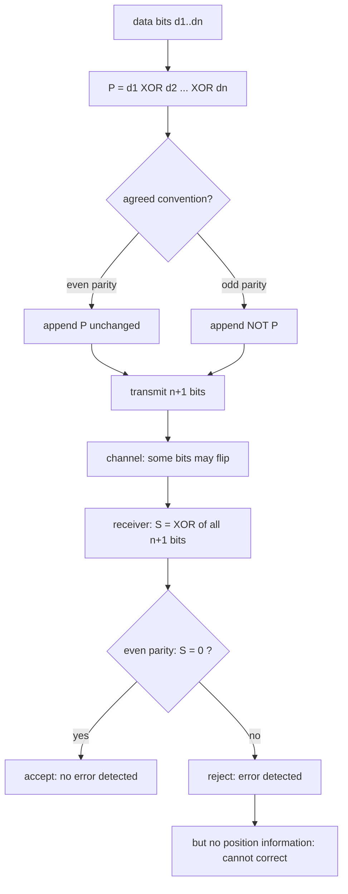

---
tags:
  - ECE2050
  - error-codes
date: 2026-09-16
updated: 2026-10-08
aliases:
  - 奇偶校验位
  - 奇偶校验
  - 校验位
  - Parity Bit
  - Parity Check
---

> [!NOTE] Where this fits · 定位
> 分区 9「Error Detection Codes」的第一篇，也是**全章第一次讨论"错了怎么办"**：前面所有编码
> （[[Binary Coded Decimal]]、[[Gray Code]]、[[American Standard Code for Information Interchange]]）
> 都假设比特不会出错；一旦数据要经过导线、射频或磁盘，就必须回答"收到的位串还可信吗"。
> 奇偶校验是最便宜的答案：**加 1 位**，换"奇数个错误一定能查出来"。
> 前置：[[Bits and Bytes]]（位/字节与 XOR 的位运算视角）、[[American Standard Code for Information Interchange]]
> （最经典的用法：7 位 ASCII + 1 位校验位 = 1 字节）。
> 下游：[[Cyclic Redundancy Check]] —— 奇偶校验查不出偶数个错误，CRC 用"模 2 长除的余数"把这个洞补上。

> [!SUMMARY] Quick recall · 英文速览
> A parity bit makes the total number of 1s even or odd by convention. A parity check detects an odd number of bit flips but cannot locate or correct them.

## Core Definition · 核心定义

**奇偶校验位 (parity bit)**：附加在一组比特后面的一位，使整组中 **1 的个数恒为偶数（偶校验 even parity）
或恒为奇数（奇校验 odd parity）**（讲义 p.70 原话：*make the total number of 1's in a group always even or
always odd*）。

记号：数据位 $d_1,d_2,\dots,d_n$（共 $n$ 位），校验位 $P$，则发送 $n+1$ 位。两种约定下 $P$ 的定义是：

$$
P_{\text{even}} = d_1 \oplus d_2 \oplus \cdots \oplus d_n
\qquad\qquad
P_{\text{odd}} = \overline{d_1 \oplus d_2 \oplus \cdots \oplus d_n}
$$

- 物理意义：$P$ 不是"数据的第 $n+1$ 位"，而是**整组 1 的个数的奇偶性检查值 (parity check value)**；
  它同样占 1 bit 的带宽。
- 数值校验：数据 `110 1001` 中有 4 个 1（偶数）。
  偶校验：$P = 1\oplus1\oplus0\oplus1\oplus0\oplus0\oplus1 = 0$，总 1 数 $4+0=4$（偶）✓；
  奇校验：$P = \overline{0} = 1$，总 1 数 $4+1=5$（奇）✓。
- 接收端的判据叫**校验子 (syndrome)**：把收到的 $n+1$ 位全部异或起来。

$$
S_{\text{even}} = d_1 \oplus \cdots \oplus d_n \oplus P,\qquad
\begin{cases} S=0 & \text{接受（未检出错）}\\ S=1 & \text{报错}\end{cases}
$$

- 数值校验：发送 `1101 0010`（偶校验，4 个 1），$S = 1\oplus1\oplus0\oplus1\oplus0\oplus0\oplus1\oplus0 = 0$ ✓；
  若某一位翻转（例如首位 $1\to0$ 得 `0101 0010`），1 的个数变成 3，$S = 1$ → 报错 ✓。

![[parity-bit-format.svg]]
*图 1 — (a) 同一个 7 位数据字 `110 1001` 在偶校验下补 $P=0$、奇校验下补 $P=1$，两种约定都把
"1 的个数"钉在固定的奇偶性上；(b) 盲区：两位同时翻转（一位 $1\to0$、另一位 $0\to1$）后
总 1 数仍然是 4，$S=0$，校验位**完全看不出**出错。*

## Assumptions and Validity · 适用前提

> [!IMPORTANT] 奇偶校验只统计"1 的个数的奇偶性"，不统计"哪些位变了"
> 因此它的检错能力有一个精确的边界：**能发现任意奇数个比特错误，对任意偶数个比特错误完全失明**。
> 原因见"推导过程"第 3 步：每一次翻转都让 1 的个数奇偶性翻转一次，翻转两次就翻回来了。

- **两端必须约定同一种奇偶性**：发送端用偶校验、接收端按奇校验判，则**每一帧都会报错**（收到的一切都不合格）。
- **它作用于"一组比特"，不是整条链路**：校验位只保护它所在的那一组；分组大小 $n$ 由协议约定
  （典型 $n=7$ 配 ASCII，或 $n=8$ 配 1 字节数据）。
- **只检错、不纠错 (detect, not correct)**：$S=1$ 只说明"这组里有奇数个错"，
  **不知道是哪一位**，也不提供任何定位信息；要纠错必须再加冗余（二维块校验、汉明码等）。
- **错误模型**：假设错误是**独立的比特翻转 (bit flip)**，且校验位本身也可能出错
  （校验位翻转 $1\to0$ 同样被检出，因为它也计入 1 的个数）。
- **开销 (overhead)**：每 $n$ 位数据多传 1 位，即

$$
\text{overhead} = \frac{1}{n+1}
$$

- 数值校验：$n=7$（ASCII）→ $1/8 = 12.5\%$；$n=8$ → $1/9 \approx 11.1\%$；
  $n=64$ → $1/65 \approx 1.54\%$ ✓ —— 组越大越划算，但一组内"偶数个错误"的概率也随之上升。

## Derivation · 推导过程

### 1. 为什么 XOR 就是校验位的算法

先把 XOR 的性质列清楚：$a \oplus b$ 在 $a\ne b$ 时为 1，因此

$$
d_1 \oplus d_2 \oplus \cdots \oplus d_n = 1
\iff \text{数据中 1 的个数为奇数}
$$

- 意义：**异或链就是"1 的个数的奇偶性指示器"**。所以偶校验位直接取异或结果，奇校验位取它的反。
- 数值校验：`110 1001` → $1\oplus1=0$，$0\oplus0=0$，$0\oplus1=1$，$1\oplus0=1$，$1\oplus0=1$，$1\oplus1=0$；
  得到 0，说明 1 的个数是偶数（4 个）✓，与直接数数一致 ✓。
- 硬件视角：全部用 XOR 门（或一棵 XOR 树），深度 $\lceil \log_2 n\rceil$，非常便宜。

### 2. 接收端判据：整组异或为 0

对偶校验，把 $P$ 也一起异或进来：

$$
S = d_1 \oplus \cdots \oplus d_n \oplus P = 0 \;\Longrightarrow\; \text{1 的个数为偶数（符合约定）}
$$

- 意义：$S$ 就是"1 的总个数 mod 2"。$S=0$ 说明约定被满足；$S=1$ 说明约定被破坏。
- 数值校验：`1101 0010` → 4 个 1 → $S = 0$ ✓；把第 3 位 $0\to1$ 得到 `1111 0010`（5 个 1）→ $S=1$ → 检出 ✓。
- 奇校验系统则相反：接收端要求 $S=1$（总 1 数为奇），$S=0$ 才是出错。

### 3. 能力边界：为什么偶数个错误一定漏

设错误模式 $e = e_1e_2\cdots e_{n+1}$（$e_i=1$ 表示第 $i$ 位翻转），收到 $S' = S \oplus (e_1\oplus\cdots\oplus e_{n+1})$。

$$
S' = S \oplus (\text{翻转位数} \bmod 2)
$$

- 意义：**校验子只反映"错误个数的奇偶性"**。翻转 1、3、5…位 → $S$ 取反 → 检出；
  翻转 2、4、6…位 → $S$ 不变 → 漏检（图 1(b)）。
- 数值校验（盲区示例）：发送 `1101 0010`（4 个 1）。让第 1 位 $1\to0$、第 6 位 $0\to1$，
  收到 `0101 0110` —— 1 的个数仍是 4 ✓，$S = 0$ → 校验通过，**错误被完整地漏掉** ✓。
- 量化：对包含校验位的 $L$ 位字，共有 $2^L-1$ 个非零错误掩码。奇数重有 $2^{L-1}$ 个，
  非零偶数重有 $2^{L-1}-1$ 个。若所有非零掩码等概率，则漏检率为 $(2^{L-1}-1)/(2^L-1)$，
  接近 50%；8 位例子为 $127/255$。这不是任意错误分布下的上限，若只出现双比特错误则全部漏检。

### 4. 提高能力的方向

| 方案 | 冗余 | 能力 | 代价 |
|---|---|---|---|
| 单组奇偶校验 | 1 bit / 组 | 检出奇数个错误 | 偶数个错误全盲、不能定位 |
| 二维/块校验 (row + column parity) | 每行每列各 1 bit | 定位并纠正 1 位错误 | 冗余约 $2/\sqrt{N}$，需矩阵存储 |
| 汉明码 (Hamming) | 多位 | 纠正 1 位、检出 2 位 | 需要多个校验方程（超本课范围，仅作了解） |
| [[Cyclic Redundancy Check]] | 4–32 bit | 检出错位位置相关的多类错误 | 需要移位寄存器与模 2 除法 |

- 数值校验（块校验为什么能定位）：把 8 字节排成 $8\times 8$ 矩阵，每行每列各加 1 位偶校验，
  共 $8+8=16$ 位冗余；若恰好 1 位翻转，则**它所在的行与列同时报错**，交点即错误位置 → 取反即纠正 ✓。

## Method and Steps · 求解步骤与方法

1. **确认约定**：这一组用偶校验还是奇校验？两端必须一致。
2. **数 1 或异或**：$P$ = 数据位异或（偶校验）；取反即奇校验。位数多时用异或链，不要真的一位位数。
3. **拼接**：约定校验位放在数据之后（也可约定在前，但要一致），得到 $n+1$ 位码字。
4. **接收端算校验子**：$S = $ 全部 $n+1$ 位异或。
5. **判定**：偶校验要求 $S=0$（奇校验要求 $S=1$）；否则报错，但不能纠错。
6. **收尾校验**：随机造一个 1 位错误 → $S$ 应变号；再叠加第二个错误 → $S$ 应回到原值（说明"偶数个错误漏检"）。

## Worked Example · 例题

**Example 1 — 讲义 p.70 原题：奇校验系统收到五组码，哪几组出错？**

题目：一个奇校验系统 (odd parity system) 收到 `10110`、`11010`、`110011`、`110101110100`、
`1100010101010`，判断哪些组有错。

解：奇校验要求每组 1 的个数为**奇数**，逐个统计：

| 收到的码组 | 位数 | 1 的个数 | 奇校验判定 |
|---|---|---|---|
| `10110` | 5 | 3 | 奇数 → 合格 |
| `11010` | 5 | 3 | 奇数 → 合格 |
| `110011` | 6 | 4 | 偶数 → **出错** |
| `110101110100` | 12 | 7 | 奇数 → 合格 |
| `1100010101010` | 13 | 6 | 偶数 → **出错** |

所以出错的是第 **3** 组 `110011` 与第 **5** 组 `1100010101010`（与讲义结论一致）。

**数值校验 (Numerical check)**：
- `10110`：$1+0+1+1+0$ 的异或 $= 1\oplus0\oplus1\oplus1\oplus0 = 1$，$S=1$ 符合奇校验 ✓。
- `110011`：$1\oplus1\oplus0\oplus0\oplus1\oplus1 = 0$，$S=0$ 违反奇校验约定 → 报错 ✓。
- 计数复核：$3,3,4,7,6$ 中只有 4 与 6 是偶数，恰好对应第 3、5 组 ✓。

**Example 2 — 给定数据 `1101001` 求偶校验位与奇校验位**

题目：数据位为 `110 1001`（7 位），分别求偶校验位与奇校验位，并写出完整码字。

解：
1. 数 1 的个数：`1 1 0 1 0 0 1` → 4 个 1（偶数）。
2. 偶校验：需要总数为偶数 → $P_{\text{even}} = 0$，码字 `1101 0010`。
3. 奇校验：需要总数为奇数 → $P_{\text{odd}} = 1$，码字 `1101 0011`。

**数值校验 (Numerical check)**：
- 异或链：$1\oplus1=0$，$0\oplus0=0$，$0\oplus1=1$，$1\oplus0=1$，$1\oplus0=1$，$1\oplus1=0$ → $P_{\text{even}}=0$ ✓。
- `1101 0010` 的 1 个数 = 4（偶）✓；`1101 0011` 的 1 个数 = 5（奇）✓。
- 两个码字只差最后一位（$0$ 与 $1$）✓，即奇校验位就是偶校验位取反。

**Example 3 — 制造一个 2 位错误，说明为什么检不出来**

题目：偶校验码字 `1101 0010` 在传输中被翻转了第 1 位与第 6 位，验证接收端会误判为"正确"。

解：
1. 翻转第 1 位（`1 → 0`）：`0101 0010`（1 的个数 3）。
2. 再翻转第 6 位（`0 → 1`）：`0101 0110`（1 的个数 4）。
3. 接收端计算校验子：$S = 0$ → 判定"无错"，把错误数据交给上层。

**数值校验 (Numerical check)**：
- 发送码字 1 的个数 = 4；接收码字 1 的个数 = 4，两者相同 ✓（一加一减互相抵消）。
- $S' = S \oplus (\text{翻转位数} \bmod 2) = 0 \oplus (2 \bmod 2) = 0$ ✓ —— 这就是"盲区"的代数解释。
- 对照：只翻转第 1 位时 1 的个数变 3，$S = 1$ → 能检出 ✓；说明**不是"能不能查错"，而是"错误个数是否为奇数"**。

## Pitfalls · 常见误区

> [!WARNING] 奇偶校验的名声不好，多半是因为被当成了"万能保险"

1. **以为奇偶校验能纠错**。错在：看到报错就去"猜是哪一位错了"。
   正确：$S=1$ 只说明"有奇数个错"，位置信息为零；要定位必须加二维校验或更强编码。
2. **以为能查出所有错误**。错在：把"能查错"理解成"一定能查错"。
   正确：偶数个错误（2、4、6…位）**一定漏检**，见 Example 3。
3. **两端约定不一致**。错在：发送端偶校验、接收端按奇校验判。
   正确：约定必须写进协议；否则正确的帧也会全部被丢弃（误报率 100%）。
4. **忘记校验位也参与计数**。错在：只在数据位里数 1，忘了 $P$ 自己。
   正确：判据是 $n+1$ 位的异或（$S$），校验位自己的翻转同样会被检出。
5. **把"1 的个数"数错**。错在：长码组里漏数/多数（如 `110101110100` 数成 6）。
   正确：按 4 位一组分段统计再相加：`1101 0111 0100` → $3+3+1=7$ ✓。
6. **以为分组越大越好**。错在：只看到开销 $1/(n+1)$ 变小。
   正确：组越大，一组内出现"偶数个错误"的概率越高；工程上要在开销与漏检率之间折中。
7. **把奇偶校验与格雷码的作用搞混**。错在：认为两者都在"防错"。
   正确：[[Gray Code]] 是**减少错误发生**（相邻符号只差 1 位），奇偶校验是**发现已发生的错误**；
   一个治因、一个治果。

## Parity generation, checking, and limits · 生成、校验与边界

Even-parity generation chooses $P=\bigoplus d_i$, so XOR of the full transmitted word is zero. Odd-parity generation chooses its complement, so XOR of the full transmitted word is one. A checker compares the received total parity against the selected convention. Avoid memorizing “XOR means odd parity” without saying whether it describes a data reduction, generated bit, or received-word check.

A zero error indication means that no error was detected, not that the data is certainly correct. Every nonzero error mask with even Hamming weight preserves parity. The probability of missing an error therefore depends on the error distribution. It can be 100% if errors always flip exactly two bits; one-half is not a universal worst-case bound.

**Worked application — odd parity for BCD data.** 数据 `00010100`（BCD 14）有两个 1。奇校验要整组有奇数个 1，故 P=1，发送组有三个 1。若给出的解答同时写“该断言正确”与 P=0，后者和定义冲突；直接数 1 可独立核验。接收后翻转两个位，会保持总 parity，仍能漏检。

In English: compute the parity over the actual data bits, not over the decimal value written alongside them. Include the transmitted parity bit when checking the received word.

**English exam question:** Does a parity failure identify the corrupted bit?

**Answer:** No. It indicates an odd number of bit flips relative to a valid parity word, but provides no position information. Different single-bit and odd-weight error masks can produce the same parity failure.

Continue with [[Exclusive-OR Gate]], [[Exclusive-NOR Gate]], [[Cyclic Redundancy Check]], and [[Testbench and Functional Verification]]. A useful parity testbench includes single-bit flips and a two-bit counterexample, not only clean data.

## Gate-Level Parity Circuits · 门级校验电路，Ch5 p.11–14

**校验位发生器 (parity-bit generator)** 对数据求校验位；**校验检查器 (parity checker)** 对收到的数据和收到的校验位共同判断。课件所说 2-bit、3-bit、4-bit generator 指原始数据位数；4 位数据加 1 位校验才形成 5 位码字 (codeword)。

### Two and Three Data Bits · 两位与三位数据

两位数据 $A,B$ 的偶校验位 $P=A\oplus B$。三位数据顺序为 ABC，根据 p.12 真值表：

$$
\begin{aligned}
P&=\bar A\bar BC+\bar AB\bar C+A\bar B\bar C+ABC\\
 &=\bar A(\bar BC+B\bar C)+A(\bar B\bar C+BC)\\
 &=\bar A(B\oplus C)+A\overline{(B\oplus C)}\\
 &=A\oplus B\oplus C.
\end{aligned}
$$

令 $T=B\oplus C$，倒数第二行就是 $\bar AT+A\bar T$，恰好是 $A\oplus T$。卡诺图的四个 1 分别是 $m_1,m_2,m_4,m_7$，互不相邻；普通 SOP 不能把它们圈成更大的组，但可识别 XOR 结构，用两个二输入 XOR 实现。

| $ABC$ | Data 1-count | $P$ | Total 1-count in $ABCP$ |
|---|---|---|---|
| 000 | 0 | 0 | 0 |
| 001 | 1 | 1 | 2 |
| 010 | 1 | 1 | 2 |
| 011 | 2 | 0 | 2 |
| 100 | 1 | 1 | 2 |
| 101 | 2 | 0 | 2 |
| 110 | 2 | 0 | 2 |
| 111 | 3 | 1 | 4 |

An XOR reduction reports odd parity in the **data**. Appending that result makes the **complete codeword** even. Thus XOR implements an even-parity generator; XNOR would generate the odd-parity bit instead.

### Four-Input Generator and Five-Input Checker · 四位发生器与五位检查器

四位发送数据为 $A_3A_2A_1A_0$；偶校验位为 $P$。课件 p.13 的平衡异或树 (balanced XOR tree) 是：

$$
t_0=A_0\oplus A_1,\qquad t_1=A_2\oplus A_3,\qquad
P=t_0\oplus t_1.
$$

它使用三个二输入 XOR，数据到 P 的最长路径是两级；串联实现也用三个门，但最长为三级。这里只比较逻辑级数；实际延迟需给出器件参数与负载条件。

收到的数据写为 $r_3r_2r_1r_0$，收到的校验位写为 $p_r$，所有符号取值均为无量纲 0/1。p.14 检查器重算数据奇偶性 $Q$，再比较收到的校验位：

$$
Q=(r_0\oplus r_1)\oplus(r_2\oplus r_3),\qquad E=Q\oplus p_r.
$$

这里 $E=1$ 是高有效检错输出，$E=0$ 表示未检出错误。检查器需四个二输入 XOR；收到的数据到 E 最长三级，收到的校验位在图示结构中只经末级 XOR。

![[parity-generator-checker.svg]]
*图 2 — (a) 四位发送数据生成 P；(b) 对四位收到的数据与收到的校验位 $p_r$ 求检错输出 E。每根输入线独立，发送与接收变量明确分开。*

| $Q$ | Received $p_r$ | $E=Q\oplus p_r$ | Meaning |
|---|---|---|---|
| 0 | 0 | 0 | 收到的整组有偶数个 1，未检出错 |
| 0 | 1 | 1 | 整组有奇数个 1，校验失败 |
| 1 | 0 | 1 | 整组有奇数个 1，校验失败 |
| 1 | 1 | 0 | 整组有偶数个 1，未检出错 |

**Worked check.** 发送数据 1010，$P=1\oplus0\oplus1\oplus0=0$，完整字 10100 的 $E=0$。只翻转首位得到 00100，$E=1$；同时翻转前两位得到 01100，$E=0$，但收到的数据已改变。位序在这个例题中从左至右为 $A_3A_2A_1A_0P$。

> [!IMPORTANT] Source wording and detection limit · 课件措辞与能力边界
> p.14 将 E=1 简述为“有错误”、E=0 为“无错误”。精确结论是：相对于合法偶校验字，奇数个翻转产生 E=1；非零偶数个翻转仍产生 E=0。因此 0 只能说明 **no error detected**，不能证明数据正确。

## Sources · 来源

- Tinghuan CHEN, *ECE 2050 Digital Logic and Systems, Chapter 2*, PDF p.70：既有奇偶校验定义与判断码组例题；[第二章课件](../ECE2050-Chap2.pdf#page=70)。
- 同课程 *Chapter 5: Combinational Logic Design*, PDF p.11–14：2/3/4 位偶校验发生器与 5 位检查器；[第五章课件](../ECE2050-Chap5.pdf#page=11)。逐节点方程、门数／级数和双比特漏检例子为推导与复核。

## Connections · 相关笔记

- 上游 (upstream)：[[Bits and Bytes]] —— 位运算是校验位的全部工具（异或链、mod 2 计数）。
- 上游 (upstream)：[[American Standard Code for Information Interchange]] —— "7 位 ASCII + 1 位校验位"是最经典的应用。
- 平行 (parallel)：[[Gray Code]] —— 目标相反的一对：一个降低出错概率，一个检测已发生的错误。
- 下游 (downstream)：[[Cyclic Redundancy Check]] —— 用模 2 长除的余数代替"1 的个数奇偶性"，
  从而同时抓住偶数个错误与突发错误。
- 延伸 (beyond)：块校验、汉明码属于后续课程内容，本篇只需知道"加更多方程就能定位并纠正"。

---
索引：[[ECE2050 Knowledge Tree]] · [[Glossary]]
