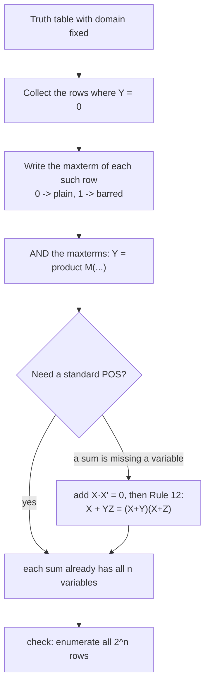

---
tags:
  - ECE2050
  - boolean-forms
date: 2026-09-16
aliases:
  - 或与式
  - 和之积形式
  - Product-of-Sums
  - POS Form
  - POS
---

> [!NOTE] Where this fits · 定位
> 第 4 章"标准形式"三篇里的第二篇（讲义 p.34, p.37, p.39, p.41–42）。
> 它是 [[Sum-of-Products Form]] 的镜像：SOP 从**输出为 1** 的行出发写 minterm，
> POS 从**输出为 0** 的行出发写 maxterm。两者描述**同一个函数**，差别只在电路代价。
> 前置：[[Minterm and Maxterm]]（maxterm 的定义与编号、$M_i=\bar m_i$）、
> [[DeMorgan's Theorems]]（SOP 与 POS 之间的桥梁）、[[Laws and Rules of Boolean Algebra]]（Rule 12 用来补变量）。

> [!SUMMARY] Quick recall · 英文速览
> A product-of-sums expression ANDs several OR terms. Its canonical form can be built from truth-table rows where the function is 0, using maxterms.

## Core Definition · 核心定义

**或与式 (POS, product-of-sums)**：若干个**和项**（literal 的 OR）用 **AND** 连接起来的表达式：

$$
Y = \underbrace{S_1}_{\text{sum}}\cdot\underbrace{S_2}\cdots\underbrace{S_k}
\qquad\text{即}\qquad
Y=\text{AND}\big(\text{OR 项}_1,\ \text{OR 项}_2,\ \dots\big)
$$

- 意义：POS 读作"**只要有一个和项为 0，输出就是 0**"。电路上是两级门：一级 OR 出和项，
  一级 AND 汇总 —— 与 SOP 的门形状正好对偶（AND ↔ OR 互换）。
- 讲义的形态判据（p.41）：**每一项都只由 literal 组成**（OR 的括号里不能再夹 AND）时才是 POS 形式：

| 表达式 | 是不是 POS | 原因 |
|---|---|---|
| $Y=(A+B)(C+D)(E+F)$ | ✅ POS | 三个和项，括号里只有 literal |
| $Z=A(B+C)(D+E)$ | ✅ POS | 单独一个 literal 也算一个和项 |
| $Y=(D+E)(F+GH)$ | ❌ 不是 | $(F+GH)$ 里夹了乘积 $GH$，不是"和" |

- **标准 POS (standard POS)**：domain 里的**每一个变量都出现在每一个和项**里（讲义 p.41）。
  标准 POS 里的每一项就是一个 maxterm，也叫 **maxterm 展开**、**最大项之积 (product of maxterms)**。
- **编号写法**（讲义 p.37 的 $Y=F(A,B)$，0 行是 `00` 与 `10`）：

$$
Y=\prod M(0,2)
$$

- 意义：$\prod$ 不是算术乘法，而是"把这些编号对应的 maxterm 全部 AND 起来"。
- 数值校验：$\prod M(0,2)=(A+B)(\bar A+B)$，枚举 4 行得 $0,1,0,1$ ✓；
  若误写成 $\prod M(0,1,2)$ 会多一个 $(A+\bar B)$，枚举变成 $0,0,0,1$ ✗ —— 编号即真值表。

> [!IMPORTANT] 取 0 行写 POS：maxterm 的"反着写"规则
> 某一行输出为 **0** 时，写它的 maxterm：**变量取 0 写原变量、取 1 写反变量**，之间用 OR。
> 这与 minterm **完全相反**（minterm 是 1 写原变量、0 写反变量）—— 因为 maxterm 要在这一行等于 0，
> 而 OR 要等于 0 必须每一项都为 0。
> 数值校验：行 $A B C=`010`$ → $M_2=A+\bar B+C$；代入 $A{=}0,B{=}1,C{=}0$ 得 $0+0+0=0$ ✓ 正好是 0。
> 若按 minterm 的规则写成 $\bar AB\bar C$，代入得 1，就写反了。

## Assumptions and Validity · 适用前提

> [!IMPORTANT] 成立条件与边界
> ① **domain 必须先定**：标准 POS 要求每个和项含全部变量；domain 变了就不再标准。
> ② 括号里只能有 OR；出现 $F+GH$ 这种"和里夹乘积"要先展开或先转换（见例题 3）。
> ③ 标准 POS 用的是**输出为 0** 的行；一个函数若 0 行比 1 行少，用 POS 写的项数就更少 ——
> 这正是选 SOP 还是 POS 的第一条标准。

- 何时要 POS：题目给了 maxterm 列表（$\prod M(\cdot)$）、或真值表里 0 少 1 多、
  或者要做 NOR-NOR 两级电路（对偶于 NAND-NAND 的 SOP 电路）。
- 化简后的最小 POS（如 $E=C\bar M$）通常**不是**标准 POS —— 它更短但项里不再含全部变量。
- 失效边界：**POS 与 SOP 不改变函数**。若两个式子的真值表不同，那不是"形式不同"，是写错了。
  检查方法：穷举 $2^n$ 行，或把另一形式取反后用 [[DeMorgan's Theorems]] 对照。

## Derivation · 推导过程

### 1. 从真值表到标准 POS（逐行选择）

$$
Y=\prod_{i:\,Y(i)=0} M_i
$$

- 意义：把"输出为 0"的行号收集起来写成 $\prod M(\cdot)$，再展开成 maxterm 的 AND。
- 为什么成立：每个 $M_i$ 只在第 $i$ 行为 0、其它行都为 1（见 [[Minterm and Maxterm]]）。
  把 0 行的 $M_i$ 全部 AND 起来：在任何 0 行，至少有一个因子是 0 → 整体为 0 ✓；
  在任何 1 行，所有因子都是 1 → 整体为 1 ✓。
- 数值校验（讲义 p.44 的例子）：某 3 变量函数在 `000`、`010`、`011`、`101`、`110` 五行为 0，
  于是 $Y=(A+B+C)(A+\bar B+C)(A+\bar B+\bar C)(\bar A+B+\bar C)(\bar A+\bar B+C)=\prod M(0,2,3,5,6)$。
  枚举 8 行得 $0,1,0,0,1,0,0,1$ —— 与"第 0、2、3、5、6 行为 0"完全一致 ✓。

### 2. 把非标准 POS 补成标准 POS（讲义 p.41，用 Rule 12）

和项缺变量时，**加上** $X\bar X=0$（Rule 8），再用 Rule 12 $X+YZ=(X+Y)(X+Z)$ 拆成两个和项：

$$
A+\bar B+C
= A+\bar B+C+D\bar D
= (A+\bar B+C+D)(A+\bar B+C+\bar D)
$$

- 意义：domain 是 $\{A,B,C,D\}$ 时 $A+\bar B+C$ 缺 $D$；补上 $D\bar D=0$（OR 加 0 不改变结果）
  再拆括号，一项变两项。
- 数值校验：枚举 16 行（$ABCD$ 从 `0000` 到 `1111`），
  左边在且仅在 `0100`、`0101` 两行为 0 → 向量 $1,1,1,1,0,0,1,1,1,1,1,1,1,1,1,1$；
  右边两个和项之积同样是该向量 ✓ —— **16 行完全一致**。
- 与 SOP 的补变量对比（对照 [[Sum-of-Products Form]]）：SOP 是**乘** $(X+\bar X)=1$ 把项拆开，
  POS 是**加** $X\bar X=0$ 再拆括号 —— 一个用 Rule 7，一个用 Rule 8 + Rule 12。

### 3. POS 与 SOP 的等价性（讲义 p.39 的午餐例子）

讲义 p.39 用同一个真值表同时写出 SOP 与 POS，并把两边都化简到同一个式子：

- SOP（取 1 行，只有行 `10`）：$E=C\bar M$；
- POS（取 0 行，行 `00`、`01`、`11`）：$E=(C+M)(C+\bar M)(\bar C+\bar M)$，化简后也是 $C\bar M$。

![[pos-from-truth-table.svg]]
*图 1 — 讲义 p.44 的例子：真值表里输出为 0 的五行为被高亮取出，每行换成一个 maxterm
（**0 写原变量、1 写反变量**，与 minterm 相反），再 AND 成
$Y=\prod M(0,2,3,5,6)$。这张图的真值表与 [[Sum-of-Products Form]] 的图 1 是同一个函数：
SOP 取 1 行得 $\sum m(1,4,7)$，POS 取 0 行得 $\prod M(0,2,3,5,6)$，两组编号正好互补。*

## Method and Steps · 求解步骤与方法

1. **定 domain 与变量顺序**（最左 = MSB），并确认题目要的是 SOP 还是 POS。
2. **圈出输出为 0 的行**（不是 1 行），把每行读成十进制 → 编号集合。
3. **每行写一个 maxterm**：**0 → 原变量，1 → 反变量**，之间用 OR。
4. **AND 起来**，先写 $\prod M(\cdot)$，再展开成显式的括号相乘。
5. **自查**：① 括号个数 = 输出为 0 的行数；② 每个括号含全部变量；
   ③ 穷举 $2^n$ 行与真值表比对；④ 需要时再用 Rule 12 化简。

## Worked Example · 例题

**Example 1 — 异或的 POS（与 SOP 对照）**

题目：写出 $Y=A\oplus B$ 的标准 POS。

解：
1. 真值表：$(0,0)\to0$、$(0,1)\to1$、$(1,0)\to1$、$(1,1)\to0$；0 行是行 0 与行 3。
2. $M_0=A+B$（0 写原变量）；$M_3=\bar A+\bar B$（1 写反变量）。
3. $Y=(A+B)(\bar A+\bar B)=\prod M(0,3)$。

**数值校验 (Numerical check)**：枚举 4 行，$(A+B)(\bar A+\bar B)=0,1,1,0$ ✓
与 [[Sum-of-Products Form]] 例题 1 的 $\sum m(1,2)$ **逐行一致** —— 两种形式同一个函数；
编号集合 $\{0,3\}$ 与 $\{1,2\}$ 互补 ✓。

**Example 2 — 由真值表写标准 POS（讲义 p.44，配图 1）**

题目：某函数 $Y(A,B,C)$ 在 `000`、`010`、`011`、`101`、`110` 五行为 0，其余为 1。写出标准 POS。

解：
1. 行号：0、2、3、5、6。
2. 每个 0 行写 maxterm（0 → 原变量，1 → 反变量）：
   $M_0=A+B+C$、$M_2=A+\bar B+C$、$M_3=A+\bar B+\bar C$、
   $M_5=\bar A+B+\bar C$、$M_6=\bar A+\bar B+C$。
3. $Y=(A+B+C)(A+\bar B+C)(A+\bar B+\bar C)(\bar A+B+\bar C)(\bar A+\bar B+C)=\prod M(0,2,3,5,6)$。

**数值校验 (Numerical check)**：枚举 8 行得 $0,1,0,0,1,0,0,1$ ——
第 0、2、3、5、6 行为 0 ✓；每个括号 3 个 literal = domain 大小 ✓ 是标准 POS。
顺带核对：把 $M_2=A+\bar B+C$ 在行 `010` 代入得 $0+0+0=0$ ✓（maxterm 在自己的行必须为 0）。

**Example 3 — 补变量：把和项补成标准 POS（讲义 p.41 + p.42 的 Rule 12）**

题目：domain 为 $\{A,B,C,D\}$，把 $Y=(A+\bar B+C)(\bar A+B)$ 写成标准 POS。

解：
1. $A+\bar B+C$ 缺 $D$：加 $D\bar D=0$，再拆：
   $(A+\bar B+C+D)(A+\bar B+C+\bar D)$。
2. $\bar A+B$ 缺 $C,D$：$\bar A+B+C\bar C+D\bar D$ 要分两次拆：
   $(\bar A+B+C)(\bar A+B+\bar C)$ 再各自补 $D$ →
   $(\bar A+B+C+D)(\bar A+B+C+\bar D)(\bar A+B+\bar C+D)(\bar A+B+\bar C+\bar D)$。
3. 合起来共 6 个和项，每项 4 个 literal —— 这就是标准 POS：
   $Y=\prod M(4,5,8,9,10,11)$。

**数值校验 (Numerical check)**：枚举 16 行（$ABCD$ 从 `0000` 到 `1111`），
原式 $=1,1,1,1,0,0,1,1,0,0,0,0,1,1,1,1$ —— 0 出现在
`0100`、`0101`（第一个括号为 0：$A{=}0,B{=}1,C{=}0$）与
`1000`～`1011`（第二个括号为 0：$A{=}1,B{=}0$）；展开后的 6 项之积是**同一条向量** ✓。
对照 [[Sum-of-Products Form]] 的例题 3：SOP 补变量是"乘 $(X+\bar X)=1$ 拆一项"，
POS 是"加 $X\bar X=0$ 后用 Rule 12 拆一项"，两者互为对偶。

**Example 4 — 午餐例子：POS 化简后与 SOP 完全一致（讲义 p.39）**

题目（接 [[Sum-of-Products Form]] 例题 4）：真值表 $C M \to E = 00{\to}0,\ 01{\to}0,\ 10{\to}1,\ 11{\to}0$。
用 POS 化简，并说明它与 SOP 的关系。

解：
1. 0 行是行 0、1、3 → $E=(C+M)(C+\bar M)(\bar C+\bar M)$。
2. 前两个括号用 Rule 12（$X+YZ=(X+Y)(X+Z)$ 的逆用）：$(C+M)(C+\bar M)=C+M\bar M$。
3. Rule 8：$M\bar M=0$；Rule 1：$C+0=C$。
4. 于是 $E=C(\bar C+\bar M)=C\bar C+C\bar M=0+C\bar M=C\bar M$。

**数值校验 (Numerical check)**：枚举 4 行，
$(C+M)(C+\bar M)(\bar C+\bar M)=0,0,1,0$ ✓；SOP 的 $C\bar M=0,0,1,0$ ✓ —— **两边逐行相同**，
都化简到 $E=C\bar M$，这就是讲义 p.39 上写的 "same"。
物理含义也对：$E=C\bar M$ = "干净 (clean) 且不是肉饼 (not meatloaf) 才吃" ✓。

## Pitfalls · 常见误区

> [!WARNING] 六个易错点

1. **取错行**。错在：写 POS 时去挑输出为 1 的行。
   正确：**POS 取 0 行**（每行一个 maxterm 在那一行为 0），SOP 才取 1 行。
2. **maxterm 写成 minterm 的形状**。错在：把 $M_2$ 写成 $\bar AB\bar C$。
   正确：maxterm 是**和**、且 0 写原变量：$M_2=A+\bar B+C$。自查：代进那一行必须得 0。
3. **补变量时用错元件**。错在：POS 里也乘 $(X+\bar X)=1$。
   正确：POS 要**加** $X\bar X=0$，再用 Rule 12 拆括号
   （$X+YZ=(X+Y)(X+Z)$），一步只能补一个缺变量。
4. **把 $X+YZ$ 直接当 POS**。错在：看到 $(D+E)(F+GH)$ 就说是 POS。
   正确：括号里必须只有 literal；含乘积的括号要先拆。
5. **认为 POS 和 SOP 会给出不同的函数**。错在：两边算出不同的真值表还都交上去。
   正确：**同一个函数的两种写法**；编号集合互补（$\sum m$ 的集合与 $\prod M$ 的集合不交且并为全体）。
6. **忘了 POS 是最小式还是标准式**。错在：题目要 standard POS，交上化简后的 $C\bar M$。
   正确：标准式每个和项含全部变量；最小式用于实现电路（见 [[Karnaugh Map with Don't Cares]] 的圈 0 技巧）。

## Canonical POS from OFF rows · 从零行建立标准或与式

A POS is an AND of sum terms. A canonical POS includes one maxterm for each row where the function is zero. Each selected maxterm forces the product to zero on its own row; on an ON row, all those maxterms are one, so their product is one.

The product does not include maxterms for ON rows. This reverses the selection rule used in canonical SOP, which collects ON minterms. SOP and POS can describe the same truth table even though they select opposite row sets.

**Worked application.** ABC 域中 $F=\Sigma m(1,3,5,7)$，输出其实等于C。OFF set为0,2,4,6，故 $F=\Pi M(0,2,4,6)$。逐个最大项的形式较长，但最简POS只有一个和项C；canonical并不等于minimum。

**English exam question:** Which universal-gate structure naturally implements POS?

**Answer:** A NOR–NOR network produces the complements of the sum terms and then complements their OR, yielding the AND of the original sums. Literal inverters may still be required. Compare [[POS Minimization with Karnaugh Map]], [[Universal Gates and Bubble Pushing]], and [[Sum-of-Products Form]] before choosing the lower-cost implementation.

## Connections · 相关笔记

- 上游 (upstream)：[[Minterm and Maxterm]] —— maxterm 的定义、编号规则与 $M_i=\bar m_i$。
- 上游 (upstream)：[[DeMorgan's Theorems]] —— SOP ↔ POS 的桥梁：对 $\sum m$ 取反就得到 $\prod M$ 的形状。
- 上游 (upstream)：[[Laws and Rules of Boolean Algebra]] —— Rule 8（$X\bar X=0$）与 Rule 12 用来补变量。
- 平行 (parallel)：[[Sum-of-Products Form]] —— 同一函数的另一种标准写法；两篇的例题共用午餐例子与同一个真值表。
- 平行 (parallel)：[[Boolean Expression Simplification]] —— 化简手法（吸收、提公因子）在 POS 上同样适用。
- 下游 (downstream)：[[Truth Table and Boolean Expression]] —— 真值表 ↔ 标准 SOP/POS 的双向流程。
- 下游 (downstream)：[[POS Minimization with Karnaugh Map]] —— 卡诺图圈 **0** 得到最小 POS。

---
索引：[[ECE2050 Knowledge Tree]] · [[Glossary]]
