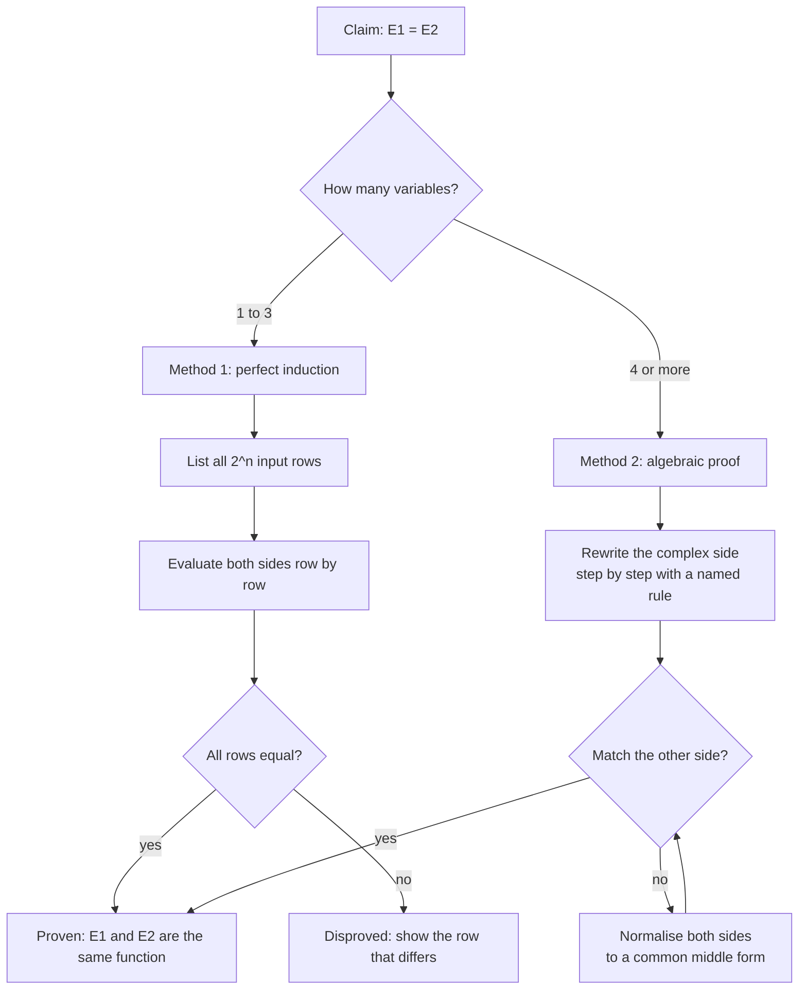

---
tags:
  - ECE2050
  - boolean-algebra
date: 2026-09-16
aliases:
  - 完全归纳法
  - 穷举证明
  - Perfect Induction
  - Proof by Exhaustion
---

> [!NOTE] Where this fits · 定位
> 第 4 章第五篇（讲义 p.20–27）。前两篇给了公理与规则，这一篇回答"凭什么相信它们"：
> 布尔代数只有两种证明方法，而讲义用 Rule 10、11、12 各演示了一遍。
> 前置：[[Boolean Axioms]]（A1–A5）、[[Laws and Rules of Boolean Algebra]]（12 条规则）。
> 下游：[[DeMorgan's Theorems]]（用同样两种方法证明）、[[Boolean Expression Simplification]]（每一步化简都要保证等价）。

> [!SUMMARY] Quick recall · 英文速览
> Perfect induction proves a Boolean identity by checking every possible input combination. It is exhaustive proof for a finite truth table, rather than a sample-based test.

## Core Definition · 核心定义

要证明两个布尔表达式**相等**，只有两条路（讲义 p.20）：

| 方法 | 名称 | 做法 | 讲义位置 |
|---|---|---|---|
| Method 1 | **完全归纳法 (perfect induction)** | 枚举**所有**可能的输入组合，逐行比较两边的值 | p.21（也叫 proof by exhaustion） |
| Method 2 | **代数化简 (algebraic proof)** | 用其它公理/定理把一个式子改写成另一个：*Make one side of the equation look like the other* | p.20 |

**完全归纳法 (perfect induction / proof by exhaustion)** 的判据（讲义 p.21 原话的意思）：

> 如果对**每一种**可能的输入组合，两个表达式都产生相同的值，那么这两个表达式相等。

- **完备性 (completeness)**：这不是"抽查几行"。$n$ 个变量只有 $2^n$ 种输入组合（[[Bits and Bytes]]），
  穷举 $2^n$ 行就把所有情况都覆盖了 —— 所以穷举在这里是**真正的证明**，不是验证。
- **代价**：行数随变量数指数增长：2 变量 4 行、3 变量 8 行、4 变量 16 行、10 变量 1024 行、20 变量约一百万行。

> [!IMPORTANT] 为什么布尔代数允许"穷举即证明"
> 数学里一般不能靠举例证明，因为定义域是无限的。布尔代数不同：公理 A1 把变量锁进 $\{0,1\}$，
> 于是 $n$ 个变量的定义域只有 $2^n$ 个点 —— **有限**。有限定义域上的"逐点相等"就是函数相等，
> 所以真值表逐行一致 ⟺ 两个表达式是同一个函数。这是布尔代数比普通代数"简单"的最大红利。

## Assumptions and Validity · 适用前提

- 成立条件 1：变量个数**有限**且每个变量只有 0/1 两个取值；此时 $2^n$ 行覆盖全部输入。
- 成立条件 2：真值表必须**不重不漏** —— 通常按二进制顺序列出 $000,001,010,\dots$，行数必须恰好 $2^n$。
- 成立条件 3：比较的是**两列**（左边一列、右边一列），不是只看一边的取值。
- Method 2 的成立条件：每一步改写都必须由**已证**的公理或定理支撑，并在右侧标注依据；
  不能拿结论本身当依据（循环论证）。
- 失效边界：$n$ 稍大（$\ge 5$）时穷举就不实用；而代数证明虽然短，却依赖"你记得住规则"。

## Derivation · 推导过程

### 1. Method 1 的流程

1. 数变量：$n$ 个 → 准备 $2^n$ 行。
2. 按二进制顺序（$00,01,10,11$）填输入列。
3. 分别算出等号左边与右边的中间量。
4. 逐行比较：**只要有一行不等，等式就被推翻**；全部 $2^n$ 行都相等，等式成立。

### 2. Method 2 的流程

1. 挑选"更复杂"的那一侧作为起点（把它往简单的一侧改）。
2. 每一步只做一件事：提取公因子、吸收、用 $A+\bar A=1$、消双重否定……
3. 每步在右边写清楚用了哪条规则（讲义 p.32 的写法规范）。
4. 当两侧形状一致时收工；如果两边都难改，可以**两边同时化简到同一个中间式**。
5. 收尾用 Method 1 抽查（或全查）一次，防止中途抄错符号。

### 3. 什么时候用哪一种

| 情形 | 建议方法 | 原因 |
|---|---|---|
| 变量数 $\le 3$（4–8 行） | Method 1 穷举 | 行数少、无需记规则、几乎不可能出错 |
| 变量数 $\ge 5$ | Method 2 代数 | $2^n$ 行爆炸（32 行以上），代数只要几步 |
| 需要证明的是"化简结果对不对" | Method 1 抽查关键行 + 全查 | 化简容易抄错横线，逐行比对最可靠 |
| 证明的是**规则本身**（如 Rule 10–12） | 两种都用 | 穷举说明"是什么"，代数说明"为什么"（讲义 p.22–27 正是这么做的） |
| 式子里有大量重复结构 | Method 2 代数 | 提取公因子能一次消掉一片 |

![[perfect-induction-rule10.svg]]
*图 1 — Rule 10（$A+AB=A$）的两种证法并排。(a) 完全归纳法：4 行穷举，第 4 列与第 5 列逐行相同，
于是 $A+AB=A$；(b) 代数法：$A+AB=A\cdot1+AB=A(1+B)=A\cdot1=A$，每一步标注所用规则。
两种证法得到同一个结论 —— 左图回答"每一行都对吗"，右图回答"为什么必然对"。*

## Method and Steps · 求解步骤与方法

1. **数变量**：从等式两边找出全部不同变量（例如 Rule 12 有 $A,B,C$ 三个 → 8 行）。
2. **列表**：输入列按二进制顺序；中间列按"括号内 → 乘积 → 和"的顺序算。
3. **比较**：把两边的最终列并排放在表格最后，逐行打勾。
4. **给结论**：$2^n$ 行全等 → 等式成立；出现不等 → 等式不成立（并给出反例行）。
5. **（代数法）改写到目标形状**：优先用 Rule 10–12 与 DeMorgan；每步写依据。
6. **交叉检查**：用 Method 1 复算一次 —— 两种方法互相独立，同时出错的可能性极低。

## Worked Example · 例题

**Example 1 — Rule 10：$A+AB=A$（讲义 p.22–23）**

**Method 1（perfect induction，4 行）**：

| $A$ | $B$ | $AB$ | $A+AB$ | $A$ | 比较 |
|---|---|---|---|---|---|
| 0 | 0 | 0 | 0 | 0 | ✓ |
| 0 | 1 | 0 | 0 | 0 | ✓ |
| 1 | 0 | 0 | 1 | 1 | ✓ |
| 1 | 1 | 1 | 1 | 1 | ✓ |

4 行全等 → $A+AB=A$ ✓（这就是图 1(a)）。

**Method 2（代数）**：

$$
\begin{aligned}
A+AB&=A\cdot1+AB &&\text{Rule 2 反向：}A=A\cdot1\\
&=A(1+B) &&\text{分配律反向（提取 }A\text{）}\\
&=A\cdot1 &&\text{Rule 3：}1+B=1\\
&=A &&\text{Rule 2：}A\cdot1=A
\end{aligned}
$$

**数值校验 (Numerical check)**：把代数证明的每一步单独对 4 行枚举 ——
$A\cdot1+AB$ 与 $A+AB$ 4 行全等 ✓；$A(1+B)$ 与 $A\cdot1+AB$ 4 行全等 ✓；$A\cdot1$ 与 $A(1+B)$ 4 行全等 ✓。
每一步都是恒等式，串起来就得到整条证明 ✓。

- 直觉：$A=1$ 时两项都是 1，$A+AB=1$；$A=0$ 时两项都是 0。**$B$ 根本不影响结果** —— 这就是"吸收"。

**Example 2 — Rule 11：$A+\bar AB=A+B$（讲义 p.24–25）**

**Method 1（perfect induction，4 行）**：

| $A$ | $B$ | $\bar A$ | $\bar AB$ | $A+\bar AB$ | $A+B$ | 比较 |
|---|---|---|---|---|---|---|
| 0 | 0 | 1 | 0 | 0 | 0 | ✓ |
| 0 | 1 | 1 | 1 | 1 | 1 | ✓ |
| 1 | 0 | 0 | 0 | 1 | 1 | ✓ |
| 1 | 1 | 0 | 0 | 1 | 1 | ✓ |

**Method 2（代数，用 Rule 12 反向）**：

$$
\begin{aligned}
A+\bar AB&=(A+\bar A)(A+B) &&\text{Rule 12 反向：}X+YZ=(X+Y)(X+Z)\\
&=1\cdot(A+B) &&\text{Rule 7：}A+\bar A=1\\
&=A+B &&\text{Rule 2：}1\cdot X=X
\end{aligned}
$$

**数值校验 (Numerical check)**：对 4 行分别验证每一步 ——
$(A+\bar A)(A+B)$ 与 $A+\bar AB$：$A=0,B=1$ 时左边 $(0+1)(0+1)=1$、右边 $0+1\cdot1=1$ ✓；
$A=1,B=0$ 时左边 $(1+0)(1+0)=1$、右边 $1+0\cdot0=1$ ✓。其余两行 0、1 同样吻合 ✓。
第二步 $1\cdot(A+B)$ 第三步 $A+B$ 分别是 Rule 7 与 Rule 2，逐行代入也成立 ✓。

- 直觉：$A=0$ 时第一项消失，式子退化成 $\bar AB=B$；$A=1$ 时结果本来就是 1，与 $A+B$ 一致 ——
  所以 $\bar A$ 这个条件可以**省掉**。

**Example 3 — Rule 12：$(A+B)(A+C)=A+BC$（讲义 p.26–27）**

**Method 1（perfect induction，$2^3=8$ 行）**：

| $A$ | $B$ | $C$ | $A+B$ | $A+C$ | $(A+B)(A+C)$ | $A+BC$ | 比较 |
|---|---|---|---|---|---|---|---|
| 0 | 0 | 0 | 0 | 0 | 0 | 0 | ✓ |
| 0 | 0 | 1 | 0 | 1 | 0 | 0 | ✓ |
| 0 | 1 | 0 | 1 | 0 | 0 | 0 | ✓ |
| 0 | 1 | 1 | 1 | 1 | 1 | 1 | ✓ |
| 1 | 0 | 0 | 1 | 1 | 1 | 1 | ✓ |
| 1 | 0 | 1 | 1 | 1 | 1 | 1 | ✓ |
| 1 | 1 | 0 | 1 | 1 | 1 | 1 | ✓ |
| 1 | 1 | 1 | 1 | 1 | 1 | 1 | ✓ |

8 行全等 → 等式成立 ✓。注意 $A=1$ 的 4 行两边都是 1，$A=0$ 的 4 行两边都等于 $BC$ ——
这正是"$A$ 为真时整式恒真，否则看 $BC$"的另一种读法。

**Method 2（代数，展开后吸收）**：

$$
\begin{aligned}
(A+B)(A+C)&=AA+AC+AB+BC &&\text{分配律（逐项相乘）}\\
&=A+AC+AB+BC &&\text{Rule 6：}AA=A\\
&=A(1+C+B)+BC &&\text{分配律反向（把前 3 项里的 }A\text{ 提出来）}\\
&=A\cdot1+BC &&\text{Rule 3：}1+C+B=1\\
&=A+BC &&\text{Rule 2：}A\cdot1=A
\end{aligned}
$$

**数值校验 (Numerical check)**：分步枚举 8 行 ——
$AA+AC+AB+BC$ 与 $(A+B)(A+C)$ 8 行全等 ✓；$A+AC+AB+BC$ 与上一步 8 行全等（只用了 $AA=A$）✓；
$A(1+C+B)+BC$ 与 $A+AC+AB+BC$ 8 行全等 ✓；最后 $A\cdot1+BC=A+BC$ ✓。
例：$A=0,B=1,C=1$ → 展开式 $0+0+0+1=1$，右式 $0+1=1$ ✓；$A=1,B=0,C=0$ → $1+0+0+0=1$，右式 $1+0=1$ ✓。

**Example 4 — 该用哪一种？（自算的判断练习）**

题目：分别选择方法并说明理由。
(a) 证明 $\bar{\bar A}=A$；(b) 证明 $WXYZ+\bar WXYZ=XYZ$；(c) 证明 $A+\bar AB=A+B$。

解：

- (a) 1 个变量 → **Method 1**，2 行：$A=0\to\bar{\bar0}=\bar1=0$ ✓；$A=1\to\bar{\bar1}=\bar0=1$ ✓。也可以直接引 Rule 9。
- (b) 4 个变量 → 16 行太多，用 **Method 2**：$WXYZ+\bar WXYZ=XYZ(W+\bar W)=XYZ\cdot1=XYZ$
  （分配律反向 + Rule 7 + Rule 2），3 步搞定。
- (c) 2 个变量 → 两者都行；讲义 p.24–25 用的是 Method 2（3 步），但 4 行穷举同样可以（Example 2）。

**数值校验 (Numerical check)**：(b) 用 16 行枚举验证 $WXYZ+\bar WXYZ$ 与 $XYZ$ 全等 ✓；
(a) 2 行 ✓；(c) 见 Example 2 的 4 行表 ✓。

## Pitfalls · 常见误区

> [!WARNING] 证明方法用错，比算错更致命

1. **把 perfect induction 当"举几个例子"**。错在：只算 $A=0,B=1$ 一行就宣布等式成立。
   正确：必须**穷举全部 $2^n$ 行**；漏一行就等于没证（反例：$A+\bar AB=A+B$ 在 $A=1$ 的行看不出差别，全靠 $A=0$ 那两行）。
2. **行数算错**。错在：3 个变量只列 4 行。正确：$n$ 个变量恰好 $2^n$ 行（Rule 12 是 3 变量 → 8 行）。
3. **循环论证**。错在：用 Rule 11 去证 Rule 11，或用尚未证明的定理当依据。
   正确：先证"更基础"的（讲义先展开证明 Rule 12，再用 Rule 12 反向证明 Rule 11；Rule 10 只用 Rule 2/3 与分配律）。
4. **只算一边**。错在：只列出左边的真值就下结论。
   正确：真值表要有**两列**结果并逐行比较；只算一边无法发现差异。
5. **变量多时硬穷举**。错在：5 个变量还画 32 行表，抄错一行前功尽弃。
   正确：变量 $\ge 4$ 优先代数法，穷举只用来抽查关键行。
6. **代数步骤不写依据**。错在：一步从 $A+AB$ 跳到 $A$ 却不说为什么。
   正确：写 `Rule 10`；讲义 p.32 的例题正是每步右侧标注规则，便于检查。

## Exhaustive proof and counterexamples · 穷举证明与反例

For n independent Boolean inputs, a complete truth table contains 2^n rows. Comparing both expressions on all rows proves equivalence over that domain. Checking only the rows where one expression is one does not establish that the other expression has no additional ON rows.

One mismatching row is enough to disprove an identity. It is useful to test all-zero, all-one, and boundary rows first, but those quick checks cannot replace the full proof when they pass. For a design with don't-cares, compare only the explicitly specified rows and state that limited domain.

**Worked application.** 声称 $AB+AC=A(B+C)$，四个变量组合类别由 A决定：A=0 时两侧0；A=1 时两侧B+C。也可列8行。声称 $A+B=AB$ 则在 A=1,B=0 得1≠0，一行反例足够否定。

**English exam question:** Can exhaustive testing of one-step state equations verify a long state sequence?

**Answer:** If every state-input pair matches the specified transition and output tables, repeated application preserves the specified behavior from a defined initial state. Initialization and unreachable-state policy still need checking. This connects the method to [[Synchronous Counter Design]], [[Sequence Detector]], and [[Testbench and Functional Verification]].

## Connections · 相关笔记

- 上游 (upstream)：[[Boolean Axioms]] —— A1 把值域锁成 $\{0,1\}$，$2^n$ 行才是"全部情况"。
- 上游 (upstream)：[[Laws and Rules of Boolean Algebra]] —— 代数证明的"工具库"：三条定律 + 12 条规则。
- 平行 (parallel)：[[Truth Table and Boolean Expression]] —— 真值表既是表达式的来源，也是 perfect induction 的表格形态。
- 下游 (downstream)：[[DeMorgan's Theorems]] —— 同样用"4 行穷举 + 代数"两套证明。
- 下游 (downstream)：[[Boolean Expression Simplification]] —— 化简的每一步都要能回退到"等价"，靠的正是本篇的方法。
- 补充对照：[[Bits and Bytes]] —— $n$ 个变量 $2^n$ 种组合，与 $n$ 位二进制能表示 $2^n$ 个值同源。

---
索引：[[ECE2050 Knowledge Tree]] · [[Glossary]]
