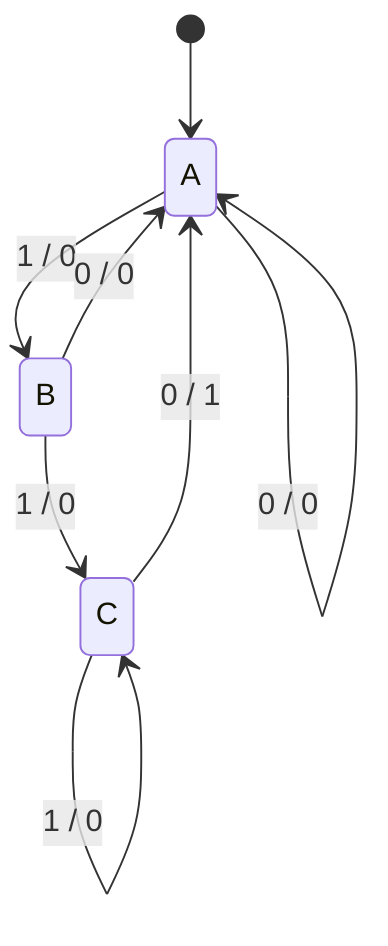

---
tags:
  - ECE2050
  - finite-state-machines
date: 2026-09-30
aliases:
  - 序列检测器
  - Sequence Detector
  - Overlapping sequence detection
---

# Sequence Detector · 序列检测器

> [!SUMMARY] Quick recall · 英文速览
> A serial pattern detector stores the longest relevant suffix of past input. Overlap means that the end of one match may become the beginning of the next match.

## Specification · 明确规范

本篇检测串行 110，高有效 input x，一位每正沿，Mealy 输出 z，允许重叠。状态表示已匹配的最长前缀：A=none、B=1、C=11。reset→A。

## Derivation · 最长后缀原则

- A 收 0：没有前缀可保留，留 A；收 1：到 B。
- B 收 0：10 的后缀没有前缀 1，回 A；收 1：到 C。
- C 收 1：111 的最长相关后缀仍是 11，留 C。
- C 收 0：110 匹配，输出 1；110 的后缀没有以 1 开始的可用前缀，回 A。

| State | x=0 next / z | x=1 next / z |
|---|---|---|
| A | A / 0 | B / 0 |
| B | A / 0 | C / 0 |
| C | A / 1 | C / 0 |

## Encoded Equations · 编码方程

令 A=00,B=01,C=10；规定 11 对任意 x 恢复 A 且 z=0：

$$D_1=x(Q_1\oplus Q_0),\qquad D_0=x\bar Q_1\bar Q_0,\qquad z=Q_1\bar Q_0\bar x.$$

检查 C=10,x=1 得 D=10；C,x=0 得 D=00,z=1。编码域 11 时 XOR=0、两个 D=0，z=0，符合恢复规定。输出是在 current state 与 current input 的组合窗口内有效。

## Worked Example · 追踪 1110110

| Bit number | Input | Pre-state | z | Post-state |
|---|---|---|---|---|
| 1 | 1 | A | 0 | B |
| 2 | 1 | B | 0 | C |
| 3 | 1 | C | 0 | C |
| 4 | 0 | C | 1 | A |
| 5 | 1 | A | 0 | B |
| 6 | 1 | B | 0 | C |
| 7 | 0 | C | 1 | A |

匹配结束于第 4、7 位。111 中保持 C 是为了不丢掉最近两个 1；若每次多一个 1 就 reset，会漏掉第 4 位结束的匹配。

## Overlap Example · 101 的重叠

对于 101，检测完成后最后一个 1 可以作为下一次的首位，故返回“已看到 1”的状态，而不是无匹配状态。输入 10101 有两个 match，结束于位 3、5。110 的完成后没有这样的非空可复用后缀，所以本例回 A 仍正确。

## Method and Exam English · 方法与答题

For each state and input, append the new symbol and keep the longest suffix that is also a prefix of the target pattern. This rule handles repeated symbols and overlap systematically.

- 明确 simultaneous word detection 与 serial detection，见 [[Combinational Logic Design]]。
- 标注 Mealy 输出在 edge 前窗口还是 registered post-edge pulse。
- 最少测试 exact match、near miss、重复前缀、连续匹配和 reset。

**Exam answer:** “Each state represents the longest suffix that remains useful for matching the target. On a completed match, I retain any suffix that can start another match, so overlapping occurrences are not lost.”

## Connections · 相关笔记

[[Finite State Machine]], [[Moore and Mealy Machines]], [[State Encoding and Unused States]], [[Shift Registers]], [[Testbench and Functional Verification]].

---
索引：[[ECE2050 Knowledge Tree]] · [[Glossary]]
