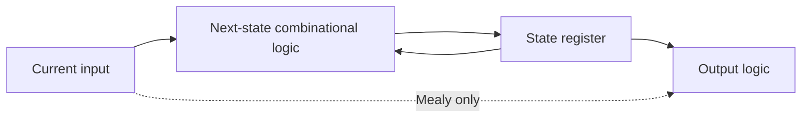

---
tags:
  - ECE2050
  - sequential-logic
date: 2026-09-30
aliases:
  - 时序逻辑
  - Sequential Logic
  - Synchronous sequential circuits
---

# Sequential Logic · 时序逻辑

> [!SUMMARY] Quick recall · 英文速览
> State stores the relevant past. A synchronous sequential circuit computes next state with combinational logic and loads it into registers at an active clock edge.

## Core Definition · 核心定义

状态 (state) 是预测未来行为所需的历史信息，不一定包含全部过去输入。设当前状态 $Q[k]$、本周期输入 $X[k]$：

$$Q[k+1]=F(Q[k],X[k]).$$

Moore 输出 $Y[k]=G(Q[k])$；Mealy 输出 $Y[k]=G(Q[k],X[k])$。k 是 clock-cycle index，没有物理单位；实际 clock period T 有时间单位。

## Mechanism and Composition · 机制与构成

寄存器提供边界，使组合反馈路径每经过一圈至少跨过一个状态元件。同步教学模型要求所有寄存器用同一 clock，至少有一个寄存器，组合部分无回路。组合输出在周期中可变化，寄存器状态只在指定事件更新。

The arrows describe information flow. The feedback is broken in time by the register. An unclocked inverter loop can oscillate, and a bistable loop can store a bit; neither is automatically a reliable synchronous FSM.

## Worked Examples · 例题

**Running parity.** 状态 Q 记录已接收 bit 的 odd/even parity，初值 0；$Q^+=Q\oplus X$。输入 1,0,1,1 后状态 1,1,0,1。只需记忆一个 bit，因为完整历史对未来 parity 不再必要。

**Counter.** n-bit counter 的当前状态为整数 q，enabled 时 $q^+=(q+1)\bmod2^n$。当前 3 与当前 7 即使输入相同，下一个状态也不同，所以输出不能只由当前输入确定。

**Simultaneous update.** 两个 DFF 有 $D_A=Q_B,D_B=Q_A$，初值 (QA,QB)=(1,0)。下一 edge 后 (0,1)，再后 (1,0)。两个右侧都必须从同一旧状态取值；先更新 QA 再用于 QB 会错误地得到 (0,0)。

## Assumptions and Limits · 条件与边界

The recurrence is a functional model. Setup/hold must still be satisfied, asynchronous inputs must be handled, and reset must establish a specified starting state. Real outputs settle after clock-to-Q delay, not at exactly zero time.

不要把“不符合组合构成规则”的一切网络都称为“正常时序电路”。多驱动冲突可能是无定义连接；奇数反相回路可振荡；需逐类分析，不能套一个确定的 next-state table。

## Method and Review · 方法与复习

- Identify the state variables and initial values.
- Write input equations for every storage element.
- Substitute the characteristic equation to obtain next state.
- 从同一当前状态求全部 $Q^+$，随后统一更新。
- Check the active edge, asynchronous controls, and output type separately.

**Exam question:** Why is a sequence detector sequential when a four-bit pattern detector is combinational?

**Answer:** A serial detector receives one symbol at a time and must remember earlier symbols. A four-bit detector receives the entire relevant pattern simultaneously, so its output can be computed from current inputs alone.

## Connections · 相关笔记

[[Combinational Circuit]], [[Set-Reset Latch]], [[D Latch and D Flip-Flop]], [[Finite State Machine]], [[Counters]], [[Shift Registers]].

---
索引：[[ECE2050 Knowledge Tree]] · [[Glossary]]
