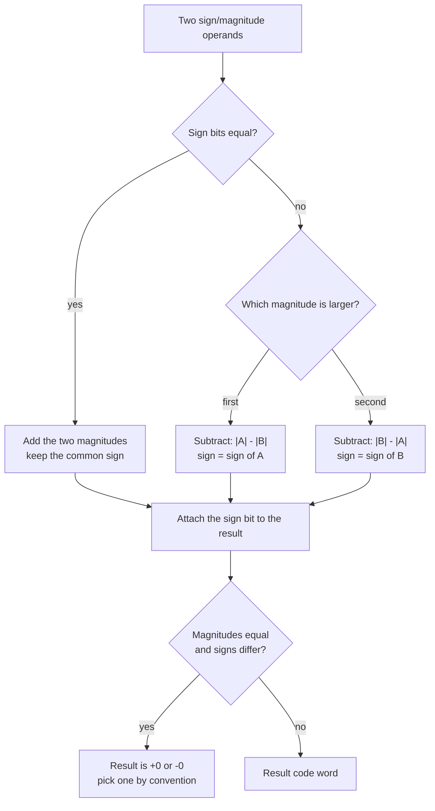

---
tags:
  - ECE2050
  - signed-numbers
date: 2026-09-16
aliases:
  - 原码
  - 符号数值表示法
  - 符号-幅值表示
  - Sign-Magnitude Representation
  - Sign and Magnitude
---

> [!NOTE] Where this fits · 定位
> 第二章从"无符号位串"跨到"有符号数"的第一步。[[Binary Arithmetic]] 里的加法器只会把位串当作无符号数相加，
> 要表示负数就必须**人为约定符号写在哪里**。sign/magnitude 是最贴近人类直觉的约定：先写正负号，再写大小（讲义 p.35–37）。
> 前置：[[Number Systems]]（位权展开）、[[Binary Arithmetic]]（进位链、溢出）。
> 下游：[[Two's Complement Representation]] 就是为了修好本篇的两个缺陷而设计的；
> 而"专门留一个符号位"的想法本身活了下来 —— 今天 IEEE 754 单精度浮点数的第 31 位仍然是符号位
> （[[Floating-Point Numbers]]）。

> [!SUMMARY] Quick recall · 英文速览
> Sign-magnitude stores the sign separately from the magnitude. It has both positive and negative zero, and ordinary binary addition does not directly implement signed addition in this format.

## Core Definition · 核心定义

**原码 (sign-magnitude representation)** 把一个 $N$ 位码字切成两段（讲义 p.36）：

- **符号位 (sign bit)**：**最高位 (MSB, most significant bit)，也就是最左边那一位**。
  - $0$ → 正数 (positive)；
  - $1$ → 负数 (negative)。
- **幅值位 (magnitude bits)**：剩下的 $N-1$ 位，按**普通无符号二进制**读，不做任何取反或补码处理。

写成公式就是"符号 × 幅值"：

$$
x_{\text{sign/mag}} \;=\; (-1)^{\,a_{N-1}} \sum_{i=0}^{N-2} a_i\,2^{\,i}
$$

- 意义：符号位只负责**定正负**，不参与数值大小；幅值部分仍然是有位权的（位权 $2^{0}\dots2^{N-2}$）。
- 数值校验（$N=4$）：$1110$ → $a_3=1$ 故取负号，幅值 $110_2=6$，所以 $1110$ 表示 $-(6)=-6$ ✓；
  $0110$ → $a_3=0$ 取正号，幅值 $110_2=6$，所以 $0110$ 表示 $+6$ ✓。
  这正是讲义 p.36 的原例：$+6=0110$，$-6=1110$。

**记号与位宽**：四位时记作 $a_3a_2a_1a_0$，其中 $a_3$ 是符号位、$a_2a_1a_0$ 是幅值（3 位，最大 $111_2=7$）。
按库内约定，位串一律 4 位一组书写：8 位原码写 $0000\,0110$（$+6$）、$1000\,0110$（$-6$）。

| 十进制    | 8 位原码       | 十进制    | 8 位原码       |
| ------ | ----------- | ------ | ----------- |
| $+0$   | `0000 0000` | $-0$   | `1000 0000` |
| $+6$   | `0000 0110` | $-6$   | `1000 0110` |
| $+127$ | `0111 1111` | $-127$ | `1111 1111` |

![[sign-magnitude-zero.svg]]
*图 1 — (a) 4 位原码的全部 16 个码字按它们所表示的十进制值排在数轴上：$0111$ 与 $1111$ 是范围的两个端点，
而 $0000$（$+0$）与 $1000$（$-0$）**叠在同一个位置**，这就是"两个零"。(b) 用竖式算 $(-6)+(+6)$：
$1110+0110=1\,0100$，也就是十进制的 20 —— 符号位被当成普通权重位卷进了加法。(b) 说明的是下文第 2 条缺陷。*

## Assumptions and Validity · 适用前提

> [!IMPORTANT] 原码的本质是"符号与幅值解耦"，代价是**不能直接把整串交给普通无符号加法器**
> 原码把"是正是负"和"有多大"这两件事彻底分开：读出 $1000\,0110$ 时，人眼先看首位得"负"，
> 再把后 7 位读成 $6$ —— 对人类极其友好。原码可用于存储和专门设计的算术；
> 若直接沿用普通无符号加法器，符号位会作为普通二进制位进入进位链，结果通常不符合原码语义（见"推导过程"第 2 节）。
> 结论：原码是**表示法 (representation)**；正确算术需要显式处理符号与幅值，不能直接复用整字无符号运算。

**取值范围**（讲义 p.36 给出通式）：

$$
x_{\text{sign/mag}} \in \left[-\left(2^{\,N-1}-1\right),\;\; 2^{\,N-1}-1\right]
$$

- 意义：幅值只有 $N-1$ 位，能表达 $0\dots2^{N-1}-1$，符号对称地贴在两边，所以范围**关于 0 对称**。
- 数值校验：$N=4$ → $2^{3}-1=7$，范围 $[-7,+7]$ ✓（$0111=+7$、$1111=-7$，与图 1(a) 的端点一致）；
  $N=8$ → $2^{7}-1=127$，范围 $[-127,+127]$ ✓。
- 对比：同样 4 位，无符号范围是 $[0,15]$，共 16 个不同数值；原码只有 $15$ 个不同数值 —— **白白浪费了一个码字**。

**两个致命缺陷**（讲义 p.37）：

1. **加法不成立**：$1110+0110=1\,0100_{(2)}=20_{(10)}$，而 $(-6)+(+6)$ 必须是 $0$。
2. **两个零**：$0000$ 与 $1000$ 都表示 $0$（$+0$ 与 $-0$），同一个数值有两种码字。

**失效边界**：只要运算涉及符号，原码就必须额外增加"比符号 → 定加减 → 定结果符号"的判断电路，
不能直接复用 [[Binary Arithmetic]] 里那一个无符号加法器。

## Derivation · 推导过程

### 1. 为什么范围是对称的，而且"少一个数"

$N$ 位一共 $2^{N}$ 个码字，原码把它们分成两半：

| 码字区间 | 数量 | 含义 |
|---|---|---|
| `0000` … `0111` | $2^{N-1}$ 个 | 符号位 0：$+0$ 到 $+(2^{N-1}-1)$ |
| `1000` … `1111` | $2^{N-1}$ 个 | 符号位 1：$-0$ 到 $-(2^{N-1}-1)$ |

负半边的 $2^{N-1}$ 个码字里，`1000` 被 $-0$ 占掉，真正能用的负数只有 $2^{N-1}-1$ 个。
所以范围是 $[-(2^{N-1}-1),\,2^{N-1}-1]$，**对称但不含 $-2^{N-1}$**。

数值校验（$N=4$）：负码字 $1000\dots1111$ 共 8 个，其中 $1000$ 是 $-0$，剩下 $1001\dots1111$ 恰好 7 个，
对应 $-1\dots-7$ ✓ 与 $[-(2^{3}-1),2^{3}-1]=[-7,7]$ 吻合。

### 2. 为什么加法不成立：符号位被当成权重位

原码的符号位就摆在最高位，而无符号加法器**不认识"符号"这个概念**，它只会把每一位按权重相加。
于是符号位 $a_{N-1}$ 被当成权重 $2^{N-1}$ 的普通数据位：

| 列（$N=4$） | $2^{3}$（符号位） | $2^{2}$ | $2^{1}$ | $2^{0}$ |
|---|---|---|---|---|
| $-6$ | $1$ | $1$ | $1$ | $0$ |
| $+6$ | $0$ | $1$ | $1$ | $0$ |
| 逐位和 | $1$（并产生向 $2^{4}$ 的进位 $1$） | $0$ | $0$ | $0$ |
| 结果 | $1$ | $0$ | $1$ | $0$ |

$1110_{(2)}=14$，$0110_{(2)}=6$，$14+6=20=1\,0100_{(2)}$ —— 也就是说，**两个绝对值相同、符号相反的数的码字相加，
得到的是两个幅值之和的两倍**。丢弃第 5 位进位后剩下 $0100$，在原码里读作 $+4$，也不是 $0$。

要做对，硬件必须走完全不同的路（见下方 Mermaid）：先看符号是否相同 → 同号则幅值相加、符号照抄；
异号则比较两个幅值、大减小、结果取绝对值大的那个的符号。**一次加法要比较三次**，这就是原码被淘汰的原因。

### 3. 两个零带来的额外代价

$0000$ 与 $1000$ 表示同一个数 $0$，于是：

- 判零电路要写成 `(code == 0000) or (code == 1000)`，而不是一次比较；
- 加法结果可能是 $+0$ 也可能是 $-0$，下游必须规定统一用哪一个；
- $16$ 个码字只承载 $15$ 个数值，编码效率 $15/16$。

> [!TIP] 一句话记住原码的处境
> 原码 = **"能读不能算"**。它像一个带正负号的标签，贴上去很清楚，
> 但你不能把标签直接扔进加法器 —— 加法器只认位权。

## Method and Steps · 求解步骤与方法

1. **确定位宽 $N$**（符号位算在 $N$ 里）。幅值位只有 $N-1$ 位。
2. **把绝对值写成二进制**，然后**左侧补 0** 到恰好 $N-1$ 位。补零这一步是最高频的失分点。
3. **贴上符号位**：正数前补 `0`，负数前补 `1`，凑满 $N$ 位。
4. **反向读码**（给定位串求值）：看 MSB 决定正负 → 把剩下 $N-1$ 位当无符号数读 → 套上符号。
5. **检查位宽与范围**：幅值是否 $\le 2^{N-1}-1$？超了就说明该数值原码根本表示不了。

| 十进制 | 绝对值的二进制 | 补到 $N-1=3$ 位 | 加符号位（$N=4$） |
|---|---|---|---|
| $+3$ | $11$ | `011` | `0011` |
| $-3$ | $11$ | `011` | `1011` |
| $+7$ | $111$ | `111` | `0111` |
| $-7$ | $111$ | `111` | `1111` |

## Worked Example · 例题

**Example 1 — 写出 $-6$ 的 4 位原码（讲义 p.36）**

题目：用 4 位原码表示 $-6$，并指出符号位与幅值位各是哪几位。

解：
1. 位宽 $N=4$ → 幅值位 $N-1=3$ 位。
2. $|-6|=6=110_{(2)}$，已经是 3 位，无需补零。
3. $6$ 是负数 → 符号位取 $1$，得到 `1110`。
4. 于是 $a_3=1$ 是符号位（负），$a_2a_1a_0=110$ 是幅值 $=6$。

**数值校验 (Numerical check)**：反过来解码 $1110$ → 符号位 $1$ 判为负，幅值 $110_2=4+2=6$，故为 $-6$ ✓。
与讲义 p.36 的 $+6=0110$ / $-6=1110$ 完全一致；两者只差最高位 ✓。

**Example 2 — 用 $(-6)+(+6)$ 演示加法失效（讲义 p.37）**

题目：直接对 $1110$ 与 $0110$ 做二进制加法，看看会发生什么。

解：
1. $1110_{(2)}=8+4+2=14$，$0110_{(2)}=4+2=6$。
2. $14+6=20$，二进制是 $1\,0100_{(2)}$（第 5 位是进位）。
3. 若保留 5 位，结果是 $20$；若按 4 位截断，得 $0100$，原码读作 $+4$。

**数值校验 (Numerical check)**：
- $1110+0110$ 逐位验算：$0+0=0$；$1+1=0$ 进位 $1$；$1+1+1=1$ 进位 $1$；$1+0+1=0$ 进位 $1$ → 结果 `1 0100` ✓
- 真值要求 $(-6)+(+6)=0$，而两种读法分别得到 $20$ 与 $+4$，**都 $\ne 0$** ✓（$20\ne0$、$4\ne0$）
- 这正是讲义 p.37 标注 `(wrong!)` 的那一步。

**Example 3 — 8 位原码的范围与端点**

题目：8 位原码能表示的最大数、最小数各是多少？$-6$ 的 8 位原码是什么？

解：
1. 范围公式：$[-(2^{7}-1),\,2^{7}-1]=[-127,\,+127]$。
2. 最大数：`0111 1111` $=+127$；最小数：`1111 1111` $=-127$。
3. $-6$：幅值 $6=$ `000 0110`（补到 7 位），加符号位得 `1000 0110`。

**数值校验 (Numerical check)**：
- $0111\,1111_2 = 64+32+16+8+4+2+1 = 127$ ✓；$1111\,1111$ 的幅值是 $127$、符号为负 → $-127$ ✓
- $1000\,0110$ 的幅值 $000\,0110_2=6$ → $-6$ ✓
- 注意端点差：8 位无符号最大是 $255$，8 位原码最大只有 $127$ —— 符号位吃掉了整整一半码字 ✓

## Pitfalls · 常见误区

> [!WARNING] 原码的坑几乎全部来自"把符号位当成普通位"或者"把码字当成补码"

1. **直接把两个原码相加/相减**。错在：$1110+0110$ 得到 $20$ 却以为答案错了。正确做法：原码**必须先拆符号和幅值**，
   按 Mermaid 流程图走"同号加、异号大减小"，或者先转成 [[Two's Complement Representation]] 再算。
2. **以为 `1000` 是 $-8$**。错在：把原码和补码的码表混了 —— `1000` 在补码里才是 $-8$，在原码里是 $-0$。
   正确：原码 4 位的 $-7$ 是 `1111`，不存在 $-8$。
3. **以为范围是 $[-2^{N-1},\,2^{N-1}-1]$**。错在：那是补码的范围。原码是**对称**的 $[-(2^{N-1}-1),\,2^{N-1}-1]$。
4. **幅值不补零**。错在：写 $-6$ 的 8 位原码时写成 `1110`（4 位）或 `100110`（把幅值写成 6 位却漏了符号位对齐）。
   正确：幅值一定补到 $N-1$ 位，再贴符号位 → `1000 0110`。
5. **用 $N-1$ 位去算范围**。错在：把"幅值位是 $N-1$ 位"和"整个码字是 $N$ 位"搞混，于是把 8 位原码的范围算成 $[-63,63]$。
   正确：幅值 $N-1$ 位，最大幅值 $2^{N-1}-1$ → $[-127,127]$。
6. **认为原码已经彻底淘汰、不用学**。错在：跳过它就看不懂为什么补码要这样设计。
   正确：原码的"符号位"思想仍在用 —— 见 [[Floating-Point Numbers]] 的 IEEE 754 格式（最高位就是符号位），
   ADC/传感器数据也常用"符号位 + 幅值"的原始格式。

## Comparing signed representations · 有符号表示的英文理解

Sign-magnitude is a valid representation with a separate sign and unsigned magnitude. It supports arithmetic when the hardware explicitly handles those fields. The limitation is that an ordinary binary adder cannot treat the entire word as a positional integer and automatically obtain the correct signed result.

For equal signs, add the magnitudes and retain the sign, provided the magnitude fits. For opposite signs, subtract the smaller magnitude from the larger and use the sign of the larger operand. If the magnitudes are equal, the mathematical result is zero; the implementation should state whether it normalizes both zero codes to positive zero.

**Worked application — opposite signs.** 5 位原码：−9=`11001`，+4=`00100`。拆出 signs 1/0 与 magnitudes 9/4，因异号做 $9-4=5$，取幅值较大的 −9 的符号，结果 `10101`=−5。普通位串相加却得 `11101`，按原码读是 −13，说明不能直接沿用无符号加法。将−5回代 $-9+4=-5$ 即验证。

In English: the failed direct addition is evidence about the chosen adder algorithm, not evidence that the representation cannot support arithmetic. A dedicated sign-magnitude datapath can calculate correctly, but it needs sign selection and magnitude comparison.

**English exam question:** Why do $N$ sign-magnitude bits represent only $2^N-1$ distinct numeric values?

**Answer:** There are $2^N$ patterns, but the all-zero magnitude appears with both sign choices. Positive zero and negative zero therefore refer to the same mathematical value. All nonzero magnitudes have one positive and one negative encoding.

Compare [[Two's Complement Representation]] for reuse of a standard adder. [[Magnitude Comparator]] provides the magnitude ordering needed here, while [[Floating-Point Numbers]] also separates a sign from a magnitude-related field.

## Connections · 相关笔记

- 上游 (upstream)：[[Number Systems]] —— 位权的概念是"幅值位按无符号读"的依据。
- 上游 (upstream)：[[Binary Arithmetic]] —— 原码的加法失效，正是因为无符号加法器只认位权、不认符号。
- 下游 (downstream)：[[Two's Complement Representation]] —— 用"MSB 权重为负"的思路同时消灭了"加法不成立"和"两个零"。
- 下游 (downstream)：[[Signed Binary Multiplication and Division]] —— 有符号乘除法只在**符号**上借用原码的思路（同号为正、异号为负），
  幅值部分则必须换成真值或补码。
- 平行 (parallel)：[[Floating-Point Numbers]] —— IEEE 754 的符号位是原码思想的直系后代；那里符号与有效数字也是解耦的。

---
索引：[[ECE2050 Knowledge Tree]] · [[Glossary]]
