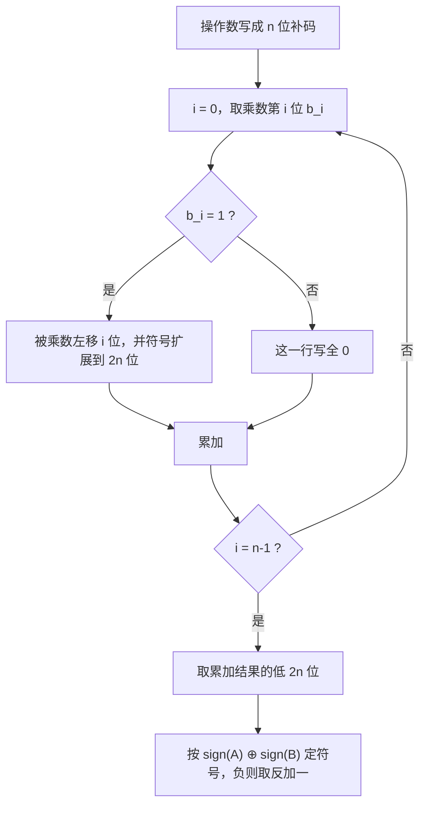
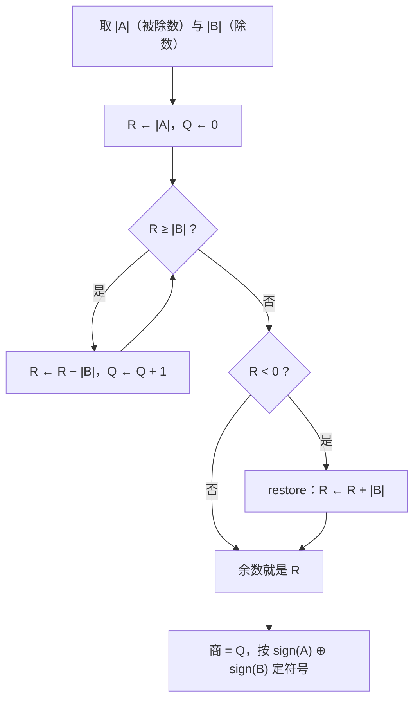

---
tags:
  - ECE2050
  - signed-numbers
date: 2026-09-16
aliases:
  - 有符号二进制乘除法
  - 补码乘除法
  - Signed Binary Multiplication and Division
  - Two's Complement Multiplication and Division
---

> [!NOTE] Where this fits · 定位
> 把 [[Binary Arithmetic]] 的四则运算从**无符号**推广到**有符号**：操作数用 [[Two's Complement Representation|补码]]
> 表示，乘法用"移位相加"、除法用"反复相减"实现。本篇回答四个问题：
> **① 怎么算（过程）；② 为什么这样算是对的（原理）；③ 补码操作数带来的麻烦；④ 每个麻烦怎么修**。
> 前置：[[Two's Complement Representation]]（符号位与"取反加一"）、[[Binary Arithmetic]]（无符号竖式与溢出）。

> [!SUMMARY] Quick recall · 英文速览
> Signed multiplication and division require consistent treatment of sign, width, and magnitude. Extend partial products correctly and verify quotient and remainder conventions.

## Core Definition · 核心定义

有符号二进制的乘除法 = **符号单独处理 + 幅值用移位/相减处理**：

$$
(A)\times(B)\;\Longrightarrow\;\text{sign}(A\cdot B)=\text{sign}(A)\oplus\text{sign}(B),\qquad |A\cdot B|=|A|\times|B|
$$

$$
(A)\div(B)\;\Longrightarrow\;\text{sign}(A/B)=\text{sign}(A)\oplus\text{sign}(B),\qquad |A/B|=|A|\div|B|
$$

- **符号规则**：同号为正、异号为负（讲义 p.46、p.47 原文 *Same sign → Positive; Different signs → Negative*）。
- **无符号幅值乘法的实现**：$B=\sum_{i=0}^{n-1}b_i2^i$，所以

$$
A\times B=\sum_{i=0}^{n-1}\bigl(b_i\cdot A\cdot 2^i\bigr)
$$

  每一项 $b_i\cdot A\cdot 2^i$ 就是"被乘数左移 $i$ 位或不出现"，称为**部分积 (partial product)**。
- **除法的实现**：反复减去除数，**商 = 相减次数**；停止条件 = 余数为 $0$ 或变负
  （讲义 p.47：*When to stop the subtraction: the remainder is a zero or a negative number;
  Quotient: # of times of subtraction performed*）。
- **位宽**：$n$ 位 $\times$ $n$ 位需要 **$2n$ 位**结果（$n=4$ 时 $11\times13=143$ 要 8 位才放得下）。

## Assumptions and Validity · 适用前提

> [!IMPORTANT] 直接补码部分积路线的三条前提（幅值路线另行处理符号）
> ① 每个部分积必须**符号扩展到最终宽度 $2n$ 位**；
> ② 乘数**最高位（符号位）那一行的权值是负的** $\bigl(-2^{n-1}\bigr)$，不能按 $+2^{n-1}$ 处理；
> ③ 结果寄存器取**低 $2n$ 位**，高于 $2n$ 位的进位是"修正项"的自然结果，直接丢弃。

- **操作数范围**：$n$ 位补码 $A,B\in[-2^{n-1},\,2^{n-1}-1]$；乘积一定落在 $2n$ 位补码范围内。
- **除法定义域**：除数 $\ne0$（$n$ 位补码中 $0$ 只有一个码字）；本课程用**截断除法**：余数与**被除数同号**，
  且 $|R|<|D|$。
- **讲义的两个限制**（p.46）：直接累加法 *very lengthy if the multiplier is a large number*，且
  *both numbers must be in true (uncomplemented) form*。本篇第 4 节专门讲这两条怎么被修掉。
- 定点小数（Q 格式）做乘法时小数点位置要另算，见 [[Fixed-Point Numbers]]。

## Derivation · 推导过程

### 1. 乘法：移位相加的逐步过程 (shift-and-add, step by step)

被乘数 $A$、乘数 $B=b_{n-1}\dots b_1b_0$，从 $i=0$（最低位）开始逐位生成部分积：

| 步骤 | 看乘数第 $i$ 位 | 这一行写什么 | 左移量 | 权值 |
|---|---|---|---|---|
| 0 | $b_0$ | $b_0=1$ 写 $A$，否则写 0 | 0 | $2^0$ |
| 1 | $b_1$ | 同上 | 1 | $2^1$ |
| $\vdots$ | $\vdots$ | $\vdots$ | $\vdots$ | $\vdots$ |
| $n-1$ | $b_{n-1}$（无符号最高位） | 同上 | $n-1$ | $2^{n-1}$ |

**小例子 $1011_2\times1101_2$**（此处为 4 位无符号幅值：$A=11$，$B=13$；不是 4 位补码正数）：

| $i$ | $b_i$ | 部分积 | 十进制 |
|---|---|---|---|
| 0 | 1 | `0000 1011` | 11 |
| 1 | 0 | `0000 0000` | 0 |
| 2 | 1 | `0010 1100` | 44 |
| 3 | 1 | `0101 1000` | 88 |

各行相加：$11+0+44+88=143=1000\,1111_2$ ✓ —— **乘法被化成了"看位、移位、相加"**：
$n$ 位乘法只要 $n$ 次判断 + 至多 $n$ 次加法，与乘数的**数值大小**无关（只与位宽有关）。

**讲义 p.46 的例题（$59\times83$）**：$59=11\,1011_2$，$83=101\,0011_2$，
按 $59$ 的各位取 $83$ 的移位值：

| $i$ | $59$ 的第 $i$ 位 | 部分积 | 十进制 |
|---|---|---|---|
| 5 | 1 | $83\times32$ | 2656 |
| 4 | 1 | $83\times16$ | 1328 |
| 3 | 1 | $83\times8$ | 664 |
| 2 | **0** | 不产生部分积 | 0 |
| 1 | 1 | $83\times2$ | 166 |
| 0 | 1 | $83\times1$ | 83 |

$2656+1328+664+0+166+83=4897$ ✓，$4897_{10}=10\,0110\,0100\,001_2$。

![[signed-multiplication-partial-products.svg]]
*图 1 — $59\times83$ 的部分积阶梯：顶部一行是各位的权值，每一行是一个 $83\times2^{i}$ 的移位部分积
（乘数位为 0 的那一行显式标注"不产生部分积"），行和 $=4897$；图的下半部分把 $+4897$ 放进 14 位补码
（取反 → 加 1）得到 $-4897=10\,1100\,1101\,1111_2$，并标出 14 位补码范围 $[-8192,+8191]$ 容得下它。*

### 2. 为什么补码可以这样算（原理与修正项）

**（a）移位相加为什么等于乘法。** 把乘数按位权展开：

$$
A\times B=A\times\sum_{i=0}^{n-1}b_i2^i=\sum_{i=0}^{n-1}b_i\bigl(A\cdot2^i\bigr)
$$

左边是一次乘法，右边只是"移位 + 条件相加"。$A\cdot2^i$ 在硬件里就是左移 $i$ 位，低位补 0 即可。

**（b）补码乘数多出来的那一项。** 补码下最高位的权是**负**的：

$$
B=-b_{n-1}2^{n-1}+\sum_{i=0}^{n-2}b_i2^i
$$

若照 (a) 把 $b_{n-1}$ 也当成 $+2^{n-1}$，就会**多算** $b_{n-1}\cdot A\cdot2^{n-1}\cdot2$；两种等价的修正写法：

1. **修正项法**：先按无符号算出 $\sum b_iA2^i$，再减去最高位那一行的"错算量"（在 $2n$ 位宽度下表现为丢弃最高进位）；
2. **符号扩展法**（硬件常用）：把每个部分积**符号扩展**到 $2n$ 位后再相加 —— 符号位的负权值被自动带上，
   不需要显式减法。**手算推荐这一种**。

**（c）为什么"符号扩展"是必需的。** 取 4 位补码 $A=1011_2$（$=-5$）、$B=0011_2$（$=+3$），
$A\times B=-15$，需要 8 位（$1111\,0001_2$）。两个部分积是 $A\cdot2^0$ 与 $A\cdot2^1$：

| 处理方式 | 第 0 行 | 第 1 行 | 相加结果 | 判定 |
|---|---|---|---|---|
| **错误**：把补码位串当无符号数 | `0000 1011` $=+11$ | `0001 0110` $=+22$ | `0010 0001` $=+33$ | ✗ 符号丢失，$+33\ne-15$ |
| **正确**：先符号扩展到 8 位 | `1111 1011` $=-5$ | `1111 0110` $=-10$ | `1111 0001` $=-15$ | ✓ 与 $-5\times3=-15$ 一致 |

原因：位串 `1011` 只有**在 4 位宽度里**才表示 $-5$；放进 8 位却不复制符号位时，最高位的权值变成 $+2^7$，
数值被解释成 $+11$。**符号扩展 = 把负权值带进新宽度**。

> [!TIP] 手算口诀
> 画一张"权值行 + 每行左移"的表：**每一行都比上一行多一个前导符号位**；符号位那一行照常参与相加，
> 最后取结果的**低 $2n$ 位**。

### 3. 除法：反复相减的逐步过程 (repeated subtraction / restoring)

**算法**：$R\leftarrow|A|$，$Q\leftarrow0$；只要 $R\ge|B|$ 就做 $R\leftarrow R-|B|$、$Q\leftarrow Q+1$；
当 $R=0$ 或 $R<|B|$ 时停止，$Q$ 是商、$R$ 是余数。若某一步减完变负（多减了一次），
就把除数**加回**（restore），商不加 1 —— 这就是"**恢复余数除法 (restoring division)**"名字的由来。

![[signed-division-restoring.svg]]
*图 2 — (a) 用反复相减做 $100\div25$：余数从 `0110 0100` 逐步减 `0001 1001`，每减一次商加 1，
第 4 次减完余数为 $0$ 即停止，商 $=4=0100_2$、余数 $=0$，故 $100=4\times25+0$；
(b) 幅值算完后**再修符号**：同号得 $+4=0000\,0100_2$，异号得 $-4=1111\,1100_2$（取反加一），
并用位权回读 $1111\,1100_2=-4$ 校验。*

**逐位长除法视角**（讲义 p.47 的 *Add 1 to quotient* 步骤）：把被除数逐位落下形成部分余数，
每落一位就比较"部分余数 $\ge$ 除数？"：是则减去除数并在商对应位记 1，否则记 0。
本质仍是反复相减，只是商位与移位被组织进了一条流水线。

**符号修正**：幅值除法做完之后按 $\text{sign}(A/B)=\text{sign}(A)\oplus\text{sign}(B)$ 定符号；
负数商再"取反加一"。余数保持**截断除法**约定：余数符号跟随被除数。

### 4. 问题与修复 (Problems and How They Are Fixed)

| # | 问题 (Problem) | 为什么是问题 | 修复 (Fix) |
|---|---|---|---|
| 1 | 直接累加实现乘法 | 乘数是 $B$ 就要加 $B$ 次，$B=59$ 尚可，$B=10^6$ 不可接受 | **移位相加**：只看乘数的 $n$ 位，$n$ 次"判断—移位—加" |
| 2 | 补码操作数不能直接累加（讲义 p.46：*must be in true form*） | 负数没有"真值位串"，直接累加符号会乱 | **两条正确路线二选一**：① 先转真值，算完再定符号；② 位串直接用 + 按符号位权值修正。**不要混用** |
| 3 | 部分积忘记符号扩展 | 高位符号丢失，负值被读成正值（$0010\,0001=+33\ne-15$） | 每行**复制符号位**扩展到 $2n$ 位后再相加 |
| 4 | 乘积位宽只留 $n$ 位 | $11\times13=143$ 需要 8 位，4 位放不下，高位被截 | 结果寄存器取 **$2n$ 位** |
| 5 | 商的符号弄错 | 幅值除法本身不含符号信息 | 幅值算完后按**同号正 / 异号负**修正，负数商取反加一 |
| 6 | 余数减成负数还在继续 | 多减了一次除数 | **restore**：加回除数，商不变；停止条件写成 $R=0$ 或 $R<|B|$ |
| 7 | 余数符号约定不一致 | 不同语言/教材约定不同（截断 vs 向下取整） | 本课程统一用**截断除法**：余数与被除数同号 |
| 8 | 术语混乱 | "取补码"既指表示法又指"取反加一" | 讲义 p.40 明确：求相反数一律叫 **reverse the sign**；见 [[Two's Complement Representation]] |

## Method and Steps · 求解步骤与方法

**乘法（移位相加，$n$ 位操作数）**

**除法（反复相减 + 恢复余数）**

## Worked Example · 例题

**Example 1 — 4 位乘法 $1011_2\times1101_2$**

已知 $A=1011_2=11$，$B=1101_2=13$，求积。
解：按 $B$ 的位从低到高生成部分积（见推导第 1 节的表）：$11+0+44+88=143$。
**数值校验 (Numerical check)**：$143=128+8+4+2+1=1000\,1111_2$ ✓；十进制验算 $11\times13=143$ ✓；
位宽检查：$4$ 位 $\times$ $4$ 位 $\Rightarrow$ $8$ 位结果，`1000 1111` 正好 8 位 ✓。

**Example 2 — 讲义 p.46 的 $59\times83$ 与 $-4897$ 的补码形式**

已知 $A=59=11\,1011_2$，$B=83=101\,0011_2$，求 $A\times B$ 及 $-A\times B$ 的 14 位补码。
解：$59\times83=2656+1328+664+0+166+83=4897$。
$4897<2^{13}=8192$，需要 $13$ 位幅值位 + $1$ 位符号 = $14$ 位：
$+4897=$ `01 0011 0010 0001`；取反 `10 1100 1101 1110`；加 1 `10 1100 1101 1111` $=-4897$ ✓
（与讲义 p.46 给出的 `10110011011111` 一致）。
**数值校验**：位权回读 $10\,1100\,1101\,1111_2=-8192+2048+1024+128+64+16+8+4+2+1=-4897$ ✓；
范围检查：$14$ 位补码 $[-8192,\,+8191]$ 同时容得下 $\pm4897$ ✓。

**Example 3 — 讲义 p.47 的除法 $01100100_2\div00011001_2$**

已知被除数 $100$、除数 $25$，求商与余数。解（反复相减，见图 2(a)）：

| 步骤 | 余数（二进制） | 十进制 | 商 |
|---|---|---|---|
| 初始 | `0110 0100` | 100 | 0 |
| 减 1 次 | `0100 1011` | 75 | 1 |
| 减 2 次 | `0011 0010` | 50 | 2 |
| 减 3 次 | `0001 1001` | 25 | 3 |
| 减 4 次 | `0000 0000` | 0 | 4 |

余数为 $0$ → 停止。商 $=4=0100_2$，余数 $=0$。
**数值校验**：$100=4\times25+0$ ✓；相减次数 $=4=$ 商的十进制值 ✓（无需 restore，恰好整除）。

**Example 4 — 有余数与有符号的情形**

(a) $100\div30$：$100\to70\to40\to10$，$10<30$ 停止 → 商 $=3=0011_2$，余数 $=10=0000\,1010_2$。
**校验**：$3\times30+10=100$ ✓。
(b) $100\div(-25)$：幅值部分同 Example 3 得 $4$；$\text{sign}(+)\oplus\text{sign}(-)=$ 异号 → 负，
商 $=-4=$ `1111 1100`。**校验**：位权回读 $1111\,1100_2=-128+64+32+16+8+4=-4$ ✓。
(c) $(-100)\div(-25)$：同号 → 商 $=+4=$ `0000 0100` ✓。可见商的符号完全由操作数符号决定，与幅值无关。

## Pitfalls · 常见误区

> [!WARNING] 最容易丢分的三处：符号扩展、乘积位宽、商的符号
> 这三处不是"算错"，而是"规则没写全"，检查时优先看它们。

1. **部分积忘记左移。** 第 $i$ 行必须左移 $i$ 位（乘 $2^i$）。所有行都右对齐相加会让结果偏小。
   正确做法：先画权值行，按权值对齐。
2. **只对幅值算乘法就完事。** 补码操作数取幅值前要先"取反加一"，算完还要把符号乘回去；
   或者直接用补码位串 + 符号扩展（推导第 2(b) 节）。**两条路线不能混用**。
3. **部分积不做符号扩展。** 见推导第 2(c)：`1011` 直接放进 8 位会变成 $+11$，加法结果 $+33$ 而非 $-15$。
4. **乘积只留 $n$ 位。** $n\times n$ 需要 $2n$ 位；$11\times13=143$ 若截成 4 位会得到 `1111`（$=-1$，离谱）。
5. **除法忘记 restore。** 余数减成负数说明多减了一次，必须加回除数；否则商会多 1。
6. **把"取反"当成"取补"。** invert（逐位取反）与 invert + 1（取相反数）相差 1；
   讲义 p.40 专门提醒这个术语陷阱。
7. **余数符号想当然。** 本课程用截断除法，余数与被除数同号，不要按"余数总是正数"写。
8. **除数为 0。** 补码中 $0$ 只有一个码字，除零必须单独判非法，不能指望减法循环自行退出。

## Width and remainder semantics · 位宽与余数约定

Choose one multiplication route and retain its interpretation throughout. Magnitude multiplication treats all magnitude bits as nonnegative weights, then applies the product sign. Direct two's-complement multiplication instead assigns negative weight to the multiplier MSB and sign-extends partial products. Mixing those rules produces an incorrect result even when the individual shifts look familiar.

For division truncated toward zero, the quotient has the XOR sign of nonzero operands and the remainder has the dividend's sign when nonzero. Always check $A=QD+R$ and $|R|<|D|$. “Floor division” uses a different rounding rule for negative quotients, so a result from a programming language is not a valid reference until its division convention is known.

**Worked application — negative dividend.** 8 位补码 $A=-23$=`11101001`、$D=5$=`00000101`。先算幅值 $23=4\times5+3$，截断到零得 Q=−4=`11111100`、R=−3=`11111101`。验证 $(-4)\times5+(-3)=-23$，且 $3<5$。若 Q=−5，则 R=2，也满足恒等式但属于向下取整规则，不能混写成同一约定。

In English: the identity alone does not select the rounding convention. The remainder magnitude and sign rules, together with the identity, define the result expected by the specified truncated division.

**English exam question:** Can the most negative $N$-bit value always be divided by −1 in an $N$-bit quotient register?

**Answer:** No. $-2^{N-1}/(-1)=2^{N-1}$ exceeds the maximum signed value $2^{N-1}-1$. This case needs an overflow policy or a wider quotient even though the divisor is nonzero.

Implementations connect to [[Combinational Multiplier]], [[Shift Registers]], and [[Binary Subtractors and Adder-Subtractors]]. State the intermediate width before taking the absolute value of the most negative input.

## Connections · 相关笔记

- 上游 (upstream)：[[Two's Complement Representation]] —— 符号位与"取反加一"是全部符号修正的基础；
  [[Binary Arithmetic]] —— 无符号竖式、进位/借位与溢出判据在这里被直接复用。
- 下游 (downstream)：[[Fixed-Point Numbers]] —— 定点/饱和运算里乘法的位宽与小数点位置由本篇结论决定；
  硬件层面连接 [[Half Adder and Full Adder]]、[[Combinational Multiplier]] 与 [[Shift Registers]]。
- 平行 (parallel)：[[Sign-Magnitude Representation]] —— 原码连加法都不成立，正是它逼出了补码，也解释了
  为什么乘除法必须先"定符号 + 算幅值"；[[Bits and Bytes]] —— 位宽与可表示范围决定了乘积要留几位。

---
索引：[[ECE2050 Knowledge Tree]] · [[Glossary]]
