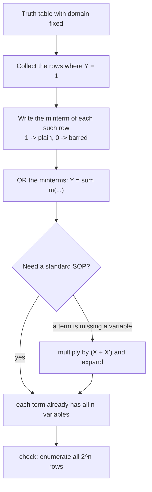

---
tags:
  - ECE2050
  - boolean-forms
date: 2026-09-16
aliases:
  - 与或式
  - 积之和形式
  - Sum-of-Products
  - SOP Form
  - SOP
---

> [!NOTE] Where this fits · 定位
> 第 4 章"标准形式"三篇里的第一篇（讲义 p.34, p.36, p.40）。上一篇 [[Minterm and Maxterm]]
> 把零件的名字定好了，这一篇开始**拼装**：把输出为 1 的那些行各写一个 minterm，再 OR 起来。
> 平行的一篇是 [[Product-of-Sums Form]]（从输出为 0 的行出发），两者描述的是同一个函数。
> 前置：[[Minterm and Maxterm]]、[[Laws and Rules of Boolean Algebra]]（分配律与 Rule 7 用来补变量）。

> [!SUMMARY] Quick recall · 英文速览
> A sum-of-products expression ORs several AND terms. Its canonical form can be built from truth-table rows where the function is 1, using minterms.

## Core Definition · 核心定义

**与或式 (SOP, sum-of-products)**：若干个**乘积项**（literal 的 AND）用 **OR** 连接起来的表达式：

$$
Y = \underbrace{P_1}_{\text{product}} + \underbrace{P_2} + \cdots + \underbrace{P_k}
\qquad\text{即}\qquad
Y=\text{OR}\big(\text{AND 项}_1,\ \text{AND 项}_2,\ \dots\big)
$$

- 意义：SOP 就是"**只要有一个乘积项为 1，输出就是 1**"。两级门电路：一级 AND 出乘积项，
  一级 OR 汇总 —— 这是最常用的两级电路形状。
- 讲义的形态判据（p.40）：**每一项都只由 literal 组成**时才是 SOP 形式：

| 表达式 | 是不是 SOP | 原因 |
|---|---|---|
| $Y=AB+BC+DE$ | ✅ SOP | 三项都是 literal 的乘积 |
| $Z=A+BC+DEF$ | ✅ SOP | 单独一个 literal 也算一个乘积项 |
| $Y=DF+E(A+B)$ | ❌ 不是 | $E(A+B)$ 里出现了 OR 的括号，不是"乘积" |

- **标准 SOP (standard SOP)**：domain 里的**每一个变量都出现在每一个乘积项**里
  （讲义 p.40：*all the variables in the domain appear in each product term*）。
  标准 SOP 里的每一项就是一个 minterm，所以也叫 **minterm 展开**、
  **最小项之和 (sum of minterms)**。
- 数值校验（形态）：domain 为 $\{A,B,C\}$ 时，$Y=A\bar BC+AB$ 是 SOP 但**不是标准 SOP**
  （$AB$ 缺 $C$）；把它补成 $AB(C+\bar C)=AB C+A B\bar C$ 后，
  $Y=A\bar BC+ABC+AB\bar C$ 才是标准 SOP（3 项，每项 3 个 literal ✓）。

**编号写法**：把标准 SOP 里所有 minterm 的编号列出来即可（讲义 p.36 的 $Y=F(A,B)=\bar AB+AB$）：

$$
Y=\sum m(1,3)
$$

- 意义：$\sum$ 在这里**不是加法**，而是"把这些编号对应的 minterm 全部 OR 起来"。
- 数值校验：$\sum m(1,3)=\bar AB+AB$，枚举 4 行得 $0,1,0,1$ ✓；
  写成 $Y=\sum m(1,2,3)$ 就会多出 $m_2=A\bar B$，枚举变成 $0,1,1,1$ ✗ —— 编号即真值表。

> [!IMPORTANT] 为什么"任何布尔函数都能写成 SOP"
> 对真值表里每一个输出为 1 的行 $i$，写一个 minterm $m_i$ —— 它在**且仅在**第 $i$ 行为 1。
> 把这些 $m_i$ OR 起来，得到的函数在每一行上的取值与真值表完全一致。
> 输出为 0 的行不需要写：那里所有 $m_i$ 都是 0，OR 出来自然是 0。
> 结论：**真值表 → 标准 SOP** 是机械操作，没有例外（哪怕函数有 100 行，也只是写 100 个 minterm）。

## Assumptions and Validity · 适用前提

> [!IMPORTANT] 成立条件与边界
> ① **domain 必须先确定**：标准 SOP 里的"每一项都含全部变量"是相对 domain 说的；
> domain 变了（多一个输入 $D$），原来的标准 SOP 就不再标准。
> ② SOP 描述的是**两级** AND-OR 结构；括号里的 OR（如 $E(A+B)$）说明还没展开成 SOP。
> ③ 化简后的最小 SOP（如 $Y=\bar AB+A\bar B$）通常**不是**标准 SOP ——
> 它更短，但每一项不再包含全部变量。考试要求"standard SOP"时不能直接给最小式。

- 何时要 SOP：做两级 AND-OR 电路、写 $\sum m(\cdot)$、用卡诺图圈 1（见 [[Karnaugh Map]]）。
- 何时不要 SOP：项数会爆炸时（$n$ 变量最多 $2^n$ 个 minterm），
  先用 [[Boolean Expression Simplification]] 化简，再决定用哪种形式实现。
- 失效边界：SOP 与 POS 在**逻辑上等价**（同一个真值表），差别只在**电路代价**。
  同一个函数，SOP 的项数与 POS 的项数一般不同，选代价小的那个。

## Derivation · 推导过程

### 1. 从真值表到标准 SOP（逐行选择）

$$
Y=\sum_{i:\,Y(i)=1} m_i
$$

- 意义：把真值表"输出为 1"的行号收集起来，直接写成 $\sum m(\cdot)$；再展开成 minterm 的 OR。
- 数值校验（讲义 p.43 的例子）：某 3 变量函数在 `001`、`100`、`111` 三行为 1，
  于是 $Y=\bar A\bar BC+A\bar B\bar C+ABC=\sum m(1,4,7)$。
  枚举 8 行：$0,1,0,0,1,0,0,1$ —— 与"行 1、4、7 为 1"完全一致 ✓。

### 2. 把非标准 SOP 补成标准 SOP（讲义 p.40）

缺变量的乘积项乘上 $(X+\bar X)=1$（Rule 7），再用分配律展开：

$$
A\bar BC + A\bar B\bar CD
= A\bar BC(D+\bar D) + A\bar B\bar CD
= A\bar BCD + A\bar BC\bar D + A\bar B\bar CD
$$

- 意义：domain 是 $\{A,B,C,D\}$ 时，$A\bar BC$ 只有 3 个 literal，缺 $D$；
  乘 $(D+\bar D)$ 把"缺的那一位"补成两种取值，一项变两项。
- 数值校验：枚举 16 行（$ABCD$ 从 `0000` 到 `1111`），左边与右边**逐行相同**：
  $0,0,0,0,0,0,0,0,0,1,1,1,0,0,0,0$ —— **16 行完全一致** ✓。
  展开后三项都含 $A,B,C,D$ 四个 literal ✓ 是标准 SOP。

### 3. 判断标准 SOP 的三步自查

1. 写下 domain（例如 $\{A,B,C\}$），数出变量个数 $n$。
2. 每一项是不是**恰好 $n$ 个 literal**且每个变量出现一次？（$AB$ 不合格，$AB\bar C$ 合格）
3. 有没有 OR 混进乘积项内部？有就不是 SOP（先展开再用第 2 步查）。

![[sop-from-truth-table.svg]]
*图 1 — 讲义 p.43 的例子：真值表里输出为 1 的三行（`001`、`100`、`111`）被高亮取出，
每行换成对应 minterm（1 写原变量、0 写反变量），再 OR 成
$Y=\bar A\bar BC+A\bar B\bar C+ABC=\sum m(1,4,7)$。输出为 0 的行直接跳过。*

## Method and Steps · 求解步骤与方法

1. **定 domain 与变量顺序**（最左 = MSB），确认真值表列顺序与之相同。
2. **圈出输出为 1 的行**，把每行的二进制值读成十进制 → 得到编号集合。
3. **每行写一个 minterm**：1 → 原变量，0 → 反变量，相乘（见 [[Minterm and Maxterm]]）。
4. **OR 起来**，先写成 $\sum m(\cdot)$，再展开成显式的乘积之和。
5. **自查**：① 项数 = 输出为 1 的行数；② 每项含全部变量；③ 穷举 $2^n$ 行与真值表比对。

## Worked Example · 例题

**Example 1 — 异或的 SOP（讲义 p.36 的两变量例子）**

题目：写出 $Y=A\oplus B$ 的真值表与标准 SOP。

解：
1. 真值表（不同为 1）：$(0,0)\to0$、$(0,1)\to1$、$(1,0)\to1$、$(1,1)\to0$。
2. 输出为 1 的行是行 1（`01`）与行 2（`10`）→ $m_1=\bar AB$，$m_2=A\bar B$。
3. 所以 $Y=\bar AB+A\bar B=\sum m(1,2)$，也可以写成 $Y=A\oplus B$（见 [[Exclusive-OR Gate]]）。

**数值校验 (Numerical check)**：枚举 4 行，$\bar AB+A\bar B=0,1,1,0$ ✓
与"不同为 1"一致；与讲义 p.36 的 $\sum m(1,3)$ 型写法对照，可见**编号直接就是真值表**。

**Example 2 — 由真值表写标准 SOP（讲义 p.43，配图 1）**

题目：某函数 $Y(A,B,C)$ 在 `001`、`100`、`111` 三行为 1，其余为 0。写出它的标准 SOP。

解：
1. 行号：`001` $=m_1$、`100` $=m_4$、`111` $=m_7$。
2. $m_1=\bar A\bar BC$；$m_4=A\bar B\bar C$；$m_7=ABC$。
3. $Y=\bar A\bar BC+A\bar B\bar C+ABC=\sum m(1,4,7)$。

**数值校验 (Numerical check)**：枚举 8 行得 $0,1,0,0,1,0,0,1$ ——
第 1、4、7 行为 1，其余为 0 ✓；三项的 literal 数都是 3 = domain 大小 ✓ 是标准 SOP。
再化简一步：$AB\bar C+ABC=AB$，得 $Y=\bar A\bar BC+A\bar B\bar C+AB$（已不是标准式）。

**Example 3 — 补变量：把 3 变量项补成 4 变量标准 SOP（讲义 p.40）**

题目：domain 为 $\{A,B,C,D\}$，把 $Y=A\bar BC+A\bar B\bar CD$ 写成标准 SOP。

解：
1. $A\bar BC$ 缺 $D$：乘 $(D+\bar D)=1$ → $A\bar BC(D+\bar D)=A\bar BCD+A\bar BC\bar D$。
2. $A\bar B\bar CD$ 已含 4 个 literal，不动。
3. $Y=A\bar BCD+A\bar BC\bar D+A\bar B\bar CD$。

**数值校验 (Numerical check)**：枚举 16 行（$ABCD$ 从 `0000` 到 `1111`），原式与结果**逐行相同**：
两边都只在 `1001`（$A=1,B=0,C=0,D=1$）以及 `1010`、`1011`（$A=1,B=0,C=1$，$D$ 任意）时为 1
→ 向量 $0,0,0,0,0,0,0,0,0,1,1,1,0,0,0,0$ ✓；展开式三项各含 4 个 literal ✓。
对应的编号写法：$Y=\sum m(9,10,11)$ —— 其中 $m_9$ 来自原来的 $A\bar B\bar CD$，
$m_{10},m_{11}$ 由第一项补上 $(D+\bar D)$ 展开而来。

**Example 4 — 午餐例子：SOP 与 POS 化简到同一个式子（讲义 p.39）**

题目（讲义 p.38–39）：去食堂吃午饭，"没吃"($E=0$) 当且仅当**不干净**($C=0$) 或**只有肉饼**($M=1$)。
(a) 写真值表；(b) 写出 SOP 并化简；(c) 由 POS 化简，比较两者。

解：
1. 真值表（domain $\{C,M\}$）：

| $C$ | $M$ | $E$ | 说明 |
|---|---|---|---|
| 0 | 0 | 0 | 不干净 → 不吃 |
| 0 | 1 | 0 | 不干净 → 不吃 |
| 1 | 0 | 1 | 干净且不是肉饼 → 吃 |
| 1 | 1 | 0 | 只有肉饼 → 不吃 |

2. SOP：输出为 1 的行只有行 2（`10`）→ $E=m_2=C\bar M$，已经最简。
3. POS：输出为 0 的行是 0、1、3 → $E=(C+M)(C+\bar M)(\bar C+\bar M)$
   （maxterm 的写法见 [[Product-of-Sums Form]]），化简：

$$
(C+M)(C+\bar M)=C+M\bar M=C+0=C
\quad\Longrightarrow\quad
E=C(\bar C+\bar M)=C\bar C+C\bar M=0+C\bar M=C\bar M
$$

**数值校验 (Numerical check)**：枚举 4 行，SOP 的 $C\bar M=0,0,1,0$；
POS 展开前的 $(C+M)(C+\bar M)(\bar C+\bar M)=0,0,1,0$ —— **4 行完全一致** ✓。
两种形式都化简到 $E=C\bar M$：**SOP 与 POS 描述同一个函数**，只是出发点不同（1 行 vs 0 行）。

## Pitfalls · 常见误区

> [!WARNING] 六个易错点

1. **把"不是标准 SOP"当成"不是 SOP"**。错在：看到 $AB+BC$（缺变量）就说它不是 SOP 形式。
   正确：SOP = 乘积之和（形态）；**标准** SOP 才要求每项含全部变量。两者是两回事。
2. **补变量时乘错因子**。错在：给缺 $D$ 的项乘 $(D\cdot\bar D)=0$。
   正确：要乘 $(D+\bar D)=1$；乘法用来展开，加法用来"制造两种取值"。
3. **$\sum m$ 的括号里漏项或多项**。错在：把 $m_1,m_4,m_7$ 写成 $\sum m(1,4,6)$。
   正确：编号集合必须**逐个**来自真值表输出为 1 的行；写完抽一行验算。
4. **把 $\sum$ 当算术加法**。错在：以为 $\sum m(1,3)$ 是"1+3"。
   正确：$\sum$ 是 OR，括号里是 minterm 的编号列表。
5. **先化简再被要求写标准式**。错在：题目要 standard SOP，交了 $Y=\bar AB+A\bar B$。
   正确：标准式 = 一行一个 minterm；化简式是最小式，两者用途不同（一个用于照真值表填写，
   一个用于实现电路）。
6. **domain 换了不回头检查**。错在：中途引入新变量 $D$ 却仍按 3 变量写项。
   正确：domain 一变，所有项都要重新数 literal 数（每项 $=n$）。

## Canonical SOP and hardware mapping · 标准与或式怎样落地

An SOP is an OR of product terms. A canonical SOP uses minterms containing every variable; a simplified SOP may omit variables within a term. Expanding a simplified term produces several minterms because the omitted variables can take either value.

Do not confuse Boolean addition with counting the number of active products. If AB and AC are both true, AB+AC is still one. Overlapping coverage is allowed. In a NAND–NAND realization, first produce each complemented product and then NAND those values to recover the OR of the original products.

**Worked application.** $Y=A\bar B$ 在变量域 ABC 内，C 可为0或1，所以 $Y=A\bar B(C+\bar C)=m_4+m_5$。若题目只有AB两个变量，标准式就是原来的 $A\bar B=m_2$，不能凭空引入C再沿用相同索引。

**English exam question:** What changes when complementary inputs are unavailable?

**Answer:** Every required complemented literal must be generated, usually adding an inverter or an equivalent tied-input NAND. The truth function remains the same, but the gate count and delay can change. Use [[Universal Gates and Bubble Pushing]] for implementation and [[Truth Table and Boolean Expression]] to check the declared variable domain.

## Connections · 相关笔记

- 上游 (upstream)：[[Minterm and Maxterm]] —— minterm 的定义与编号规则，是 SOP 的砖块。
- 上游 (upstream)：[[Boolean Equation]] —— 从文字到方程的映射（and → 乘、or → 加），是读懂题目的前提。
- 上游 (upstream)：[[Laws and Rules of Boolean Algebra]] —— 分配律与 Rule 7 用来补变量。
- 平行 (parallel)：[[Product-of-Sums Form]] —— 同一函数的另一种标准写法（取 0 行 → maxterm → AND）；
  p.39 的午餐例子证明两者等价。
- 平行 (parallel)：[[Boolean Expression Simplification]] —— 把 SOP 写短的手法（吸收、补项）。
- 下游 (downstream)：[[Truth Table and Boolean Expression]] —— $\sum m(\cdot)$ 与真值表之间的双向翻译。
- 下游 (downstream)：[[Karnaugh Map]] —— 圈 1 得到的就是**最小 SOP**。

---
索引：[[ECE2050 Knowledge Tree]] · [[Glossary]]
