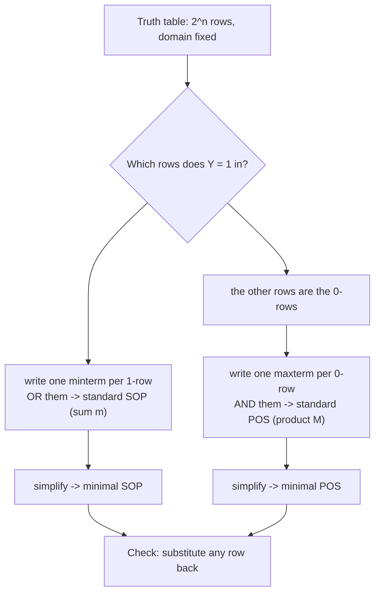

---
tags:
  - ECE2050
  - boolean-forms
date: 2026-09-16
aliases:
  - 真值表与布尔表达式
  - 真值表转表达式
  - Truth Table and Boolean Expression
  - Truth Table to Expression
---

> [!NOTE] Where this fits · 定位
> 第 4 章"标准形式"三篇的收尾（讲义 p.43–46）。[[Sum-of-Products Form]] 与 [[Product-of-Sums Form]]
> 各讲了一个方向，这一篇把三条路串成一个闭环：**标准 SOP ↔ 真值表 ↔ 标准 POS**。
> 它也是下一站 [[Karnaugh Map]] 的入场券 —— 卡诺图就是把真值表画成格子，再圈出最小式。
> 前置：[[Minterm and Maxterm]]、[[Sum-of-Products Form]]、[[Product-of-Sums Form]]；
> 工具：[[Boolean Expression Simplification]]（把标准式再化简成最小式）。

> [!SUMMARY] Quick recall · 英文速览
> A truth table defines an output for every input combination in its domain. From it, construct canonical SOP from the 1 rows or canonical POS from the 0 rows.

## Core Definition · 核心定义

**真值表 (truth table)**：把定义域 (domain) 里**每一个**输入变量的**每一种**组合列成一行，
逐行写出输出的表。$n$ 个输入 → $2^n$ 行（讲义 p.4 的"$n$ 输入有 $2^n$ 种组合"）。

- **域 (domain)**：这个函数的输入变量全集，例如 $\{A,B,C\}$。它决定三件事：
  ① 表的行数 $2^n$；② 每个 minterm / maxterm 的 literal 个数；③ "标准式"里"全部变量"指哪些。
- 三个对象之间的等价关系（本篇的核心）：

| 对象 | 它记录的信息 | 与真值表的接口 |
|---|---|---|
| 标准 SOP $\sum m(\cdot)$ | 输出为 **1** 的行号 | 每个 minterm 在**自己那一行**为 1，其余行 0 |
| 真值表 | 每行的输出值 | —— |
| 标准 POS $\prod M(\cdot)$ | 输出为 **0** 的行号 | 每个 maxterm 在**自己那一行**为 0，其余行 1 |

- 两个方向的操作（都要背下来）：
  - **表达式 → 真值表**：先把 $2^n$ 行写全，再让每个 minterm 把自己的行标 1（其它行标 0），
    或让每个 maxterm 把自己的行标 0（其它行标 1）；同一行的多个项按 **OR**（SOP）或
    **AND**（POS）合成输出。
  - **真值表 → 表达式**：数输出为 1 的行（→ SOP）或输出为 0 的行（→ POS），逐行写 minterm / maxterm。
- 数值校验：3 变量函数 $X$ 的两种标准式
  $X=\sum m(3,4,6,7)$ 与 $X=\prod M(0,1,2,5)$，枚举 8 行都得 $0,0,0,1,1,0,1,1$ ——
  **逐行一致** ✓，而两个编号集合 $\{3,4,6,7\}$ 与 $\{0,1,2,5\}$ 互补（并集 $=\{0,\dots,7\}$，交集 $=\varnothing$）。

> [!IMPORTANT] "Don't Care" 的两副面孔（讲义 p.43–44 的表格约定）
> 讲义在填表时，把"这一项在这一行不成立"的格子写成 **Don't Care**：
> - 用**标准 SOP** 填表时，某一行的三个 minterm 里只有一个为 1；另外两个（为 0）被标成 Don't Care；
> - 用**标准 POS** 填表时，某一行的 maxterm 里只有那个"属于本行"的为 0；其余为 1 的都被标成 Don't Care。
> 这里的 Don't Care 意思是"**这一项与本行无关 / 我不关心它在这一行取什么**"，
> 与卡诺图里真正的 **don't-care condition（X，输入组合不会出现或输出无所谓）**
> 是**两码事**（后者见 [[Karnaugh Map with Don't Cares]]）。考试里看到 "Don't Care" 要先分辨语境。

## Assumptions and Validity · 适用前提

> [!IMPORTANT] 三条前提
> ① **域与变量顺序固定**：变量按字母序、最左为 MSB。顺序一变，行号与 $m_i/M_i$ 全变。
> ② **行必须写全**：$n$ 变量 $2^n$ 行，不能只写"输出为 1 的行"。
> ③ **标准式的每一项含全部变量**：只有这样，"一项只在一行为 1（或 0）"才成立，
> 才能反推回真值表。

- 数量对照：3 变量时 minterm 有 8 个、maxterm 有 8 个；若函数有 $k$ 行为 1，
  则标准 SOP 有 $k$ 项，标准 POS 有 $2^n-k$ 项。**哪边项少就用哪边**（$k$ 与 $2^n-k$ 谁小）。
- 失效边界：**非标准**的 SOP/POS（例如 $Y=AB+C$）不能直接"每项标一行" ——
  一项会覆盖多行（$AB$ 覆盖 2 行、$C$ 覆盖 4 行）。要填表就得逐项算出该行取值再 OR/AND。
- 化简后的最小式同样不能直接读行号（$BC+A\bar C$ 的两项各覆盖 2 行），
  必须**逐行代值**才能填表。

## Derivation · 推导过程

### 1. 标准 SOP → 真值表（讲义 p.43）

$$
Y=\sum m(i_1,i_2,\dots)\ \Longrightarrow\ Y(j)=1 \iff j\in\{i_1,i_2,\dots\}
$$

- 意义：minterm 是"行号选择器"，所以把 $2^n$ 行写全后，只需给列出的那几个行号打 1。
- 数值校验（讲义 p.43 的例子）：$Y=\bar A\bar BC+A\bar B\bar C+ABC$（即 $\sum m(1,4,7)$），
  8 行输出 $=0,1,0,0,1,0,0,1$ —— 恰好在 1、4、7 三行为 1 ✓。

### 2. 标准 POS → 真值表（讲义 p.44）

$$
Y=\prod M(i_1,i_2,\dots)\ \Longrightarrow\ Y(j)=0 \iff j\in\{i_1,i_2,\dots\}
$$

- 意义：maxterm 是"行号消除器"——它在自己那一行为 0。所以 AND 起来后，这些行必为 0，其余行必为 1。
- 数值校验（讲义 p.44 的例子）：$Y=\prod M(0,2,3,5,6)$，8 行输出 $=0,1,0,0,1,0,0,1$ ✓。
  注意它与第 1 条**完全相同** —— 讲义 p.43 与 p.44 讲的就是同一个函数的两种写法 ✓。

### 3. 真值表 → 最小 SOP / 最小 POS（讲义 p.45–46 的 $X$ 例）

先把真值表读成标准式（第 1、2 条），再用 [[Boolean Expression Simplification]] 化简：

$$
X=\bar ABC+A\bar B\bar C+AB\bar C+ABC
=(\bar ABC+ABC)+(A\bar B\bar C+AB\bar C)
=BC+A\bar C
$$

- 第一步：把 4 个 1 行两两配对，每对只差一个变量的正反；
- 第二步：$BC(A+\bar A)=BC$，$A\bar C(\bar B+B)=A\bar C$ —— Rule 7 + Rule 2。

POS 侧同理（把 0 行配对）：

$$
X=(A+B+C)(A+B+\bar C)(A+\bar B+C)(\bar A+B+\bar C)
=\underbrace{(A+B+C)(A+\bar B+C)}_{A+C}\cdot\underbrace{(A+B+\bar C)(\bar A+B+\bar C)}_{B+\bar C}
=(A+C)(B+\bar C)
$$

- 意义：两个只差一个变量的 maxterm 相乘，那个变量被消掉（Rule 12 的逆用：$(X+Y)(X+\bar Y)=X$）。
- 数值校验：枚举 8 行，$BC+A\bar C = 0,0,0,1,1,0,1,1$ ✓；
  $(A+C)(B+\bar C)=0,0,0,1,1,0,1,1$ ✓ —— 与真值表**逐行一致**，两者也互为等价形式 ✓。
- 最小性核对（穷举所有单个乘积项 / 单个和项）：没有任何**一项**能同时覆盖 4 个 1 行而不多带 0 行，
  也没有任何一个和项能同时覆盖 4 个 0 行而不多带 1 行 → 两项（SOP）与两项（POS）都已是最少 ✓。

![[truth-table-conversion.svg]]
*图 1 — 标准 SOP / 真值表 / 标准 POS 的三向互转，用讲义 p.45–46 的 $X$ 例走完一圈：
$X=\sum m(3,4,6,7)$（左）与 $X=\prod M(0,1,2,5)$（右）描述同一个函数；中间是真值表，
阴影行是输出为 1 的行（SOP 的来源），未阴影行是输出为 0 的行（POS 的来源），
两个编号集合互补。*

## Method and Steps · 求解步骤与方法

1. **写域名**：列出全部输入变量与顺序，算出 $2^n$ 行。
2. **看题目给的是哪一边**：给了项就**填表**，给了表就**写式**。
3. **表达式 → 表**：标准 SOP 在列出的行打 1（其余 0）；标准 POS 在列出的行打 0（其余 1）；
   非标准式逐行代值。
4. **表 → 表达式**：数 1 行写 $\sum m(\cdot)$，数 0 行写 $\prod M(\cdot)$，
   哪边行少用哪边。
5. **需要最简式时**再化简（配对消变量、吸收项），并用卡诺图确认（见 [[Karnaugh Map]]）。
6. **自查**：任选一行代回原式；再检查编号集合互补、项数 = 行数。

## Worked Example · 例题

**Example 1 — 由标准 SOP 填真值表（讲义 p.43）**

题目：domain 为 $\{A,B,C\}$，$Y=\bar A\bar BC+A\bar B\bar C+ABC$。填真值表，并按讲义的写法标出 Don't Care。

解：三项分别是 $m_1,m_4,m_7$。每一行里只有"属于本行"的那一项为 1，另外两项为 0（标 Don't Care）：

| $A$ | $B$ | $C$ | $\bar A\bar BC$ | $A\bar B\bar C$ | $ABC$ | 输出 $Y$ |
|---|---|---|---|---|---|---|
| 0 | 0 | 0 | Don't Care | Don't Care | Don't Care | 0 |
| 0 | 0 | 1 | **1** | Don't Care | Don't Care | 1 |
| 0 | 1 | 0 | Don't Care | Don't Care | Don't Care | 0 |
| 0 | 1 | 1 | Don't Care | Don't Care | Don't Care | 0 |
| 1 | 0 | 0 | Don't Care | **1** | Don't Care | 1 |
| 1 | 0 | 1 | Don't Care | Don't Care | Don't Care | 0 |
| 1 | 1 | 0 | Don't Care | Don't Care | Don't Care | 0 |
| 1 | 1 | 1 | Don't Care | Don't Care | **1** | 1 |

**数值校验 (Numerical check)**：逐行代入三项并把结果 OR：第 1 行 $0+0+1=1$ ✓、
第 4 行 $1+0+0=1$ ✓、第 7 行 $0+0+1=1$ ✓，其余行三项全 0 → 输出 0 ✓。
整表输出 $=0,1,0,0,1,0,0,1$，即 $Y=\sum m(1,4,7)$ ✓。

**Example 2 — 由标准 POS 填真值表（讲义 p.44）**

题目：$Y=(A+B+C)(A+\bar B+C)(A+\bar B+\bar C)(\bar A+B+\bar C)(\bar A+\bar B+C)$。填真值表。

解：五个 maxterm 是 $M_0,M_2,M_3,M_5,M_6$，它们各自的行输出为 0，其余行为 1
（不在列表里的 $M_1,M_4,M_7$ 在本行取 1，按讲义的写法标 Don't Care）：

| $A$ | $B$ | $C$ | 本行的 maxterm 在列表里吗 | 五项在本行的值 | 输出 $Y$ |
|---|---|---|---|---|---|
| 0 | 0 | 0 | 是（$M_0=A+B+C$） | $M_0=0$，其余为 1 | 0 |
| 0 | 0 | 1 | 否（$M_1$ 未列出） | 全为 1（Don't Care） | 1 |
| 0 | 1 | 0 | 是（$M_2=A+\bar B+C$） | $M_2=0$，其余为 1 | 0 |
| 0 | 1 | 1 | 是（$M_3=A+\bar B+\bar C$） | $M_3=0$，其余为 1 | 0 |
| 1 | 0 | 0 | 否（$M_4$ 未列出） | 全为 1（Don't Care） | 1 |
| 1 | 0 | 1 | 是（$M_5=\bar A+B+\bar C$） | $M_5=0$，其余为 1 | 0 |
| 1 | 1 | 0 | 是（$M_6=\bar A+\bar B+C$） | $M_6=0$，其余为 1 | 0 |
| 1 | 1 | 1 | 否（$M_7$ 未列出） | 全为 1（Don't Care） | 1 |

**数值校验 (Numerical check)**：任抽一行代回原式：
第 4 行 $(1,0,0)$：五个 maxterm 依次为 $M_0=A+B+C=1$、$M_2=A+\bar B+C=1$、$M_3=A+\bar B+\bar C=1$、
$M_5=\bar A+B+\bar C=0+0+1=1$、$M_6=\bar A+\bar B+C=0+1+0=1$ → AND 得 1 ✓；
第 3 行 $(0,1,1)$：$M_3=A+\bar B+\bar C=0+0+0=0$ → AND 必为 0 ✓。
8 行输出 $=0,1,0,0,1,0,0,1$ —— 与 Example 1 **完全相同** ✓：
p.43 与 p.44 是同一个函数的 SOP 与 POS（编号集合互补）。

**Example 3 — 从真值表到最小 SOP 与最小 POS（讲义 p.45–46 的 $X$ 例）**

题目：$X=\bar ABC+A\bar B\bar C+AB\bar C+ABC$。写出真值表、$\sum m$ 形式、以及最小的 SOP 与 POS。

解：
1. 四项是 $m_3,m_4,m_6,m_7$ → $X=\sum m(3,4,6,7)$，真值表 $0,0,0,1,1,0,1,1$。
2. 0 行是 0、1、2、5 → POS 侧 $X=\prod M(0,1,2,5)=(A+B+C)(A+B+\bar C)(A+\bar B+C)(\bar A+B+\bar C)$。
3. 最小 SOP：$(\bar ABC+ABC)=BC$，$(A\bar B\bar C+AB\bar C)=A\bar C$ → $X=BC+A\bar C$。
4. 最小 POS：$(A+B+C)(A+\bar B+C)=A+C$，$(A+B+\bar C)(\bar A+B+\bar C)=B+\bar C$ → $X=(A+C)(B+\bar C)$。

**数值校验 (Numerical check)**：枚举 8 行，四种写法
（标准 SOP、标准 POS、$BC+A\bar C$、$(A+C)(B+\bar C)$）的输出都是 $0,0,0,1,1,0,1,1$ ✓。
再抽一行：第 4 行 $(1,0,0)$ —— 标准 SOP 由 $A\bar B\bar C$ 得 1 ✓；
$BC+A\bar C = 0+1\cdot1 = 1$ ✓；$(A+C)(B+\bar C)=(1+0)(0+1)=1$ ✓。
最小性核对：没有任何单项能覆盖 4 个 1 行而不带入 0 行，所以 2 项已是最少 ✓。

## Pitfalls · 常见误区

> [!WARNING] 六个易错点

1. **行没写全**。错在：只列出输出为 1 的 3 行就交卷。
   正确：真值表必须 $2^n$ 行齐全；表达式可以只写 1 行（SOP）或 0 行（POS），但表不行。
2. **把讲义的 Don't Care 当成卡诺图的 X**。错在：以为那些格子"可以随便取 0/1"。
   正确：p.43–44 的 Don't Care 只是"这一项不属于本行"的标注；
   真正的 don't-care condition 见 [[Karnaugh Map with Don't Cares]]。
3. **用非标准式直接读行号**。错在：看到 $Y=AB+C$ 就说"$AB$ 对应一行"。
   正确：$AB$ 覆盖 2 行、$C$ 覆盖 4 行；非标准式必须逐行代值填表。
4. **SOP 与 POS 的编号集合写重或写漏**。错在：把 $\sum m(3,4,6,7)$ 的 POS 写成 $\prod M(0,1,2,6)$。
   正确：两个集合必须**不交且并起来是全体行号**（互补）；写完立刻检查一遍。
5. **变量顺序前后不一致**。错在：填表用 $A$ 当 MSB，写编号时按 $C$ 当 MSB 读。
   正确：全篇统一顺序（字母序），并在表头标清楚。
6. **化简后忘了回头验证**。错在：把 $BC+A\bar C$ 直接当答案交上去而没核。
   正确：抽一行（最好是被化简掉的项原本为 1 的那一行）代回；或直接穷举 $2^n$ 行比对。

## A table as a verification contract · 真值表是验证契约

Use one declared variable order throughout the table, minterm list, Karnaugh map, decoder connections, and MUX select inputs. A truth table is not simply a presentation of a final expression; it is the independently stated contract used to judge every implementation.

For multiple outputs, each output has its own ON set and OFF set. Outputs may share intermediate product terms in a physical implementation, but that sharing must preserve each column separately. A valid code indicator is often an additional output rather than an interpretation guessed from the data bits.

**Worked application.** full adder 以ABC为输入，C表示carry-in。sum ON set为1,2,4,7；carry ON set为3,5,6,7。在111行，sum=1且carry=1，合成值 $1+2=3$；两列都为1并不冲突。

**English exam question:** Why can a priority encoder's data table be insufficient by itself?

**Answer:** Code zero may mean input zero is active or no input is active. A separate valid output distinguishes those cases when required by the interface. Read [[Encoder and Priority Encoder]] for that boundary and [[Half Adder and Full Adder]] for multi-output arithmetic verification.

## Connections · 相关笔记

- 上游 (upstream)：[[Minterm and Maxterm]] —— $m_i$、$M_i$ 的定义与 $M_i=\bar m_i$，是"读行号"的依据。
- 上游 (upstream)：[[Sum-of-Products Form]] —— 真值表 → 标准 SOP（取 1 行）的方向。
- 上游 (upstream)：[[Product-of-Sums Form]] —— 真值表 → 标准 POS（取 0 行）的方向。
- 平行 (parallel)：[[Boolean Expression Simplification]] —— 把标准式继续化成最小式的手法。
- 平行 (parallel)：[[Boolean Equation]] —— 反方向：从文字描述建真值表/方程（讲义 p.10–14 与 p.38 的午餐例子）。
- 下游 (downstream)：[[Karnaugh Map]] —— 把真值表画成格子再圈组，系统地得到最小 SOP/POS。
- 下游 (downstream)：[[Karnaugh Map with Don't Cares]] —— 真正意义上的 don't-care（X）只在那里使用。
- 下游 (downstream)：[[POS Minimization with Karnaugh Map]] —— 圈 0 求最小 POS 的完整流程。

---
索引：[[ECE2050 Knowledge Tree]] · [[Glossary]]
