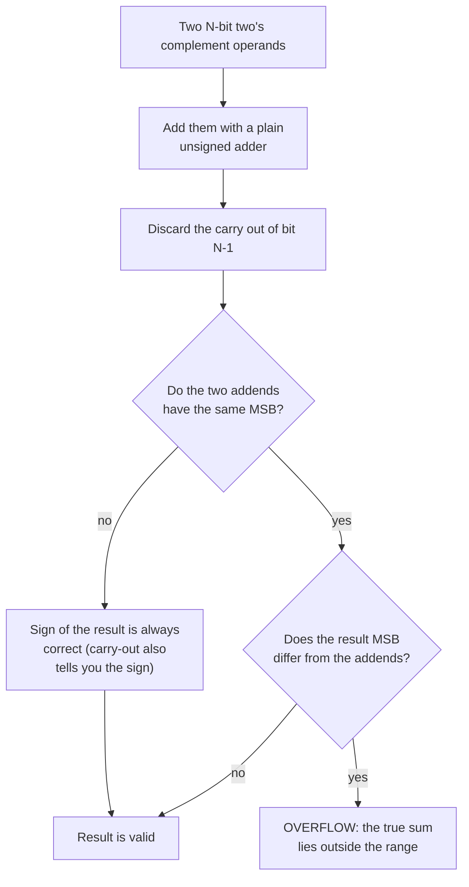

---
tags:
  - ECE2050
  - signed-numbers
date: 2026-09-16
aliases:
  - 补码
  - 二进制补码
  - 二的补码
  - Two's Complement Representation
  - 2's Complement
---

> [!NOTE] Where this fits · 定位
> **全章最核心的一篇。** [[Sign-Magnitude Representation]] 有两个致命缺陷（加法不成立、两个零），
> 补码用一句"最高位权重取负"就同时修好了它们，代价是把"人类可读"换成了"机器好算"（讲义 p.38–45）。
> 前置：[[Binary Arithmetic]]（进位链、位宽固定）、[[Sign-Magnitude Representation]]（被淘汰的对照方案）。
> 下游：[[Signed Binary Multiplication and Division]]（部分积与符号扩展）、
> [[Fixed-Point Numbers]]（$Qa.b$ 就是补码小数）、[[Bits and Bytes]]（$N$ 位容量 $2^N$）。

> [!SUMMARY] Quick recall · 英文速览
> Two's complement assigns the most significant bit a negative weight, giving one representation of zero. Fixed-width addition uses ordinary binary adders, but signed overflow must be checked separately from carry-out.

## Core Definition · 核心定义

**补码 (two's complement)** 不去"专门留一位当符号"，而是**重新定义最高位的权重**（讲义 p.39）：

$$
x_{2\text{'s}} \;=\; -\,a_{N-1}\,2^{\,N-1} \;+\; \sum_{i=0}^{N-2} a_i\,2^{\,i}
$$

- 意义：MSB 的权重从 $+2^{N-1}$ 变成 $-2^{N-1}$，其余位保持正权。**MSB 常称符号位，同时具有负位权；它不是与幅值独立的符号字段。**
- 数值校验（$N=4$）：`1010` → $-8+2=-6$ ✓；`1000` → $-8$ ✓；`0111` → $4+2+1=7$ ✓；
  `1111` → $-8+4+2+1=-1$ ✓。

等价的"操作式"定义：**若 MSB 为 1，就把整串当无符号数读，再减去 $2^{N}$**。
两种算法给出同一个值，因为 $-2^{N-1}=2^{N-1}-2^{N}$。
数值校验：`1010` 无符号读得 $10$，$10-2^{4}=10-16=-6$ ✓。

4 位补码的完整码表（图 1 把它排成了一个 16 格的圆盘）：

| 十进制 | 码字 | 十进制 | 码字 | 十进制 | 码字 | 十进制 | 码字 |
|---|---|---|---|---|---|---|---|
| $0$ | `0000` | $4$ | `0100` | $-8$ | `1000` | $-4$ | `1100` |
| $1$ | `0001` | $5$ | `0101` | $-7$ | `1001` | $-3$ | `1101` |
| $2$ | `0010` | $6$ | `0110` | $-6$ | `1010` | $-2$ | `1110` |
| $3$ | `0011` | $7$ | `0111` | $-5$ | `1011` | $-1$ | `1111` |

三条立刻可读出的事实：

1. **MSB 仍然指示符号**：MSB $=0$ 是非负数，MSB $=1$ 是负数（讲义 p.39）。
2. **零只有一种写法**：`0000`。$+0$ 与 $-0$ 的重复被消灭了。
3. **16 个码字 ↔ 16 个不同数值**，没有浪费 —— 但分配**不对称**：多出来的那个码字给了最负的 $-8$。

![[twos-complement-wheel.svg]]
*图 1 — 4 位补码排成 16 格圆盘（每格 $22.5^\circ$）：顺时针走一格就是 $+1$，所以"加 $k$"就是"顺时针转 $k$ 格"。
从 `0111`（$+7$）再走一格会跨过符号分界线落到 `1000`（$-8$）—— 这就是补码的回绕点，
也解释了为什么 $+7$ 再加 $1$ 会得到 $-8$ 而不是 $+8$。*

## Assumptions and Validity · 适用前提

> [!IMPORTANT] 补码成立的底层前提是"位宽固定 + 模 $2^{N}$ 运算"
> 硬件里只有 $N$ 根线，第 $N+1$ 位的进位会被物理丢掉。补码正是**把这种"丢进位"从缺陷变成定义**：
> 所有运算都在 $\bmod\,2^{N}$ 的环上做，而 $\bmod\,2^{N}$ 下的加法天然处理了负数。
> 只要位宽固定，补码的加、减、乘（见 [[Signed Binary Multiplication and Division]]）就都是同一套无符号电路。

**取值范围**（讲义 p.39）：

$$
x_{2\text{'s}} \in \left[-\,2^{\,N-1},\;\; 2^{\,N-1}-1\right]
$$

- 意义：MSB $=0$ 时取 $0\dots2^{N-1}-1$（$2^{N-1}$ 个数），MSB $=1$ 时取 $-2^{N-1}\dots-1$（$2^{N-1}$ 个数），
  合计恰好 $2^{N}$ 个，**负数比正数多一个**。
- 数值校验：$N=4$ → $[-2^{3},2^{3}-1]=[-8,7]$ ✓；$N=8$ → $[-128,127]$ ✓；
  $N=16$ → $[-32768,32767]$ ✓；$N=32$ → $[-2147483648,2147483647]$ ✓。
- 与原码对比：同样 4 位，原码是 $[-7,7]$（15 个数、两个零），补码是 $[-8,7]$（16 个数、一个零）。

![[nbit-range.svg]]
*图 2 — 4 位下三种表示的对照（同一水平刻度）：unsigned 用满 16 个码字但拿负数没办法；
sign/magnitude 的 16 个码字只表示 15 个值，多出来的那个被 $-0$ 吃掉，负半边停在 $-7$；
two's complement 的 16 个码字对应 16 个值，代价是**不对称** —— 唯一多出来的码字 `1000` 变成了 $-8$，没有 $+8$ 与之配对。*

**失效边界**：

- **溢出 (overflow)**：结果超出 $[-2^{N-1},\,2^{N-1}-1]$ 时，位宽装不下，答案就是错的（见"推导过程"第 5 节）。
- **无符号与有符号不可混用**：同一个码字 `1111 1111` 在无符号里读 $255$、在补码里读 $-1$；
  进位标志 (carry flag) 判的是**无符号**溢出，符号标志判的是**有符号**，两者不能互换。
- **取相反数在 $-2^{N-1}$ 上失效**：对 $-128$ 取反符号仍得到 `1000 0000`，因为 $+128$ 超出 8 位补码范围。

## Derivation · 推导过程

### 1. 为什么"MSB 负权"能自洽

把 $N$ 位码字看成一圈 $2^{N}$ 个状态：`0000`…`1111` 顺着数下去，走过 `1111` 之后回到 `0000`。
若把 `1000` 起的后半圈解释成负数，最自然的做法就是"从 `1000` 开始每次减 $1$"：

| 码字 | `0111` | `1000` | `1001` | `1010` | … | `1111` | `0000` |
|---|---|---|---|---|---|---|---|
| 值 | $+7$ | $-8$ | $-7$ | $-6$ | … | $-1$ | $0$ |

要让这个表与"按位权求和"一致，就必须把 MSB 的权从 $+8$ 改成 $-8$：$1001$ 若按正权读是 $9$，
按负权读是 $-8+1=-7$ ✓，正好接在 $-8$ 后面。**选择补码编码后，这个负位权与模 $2^N$ 的加法自洽；补码本身仍是一种表示约定。**

数值校验：把 4 位所有码字按 $x=-8a_3+4a_2+2a_1+a_0$ 算一遍，得到
$0,1,2,3,4,5,6,7,-8,-7,-6,-5,-4,-3,-2,-1$ —— 与上面的表逐项吻合 ✓。

### 2. 反符号 (reverse the sign)：取反加 1

**算法**（讲义 p.40–41）：

1. **Invert the bits**（逐位取反，$0\leftrightarrow1$）；
2. **Add 1**。

**为什么成立**：任意 $N$ 位码字 $x$ 与它的逐位取反 $\bar{x}$ 满足

$$
x + \bar{x} = \underbrace{11\cdots1}_{N\ \text{bits}} = 2^{N}-1
\qquad\Longrightarrow\qquad
\bar{x} = 2^{N}-1-x \;\equiv\; -1-x \pmod{2^{N}}
$$

再 $+1$ 就得到 $\bar{x}+1 \equiv -x \pmod{2^{N}}$ —— **丢掉第 $N+1$ 位进位后，恰好是相反数**。

- 意义：一个加法器 + 一排反相器就能求相反数，不需要任何"符号判断"电路。
- 数值校验（$N=4$，$x=3=$ `0011`）：$\bar{x}=$ `1100`，$3+12=15=2^{4}-1$ ✓；
  $\bar{x}+1=$ `1101` $=13$，而 $13-16=-3$ ✓。与讲义 p.40 的 `0011 → 1100 → 1101 = -3` 一致 ✓。
- 数值校验（求 `1001` 的十进制值，讲义 p.41）：`1001` → 取反 `0110` → $+1$ 得 `0111` $=7$，
  所以 `1001` $=-7$ ✓（与码表一致）。

> [!WARNING] 命名陷阱：`taking the two's complement` 不是"求补码"
> 讲义 p.40 特意提醒：历史上把"取反加 1"这个**动作**叫作 *taking the two's complement*，
> 但它容易和"把一个数表示成补码形式"混淆。本课统一叫 **reverse the sign**（求相反数）。
> 记住：**"补码"是名词（一种表示法），"取反加 1"是动词（求相反数）。**

### 3. 加法为什么成立，以及进位怎么读

**三步法**（讲义 p.42–43）：

1. 把两个十进制数都写成 $N$ 位二进制，**负数用补码形式**；
2. 直接做二进制加法（就是 [[Binary Arithmetic]] 里那个无符号加法器）；
3. 看符号：同号相加，结果符号应与加数相同；**符号不对就是溢出**。

**第 $N+1$ 位的进位一律丢弃** —— 它不是错误，而是 $\bmod\,2^{N}$ 的定义本身。

**异号相加时，进位直接告诉你结果的符号**（讲义 p.44）：

- 有进位 (carry-out $=1$) → 结果**非负（也可能为零）**；
- 无进位 (carry-out $=0$) → 结果**为负**。

为什么：设 $a\ge0$、$b<0$。$b$ 的码字是 $b+2^{N}$，于是 $a+(b+2^{N})=(a+b)+2^{N}$。
若 $a+b\ge0$，和 $\ge2^{N}$ → 产生进位；若 $a+b<0$，和 $<2^{N}$ → 没有进位。

数值校验：
- $15+(-6)$：`0000 1111` $+$ `1111 1010` $=$ `1 0000 1001`，进位 $=1$，丢弃后 `0000 1001` $=9$ ✓（$15-6=9$ ✓，结果为正 ✓）
- $16+(-24)$：`0001 0000` $+$ `1110 1000` $=$ `0 1111 1000`，**无**进位，`1111 1000` $=-128+64+32+16+8=-8$ ✓（$16-24=-8$ ✓，结果为负 ✓）

同号相加的对照：$5+9$ → `0000 0101` $+$ `0000 1001` $=$ `0 0000 1110` $=14$ ✓（无进位，正 ✓）；
$-5+(-9)$ → `1111 1011` $+$ `1111 0111` $=$ `1 1111 0010` $=-14$ ✓（有进位，负 ✓）。

### 4. 溢出判据：同号相加而结果变号

**判据**（讲义 p.43）：两个加数**符号相同**，而结果的符号**与它们相反** → 溢出。

$$
\text{overflow} \;=\; \bigl(a_{N-1} = b_{N-1}\bigr)\ \wedge\ \bigl(s_{N-1} \ne a_{N-1}\bigr)
$$

- 意义：同号相加只会让绝对值更大，一旦大到越过边界，就会"翻"到环的另一侧，符号随之翻转。
- 数值校验（讲义 p.43 原例）：`1000 0011` $+$ `1100 0110` $=$ `1 0100 1001`。
  两个加数的 MSB 都是 $1$（同负），而 8 位结果 `0100 1001` 的 MSB 是 $0$（读作 $+73$）→ **符号翻转 → 溢出** ✓。
  真值 $-125+(-58)=-183$，而 8 位补码范围是 $[-128,127]$，$-183<-128$ ✓ 确实越界。
- **硬件等价写法**（超出讲义，供理解）：进位进 MSB 列 $c_{N-1}$ 与进位出 MSB 列 $c_{N}$ 不相等时溢出，
  $\text{overflow}=c_{N-1}\oplus c_{N}$。上例 $c_7=0$、$c_8=1$ → 异或为 $1$ → 溢出 ✓；
  而 $15+(-6)$ 中 $c_7=c_8=1$ → 异或为 $0$ → 不溢出 ✓。

![[overflow-detection.svg]]
*图 3 — (a) 8 位补码数轴 $[-128,+127]$：$(-5)+(-9)=-14$ 落在范围内（合法）；
$(-125)+(-58)=-183$ 越过左端 $-128$，丢掉第 9 位后"假象结果"是 `0100 1001` $=+73$
（$-183+256=+73$，正是模 $2^{8}$ 回绕）。(b) 讲义 p.43 原例的逐列加法：两个加数的符号位都是 $1$，
而结果的符号位是 $0$ —— 符号翻转就是溢出的信号。*

### 5. 减法：加相反数

**减法 = 加上被减数的相反数**（讲义 p.45），而"相反数"用取反加 1 得到，所以**减法不需要减法器**：

$$
a-b \;=\; a + (-b) \;=\; a + \bigl(\bar{b}+1\bigr) \pmod{2^{N}}
$$

数值校验：
- $8-3$：$8+(-3)=$ `0000 1000` $+$ `1111 1101` $=$ `1 0000 0101`，**丢弃进位**得 `0000 0101` $=5$ ✓（$8-3=5$ ✓）
- $3-5$：$3+(-5)=$ `0000 0011` $+$ `1111 1011` $=$ `0 1111 1110` $=-2$ ✓（$3-5=-2$ ✓）

> [!TIP] 为什么硬件偏爱补码
> 一套**无符号加法器** + 一排**反相器**（配合最低位的 carry-in $=1$）就能同时做加法和减法：
> 减法时把 $b$ 取反、让 $c_0=1$，其余照旧。省掉整个减法器，也省掉符号比较电路 ——
> 这是补码在 1960 年代以后一统天下的真正原因。

### 6. 符号扩展 (sign extension)

把 $N$ 位补码数加宽到 $M>N$ 位时，**把符号位复制到所有新增的高位**，数值不变：

$$
\underbrace{a_{N-1}}_{1\ \text{位}} \;\longrightarrow\; \underbrace{a_{N-1}\cdots a_{N-1}}_{M-N+1\ \text{位}}
$$

数值校验：$-6$ 的 4 位码是 `1010`，扩到 8 位得 `1111 1010` $=-128+64+32+16+8+2=-6$ ✓。
若错误地补 $0$（`0000 1010`），会得到 $+10$ —— 数值被彻底改掉 ✗。

## Method and Steps · 求解步骤与方法

1. **确认位宽 $N$**，并写下范围 $[-2^{N-1},\,2^{N-1}-1]$，先判断结果是否可能越界。
2. **十进制 → 补码**：正数直接写成 $N$ 位二进制；负数先写绝对值的 $N$ 位二进制，再**取反加 1**。
3. **补码 → 十进制**：用负权公式 $x=-a_{N-1}2^{N-1}+\sum_{i<N-1}a_i2^{i}$；或"取反加 1 得到相反数"再取负。
4. **做加减**：负数换成补码后直接相加，**丢弃第 $N+1$ 位进位**。
5. **判符号与溢出**：看结果的 MSB；若两加数同号而结果异号 → 溢出，必须报错而不是给出错误结果。
6. **位宽不一致先符号扩展**：把窄的那个数复制符号位补齐，再运算。

## Worked Example · 例题

**Example 1 — $-6$ 的 4 位补码，并用反符号验证（讲义 p.41）**

题目：写出 $-6$ 的 4 位补码；再对它做一次取反加 1，看是否回到 $+6$。

解：
1. $|-6|=6=$ `0110`（4 位）。
2. 取反：`1001`。
3. 加 1：`1001 + 0001 = 1010` → $-6$ 的补码是 `1010`。
4. 反符号验证：`1010` → 取反 `0101` → $+1$ 得 `0110` $=+6$ ✓。

**数值校验 (Numerical check)**：
- 负权公式：`1010` $=-8+2=-6$ ✓
- 取反加 1 的代数：$\bar{x}+1=2^{4}-1-x+1=16-x$；$x=$`1010`$=10$ → $16-10=6$ ✓
- 与原码对照：原码的 $-6$ 是 `1110`（[[Sign-Magnitude Representation]]），补码是 `1010`，**两者不同** —— 这也是最容易混的一处 ✓

**Example 2 — 异号相加与进位判别（讲义 p.44）**

题目：用 8 位补码计算 $15+(-6)$ 与 $16+(-24)$，并解释进位。

解：
1. $15=$ `0000 1111`，$-6=$ `1111 1010`（$6=$`0000 0110` → 取反 `1111 1001` → $+1$）。
   `0000 1111 + 1111 1010 = 1 0000 1001`；**有进位** → 结果为正，丢弃进位得 `0000 1001`。
2. $16=$ `0001 0000`，$-24=$ `1110 1000`（$24=$`0001 1000` → 取反 `1110 0111` → $+1$）。
   `0001 0000 + 1110 1000 = 0 1111 1000`；**无进位** → 结果为负，结果就是 `1111 1000`。

**数值校验 (Numerical check)**：
- `0000 1001` $=8+1=9$，而 $15-6=9$ ✓；两加数异号（MSB $=0$ 与 $1$），结果 MSB $=0$，符号没翻转 → 不溢出 ✓
- `1111 1000` $=-128+64+32+16+8=-8$，而 $16-24=-8$ ✓；结果 MSB $=1$，确实为负 ✓
- 两条进位规则都被本例验证：有进位 → 正，无进位 → 负 ✓

**Example 3 — 判断溢出：$(-125)+(-58)$（讲义 p.43）**

题目：在 8 位补码下计算 $(-125)+(-58)$，判断是否溢出。

解：
1. $125=$ `0111 1101` → 取反 `1000 0010` → $+1$ 得 `1000 0011` $=-125$。
2. $58=$ `0011 1010` → 取反 `1100 0101` → $+1$ 得 `1100 0110` $=-58$。
3. 相加：`1000 0011 + 1100 0110 = 1 0100 1001`，丢弃进位得 `0100 1001`。
4. 两个加数 MSB 都是 $1$，结果 MSB 是 $0$ → **符号翻转 → 溢出**。

**数值校验 (Numerical check)**：
- 真值 $-125-58=-183$，8 位补码范围 $[-128,127]$，$-183<-128$ ✓ 确实越界
- 假象结果 `0100 1001` $=64+8+1=73$，而 $-183+2^{8}=-183+256=73$ ✓ 正是模 $2^{8}$ 回绕
- 硬件判据复核：$c_7=0$、$c_8=1$ → $c_7\oplus c_8=1$ → 溢出 ✓
- 注意：本例**有进位**却仍然溢出 —— 进位标志（无符号溢出）与符号溢出是两回事 ✗

**Example 4 — 用加法实现减法：$3-5$（讲义 p.45）**

题目：不使用减法器，用 8 位补码算出 $3-5$。

解：
1. $3=$ `0000 0011`。
2. $-5$：$5=$ `0000 0101` → 取反 `1111 1010` → $+1$ 得 `1111 1011`。
3. `0000 0011 + 1111 1011 = 0 1111 1110`（无进位）。
4. `1111 1110` $=-128+64+32+16+8+4+2=-2$。

**数值校验 (Numerical check)**：$3-5=-2$ ✓；结果 MSB $=1$（负）与两加数异号的情形一致（异号相加，无进位 → 结果为负 ✓）。
另一路核对：`1111 1110` 取反加 1 → `0000 0001` $+1$ 的前一步 `0000 0001`，即 `0000 0010` $=2$，故原数为 $-2$ ✓。

**Example 5 — 8 位范围与 $-128$ 的特殊性**

题目：8 位补码的范围是什么？为什么 $+128$ 表示不了？$-128$ 取相反数会怎样？

解：
1. 范围 $[-2^{7},\,2^{7}-1]=[-128,\,127]$。
2. $+128$ 需要码字 `1000 0000`，但该码字按负权读是 $-128$；8 位里**没有**表示 $+128$ 的码字。
3. $-128$ = `1000 0000` → 取反 `0111 1111` → $+1$ 得 `1000 0000`，**回到自己**。

**数值校验 (Numerical check)**：
- `1000 0000` $=-128$ ✓；$+127$ 是 `0111 1111` ✓；正数比负数少一个（$128$ 个负数 vs $127$ 个正数 $+$ 一个零）✓
- 对 $-128$ 取相反数得到 `1000 0000` $=-128$，说明 $+128$ 不可表示 —— 这正是"非对称范围"的代价 ✓

## Pitfalls · 常见误区

> [!WARNING] 补码的考点几乎全部集中在"符号、进位、溢出"这三个字上

1. **把进位当成溢出**。错在：$15+(-6)$ 有进位就判溢出。正确：有符号溢出看**符号是否翻转**（或 $c_{N-1}\oplus c_N$），
   进位标志判的是**无符号**溢出 —— Example 3 有进位且溢出，Example 2 有进位却不溢出。
2. **忘记丢弃第 $N+1$ 位进位**。错在：把 `1 0000 1001` 当成 9 位结果 $265$。正确：位宽固定为 $N$，进位直接丢。
3. **取反加 1 时只在取反后加 1、或忘了加 1**。错在：把 $-6$ 写成 `1001`。正确：`0110` → `1001` → `1010`。
4. **以为补码也有 $-0$**。错在：沿用原码的码表。正确：补码的零只有 `0000`，`1000` 是 $-8$。
5. **以为范围对称**。错在：写成 $[-2^{N-1}+1,\,2^{N-1}-1]$ 或 $[-2^{N-1},\,2^{N-1}]$。
   正确：$[-2^{N-1},\,2^{N-1}-1]$（4 位是 $[-8,7]$）。
6. **符号扩展时补 0**。错在：把 4 位的 `1010` 扩成 8 位的 `0000 1010`，$-6$ 变成了 $+10$。
   正确：复制符号位 → `1111 1010`。
7. **对 $-2^{N-1}$ 求相反数**。错在：以为 $-(-128)=+128$ 能被表示。正确：取反加 1 后仍是 `1000 0000`，
   必须把它当作"不可取反"的特例处理（很多 DSP 会在此产生溢出标志）。

## Signed subtraction and independent checks · 有符号减法与独立验证

Two's-complement arithmetic works because codes represent residues modulo $2^N$. Signed interpretation assigns the upper half of those residues to negative values. The most significant bit is commonly called the sign bit, but it also has negative positional weight; it is not an independent sign attached to an unsigned magnitude.

For subtraction $A-B$, overflow occurs when $A$ and $B$ have different signs and the stored result has a sign different from $A$. Equivalently, apply the addition overflow rule to the adder that computes $A+\bar B+1$. Carry-out alone is insufficient because it describes unsigned wraparound under a different interpretation.

**Worked application — verify a supplied solution.** 8 位题目 `00001100−11110110`：前者 $=12$，后者 $=246-256=-10$，故真值 $12-(-10)=22$。取反加 1 得 `00001010`，再算 `00001100+00001010=00010110`，即 22，范围 $[-128,127]$ 内且无 signed overflow。若解答文字写 13 或 23，与题目位串及竖式不符，应以两条独立计算链为准。

In English: decoding the operands first gives an independent decimal check. The final bit pattern `00010110` agrees with 22, not 23. The two routes check both the arithmetic and the transcription of the original operands.

**English exam question:** Why does $7-(-1)$ overflow in four bits even though the subtraction is mathematically simple?

**Answer:** The true result is 8, outside the four-bit signed range −8 to 7. The adder stores `1000`, which is interpreted as −8. The operands have different signs, and the result sign differs from the minuend, so signed overflow is asserted.

The circuit appears in [[Binary Subtractors and Adder-Subtractors]]. Use [[Magnitude Comparator]] carefully: an unsigned comparison of negative codes does not implement signed ordering.

## Connections · 相关笔记

- 上游 (upstream)：[[Binary Arithmetic]] —— 补码的加法完全复用无符号加法器，只是解释方式不同。
- 上游 (upstream)：[[Sign-Magnitude Representation]] —— 先看清原码怎么坏掉，才能理解补码为什么这样设计。
- 上游 (upstream)：[[Bits and Bytes]] —— $N$ 位有 $2^{N}$ 个码字，是"范围不对称"的计数基础。
- 下游 (downstream)：[[Signed Binary Multiplication and Division]] —— 部分积必须做符号扩展，正是本篇第 6 节。
- 下游 (downstream)：[[Fixed-Point Numbers]] —— $Qa.b$ 就是"隐含小数点的补码"，$-6.75$ 的 Q4.4 直接由补码推得。
- 平行 (parallel)：[[Number Systems]] —— 全章范围对照表把本篇的 $[-2^{N-1},2^{N-1}-1]$ 与另外两种表示并排放在一起。

---
索引：[[ECE2050 Knowledge Tree]] · [[Glossary]]
